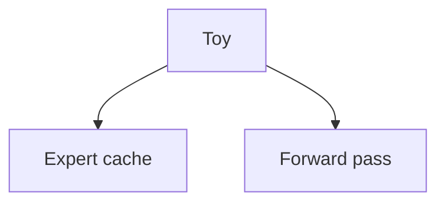
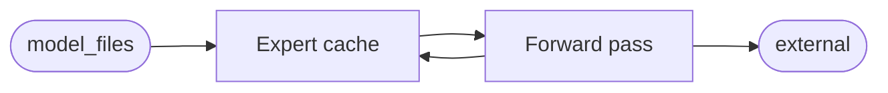

# Toy engine

Generated by `tools/so_docs.py` from the description files in this directory. Do not edit by hand.

A two-layer description. **Layer 1, system**: the engine as a whole. **Layer 2, components**: one entry per part with a single responsibility, independent of the target machine. Terms are defined in [the dictionary](../../../ontology/dictionary.md).

## Layer 1: system

Keeps the most used experts in memory and reads the others from storage when a token selects them.

| | |
|---|---|
| Product | Toy |
| Form | invented for this example |

### Targets

| Model | Hardware | Resolved engine spec | Note |
|---|---|---|---|
| `model/toy` | `hw/toy-box` | `` |  |

### Mechanism families used

- `mech/hot-expert-residency`: partial-residency-of-selected-weights

### What this description covers

Invented. There is no source.

## Component tree

| Component | Role | Runs | Responsibility | Basis |
|---|---|---|---|---|
| Expert cache | `cache` | startup, per_step | Keep the most used experts in memory and supply any selected expert's weights before they are needed. | docs |
| Forward pass | `host_loop` | per_step | Take one token through every layer and produce the next token. | docs |

Basis: `code` the implementation was read; `header_comment` only the file's header comment was read; `docs` documents only.

## Flows between top-level components

### All flows

| Flow | From | To | Carries | When | Description |
|---|---|---|---|---|---|
| `expert-bytes-from-disk` | model_files | Expert cache | weights `expert_weights` | on_demand | The weights of an expert that is selected but not cached |
| `cached-experts` | Expert cache | Forward pass | weights `expert_weights` | per_step | The weights of the experts this step selected |
| `selected-experts` | Forward pass | Expert cache | signal | per_step | Which experts each token selected, used to count usage |
| `tokens-out` | Forward pass | external | tokens | per_step | Generated token ids |

## Layer 2: components

### Expert cache

`comp/toy/expert-cache` · role `cache` · runs startup, per_step

**Responsibility.** Keep the most used experts in memory and supply any selected expert's weights before they are needed.

**Not responsible for.** Computing experts.

| | |
|---|---|
| Owns state | `expert_heat` |
| Runs policies | `cache-experts` |
| Implements mechanisms | `mech/hot-expert-residency` |
| Effect on output | `bit_exact` |

| Direction | Flow | Other end | Carries | When |
|---|---|---|---|---|
| in | The weights of an expert that is selected but not cached | model_files | weights `expert_weights` | on_demand |
| out | The weights of the experts this step selected | Forward pass | weights `expert_weights` | per_step |
| in | Which experts each token selected, used to count usage | Forward pass | signal | per_step |

| Needs | For |
|---|---|
| fast_memory | cached experts |
| storage | all experts |

| Decision | Value | Fixed at | Source |
|---|---|---|---|
| How much memory the cache may take. |  | startup |  |

| Call | Takes | Returns | Guarantees |
|---|---|---|---|
| `lookup` | layer and expert number | where the weights are, or that they are absent | Never reports an expert whose weights are still arriving. |

**Invariants.**

- `inv/read-ready`: An expert is reported as cached only after its weights have fully arrived.

| Checked by | What | Against | Where |
|---|---|---|---|
| invariant_test | A lookup during a load never returns the expert being loaded. |  |  |

**Sources.** `invented for this example` (docs)

### Forward pass

`comp/toy/forward-pass` · role `host_loop` · runs per_step

**Responsibility.** Take one token through every layer and produce the next token.

| | |
|---|---|
| Implements stages | `load`, `decode` |
| Performs model operations | `expert_router`, `expert_ffn`, `shared_blocks` |
| Owns state | `attention_kv` |
| Effect on output | `bit_exact` |

| Direction | Flow | Other end | Carries | When |
|---|---|---|---|---|
| in | The weights of the experts this step selected | Expert cache | weights `expert_weights` | per_step |
| out | Which experts each token selected, used to count usage | Expert cache | signal | per_step |
| out | Generated token ids | external | tokens | per_step |

| Needs | For |
|---|---|
| accelerator | all layer computation |

| Checked by | What | Against | Where |
|---|---|---|---|
| parity_with_reference | Same next token as a plain reference implementation on a fixed prompt set. | reference implementation |  |

**Sources.** `invented for this example` (docs)

