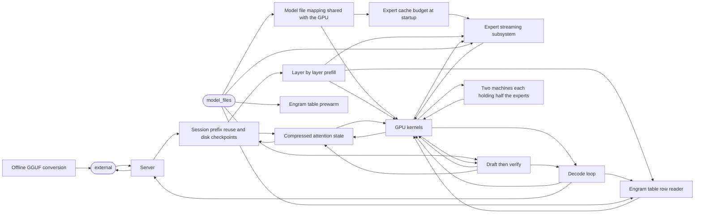

# DwarfStar (ds4)

Generated by `tools/so_docs.py` from the description files in this directory. Do not edit by hand.

A two-layer description. **Layer 1, system**: the engine as a whole. **Layer 2, components**: one entry per part with a single responsibility, independent of the target machine. Terms are defined in [the dictionary](../../../ontology/dictionary.md).

## Layer 1: system

ds4 is a C engine written for a few large mixture-of-experts models. It keeps one copy of the model in memory the GPU reads directly, by mapping the model file and handing the same pages to the GPU. When the model does not fit, it keeps only recently and often selected experts in a bounded locked cache, reads the others from SSD at the moment they are selected, still computes them on the GPU, and hides the read time behind other computation. The Engram tables of DeepSeek V4.1 Flash stay on SSD and a few dozen rows are read per token. Optionally a draft module proposes several tokens that the full model checks in one pass. Session state is compact, so it is snapshotted, rolled back and checkpointed to disk for prefix reuse.

| | |
|---|---|
| Product | DwarfStar |
| Source revision | b3f5018 |
| Source | https://github.com/antirez/ds4 |
| Form | A C engine written for a small set of model families. It accepts only GGUF files converted by the project itself. |

### Targets

| Model | Hardware | Resolved engine spec | Note |
|---|---|---|---|
| `model/deepseek-v4.1-flash` | `hw/dgx-spark` | `` | The ds4 documentation says V4.1 Flash Q2 on DGX Spark needs SSD streaming. ds4 also supports five other model families and other hardware, which this description does not cover as targets. |

### Resource expectations

| Holding | Held on | Amount | Note |
|---|---|---|---|
| Non-expert weights (attention, router, shared expert, output head), used through the mapped pages of the model file | fast_memory | UNSET | The documentation gives 152 GiB for all resident weights at Q2 and does not split expert from non-expert. |
| Expert cache: separately allocated and locked buffers, only in SSD streaming mode | fast_memory | UNSET | Computed at startup: suggested working set times 80 percent, minus non-expert weights. No figure for this target is given. |
| The model file with all experts | storage | 341 GiB (reported) |  |
| Engram tables, never resident, read by row | storage | 189 GiB (reported) |  |
| DSpark draft support file | UNSET | 8.04 GiB (reported) | The notes do not say where the draft module is kept. |
| Compressed attention state of the sessions | fast_memory | UNSET |  |
| Session state checkpoint files | storage | 4096 MB (reported) |  |

### Mechanism families used

- `mech/hot-expert-residency`: partial-residency-of-selected-weights
- `mech/draft-then-verify`: draft-verify-commit
- `mech/low-bit-expert-quantization`: per-role-weight-precision

### Mechanisms with no mechanism file yet

- **single-copy-mapped-weights**: On unified memory, map the model file and hand the same pages to the GPU, so the weights exist once instead of once for the file and once for the device.
- **table-read-by-row**: Leave a large lookup table on storage and read only the few dozen rows a token needs.
- **read-latency-hidden-behind-compute**: Start the storage read of a selected expert early and do other computation of the same layer while it arrives.
- **compact-session-checkpoint**: Keep session state small enough to snapshot, roll back and write to disk, so a request sharing a prefix with an earlier one continues from its checkpoint.
- **expert-split-across-machines**: Hold disjoint sets of experts on two machines and send each selected expert's work to the machine that holds it.

### Claims

| Claim | Status | Source | Baseline |
|---|---|---|---|
| On DGX Spark with V4.1 Flash Q2, prefill of a 3241 token prompt rose from 49 to 54 tokens per second to 93 to 96 tokens per second. | reported | ds4 docs/DGX_SPARK.md lines 45 to 52 | The same engine with its earlier disk read strategy |
| Keeping the Engram tables on disk saves 189 GiB of memory for V4.1 Flash. No speed comparison is given. | reported | ds4 docs/MODELS.md lines 54 to 64 |  |
| SSD streaming is slower than resident mode. The documentation says to use resident mode when the model fits. | reported | ds4 docs/SSD_STREAMING.md lines 5 to 8 |  |
| Speculative decoding can be slower. On hard to predict prose at temperature 1 it gave 18.81 tokens per second against 19.53 without it. | reported | ds4 docs/DGX_SPARK.md lines 155 to 166 | Ordinary decoding on the same engine |

### What this description covers

Written only from engines/ds4.md, which was itself written from reading the ds4 source at revision b3f5018 and its documentation, without building or running. This description covers DeepSeek V4.1 Flash on DGX Spark. It does not cover the other five model families, the Metal specific details beyond what the notes generalise, the ROCm path, the server and agent code, or session batching and the power option, which the notes list without detail.

## Component tree

```mermaid
flowchart TB
  S["DwarfStar"]
  S --> n_model_preparation["Offline GGUF conversion"]
  S --> n_weight_mapping["Model file mapping shared with the GPU"]
  S --> n_memory_plan["Expert cache budget at startup"]
  S --> n_api_server["Server"]
  S --> n_prefix_reuse["Session prefix reuse and disk checkpoints"]
  S --> n_prefill_driver["Layer by layer prefill"]
  S --> n_decode_loop["Decode loop"]
  S --> n_engram_row_reader["Engram table row reader"]
  S --> n_engram_prewarm["Engram table prewarm"]
  S --> n_expert_subsystem["Expert streaming subsystem"]
  S --> n_gpu_kernels["GPU kernels"]
  S --> n_kv_state["Compressed attention state"]
  S --> n_speculation_subsystem["Draft then verify"]
  S --> n_distributed_tp["Two machines each holding half the experts"]
  n_expert_subsystem --> n_expert_split_dispatch["Resident and missing expert split"]
  n_expert_subsystem --> n_expert_cache["Expert cache"]
  n_expert_subsystem --> n_expert_eviction["Expert heat and victim choice"]
  n_expert_subsystem --> n_expert_stream_reader["Expert reads from SSD"]
  n_speculation_subsystem --> n_dspark_scheduler["DSpark scheduler"]
  n_speculation_subsystem --> n_dspark_drafter["DSpark draft module"]
  n_speculation_subsystem --> n_draft_verify_commit["Draft check and prefix commit"]
```

| Component | Role | Runs | Responsibility | Basis |
|---|---|---|---|---|
| Offline GGUF conversion | `model_preparer` | offline | Produces the project's own GGUF files, with the compression spent mainly on the routed experts, in the tensor layout the kernels read. | docs |
| Model file mapping shared with the GPU | `weight_loader` | startup | Makes the tensors of the model file readable by the GPU from the same mapped pages, without a second copy. | code |
| Expert cache budget at startup | `memory_planner` | startup | Computes at startup how many expert cache slots the machine actually present can hold. | code |
| Server | `api_server` | per_request | Accepts client requests and returns generated output. | docs |
| Session prefix reuse and disk checkpoints | `conversation_store` | per_request | Finds the longest already computed prefix of an incoming conversation, in memory or on disk, so that only the new suffix is prefilled. | code |
| Layer by layer prefill | `prompt_reader` | per_request | Passes each chunk of prompt tokens through the layers one layer at a time, building the session state once. | header_comment |
| Decode loop | `host_loop` | per_step | Produces one output token per step in a fixed order of work, starting table row reads as soon as the token is known and choosing between a drafted round and an ordinary step. | code |
| Engram table row reader | `table_reader` | per_step, per_request | Delivers the table rows a token needs, read directly from SSD by row, without keeping the table in memory. | code |
| Engram table prewarm | `memory_governor` | startup, background | When memory allows, reads the whole table once in the background so that later row reads find it in the page cache, and stops under memory pressure. | code |
| Expert streaming subsystem | `subsystem` | startup, per_step, on_demand | Groups the parts that make a selected expert available to the GPU when not all experts fit in memory. Active only in SSD streaming mode. |  |
| &nbsp;&nbsp;&nbsp;Resident and missing expert split | `assigner` | per_step | Decides for each layer whether the selected experts are computed in one submission or in two, resident ones first and just-read ones second, while keeping the final summation order the same. | code |
| &nbsp;&nbsp;&nbsp;Expert cache | `cache` | per_step, on_demand | Keeps a bounded set of experts in locked memory the GPU reads and answers whether a selected expert is there with the right file offset and size. | code |
| &nbsp;&nbsp;&nbsp;Expert heat and victim choice | `policy_runner` | per_step, on_demand | Chooses which cached expert leaves when room is needed, from a decaying count of how often each expert was selected. | code |
| &nbsp;&nbsp;&nbsp;Expert reads from SSD | `data_mover` | on_demand, startup | Copies the gate, up and down blocks of an expert from the model file on SSD into a cache buffer, with several threads. | code |
| GPU kernels | `kernel_set` | per_step, per_window, per_request | Computes all model operations on the GPU, with kernels specific to each tensor format the engine accepts. | code |
| Compressed attention state | `state_manager` | per_step, per_window | Keeps the attention state of a session as recent raw rows plus compressed rows of older history, with row counters that say which rows are valid. | code |
| Draft then verify | `subsystem` | per_window | Groups the parts that draft several tokens and check them in one pass of the full model. Off by default. |  |
| &nbsp;&nbsp;&nbsp;DSpark scheduler | `speculation_controller` | per_window | Decides for each round whether drafting is attempted, pausing it for some rounds when recent acceptance shows it does not pay. | code |
| &nbsp;&nbsp;&nbsp;DSpark draft module | `drafter` | per_window | Proposes up to 5 following tokens one after another, each with a confidence, and stops when the confidence falls below a threshold. | code |
| &nbsp;&nbsp;&nbsp;Draft check and prefix commit | `draft_verifier` | per_window | Checks the drafted tokens in one pass of the full model and leaves the session state exactly as that of the accepted prefix. | code |
| Two machines each holding half the experts | `distributed_coordinator` | per_step | Splits the routed experts of each layer by id range between two directly linked machines that process the same token and exchange partial results. | header_comment |

Basis: `code` the implementation was read; `header_comment` only the file's header comment was read; `docs` documents only.

## Flows between top-level components

### All flows

| Flow | From | To | Carries | When | Description |
|---|---|---|---|---|---|
| `prepared_model_file` | Offline GGUF conversion | external | weights `expert_weights` |  | The offline conversion writes the GGUF file that the engine later reads as model_files. |
| `request_in` | external | Server | request | per_request | A client request. Clients usually resend the whole conversation. |
| `response_out` | Server | external | response | per_request |  |
| `mapped_file` | model_files | Model file mapping shared with the GPU | weights `dense_weights` | startup | The model file is mapped into the process. |
| `device_visible_weights` | Model file mapping shared with the GPU | GPU kernels | weights `dense_weights` | startup | The same mapped pages are registered for GPU access, without a second copy. |
| `non_expert_weight_size` | Model file mapping shared with the GPU | Expert cache budget at startup | signal | startup | Size of the non-expert weights, subtracted when the cache budget is computed. |
| `expert_cache_budget` | Expert cache budget at startup | Expert cache | plan | startup | Number of cache slots and cache bytes. |
| `conversation_tokens` | Server | Session prefix reuse and disk checkpoints | tokens | per_request |  |
| `restored_session_state` | Session prefix reuse and disk checkpoints | Compressed attention state | model_state `compressed_kv` | per_request | State of the longest matching prefix, from a live session or a disk checkpoint. |
| `session_state_to_checkpoint` | Compressed attention state | Session prefix reuse and disk checkpoints | model_state `compressed_kv` | on_demand |  |
| `new_suffix_tokens` | Session prefix reuse and disk checkpoints | Layer by layer prefill | tokens | per_request | Only the tokens after the reused prefix are prefilled. |
| `prefill_chunks` | Layer by layer prefill | GPU kernels | tokens | per_request |  |
| `prefill_table_rows_wanted` | Layer by layer prefill | Engram table row reader | tokens | per_request |  |
| `prefill_expert_reads_wanted` | Layer by layer prefill | Expert reads from SSD | control | per_request | During prefill the experts of the next layer are read while the current layer computes. |
| `decode_token_in` | Decode loop | GPU kernels | tokens | per_step |  |
| `decode_logits` | GPU kernels | Decode loop | activations | per_step |  |
| `decode_table_rows_wanted` | Decode loop | Engram table row reader | tokens | per_step |  |
| `engram_rows_from_file` | model_files | Engram table row reader | weights `engram_tables` | per_step |  |
| `engram_rows` | Engram table row reader | GPU kernels | weights `engram_tables` | per_step |  |
| `engram_table_prewarm_read` | model_files | Engram table prewarm | weights `engram_tables` | background |  |
| `selected_expert_ids` | GPU kernels | Resident and missing expert split | activations | per_step | The router result read back to the CPU. It happens once per layer within a step. |
| `experts_wanted` | Resident and missing expert split | Expert cache | control | per_step |  |
| `expert_selected_signal` | Expert cache | Expert heat and victim choice | signal | per_step | Every selection of an expert, whether it hit or missed. |
| `victim_choice` | Expert heat and victim choice | Expert cache | control | on_demand |  |
| `expert_read_request` | Expert cache | Expert reads from SSD | control | on_demand |  |
| `expert_bytes_from_file` | model_files | Expert reads from SSD | weights `expert_weights` | on_demand |  |
| `expert_bytes_into_cache` | Expert reads from SSD | Expert cache | weights `expert_weights` | on_demand |  |
| `cached_expert_weights` | Expert cache | GPU kernels | weights `expert_weights` | per_step |  |
| `expert_work_order` | Resident and missing expert split | GPU kernels | control | per_step | Which experts to compute first and which after their read completes. Down projection and sum are issued once. |
| `attention_state_rows` | GPU kernels | Compressed attention state | model_state `raw_kv` | per_step |  |
| `attention_state_read` | Compressed attention state | GPU kernels | model_state `compressed_kv` | per_step |  |
| `draft_module_weights` | model_files | DSpark draft module | weights `dspark_weights` | startup | The DSpark support file is a separate file from the main model file. |
| `draft_features` | GPU kernels | DSpark draft module | activations | per_step | Features of recent positions that the draft module needs. |
| `draft_permission` | DSpark scheduler | DSpark draft module | control | per_window |  |
| `drafted_tokens` | DSpark draft module | Draft check and prefix commit | tokens | per_window |  |
| `verify_batch` | Draft check and prefix commit | GPU kernels | tokens | per_window | The last committed token plus the drafts, at most 6 rows. |
| `verify_logits` | GPU kernels | Draft check and prefix commit | activations | per_window |  |
| `accepted_prefix_commit` | Draft check and prefix commit | Compressed attention state | control | per_window |  |
| `accepted_tokens` | Draft check and prefix commit | Decode loop | tokens | per_window |  |
| `acceptance_count` | Draft check and prefix commit | DSpark scheduler | signal | per_window |  |
| `generated_tokens` | Decode loop | Server | tokens | per_step |  |
| `partial_results_to_peer_link` | GPU kernels | Two machines each holding half the experts | activations | per_step |  |
| `partial_results_from_peer_link` | Two machines each holding half the experts | GPU kernels | activations | per_step |  |

## Layer 2: components

### Offline GGUF conversion

`comp/ds4/model-preparation` · role `model_preparer` · runs offline

**Responsibility.** Produces the project's own GGUF files, with the compression spent mainly on the routed experts, in the tensor layout the kernels read.

**Not responsible for.** Loading or mapping the file when the engine starts.

| | |
|---|---|
| Implements mechanisms | `mech/low-bit-expert-quantization` |
| Effect on output | `approximate`. Quantization is calibrated with an imatrix. |

| Direction | Flow | Other end | Carries | When |
|---|---|---|---|---|
| out | The offline conversion writes the GGUF file that the engine later reads as model_files. | external | weights `expert_weights` |  |

| Decision | Value | Fixed at | Source |
|---|---|---|---|
| Which tensor formats the routed experts get. In the Q2 recipe gate and up matrices use IQ2_XXS and the down matrix uses Q2_K. | IQ2_XXS for gate and up, Q2_K for down | design | ds4 docs/MODELS.md lines 33 to 36. Stated for Flash Q2. |
| Which formats attention projections, shared expert and output head get. | Q8 | design | ds4 docs/MODELS.md lines 33 to 36 |

**Sources.** `docs/MODELS.md lines 33 to 36` (docs); `README.md lines 13 to 15 and 45` (docs)

**Not read.** gguf-tools/, where the quantization recipe lives. QA_BEFORE_RELEASES.md lines 194 to 230 were not read closely.

### Model file mapping shared with the GPU

`comp/ds4/weight-mapping` · role `weight_loader` · runs startup

**Responsibility.** Makes the tensors of the model file readable by the GPU from the same mapped pages, without a second copy.

**Not responsible for.** Deciding which experts stay in memory in SSD streaming mode; Converting tensor layout, since the file layout is already the layout the kernels read.

| | |
|---|---|
| Implements stages | `load` |
| Owns state | `weight_mapping_registration` |
| Requires | Unified memory, so that the GPU can read pages mapped by the CPU; CUDA host memory registration, or on Metal a no-copy buffer over existing bytes |
| Effect on output | `bit_exact`. The same bytes are read. |

| Direction | Flow | Other end | Carries | When |
|---|---|---|---|---|
| in | The model file is mapped into the process. | model_files | weights `dense_weights` | startup |
| out | The same mapped pages are registered for GPU access, without a second copy. | GPU kernels | weights `dense_weights` | startup |
| out | Size of the non-expert weights, subtracted when the cache budget is computed. | Expert cache budget at startup | signal | startup |

| Needs | For |
|---|---|
| fast_memory | Pages of the mapped model file that the GPU reads directly |
| storage | The model file behind the mapping |

| Decision | Value | Fixed at | Source |
|---|---|---|---|
| Register the whole mapping for device access, or copy it to device memory, or when sharded register only the expert range this machine owns. |  | startup | ds4_cuda.cu lines 4020 to 4055 and 4152 to 4187 |

**Sources.** `ds4_cuda.cu lines 4020 to 4055 and 4152 to 4187` (code); `ds4_metal.m lines 2340 to 2354` (code); `AGENT.md line 13` (docs)

### Expert cache budget at startup

`comp/ds4/memory-plan` · role `memory_planner` · runs startup

**Responsibility.** Computes at startup how many expert cache slots the machine actually present can hold.

**Not responsible for.** Choosing which experts occupy the slots; Locking the buffers.

| Direction | Flow | Other end | Carries | When |
|---|---|---|---|---|
| in | Size of the non-expert weights, subtracted when the cache budget is computed. | Model file mapping shared with the GPU | signal | startup |
| out | Number of cache slots and cache bytes. | Expert cache | plan | startup |

| Needs | For |
|---|---|
| cpu | A one-time computation |

| Decision | Value | Fixed at | Source |
|---|---|---|---|
| The fraction of the system's suggested working set size taken before non-expert weights are subtracted. Settable through DS4_SSD_AUTO_CACHE_PCT between 50 and 95. | 80 percent (reported) | startup | ds4.c lines 71028 to 71116 and ds4_ssd.c lines 108 to 140 |
| Cache bytes divided by the bytes of one expert, at least 1 and at most the number of experts in the model. |  | startup |  |
| A byte count or slot count given by the user is a target and not a guarantee. |  | startup | ds4 docs/SSD_STREAMING.md lines 53 to 59 |

**Sources.** `ds4.c lines 71028 to 71116` (code); `ds4_ssd.c lines 108 to 140` (code); `docs/SSD_STREAMING.md lines 53 to 66` (docs)

### Server

`comp/ds4/api-server` · role `api_server` · runs per_request

**Responsibility.** Accepts client requests and returns generated output.

**Not responsible for.** Finding a reusable prefix for the conversation.

| Direction | Flow | Other end | Carries | When |
|---|---|---|---|---|
| in | A client request. Clients usually resend the whole conversation. | external | request | per_request |
| out | response_out | external | response | per_request |
| out | conversation_tokens | Session prefix reuse and disk checkpoints | tokens | per_request |
| in | generated_tokens | Decode loop | tokens | per_step |

| Decision | Value | Fixed at | Source |
|---|---|---|---|
| When an accepted run of drafted tokens crosses a tool call grammar boundary, where the sampling mode changes, go back to the start of that run and recompute the token at the boundary. At most one verify block is replayed. |  | runtime | ds4 docs/SPECULATIVE_DECODING.md lines 164 to 169 and ds4.c lines 89533 to 89584 |

**Sources.** `docs/SERVER.md lines 71 to 136` (docs)

**Not read.** ds4_server.c and ds4_agent.c. The protocol, streaming, cancellation and error behaviour are not described in the notes.

### Session prefix reuse and disk checkpoints

`comp/ds4/prefix-reuse` · role `conversation_store` · runs per_request

**Responsibility.** Finds the longest already computed prefix of an incoming conversation, in memory or on disk, so that only the new suffix is prefilled.

**Not responsible for.** Rolling state back after rejected drafts.

| | |
|---|---|
| Owns state | `session_token_list`, `kv_checkpoint_store` |
| Reads state | `raw_kv`, `compressed_kv`, `indexer_rows`, `compressor_pending`, `engram_history` |
| Writes state | `raw_kv`, `compressed_kv`, `indexer_rows`, `compressor_pending`, `engram_history`, `kv_row_counters` |
| Runs policies | `kv_checkpoint_retention` |
| Effect on output | `bit_exact` when The checkpoint was made with the same quantization. Reuse across quantizations brings in state computed by another quantization and is approximate. |

| Direction | Flow | Other end | Carries | When |
|---|---|---|---|---|
| in | conversation_tokens | Server | tokens | per_request |
| out | State of the longest matching prefix, from a live session or a disk checkpoint. | Compressed attention state | model_state `compressed_kv` | per_request |
| in | session_state_to_checkpoint | Compressed attention state | model_state `compressed_kv` | on_demand |
| out | Only the tokens after the reused prefix are prefilled. | Layer by layer prefill | tokens | per_request |

| Needs | For |
|---|---|
| storage | Checkpoint files of session state |

| Decision | Value | Fixed at | Source |
|---|---|---|---|
| A checkpoint file is named by the SHA of the rendered text prefix, not by a hash of the token sequence. The file still carries the exact tokens and state. |  | design | ds4_kvstore.h lines 11 to 66 |
| Fewest tokens for which a checkpoint is stored. | 512 | design | ds4_kvstore.c lines 33 to 42 |
| A cold start prompt is stored up to this many tokens. | 30000 | design | ds4_kvstore.c lines 33 to 42 |
| A continuing conversation is stored each time it grows by this many tokens. | 10000 | design | ds4_kvstore.c lines 33 to 42 |
| The boundary is moved back 32 tokens and aligned to 2048. |  | design | ds4_kvstore.c lines 33 to 42 |
| Upper limit of disk space for checkpoints. | 4096 MB (reported) | design | ds4_kvstore.c lines 33 to 42 |
| Half life of the hit count used for retention. | 6 hours (reported) | design | ds4_kvstore.c lines 33 to 42 |
| Checkpoints made with a different quantization may be reused by default. A switch forbids it. | True | startup | ds4_kvstore.h lines 11 to 66 |

**Sources.** `ds4_kvstore.h lines 11 to 66` (header_comment); `ds4_kvstore.c lines 33 to 42` (code); `docs/SERVER.md lines 109 to 136` (docs)

**Not read.** The implementation in ds4_kvstore.c beyond its default values. The lookup flow is known from documentation only.

### Layer by layer prefill

`comp/ds4/prefill-driver` · role `prompt_reader` · runs per_request

**Responsibility.** Passes each chunk of prompt tokens through the layers one layer at a time, building the session state once.

**Not responsible for.** Deciding how much of the prompt is already covered by a reused prefix.

| | |
|---|---|
| Implements stages | `prefill` |
| Writes state | `expert_heat` |

| Direction | Flow | Other end | Carries | When |
|---|---|---|---|---|
| in | Only the tokens after the reused prefix are prefilled. | Session prefix reuse and disk checkpoints | tokens | per_request |
| out | prefill_chunks | GPU kernels | tokens | per_request |
| out | prefill_table_rows_wanted | Engram table row reader | tokens | per_request |
| out | During prefill the experts of the next layer are read while the current layer computes. | Expert reads from SSD | control | per_request |

| Needs | For |
|---|---|
| accelerator | Layer computation over whole chunks, with intermediate activations kept on the GPU |
| cpu | Read threads for the next layer |

| Decision | Value | Fixed at | Source |
|---|---|---|---|
| How many tokens pass through a layer together. | 4096 | design | ds4 docs/PERFORMANCE.md lines 30 to 33. Default for DeepSeek. |
| While a layer computes, the experts the next layer needs are read. On CUDA for V4.1 the selected experts are read in file order and adjacent reads are merged. |  | design | AGENT.md line 13, docs/MODELS.md lines 110 to 112 and docs/SSD_STREAMING.md lines 79 to 83 |
| A long prefill yields to decoding sessions every 128 tokens. | 128 | design | Mentioned in engines/ds4.md section 12 without a location |
| A prefill that starts from the beginning sets expert heat to zero. |  | design | ds4.c lines 34267 to 34269 |

**Claims.**

- On DGX Spark with V4.1 Flash Q2, prefill of a 3241 token prompt rose from 49 to 54 to 93 to 96 tokens per second. (reported; ds4 docs/DGX_SPARK.md lines 45 to 52; baseline: The same engine with its earlier disk read strategy)

**Sources.** `ds4.c lines 37820 to 37821 (comment)` (header_comment); `docs/PERFORMANCE.md lines 30 to 33` (docs); `docs/SSD_STREAMING.md lines 79 to 83` (docs)

**Not read.** The read-ahead functions from ds4.c line 21248 on, and the CUDA streaming implementation.

### Decode loop

`comp/ds4/decode-loop` · role `host_loop` · runs per_step

**Responsibility.** Produces one output token per step in a fixed order of work, starting table row reads as soon as the token is known and choosing between a drafted round and an ordinary step.

**Not responsible for.** Deciding whether drafting is currently worthwhile; Choosing which expert leaves the cache.

| | |
|---|---|
| Implements stages | `decode` |
| Reads state | `session_token_list` |

| Direction | Flow | Other end | Carries | When |
|---|---|---|---|---|
| out | decode_token_in | GPU kernels | tokens | per_step |
| in | decode_logits | GPU kernels | activations | per_step |
| out | decode_table_rows_wanted | Engram table row reader | tokens | per_step |
| in | accepted_tokens | Draft check and prefix commit | tokens | per_window |
| out | generated_tokens | Server | tokens | per_step |

| Needs | For |
|---|---|
| cpu | Ordering of work and sampling |
| accelerator | The forward pass it drives |

| Decision | Value | Fixed at | Source |
|---|---|---|---|
| Row numbers are computed and the read thread started as soon as the token is known. The GPU encodes layer 0 first and layer 1 waits for the read when it needs the rows. |  | design | ds4.c lines 43322 to 43331 |
| If any step of a drafted round fails, the whole session state is marked invalid and the caller prefills again from the kept token list. |  | design | ds4.c lines 88426 to 88432 |

**Sources.** `ds4.c lines 43322 to 43331` (code); `ds4.c lines 88302 to 88433` (code)

**Not read.** Sampling code. The notes only say that sampling is done on the CPU.

### Engram table row reader

`comp/ds4/engram-row-reader` · role `table_reader` · runs per_step, per_request

**Responsibility.** Delivers the table rows a token needs, read directly from SSD by row, without keeping the table in memory.

**Not responsible for.** Warming the table into the page cache.

| | |
|---|---|
| Performs model operations | `engram_lookup` |
| Owns state | `engram_history` |
| Requires | Fast random reads from local NVMe. An external USB disk reads about 6K rows per second according to a source comment. |
| Effect on output | `bit_exact`. The same bytes are read whichever way they are read, so logits do not change. |

| Direction | Flow | Other end | Carries | When |
|---|---|---|---|---|
| in | prefill_table_rows_wanted | Layer by layer prefill | tokens | per_request |
| in | decode_table_rows_wanted | Decode loop | tokens | per_step |
| in | engram_rows_from_file | model_files | weights `engram_tables` | per_step |
| out | engram_rows | GPU kernels | weights `engram_tables` | per_step |

| Needs | For |
|---|---|
| storage | The Engram tables, 189 GiB for V4.1 Flash |
| cpu | Hashing and concurrent read threads |

| Decision | Value | Fixed at | Source |
|---|---|---|---|
| For each new token, a multiplicative hash of its compressed vocabulary id and those of the 3 tokens before it, taken modulo a set of primes, gives 24 row numbers per table. |  | design | ds4_engram.c lines 49 to 135 |
| Rows are read through a separate file descriptor that bypasses the page cache. F_NOCACHE with read-ahead off on macOS and POSIX_FADV_RANDOM on Linux. Rows are scattered, so read-ahead would bring in useless pages and take memory the model needs. |  | design | ds4_engram.c lines 109 to 115 |
| During prefill the row numbers of a batch of at most 2048 tokens are sorted and then read by a fixed number of concurrent read threads. | 2048 | design | ds4_engram.c lines 281 to 300 |

| Call | Takes | Returns | Guarantees |
|---|---|---|---|
| `start_row_read` | The new token and the 3 token history | A handle the forward pass waits on when layer 1 needs the rows | Computes the row numbers and starts reading the rows. |
| `snapshot_history` |  | A copy of the 3 token history | Gives a complete snapshot of this component's state, since the history is a small structure of 3 integers. |

**Sources.** `ds4_engram.h (whole file)` (code); `ds4_engram.c lines 49 to 135 and 281 to 300` (code); `ds4.c lines 41265 to 41266 and 43322 to 43331` (code)

### Engram table prewarm

`comp/ds4/engram-prewarm` · role `memory_governor` · runs startup, background

**Responsibility.** When memory allows, reads the whole table once in the background so that later row reads find it in the page cache, and stops under memory pressure.

**Not responsible for.** Guaranteeing that the table stays in memory. The pages remain reclaimable by the operating system..

| | |
|---|---|
| Runs policies | `engram_prewarm` |
| Effect on output | `bit_exact` |

| Direction | Flow | Other end | Carries | When |
|---|---|---|---|---|
| in | engram_table_prewarm_read | model_files | weights `engram_tables` | background |

| Needs | For |
|---|---|
| fast_memory | Page cache pages, as a hint and not a reservation |
| storage | Sequential read of the table |
| cpu | 4 read threads |

| Decision | Value | Fixed at | Source |
|---|---|---|---|
| Prewarm only when model size plus runtime buffers plus table size plus a 64 GiB reserve does not exceed physical memory. |  | startup | ds4.c lines 41257 to 41289 |
| Number of threads that read the table sequentially. | 4 | design | ds4_engram.c lines 380 to 445 |

**Sources.** `ds4.c lines 41257 to 41289` (code); `ds4_engram.c lines 380 to 445` (code)

### Expert streaming subsystem

`comp/ds4/expert-subsystem` · role `subsystem` · runs startup, per_step, on_demand

**Responsibility.** Groups the parts that make a selected expert available to the GPU when not all experts fit in memory. Active only in SSD streaming mode.

**Parts.** Resident and missing expert split, Expert cache, Expert heat and victim choice, Expert reads from SSD.

| | |
|---|---|
| Implements mechanisms | `mech/hot-expert-residency` |
| Effect on output | `bit_exact`. The release checklist requires identical full logits across cache policies and byte identical output across cache capacities. The test was not run by the author of the notes. |

**Claims.**

- Appending 16 tokens after a short cached tool result prompt took 2.9 seconds instead of 30.8 seconds, with identical logits and text. (reported; ds4 docs/SSD_STREAMING.md lines 113 to 118)
- Prefill 121 tokens per second and generation 11.9 and 14.9 tokens per second. (reported; ds4 docs/SSD_STREAMING.md lines 98 to 111)

**Sources.** `docs/SSD_STREAMING.md` (docs)

**Not read.** The streaming cache implementation in ds4_cuda.cu. The details in the parts come from the Metal path.

#### Resident and missing expert split

`comp/ds4/expert-split-dispatch` · role `assigner` · runs per_step · part of `comp/ds4/expert-subsystem`

**Responsibility.** Decides for each layer whether the selected experts are computed in one submission or in two, resident ones first and just-read ones second, while keeping the final summation order the same.

**Not responsible for.** Reading missing experts from disk; Choosing a victim.

| | |
|---|---|
| Effect on output | `bit_exact` when Same model and same prefill chunking |

| Direction | Flow | Other end | Carries | When |
|---|---|---|---|---|
| in | The router result read back to the CPU. It happens once per layer within a step. | GPU kernels | activations | per_step |
| out | experts_wanted | Expert cache | control | per_step |
| out | Which experts to compute first and which after their read completes. Down projection and sum are issued once. | GPU kernels | control | per_step |

| Needs | For |
|---|---|
| fast_memory | A staging area shared by the two stages |
| cpu | Reading back the selected ids and the service thread |

| Decision | Value | Fixed at | Source |
|---|---|---|---|
| A layer is split when this many or more of its selected experts are missing from the cache. With one or two missing, a single computation is faster. | 3 | design | ds4_metal.m lines 13520 to 13531 |
| Splitting is enabled only after at least this many tokens have been generated. | 4 | design | ds4_metal.m lines 14674 to 14695 |
| Splitting is enabled only when the cache holds at least this many entries. If the budget is below 2048 entries, half of the budget is used. | 1024 | design | ds4_metal.m lines 14674 to 14695 |
| As soon as the selected ids are read back to the CPU, a service thread starts reading the missing experts while the GPU computes the shared expert. |  | design | ds4.c lines 27055 to 27080 |

**Invariants.**

- `sum_order_independent_of_split`: Down projection and sum are done once, after all selected experts are computed, so the final accumulation order does not depend on how the layer was split.
- `second_stage_waits_for_first`: The second stage reuses the staging area of the first and must wait for the first stage's commands to finish.

| Checked by | What | Against | Where |
|---|---|---|---|
| parity_with_reference | Full logits are identical for the same model and prefill chunking under different cache policies | The same engine with a different cache policy or capacity | QA_BEFORE_RELEASES.md lines 711 to 718 |

**Sources.** `ds4_metal.m lines 13520 to 13531, 43294 to 43310 and 44190 to 44345` (code); `ds4_metal.m lines 14674 to 14695` (code); `ds4.c lines 27055 to 27080` (code)

#### Expert cache

`comp/ds4/expert-cache` · role `cache` · runs per_step, on_demand · part of `comp/ds4/expert-subsystem`

**Responsibility.** Keeps a bounded set of experts in locked memory the GPU reads and answers whether a selected expert is there with the right file offset and size.

**Not responsible for.** Choosing which expert to evict; Computing an expert on the CPU or skipping it. Neither path exists..

| | |
|---|---|
| Owns state | `expert_cache_index` |
| Implements mechanisms | `mech/hot-expert-residency` |
| Observation points | `last use time per entry`, `use count per entry` |

| Direction | Flow | Other end | Carries | When |
|---|---|---|---|---|
| in | Number of cache slots and cache bytes. | Expert cache budget at startup | plan | startup |
| in | experts_wanted | Resident and missing expert split | control | per_step |
| out | Every selection of an expert, whether it hit or missed. | Expert heat and victim choice | signal | per_step |
| in | victim_choice | Expert heat and victim choice | control | on_demand |
| out | expert_read_request | Expert reads from SSD | control | on_demand |
| in | expert_bytes_into_cache | Expert reads from SSD | weights `expert_weights` | on_demand |
| out | cached_expert_weights | GPU kernels | weights `expert_weights` | per_step |

| Needs | For |
|---|---|
| fast_memory | Separately allocated buffers locked with mlock, three per expert for gate, up and down |

| Decision | Value | Fixed at | Source |
|---|---|---|---|
| If locking a buffer fails, the effective cache limit is lowered. |  | runtime | ds4_metal.m lines 14188 to 14245 |

| Call | Takes | Returns | Guarantees |
|---|---|---|---|
| `ensure_expert` | Layer and expert id, with file offset and size | Buffers holding the gate, up and down blocks | On a hit updates the last use time and the use count. On a miss obtains a buffer, evicting if the cache is full, and has the three blocks read in. |

**Invariants.**

- `in_flight_entry_not_reclaimed`: A cache entry in use by a submitted GPU command is not reclaimed.
- `selected_experts_protected_during_load`: The experts selected for the current layer do not evict one another while they are being loaded.
- `no_stale_data_on_read_failure`: If a read fails or an expert cannot be fitted, the step reports an error and does not use old data.

| Checked by | What | Against | Where |
|---|---|---|---|
| parity_with_reference | Output is byte identical under different cache capacities |  | QA_BEFORE_RELEASES.md lines 711 to 718 |

**Sources.** `ds4_metal.m lines 16695 to 16828` (code); `ds4_metal.m lines 14188 to 14245` (code); `ds4_metal.m lines 15843 to 15853` (code)

#### Expert heat and victim choice

`comp/ds4/expert-eviction` · role `policy_runner` · runs per_step, on_demand · part of `comp/ds4/expert-subsystem`

**Responsibility.** Chooses which cached expert leaves when room is needed, from a decaying count of how often each expert was selected.

**Not responsible for.** Reading the entering expert.

| | |
|---|---|
| Owns state | `expert_heat` |
| Reads state | `expert_cache_index` |
| Runs policies | `expert_cache_eviction` |
| Observation points | `heat per expert` |

| Direction | Flow | Other end | Carries | When |
|---|---|---|---|---|
| in | Every selection of an expert, whether it hit or missed. | Expert cache | signal | per_step |
| out | victim_choice | Expert cache | control | on_demand |

| Decision | Value | Fixed at | Source |
|---|---|---|---|
| Heat goes up by 1 every time the router selects the expert, on a miss as well as on a hit. Otherwise an expert that keeps being selected but is evicted before its second hit would always lose. |  | design | ds4_metal.m lines 1008 and 14697 to 14803 |
| After this many generated tokens all heat values are shifted right by one bit. Prefill does not advance this clock. | 16 | design | ds4_metal.m lines 14697 to 14803 |
| The entry with the lowest heat is chosen. Among equal heat the one unused longest. Entries in flight and the experts selected for the current layer are passed over. |  | design | ds4_metal.m lines 15796 to 15906 and 15722 to 15763 |
| If no victim is found only because of in-flight entries, wait for those commands to finish and try once more. |  | design | ds4_metal.m lines 15796 to 15906 |
| The cache starts from a built-in list of often used experts gathered offline, ordered by hits per weight. One list for Flash and PRO. |  | design | ds4_streaming_hotlist.inc lines 1 and 6893 on |

**Sources.** `ds4_metal.m lines 15796 to 15906 and 15722 to 15763` (code); `ds4_metal.m lines 1008 and 14697 to 14803` (code); `ds4_streaming_hotlist.inc` (code)

#### Expert reads from SSD

`comp/ds4/expert-stream-reader` · role `data_mover` · runs on_demand, startup · part of `comp/ds4/expert-subsystem`

**Responsibility.** Copies the gate, up and down blocks of an expert from the model file on SSD into a cache buffer, with several threads.

**Not responsible for.** Deciding which buffer is freed.

| Direction | Flow | Other end | Carries | When |
|---|---|---|---|---|
| in | During prefill the experts of the next layer are read while the current layer computes. | Layer by layer prefill | control | per_request |
| in | expert_read_request | Expert cache | control | on_demand |
| in | expert_bytes_from_file | model_files | weights `expert_weights` | on_demand |
| out | expert_bytes_into_cache | Expert cache | weights `expert_weights` | on_demand |

| Needs | For |
|---|---|
| storage | The model file holding all experts |
| cpu | Read threads using pread |

| Decision | Value | Fixed at | Source |
|---|---|---|---|
| At startup experts are read in the order of the built-in hot list, at most this many in automatic mode, to avoid thousands of reads at startup. | 4096 | design | ds4.c lines 23054 to 23087 |

**Costs.**

- SSD streaming is slower than resident mode. (reported; ds4 docs/SSD_STREAMING.md lines 5 to 8)

**Sources.** `ds4_metal.m lines 16695 to 16828` (code); `ds4.c lines 23054 to 23087` (code)

### GPU kernels

`comp/ds4/gpu-kernels` · role `kernel_set` · runs per_step, per_window, per_request

**Responsibility.** Computes all model operations on the GPU, with kernels specific to each tensor format the engine accepts.

**Not responsible for.** Reading from disk; Sampling.

| | |
|---|---|
| Performs model operations | `attention`, `kv_compress`, `expert_router`, `expert_ffn`, `shared_expert_ffn`, `output_head`, `dspark_draft` |
| Writes state | `raw_kv`, `compressed_kv`, `indexer_rows`, `compressor_pending` |

| Direction | Flow | Other end | Carries | When |
|---|---|---|---|---|
| in | The same mapped pages are registered for GPU access, without a second copy. | Model file mapping shared with the GPU | weights `dense_weights` | startup |
| in | prefill_chunks | Layer by layer prefill | tokens | per_request |
| in | decode_token_in | Decode loop | tokens | per_step |
| out | decode_logits | Decode loop | activations | per_step |
| in | engram_rows | Engram table row reader | weights `engram_tables` | per_step |
| out | The router result read back to the CPU. It happens once per layer within a step. | Resident and missing expert split | activations | per_step |
| in | cached_expert_weights | Expert cache | weights `expert_weights` | per_step |
| in | Which experts to compute first and which after their read completes. Down projection and sum are issued once. | Resident and missing expert split | control | per_step |
| out | attention_state_rows | Compressed attention state | model_state `raw_kv` | per_step |
| in | attention_state_read | Compressed attention state | model_state `compressed_kv` | per_step |
| out | Features of recent positions that the draft module needs. | DSpark draft module | activations | per_step |
| in | The last committed token plus the drafts, at most 6 rows. | Draft check and prefix commit | tokens | per_window |
| out | verify_logits | Draft check and prefix commit | activations | per_window |
| out | partial_results_to_peer_link | Two machines each holding half the experts | activations | per_step |
| in | partial_results_from_peer_link | Two machines each holding half the experts | activations | per_step |

| Needs | For |
|---|---|
| accelerator | All computation |
| fast_memory | Weights read in place, intermediate activations |

| Decision | Value | Fixed at | Source |
|---|---|---|---|
| The tensor formats the engine recognises. | F32, F16, BF16, Q4_0, Q4_1, Q8_0, Q2_K, Q4_K, Q5_K, Q6_K, Q8_K, IQ2_XXS, I8, I32, MXFP4 | design | ds4.c lines 2452 to 2466 |
| The CPU backend is for reference and debugging only. Layouts that would need CPU execution are refused at startup. |  | design | AGENT.md lines 9 to 16 and docs/CUDA_MULTI_GPU.md lines 36 to 38 |

**Sources.** `ds4.c lines 2452 to 2466` (code); `AGENT.md lines 9 to 16` (docs)

**Not read.** The kernel implementations under metal/ and cuda/. Which kernel computes which operation was not checked.

### Compressed attention state

`comp/ds4/kv-state` · role `state_manager` · runs per_step, per_window

**Responsibility.** Keeps the attention state of a session as recent raw rows plus compressed rows of older history, with row counters that say which rows are valid.

**Not responsible for.** Deciding how many drafted positions are accepted; Storing state on disk.

| | |
|---|---|
| Owns state | `raw_kv`, `compressed_kv`, `indexer_rows`, `compressor_pending`, `kv_row_counters` |

| Direction | Flow | Other end | Carries | When |
|---|---|---|---|---|
| in | State of the longest matching prefix, from a live session or a disk checkpoint. | Session prefix reuse and disk checkpoints | model_state `compressed_kv` | per_request |
| out | session_state_to_checkpoint | Session prefix reuse and disk checkpoints | model_state `compressed_kv` | on_demand |
| in | attention_state_rows | GPU kernels | model_state `raw_kv` | per_step |
| out | attention_state_read | GPU kernels | model_state `compressed_kv` | per_step |
| in | accepted_prefix_commit | Draft check and prefix commit | control | per_window |

| Needs | For |
|---|---|
| fast_memory | Append-only cache rows and the compressor's pending group |

| Decision | Value | Fixed at | Source |
|---|---|---|---|
| Each layer keeps the raw rows of the most recent positions. | 128 | design | ds4.c lines 1461 to 1475. A property of the model. |
| Layers 0 and 1 have no compressed history. From layer 2 on, even layers compress every 4 tokens into one row and an indexer picks at most 512 rows once there are more than 512. Odd layers compress every 128 tokens into one row. |  | design | ds4.c lines 1461 to 1475 and MODEL_CARD.md lines 25 to 59. Stated for V4 Flash. |
| Rows written for rejected positions stay where they are and are made invisible by the row counters. They are overwritten the next time those positions are written. |  | design | ds4.c lines 65081 to 65200. Read for V4 Flash. |

| Call | Takes | Returns | Guarantees |
|---|---|---|---|
| `snapshot_frontier` |  | The compressor's pending group state and the per layer row counters | Gives everything that must be saved before a verify pass. Append-only rows are not copied. |
| `restore_frontier` | A snapshot for one prefix length |  | Sets the pending group state and row counters to those of the accepted prefix. |

**Sources.** `ds4.c lines 1461 to 1475` (code); `ds4.c lines 65081 to 65200` (code); `MODEL_CARD.md lines 25 to 59` (docs)

### Draft then verify

`comp/ds4/speculation-subsystem` · role `subsystem` · runs per_window

**Responsibility.** Groups the parts that draft several tokens and check them in one pass of the full model. Off by default.

**Parts.** DSpark scheduler, DSpark draft module, Draft check and prefix commit.

| | |
|---|---|
| Implements mechanisms | `mech/draft-then-verify` |

**Costs.**

- With a low acceptance rate it is slower than ordinary decoding. The documentation tells users to measure for themselves. (reported; ds4 docs/SPECULATIVE_DECODING.md lines 9 to 11)

**Claims.**

- Writing a C hash table at temperature 0, 31.41 tokens per second with speculative decoding against 19.72 without. (reported; ds4 docs/DGX_SPARK.md lines 155 to 166; baseline: Ordinary decoding on the same engine)
- Hard to predict prose at temperature 1, 18.81 tokens per second with speculative decoding against 19.53 without. Slower. (reported; ds4 docs/DGX_SPARK.md lines 155 to 166; baseline: Ordinary decoding on the same engine)

**Sources.** `docs/SPECULATIVE_DECODING.md` (docs); `ds4.c lines 88302 to 88433` (code)

#### DSpark scheduler

`comp/ds4/dspark-scheduler` · role `speculation_controller` · runs per_window · part of `comp/ds4/speculation-subsystem`

**Responsibility.** Decides for each round whether drafting is attempted, pausing it for some rounds when recent acceptance shows it does not pay.

**Not responsible for.** Deciding when the drafter stops within a round. That is the confidence threshold of the drafter..

| | |
|---|---|
| Owns state | `dspark_scheduler_window` |
| Runs policies | `dspark_pause` |

| Direction | Flow | Other end | Carries | When |
|---|---|---|---|---|
| out | draft_permission | DSpark draft module | control | per_window |
| in | acceptance_count | Draft check and prefix commit | signal | per_window |

| Decision | Value | Fixed at | Source |
|---|---|---|---|
| A judgement is made each time this many rounds are complete. | 4 | design | ds4.c lines 63216 to 63500. 16 for two Sparks and one ROCm path. |
| Below this mean number of accepted drafts per round, drafting pauses. | 1.5 | design | ds4.c lines 63216 to 63500. 1.0 for two Sparks, 4.0 on the ROCm fast path. |
| How many rounds a pause lasts. Ordinary decoding is used meanwhile. | 2 | design | ds4.c lines 63216 to 63500. Platform variants of 4, 8 and 32. |
| When the drafter gave no draft at all, pause at least 3 rounds. 4 if only short acceptances came before. 7 if nothing was ever accepted and the first confidence was not above 0.5. |  | design | ds4.c lines 63216 to 63500 |
| When more than half the rounds of a window gave no draft, pause at least 4 rounds. |  | design | ds4.c lines 63216 to 63500 |
| Judgements use counts only and never elapsed time, so that which path advanced a token does not vary with machine load and greedy output stays repeatable. The time based option is off by default. | counts | design | ds4.c lines 63302 to 63307 (comment) |

**Sources.** `ds4.c lines 63216 to 63500` (code)

#### DSpark draft module

`comp/ds4/dspark-drafter` · role `drafter` · runs per_window · part of `comp/ds4/speculation-subsystem`

**Responsibility.** Proposes up to 5 following tokens one after another, each with a confidence, and stops when the confidence falls below a threshold.

**Not responsible for.** Accepting or rejecting its own proposals.

| | |
|---|---|
| Implements stages | `draft` |
| Performs model operations | `dspark_draft` |
| Owns state | `dspark_window` |

| Direction | Flow | Other end | Carries | When |
|---|---|---|---|---|
| in | The DSpark support file is a separate file from the main model file. | model_files | weights `dspark_weights` | startup |
| in | Features of recent positions that the draft module needs. | GPU kernels | activations | per_step |
| in | draft_permission | DSpark scheduler | control | per_window |
| out | drafted_tokens | Draft check and prefix commit | tokens | per_window |

| Needs | For |
|---|---|
| accelerator | Running the draft module |
| storage | The external DSpark support file, 8.04 GiB for V4.1 Flash |

| Decision | Value | Fixed at | Source |
|---|---|---|---|
| Most tokens drafted in one round. | 5 | design | ds4_deepseek41_dspark.h lines 6 to 7 |
| Drafting stops when the confidence of a draft is below this value. | 0.4 (reported) | startup | ds4.c lines 74622 to 74634 and 80463 to 80465, docs/SPECULATIVE_DECODING.md lines 44 to 47 |
| Drafting needs the features of the most recent 128 positions to be complete. After a session is restored, ordinary decoding runs until the window is full. | 128 | design | ds4.c lines 88302 to 88433 |
| The draft support file must come from the same checkpoint as the main model. |  | design | ds4 docs/SPECULATIVE_DECODING.md lines 15 to 38 |

**Sources.** `ds4_deepseek41_dspark.h lines 6 to 7` (code); `ds4.c lines 88302 to 88433` (code); `docs/SPECULATIVE_DECODING.md lines 56 to 75` (docs)

#### Draft check and prefix commit

`comp/ds4/draft-verify-commit` · role `draft_verifier` · runs per_window · part of `comp/ds4/speculation-subsystem`

**Responsibility.** Checks the drafted tokens in one pass of the full model and leaves the session state exactly as that of the accepted prefix.

**Not responsible for.** Deciding whether a round drafts at all.

| | |
|---|---|
| Implements stages | `verify`, `commit` |
| Owns state | `speculation_snapshots` |
| Reads state | `raw_kv`, `compressed_kv`, `indexer_rows` |
| Writes state | `compressor_pending`, `kv_row_counters`, `engram_history`, `dspark_window` |
| Implements mechanisms | `mech/draft-then-verify` |
| Effect on output | `numeric` when Temperature 0. With temperature above 0 the default opportunistic mode changes the distribution and is approximate. With exact sampling the distribution is kept but the sampling path differs.. At temperature 0 the kept state is the one computed by the batched check, whose floating point summation order differs from token by token decoding. Long continuations are not guaranteed byte identical. |

| Direction | Flow | Other end | Carries | When |
|---|---|---|---|---|
| in | drafted_tokens | DSpark draft module | tokens | per_window |
| out | The last committed token plus the drafts, at most 6 rows. | GPU kernels | tokens | per_window |
| in | verify_logits | GPU kernels | activations | per_window |
| out | accepted_prefix_commit | Compressed attention state | control | per_window |
| out | accepted_tokens | Decode loop | tokens | per_window |
| out | acceptance_count | DSpark scheduler | signal | per_window |

| Needs | For |
|---|---|
| accelerator | One batched pass over at most 6 rows |
| fast_memory | One saved copy of the compressor frontier per possible prefix length, and the logits from before the check |

| Decision | Value | Fixed at | Source |
|---|---|---|---|
| The last committed token plus the drafts are checked together. | 6 | design | ds4.c lines 88302 to 88433 |
| In greedy mode a draft is accepted when the full model's most probable token at position k equals draft k plus 1. Checking stops at the first difference. |  | design | ds4.c lines 88302 to 88433 |
| With temperature above 0 by default, a draft equal to the full model's greedy result is accepted directly and sampling at the set temperature happens only otherwise. Deliberately more deterministic than ordinary sampling. |  | runtime | ds4.c lines 88383 to 88384 and docs/SPECULATIVE_DECODING.md lines 153 to 157 |
| With --mtp-exact-sampling a draft is accepted with probability target probability divided by draft probability, and on rejection a token is resampled from the remaining probability mass. |  | startup | ds4.c lines 88385 to 88394 and 84752 to 84770 |
| Most prefix lengths for which a copy of the compressor frontier is kept during a check. | 5 | design | ds4.c line 3013. Read for V4 Flash. |
| The logits from before the check are saved and restored unchanged when no draft is accepted. |  | design | ds4.c lines 65081 to 65200. Read for V4 Flash. |

**Invariants.**

- `only_accepted_prefix_state_visible`: After a round, only state belonging to the accepted prefix is visible. Rows written for rejected positions are hidden by the row counters.

**Sources.** `ds4.c lines 88302 to 88433` (code); `ds4.c lines 65081 to 65200` (code); `ds4.c lines 84752 to 84770` (code); `docs/SPECULATIVE_DECODING.md lines 153 to 176` (docs)

**Not read.** The V4 Flash DSpark main loop. The snapshot and commit code that was read is the V4 Flash one. For V4.1 the notes add only that the Engram history is copied with the snapshot.

### Two machines each holding half the experts

`comp/ds4/distributed-tp` · role `distributed_coordinator` · runs per_step

**Responsibility.** Splits the routed experts of each layer by id range between two directly linked machines that process the same token and exchange partial results.

**Not responsible for.** Pipeline parallelism, which places consecutive layer ranges on different machines.

| | |
|---|---|
| Requires | A direct RDMA link between two machines; The complete model file on the disk of both machines |
| Effect on output | `numeric`. The documentation says scalar, batched and tensor parallel execution are not numerically identical. |

| Direction | Flow | Other end | Carries | When |
|---|---|---|---|---|
| in | partial_results_to_peer_link | GPU kernels | activations | per_step |
| out | partial_results_from_peer_link | GPU kernels | activations | per_step |

| Decision | Value | Fixed at | Source |
|---|---|---|---|
| Routed experts of each layer are split in half by id range. Machine 0 holds the lower half. |  | design | ds4.c lines 8624 to 8626 (comment) |
| The output head is split in half by vocabulary. |  | design | ds4 docs/DISTRIBUTED.md lines 17 to 22 |

**Claims.**

- Two Sparks generate 512 tokens from a 105 token prompt at 26.0 tokens per second, single run. (reported; ds4 docs/DISTRIBUTED.md and docs/PERFORMANCE.md line 48, as quoted in engines/ds4.md section 11)

**Sources.** `docs/DISTRIBUTED.md lines 17 to 22` (docs); `ds4.c lines 8624 to 8626 (comment)` (header_comment)

**Not read.** ds4_tp.c and ds4_distributed.c.

