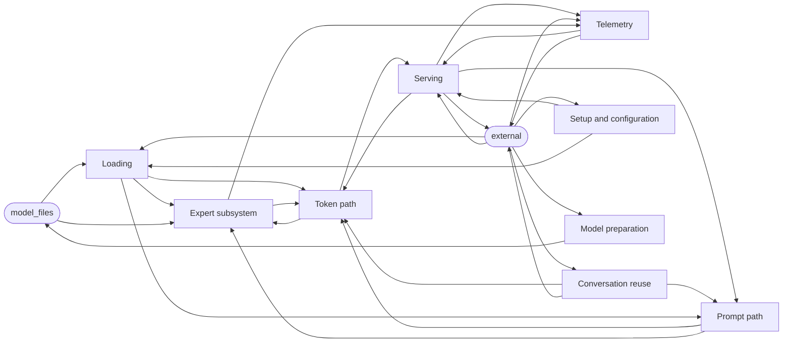

# Engine for Muse Spark Open on DGX Spark (proposed)

Generated by `tools/so_docs.py` from the description files in this directory. Do not edit by hand.

A two-layer description. **Layer 1, system**: the engine as a whole. **Layer 2, components**: one entry per part with a single responsibility, independent of the target machine. Terms are defined in [the dictionary](../../../ontology/dictionary.md).

## Layer 1: system

A proposed engine for a mixture-of-experts model whose expert weights are larger than the machine's memory: 206 GB in the model files the bench runs, against 128 GB. Each token uses 8 of 256 experts in each of 62 layers. The weights every token needs stay in memory. All experts stay on storage in a file prepared so that one expert is one contiguous read. A cache in memory holds the most used experts; a routed expert that is not cached is read from storage for that step and may replace a less used one. Reading is started as soon as routing is known and overlaps with the computation of the experts already in memory. The design is taken from Strata component by component, with the storage path taken from ds4, and nothing of it has been built.

| | |
|---|---|
| Product | Muse engine (working name) |
| Form | A design derived from the descriptions of Strata and ds4. No implementation exists. |

### Targets

| Model | Hardware | Resolved engine spec | Note |
|---|---|---|---|
| `model/muse-spark-open-ud-iq2-xxs` | `hw/dgx-spark` | `` | Text in, text out. The perception encoder for image, video and audio is not loaded in the first version. |

### Resource expectations

| Holding | Held on | Amount | Note |
|---|---|---|---|
| Weights every token uses: attention, router, embedding table, output head | fast_memory | 19.6 GB (measured) |  |
| Attention keys and values for the configured context length | fast_memory | UNSET | 0.254 MB per token at 16 bits when every layer keeps every token: 8.3 GB at 32,768 tokens. 46 of the 62 layers attend only to the last 2,048 tokens; an engine that keeps no more than that for them needs 2.5 GB at 32,768 tokens. The amount is open because the context length is. |
| Expert cache: what remains of the memory budget | fast_memory |  | 12.98 MB per expert in the model files the bench runs, so each GB holds about 77 experts of 15,872. At the 4 bits of the published weights an expert is 25.17 MB. |
| Every expert | storage | 205.96 GB (measured) |  |

### Mechanism families used

- `mech/hot-expert-residency`: partial-residency-of-selected-weights

### Mechanisms with no mechanism file yet

- **read-latency-hidden-behind-compute**: Start the storage read of a missed expert as soon as routing is known, and compute the cached experts of the same layer while it arrives.
- **one-expert-one-read**: Prepare the weight file offline so that each expert is one contiguous, block-aligned range, readable without parsing.
- **layer-major-prompt-reading**: Read a prompt chunk one layer at a time, so that an expert routed by many tokens of the chunk is read from storage once.

### What this description covers

A design, not a description of something built. Each component names the existing component it was adapted from. Every text here comes from one of two places: it was written for this engine in the derivation list, or it is the source's text and the derivation's list of kept texts names it as read against this engine, with the reason. The derivation writes no other text of the source and changes none by itself. Of a source component an adapted component also takes the title, the role, the timings, the state and the names of what it performs, without the names this engine does not have. The kept texts were read by Claude, an AI model, and not by a person. Word patterns for the source model's numbers and features, the source machine's kinds of memory, the source engine's name and implementation identifiers are looked for in every text; they find the usual wordings and nothing else. Not covered in the first version: image, video and audio input; drafting; generating more than one conversation at the same time; more than one machine. The state of earlier conversations may be kept for reuse, within a memory budget that may be zero.

## Component tree

```mermaid
flowchart TB
  S["Muse engine (working name)"]
  S --> n_preparation["Model preparation"]
  S --> n_setup["Setup and configuration"]
  S --> n_loading["Loading"]
  S --> n_serving["Serving"]
  S --> n_conversation_reuse["Conversation reuse"]
  S --> n_prompt_path["Prompt path"]
  S --> n_token_path["Token path"]
  S --> n_expert_subsystem["Expert subsystem"]
  S --> n_telemetry["Telemetry"]
  n_setup --> n_run_config_generator["Run configuration generator and store"]
  n_setup --> n_launch_argument_resolver["Launch and start-time argument resolver"]
  n_loading --> n_model_file_reader["Model file reader and geometry check"]
  n_loading --> n_expert_layout["Expert layout table"]
  n_loading --> n_weight_loader["Weight loader"]
  n_loading --> n_startup_memory_sizing["Startup memory sizing"]
  n_expert_subsystem --> n_expert_source["Expert source"]
  n_expert_subsystem --> n_expert_cache["Expert cache"]
  n_expert_subsystem --> n_expert_dispatch["Expert dispatch"]
  n_expert_subsystem --> n_cache_policy["Cache policy"]
  n_expert_subsystem --> n_storage_reader["Storage reader"]
  n_token_path --> n_decode_loop["Decode loop"]
  n_token_path --> n_layer_kernels["Layer kernels and their order"]
  n_token_path --> n_expert_router["Expert router"]
  n_token_path --> n_kv_store["Key and value store"]
  n_token_path --> n_output_head["Output head"]
  n_token_path --> n_sampler["Sampler"]
  n_serving --> n_http_front["HTTP front and admission bound"]
  n_serving --> n_prompt_builder["Prompt builder"]
  n_serving --> n_request_runner["Request runner"]
  n_serving --> n_engine_client["Engine process client and supervisor"]
  n_serving --> n_engine_command_loop["Engine command loop"]
  n_conversation_reuse --> n_resume_decision["Resume decision"]
  n_conversation_reuse --> n_parked_conversations["Parked conversation cache"]
  n_conversation_reuse --> n_session_files["Session files"]
  n_telemetry --> n_engine_diagnostics["Engine diagnostics"]
  n_telemetry --> n_server_metrics["Request accounting and metric exporters"]
```

| Component | Role | Runs | Responsibility | Basis |
|---|---|---|---|---|
| Model preparation | `model_preparer` | offline | Offline, turn the model checkpoint the target names into the files the engine reads: the weights every token uses in load order, and every expert as one contiguous block-aligned range with a table of where each lies. | adapted |
| Setup and configuration | `subsystem` | offline, startup | Decide the engine's options for one model on one machine, keep the person's own choices across rewrites, and hand the engine process its final argument list and environment at every start. |  |
| &nbsp;&nbsp;&nbsp;Run configuration generator and store | `configuration` | offline | Produce a complete run configuration file for one model on this machine from machine facts and the person's answers, and rewrite it without losing what the person added by hand. | adapted |
| &nbsp;&nbsp;&nbsp;Launch and start-time argument resolver | `configuration` | startup | Turn the stored run configuration into the argument list and environment the engine process actually receives, at every launch and every engine start, so that standing choices kept outside the list cannot be undone by whoever last rewrote it. | adapted |
| Loading | `subsystem` | startup, on_demand | Put the weights every token uses into memory, lay out the expert cache, and size every memory consumer before the first token from what the machine reports free at that moment. The experts themselves stay on storage. |  |
| &nbsp;&nbsp;&nbsp;Model file reader and geometry check | `file_reader` | startup, on_demand | Open the prepared files read-only, expose their metadata and tensor directory unchanged, and refuse files whose declared shape the compiled kernels cannot run. | adapted |
| &nbsp;&nbsp;&nbsp;Expert layout table | `file_reader` | startup, on_demand | Read the table of expert ranges once and answer, for the whole process, where each expert's bytes lie in the prepared file and how long they are. | adapted |
| &nbsp;&nbsp;&nbsp;Weight loader | `weight_loader` | startup | At startup, place the weights every token uses in fast memory and return a table from tensor name to location. | adapted |
| &nbsp;&nbsp;&nbsp;Startup memory sizing | `memory_planner` | startup | Within the memory budget, price the weights every token uses, the attention state for the configured context, the staging area and a reserve; give the expert cache what remains; and refuse to start when the cache would be below its minimum. | adapted |
| Serving | `subsystem` | startup, per_request, per_step, background, on_demand | Turn each client request into prompt token ids for one resident engine process, and turn that process's token lines back into a response. |  |
| &nbsp;&nbsp;&nbsp;HTTP front and admission bound | `api_server` | per_request, background | Accept client requests over HTTP, bound how many inference calls are pending, answer every failure class with a defined status code, and cancel a request whose client has hung up. | adapted |
| &nbsp;&nbsp;&nbsp;Prompt builder | `tokenizer` | startup, per_request | Produce the exact prompt token ids and the token limit for a request from its messages, or refuse the request. | adapted |
| &nbsp;&nbsp;&nbsp;Request runner | `api_server` | per_request, per_step | Drive one API request through one or more engine generations and turn the token ids into content events with a final finish record. | adapted |
| &nbsp;&nbsp;&nbsp;Engine process client and supervisor | `supervisor` | startup, per_request, per_step, background, on_demand | Keep one engine child process resident and in step with the server: send each generation as one text command, deliver its token lines to the caller, and end and restart a process that is dead, silent, frozen or fatally broken. | adapted |
| &nbsp;&nbsp;&nbsp;Engine command loop | `scheduler` | startup, per_request, per_step | Inside the engine process, read one command at a time, run one prompt read and one generation at a time, and report each generation's tokens and end figures as text lines. | adapted |
| Conversation reuse | `subsystem` | startup, per_request, on_demand | Let a request that continues a conversation the engine has seen start from stored state instead of reading its whole prompt again. |  |
| &nbsp;&nbsp;&nbsp;Resume decision | `policy_runner` | per_request | For each request, choose the stored state that shares the longest valid prefix with the prompt, make the session hold exactly that state by truncating or restoring, and report the prefix length. | adapted |
| &nbsp;&nbsp;&nbsp;Parked conversation cache | `conversation_store` | startup, per_request, on_demand | Hold images of other conversations' attention state within a budget, find the one with the longest valid prefix for a prompt, and evict. | adapted |
| &nbsp;&nbsp;&nbsp;Session files | `conversation_store` | on_demand | On an explicit command, write the session's current conversation to one file or read one back, refusing any file that does not belong to this model, configuration and engine version before any state changes. | adapted |
| Prompt path | `prompt_reader` | per_request | Read the prompt in chunks, one layer at a time, reading each routed expert that is not cached once per chunk, and leave behind the attention state that generation continues from. | adapted |
| Token path | `subsystem` | startup, per_request, per_step, per_layer | Take one token through all 62 layers and the output head and produce a token choice. |  |
| &nbsp;&nbsp;&nbsp;Decode loop | `host_loop` | per_step, per_layer | Take one token through the 62 layers and the output head, at each layer handing the routing to the expert subsystem and waiting until every routed expert has been computed. | adapted |
| &nbsp;&nbsp;&nbsp;Layer kernels and their order | `kernel_set` | startup, per_request, per_layer | Compute the part of each layer every token needs, in a fixed order. | adapted |
| &nbsp;&nbsp;&nbsp;Expert router | `kernel_set` | per_layer | For each token in each layer, turn the feed-forward input into 256 logits and choose 8 experts with their weights. | adapted |
| &nbsp;&nbsp;&nbsp;Key and value store | `state_manager` | startup, per_request, per_layer | Hold the attention keys and values of every position up to the configured context length, and truncate them to a given position when asked. | adapted |
| &nbsp;&nbsp;&nbsp;Output head | `kernel_set` | per_step | Turn the residual after the last layer into one row of vocabulary logits per position. | adapted |
| &nbsp;&nbsp;&nbsp;Sampler | `sampler` | per_step | Turn the logits of the position being generated into one token id by a fixed chain: logit bias, penalties, top-k, top-p, min-p, temperature, pick. | adapted |
| Expert subsystem | `subsystem` | startup, per_layer, background, on_demand | For every layer of every step, have each routed expert computed from memory, reading it from storage first when it is not cached, and keep the cache filled with the experts in most use. |  |
| &nbsp;&nbsp;&nbsp;Expert source | `data_source` | startup, on_demand | For any expert, give the range of the prepared file that holds it, and deliver its bytes into a buffer it is handed. | adapted |
| &nbsp;&nbsp;&nbsp;Expert cache | `cache` | startup, on_demand | Hold as many experts in fast memory as its budget allows and answer, for any expert, whether it is there and in which slot. | adapted |
| &nbsp;&nbsp;&nbsp;Expert dispatch | `assigner` | per_layer | For one layer of one step, decide for every routed expert whether it is computed from the cache at once or after a read from storage, and issue the reads before the cached experts start computing. | adapted |
| &nbsp;&nbsp;&nbsp;Cache policy | `policy_runner` | per_layer, background | Decide, for an expert that has just been read from storage, whether it enters the cache and which resident expert leaves, so that the cache holds the experts the current work uses most. | adapted |
| &nbsp;&nbsp;&nbsp;Storage reader | `data_mover` | on_demand | Read the bytes of missed experts from storage into the staging area or a cache slot, several at a time, and report each as ready only when it is complete. | adapted |
| Telemetry | `subsystem` | startup, per_request, per_step, background, on_demand | Record what a run chose and what each request cost, and make it readable from outside without changing any token. |  |
| &nbsp;&nbsp;&nbsp;Engine diagnostics | `telemetry` | startup, per_step, on_demand | Inside the engine process, record what the run selected at start, count cache hits and storage reads per layer, and record how often each expert is routed, writing each when asked. | adapted |
| &nbsp;&nbsp;&nbsp;Request accounting and metric exporters | `telemetry` | per_request, per_step, background, on_demand | In the server process, turn the engine's end-of-request figures and the server's own clocks into per-request records, running totals and a live rate, fill the usage and timings of each response, sample the machine at intervals, and render all of it for outside monitors. | adapted |

This engine is a design. Basis says how each component was obtained: `reused` taken over unchanged from an existing engine, `adapted` taken over and changed, `new` designed here.

## Derivation from existing engines

- `sys/strata` (main source: every one of its leaf components is accounted for below): The decomposition as a whole: loading, serving, conversation reuse, the per-token path, the expert subsystem and telemetry.
- `sys/ds4`: The storage path: offline preparation of the weight file, reading experts from storage on demand, eviction.

### Carried over

| Component here | Taken from | How | What changed and why |
|---|---|---|---|
| Model preparation | `comp/ds4/model-preparation` | adapted | ds4 converts to its own GGUF layout. Here the input is the model checkpoint the target names, and the output is a file in which each of the 15,872 experts is one contiguous block-aligned range, plus a table of those ranges. |
| Run configuration generator and store | `comp/strata/run-config-generator` | adapted | The source's choices about its lookup table and about its draft layer are not carried: this model has neither. One run configuration, not one per installed model. |
| Launch and start-time argument resolver | `comp/strata/launch-argument-resolver` | adapted | The source's choices about a draft model and about several GPUs are not carried: the first version has no drafting, and this machine has one GPU. |
| Model file reader and geometry check | `comp/strata/model-file-reader` | adapted | Reads the prepared files and their header instead of GGUF shards, and checks Muse's geometry (62 layers, 256 experts, 8 per token, hidden size 8,192). |
| Expert layout table | `comp/strata/expert-layout` | adapted | Reads the range table written by model preparation instead of Strata's layout file. One range per expert, not three tensors per layer. |
| Weight loader | `comp/strata/weight-loader` | adapted | Loads only the weights every token uses. Experts are never loaded at startup. No byte transforms: the prepared file is already in the form the kernels read. |
| Startup memory sizing | `comp/strata/startup-memory-sizing` | adapted | One memory pool instead of card memory and host memory. The attention state for the configured context is priced first because it can be tens of GB; there is no step that moves the output head to host memory. |
| HTTP front and admission bound | `comp/strata/http-front` | adapted | One conversation at a time: what the source says about its slot scheduler is not carried. Which request dialects the front offers is open until the form of the engine is decided. |
| Prompt builder | `comp/strata/prompt-builder` | adapted | Muse's vocabulary of 202,048 tokens and its chat template. Text only in the first version. The kind of tokenizer is the published one's, not the source model's. |
| Request runner | `comp/strata/request-runner` | adapted | One conversation at a time: what concerns several conversations generated at the same time is not carried. The model description names no reasoning or tool-call format, so the events are content events. |
| Engine process client and supervisor | `comp/strata/engine-client` | adapted | The source's command-line transport flag, its second start without a draft model and its query for free memory on a separate GPU memory are not carried. |
| Engine command loop | `comp/strata/engine-command-loop` | adapted | No batch slots: one prompt read or one generation at a time. |
| Resume decision | `comp/strata/resume-decision` | adapted | With attention state only, going back to an earlier point is a truncation of keys and values; no chain of checkpoints is needed. |
| Parked conversation cache | `comp/strata/parked-conversations` | adapted | An image is keys and values only. On one memory pool a parked image takes memory directly from the expert cache, so the budget is a trade against cache size, not a separate host memory budget. |
| Session files | `comp/strata/session-files` | adapted | A session file holds this model's state only, the attention keys and values. The source's other kinds of state and its checkpoints do not exist here, and what concerns several conversations generated at the same time is not carried. |
| Prompt path | `comp/strata/prompt-path`, `comp/ds4/prefill-driver` | adapted | No CPU share: there is no second copy of the experts for the CPU to read. The chunk size becomes the main choice, because the tokens of a large chunk together route to most of a layer's 256 experts, which is up to 3.3 GB read from storage per layer. |
| Decode loop | `comp/strata/window-loop`, `comp/ds4/decode-loop` | adapted | One token per step in the first version, with no draft window. A layer may have to wait for a storage read, so the step is driven layer by layer and not as one replayed graph. |
| Layer kernels and their order | `comp/strata/layer-kernels` | adapted | Muse's card names attention state only, so the recurrent state, the indexer keys and the lookup history that Strata's kernels own do not exist here. |
| Expert router | `comp/strata/expert-router` | adapted | The router of this model picks 8 of 256 experts per token per layer, where the source's picks 10 of 512. The source's choice of kernel, its recorded graph and its two optional routing biases, which read the residency table, belong to that implementation and are not carried. |
| Key and value store | `comp/strata/kv-store` | adapted | Only attention keys and values. The model allows a context of about one million tokens, which cannot be held beside the weights and the cache; the configured context length is bounded by the memory budget. 46 of the model's 62 layers attend only to the last 2,048 tokens: whether the store drops older state for those layers is an open choice of this design. Moving old keys and values out of memory is not part of the first version. |
| Output head | `comp/strata/output-head` | adapted | The source's choice between two head kernels by weight file format belongs to that implementation and is not carried. One row of logits per position, where the source has one per row of a window. The model description names only the projection to the vocabulary. |
| Sampler | `comp/strata/sampler` | adapted | No drafting in the first version: the stage that checks drafted tokens, the choices about drafted rows and the equivalence cases that depend on how drafts are accepted are not carried. The source's alternative sampler kernels are not carried. |
| Expert source | `comp/strata/expert-source`, `comp/ds4/expert-stream-reader` | adapted | Strata makes every expert addressable in host memory. Here no copy in memory is possible, so the source answers only where an expert lies on storage and hands out its bytes on request. |
| Expert cache | `comp/strata/expert-cache`, `comp/ds4/expert-cache` | adapted | Strata's cache on this machine holds every expert. Here it holds only a part of them, because the experts are larger than the memory budget, so a slot must be released for an incoming expert; releasing is still decided by the policy component, not by the cache. |
| Expert dispatch | `comp/strata/expert-dispatch`, `comp/ds4/expert-split-dispatch` | adapted | Two paths instead of five: cached, or read from storage for this step. No CPU path, no second accelerator. Omitting low-ranked experts is not part of the first version because it changes output. |
| Cache policy | `comp/strata/adaptive-tier`, `comp/ds4/expert-eviction` | adapted | Strata swaps a bounded number of experts every few windows from memory to memory. Here every miss already brings the expert in from storage, so the question is which resident expert it replaces, if any. The usage counts and their decay are kept. |
| Storage reader | `comp/strata/host-to-device-transfer`, `comp/ds4/expert-stream-reader` | adapted | Strata copies from host memory to card memory. Here the copy is a read from storage into the unified pool, far slower per byte (4.77 GB/s measured on the target machine, against 273 GB/s of memory bandwidth), so its queueing and its overlap with computation decide the engine's speed. |
| Engine diagnostics | `comp/strata/engine-diagnostics` | adapted | It must also record how often each expert of each layer is routed. That distribution is the quantity the speed of this engine depends on most, and it has not been measured for this model. |
| Request accounting and metric exporters | `comp/strata/server-metrics` | adapted | No drafting in the first version, so the counts of drafted tokens are not carried. The sizes of its histories are open choices. |

### Not carried over

| Component of the existing engine | Why | Reason for this model and hardware |
|---|---|---|
| `comp/strata/native-weight-loader` | does not apply | It serves tensors Strata keeps in GGUF form. Muse's prepared files have one form and one loader. |
| `comp/strata/host-memory-admission` | does not apply | It admits a page-locked host copy of every expert and of the lookup table. Muse's experts are larger than the machine's memory (206 GB against 128 GB) and the model has no lookup table. |
| `comp/strata/slot-scheduler` | postponed | A second conversation needs its own attention state in memory, taken from the expert cache. |
| `comp/strata/replica-router` | does not apply | One machine: there is no second engine to route a request to. |
| `comp/strata/checkpoint-chain` | does not apply | It exists to go back in recurrent state that cannot be truncated. Muse's card names attention state only. |
| `comp/strata/speed-calibration` | postponed | Its presets were measured on Strata's weight packs. It needs first measurements of this engine. |
| `comp/strata/mtp-drafter` | does not apply | The model card names no draft head. |
| `comp/strata/dflash2-drafter` | does not apply | A separate drafter model trained for Strata's model. |
| `comp/strata/lookup-drafter` | postponed | It needs nothing from the model, but a window of drafted tokens routes more experts per step. Whether that pays depends on the cost of a miss and on the acceptance rate, neither measured. |
| `comp/strata/draft-policy` | postponed | Postponed with the lookup drafter. |
| `comp/strata/draft-verifier` | postponed | Postponed with the lookup drafter. |
| `comp/strata/session-loop` | does not apply | It exists for one of Strata's weight packs only. |
| `comp/strata/window-graphs` | postponed | Replaying one recorded graph per step assumes no wait inside a layer. Here a layer may wait for storage. To be revisited when the miss rate is measured. |
| `comp/strata/ngram-reader` | does not apply | The model card names no lookup table. |
| `comp/strata/cpu-expert-pool` | does not apply | It computes experts the GPU cannot reach. On one memory pool the GPU reads every expert that is in memory, and an expert that is not in memory is on storage, where the CPU has no advantage. |

## Flows between top-level components

### All flows

| Flow | From | To | Carries | When | Description |
|---|---|---|---|---|---|
| `model-geometry` | Model file reader and geometry check | Startup memory sizing | plan | startup | Layer count, widths, expert count and experts per token read from the metadata of the prepared files and checked against the compiled shapes; every later size is computed from it. |
| `expert-layout-file` | model_files | Expert layout table | plan | startup | The table of expert ranges in the prepared files: for each expert, where its bytes lie and how long they are. |
| `expert-layout-to-source` | Expert layout table | Expert source | plan | startup | For each expert, the offset and length of its range in the prepared file, and the total bytes. |
| `expert-layout-to-sizing` | Expert layout table | Startup memory sizing | plan | startup | The largest expert range, the unit the expert cache's slots are counted in. |
| `shared-weights-read` | model_files | Weight loader | weights `shared_weights` | startup | The weights every token uses, read from the prepared files. |
| `shared-weights-in-memory` | Weight loader | Layer kernels and their order | weights `shared_weights` | startup | Where the weights every token uses lie in memory, by name. |
| `operator-memory-settings` | external | Startup memory sizing | plan | startup | Command-line flags and environment: context length, expert cache size or auto, reserve, prompt chunk. |
| `free-memory` | external | Startup memory sizing | signal | startup | Free memory of the machine's one memory pool as the operating system reports it, read before the cache is sized and again after its slots are written. |
| `expert-cache-size` | Startup memory sizing | Expert cache | plan | startup | Number of slots and the byte size of a slot. |
| `expert-bytes-from-files` | model_files | Expert source | weights `expert_weights` | on_demand | The bytes of a requested expert, one contiguous range of the prepared file, read from storage when asked for. |
| `expert-ranges-to-read` | Expert source | Storage reader | weights `expert_weights` | on_demand | The ranges of the prepared file to be read: cache fill, replacements, the prompt path's staging. |
| `residency-lookup` | Expert cache | Expert dispatch | engine_state `residency_table` | per_layer | For each routed expert, the fast-memory slot holding it or that it is absent |
| `accelerator-expert-plan` | Expert dispatch | Layer kernels and their order | plan `expert_ffn` | per_layer | Which routed experts are computed this layer, from cache slots or from the staging area. |
| `step-fetch-request` | Expert dispatch | Storage reader | control `expert_weights` | per_layer | Missed experts to read into the staging area for this step only. |
| `expert-usage` | Expert dispatch | Cache policy | signal `expert_heat` | per_layer | How many tokens of the step or of the prompt chunk routed each expert. |
| `swap-requests` | Cache policy | Storage reader | control | background | Experts to read into the slots of experts that are leaving the cache. |
| `residency-updates` | Cache policy | Expert cache | engine_state `residency_table` | background | A leaving expert is marked absent before its slot is overwritten; an entering expert is marked resident after its bytes have fully arrived. |
| `prompt-state` | Prompt path | Key and value store | model_state `attention_kv` | per_request | The model state left by reading the prompt, from which generation continues |
| `step-inputs` | Decode loop | Layer kernels and their order | tokens | per_step | The token id and its position for this step. |
| `routed-experts` | Expert router | Layer kernels and their order | activations | per_layer | 8 expert ids and weights per token, read by the combine of expert rows. |
| `layer-handoff` | Decode loop | Expert dispatch | activations | per_layer | When a layer's routing is known: its feed-forward input and routed ids, handed to expert dispatch. |
| `kv-pages-for-attention` | Key and value store | Layer kernels and their order | model_state `attention_kv` | per_layer | The keys and values an attention step reads. |
| `kv-append` | Layer kernels and their order | Key and value store | model_state `attention_kv` | per_layer | The new position's keys and values of each attention layer, written into the store. |
| `final-residual-to-head` | Layer kernels and their order | Output head | activations | per_step | The residual after the last layer, one per position. |
| `logits-to-sampler` | Output head | Sampler | activations | per_step | One row of vocabulary logits per position. |
| `client-request` | external | HTTP front and admission bound | request | per_request | A client request over HTTP: messages, sampling fields and an output limit. |
| `client-response` | HTTP front and admission bound | external | response | per_step | The response to the client: tokens as they are produced or one body at the end, with usage and timings. |
| `messages-to-prompt` | HTTP front and admission bound | Prompt builder | request | per_request | Messages and template arguments in one internal form. |
| `prompt-ids` | Prompt builder | Request runner | tokens | per_request | The prompt token ids and the output limit fitted to the context. |
| `generation-call` | Request runner | Engine process client and supervisor | tokens | per_request | Prompt token ids, output limit, sampling settings and a cancel event for one engine generation. |
| `engine-commands` | Engine process client and supervisor | Engine command loop | control | per_request | Text lines on the engine's standard input: generate with settings and prompt token ids, stop, report memory, save and restore. |
| `engine-token-lines` | Engine command loop | Engine process client and supervisor | tokens | per_step | One line per produced token id. |
| `engine-stat-lines` | Engine command loop | Request accounting and metric exporters | metrics | per_request | A line at start; per request, prompt progress, a line when a conversation is resumed, and an end line with counts, prompt and decode milliseconds, reused tokens and expert cache hits. |
| `tokens-to-runner` | Engine process client and supervisor | Request runner | tokens | per_step | Token ids as they arrive, with a heartbeat after a set time of quiet. |
| `response-events` | Request runner | HTTP front and admission bound | response | per_step | Content events, pings and one finish record. |
| `prompt-to-read` | Engine command loop | Prompt path | tokens | per_request | The prompt token ids of one generation, to be read from the resume point. |
| `resume-point` | Resume decision | Prompt path | plan | per_request | How many prompt tokens the session already holds, so reading starts there |
| `take-or-park` | Resume decision | Parked conversation cache | control | per_request | Park the outgoing conversation; restore from the chosen parked entry. |
| `parked-restore` | Parked conversation cache | Key and value store | model_state `attention_kv` | on_demand | A parked conversation's attention keys and values and its token record, copied back into the live conversation. |
| `session-file-out` | Session files | external | model_state `attention_kv` | on_demand | One session file on storage: the conversation's token record and every attention layer's keys and values. |
| `session-file-in` | external | Session files | model_state `attention_kv` | on_demand | A session file read back and validated before the live state is written. |
| `operator-choices` | external | Run configuration generator and store | control | offline | The person's setup answers and options: model, context length, format of the attention state, reserve. |
| `run-config` | Run configuration generator and store | Launch and start-time argument resolver | plan | startup | The run configuration file: engine path, argument list, environment, the person's own options and server keys |
| `engine-argv` | Launch and start-time argument resolver | Engine process client and supervisor | plan | startup | The engine process's argument list and environment |
| `memory-options` | Launch and start-time argument resolver | Startup memory sizing | plan | startup | Context length, format of the attention state, memory reserve and expert cache request, as engine arguments. |
| `request-figures` | Request accounting and metric exporters | HTTP front and admission bound | metrics | per_request | Usage with cached tokens and the timings object placed in the response |
| `metrics-out` | Request accounting and metric exporters | external | metrics | on_demand | The records, totals and rates, rendered for outside monitors when they ask. |
| `hardware-readings` | external | Request accounting and metric exporters | signal | background | GPU utilisation, temperature and power from the vendor library, and CPU, memory and disk readings from the operating system. |
| `gpu-busy` | Request accounting and metric exporters | Engine process client and supervisor | signal | background | Whether the GPU is working, read by the frozen-engine check. |
| `diagnostic-files` | Engine diagnostics | external | metrics | on_demand | The counts report at exit and the run manifest, each only when asked for. |
| `model-checkpoint` | external | Model preparation | weights `expert_weights` `shared_weights` | offline | The model checkpoint the target names, read once |
| `prepared-files` | Model preparation | model_files | weights `expert_weights` `shared_weights` | offline | The files the engine reads: weights every token uses, and every expert as one range |
| `prepared-header` | model_files | Model file reader and geometry check | plan | startup | Metadata and tensor directory of the prepared files |
| `head-weights` | Weight loader | Output head | weights `output_head_weights` | startup | Where the output head's weights lie in fast memory |
| `context-plan` | Startup memory sizing | Key and value store | plan | startup | The context length the attention state is sized for |
| `chunk-plan` | Startup memory sizing | Prompt path | plan | startup | The chunk size and the memory the prompt path may use |
| `read-requests` | Storage reader | Expert source | control `expert_weights` | on_demand | Which experts to deliver and into which buffers |
| `staged-experts-ready` | Storage reader | Expert dispatch | engine_state `staged_experts` | per_layer | Which missed experts of this layer have arrived |
| `fetched-experts-to-cache` | Storage reader | Expert cache | weights `expert_weights` | on_demand | The bytes of an expert the cache policy admitted |
| `prompt-layer-handoff` | Prompt path | Expert dispatch | activations | per_layer | For one layer of one chunk, the routing of every token and the activations |
| `generate` | Engine command loop | Decode loop | control | per_request | Start generating from the current attention state, with the sampling settings and the token limit |
| `picked-token` | Sampler | Decode loop | tokens | per_step | The token chosen for this step; it is the input of the next |
| `emitted-tokens` | Decode loop | Engine command loop | tokens | per_step | Each generated token as it is produced |
| `truncate-to-prefix` | Resume decision | Key and value store | control `attention_kv` | per_request | Cut the attention state back to the shared prefix |
| `routing-counts` | Expert dispatch | Engine diagnostics | signal `expert_usage_profile` | per_layer | Which experts were routed, and which were found in the cache |
| `usage-profile-out` | Engine diagnostics | external | metrics `expert_usage_profile` | on_demand | The recorded usage of every expert, written as a file that a later start can load |

## Layer 2: components

### Model preparation

`comp/muse/preparation` · role `model_preparer` · runs offline

**Responsibility.** Offline, turn the model checkpoint the target names into the files the engine reads: the weights every token uses in load order, and every expert as one contiguous block-aligned range with a table of where each lies.

**Not responsible for.** Changing any weight value; it re-arranges bytes only; Anything at run time.

| Direction | Flow | Other end | Carries | When |
|---|---|---|---|---|
| in | The model checkpoint the target names, read once | external | weights `expert_weights` `shared_weights` | offline |
| out | The files the engine reads: weights every token uses, and every expert as one range | model_files | weights `expert_weights` `shared_weights` | offline |

| Needs | For |
|---|---|
| storage | the model checkpoint and the prepared files, each about as large as the model's weights |
| cpu | copying and aligning |

| Checked by | What | Against | Where |
|---|---|---|---|
| parity_with_reference | Every tensor read back from the prepared files is byte-identical to the same tensor in the model checkpoint. | the model checkpoint the target names |  |

**Sources.** `comp/ds4/model-preparation` (proposal)

### Setup and configuration

`comp/muse/setup` · role `subsystem` · runs offline, startup

**Responsibility.** Decide the engine's options for one model on one machine, keep the person's own choices across rewrites, and hand the engine process its final argument list and environment at every start.

**Not responsible for.** Sizing memory pools inside the engine (startup memory sizing); Starting the engine process (engine client).

**Parts.** Run configuration generator and store, Launch and start-time argument resolver.

**Sources.** `comp/strata/setup` (proposal)

#### Run configuration generator and store

`comp/muse/run-config-generator` · role `configuration` · runs offline · part of `comp/muse/setup`

**Responsibility.** Produce a complete run configuration file for one model on this machine from machine facts and the person's answers, and rewrite it without losing what the person added by hand.

| | |
|---|---|
| Owns state | `run_config` |

| Direction | Flow | Other end | Carries | When |
|---|---|---|---|---|
| in | The person's setup answers and options: model, context length, format of the attention state, reserve. | external | control | offline |
| out | The run configuration file: engine path, argument list, environment, the person's own options and server keys | Launch and start-time argument resolver | plan | startup |

| Needs | For |
|---|---|
| cpu | Probes of the machine: GPU, memory, CPU and disk type; negligible |
| storage | The run configuration file, with a backup of the previous one |

**Sources.** `comp/strata/run-config-generator` (proposal)

#### Launch and start-time argument resolver

`comp/muse/launch-argument-resolver` · role `configuration` · runs startup · part of `comp/muse/setup`

**Responsibility.** Turn the stored run configuration into the argument list and environment the engine process actually receives, at every launch and every engine start, so that standing choices kept outside the list cannot be undone by whoever last rewrote it.

| Direction | Flow | Other end | Carries | When |
|---|---|---|---|---|
| in | The run configuration file: engine path, argument list, environment, the person's own options and server keys | Run configuration generator and store | plan | startup |
| out | The engine process's argument list and environment | Engine process client and supervisor | plan | startup |
| out | Context length, format of the attention state, memory reserve and expert cache request, as engine arguments. | Startup memory sizing | plan | startup |

**Sources.** `comp/strata/launch-argument-resolver` (proposal)

### Loading

`comp/muse/loading` · role `subsystem` · runs startup, on_demand

**Responsibility.** Put the weights every token uses into memory, lay out the expert cache, and size every memory consumer before the first token from what the machine reports free at that moment. The experts themselves stay on storage.

**Parts.** Model file reader and geometry check, Expert layout table, Weight loader, Startup memory sizing.

| | |
|---|---|
| Implements stages | `load` |
| Effect on output | `bit_exact` when by design: weights are copied unchanged |

| Needs | For |
|---|---|
| storage | the prepared files |
| fast_memory | the weights every token uses |
| cpu | parsing, sizing arithmetic |

**Sources.** `comp/strata/loading` (proposal)

#### Model file reader and geometry check

`comp/muse/model-file-reader` · role `file_reader` · runs startup, on_demand · part of `comp/muse/loading`

**Responsibility.** Open the prepared files read-only, expose their metadata and tensor directory unchanged, and refuse files whose declared shape the compiled kernels cannot run.

| Direction | Flow | Other end | Carries | When |
|---|---|---|---|---|
| out | Layer count, widths, expert count and experts per token read from the metadata of the prepared files and checked against the compiled shapes; every later size is computed from it. | Startup memory sizing | plan | startup |
| in | Metadata and tensor directory of the prepared files | model_files | plan | startup |

| Needs | For |
|---|---|
| storage | the prepared files |
| cpu | header parsing |

| Decision | Value | Fixed at | Source |
|---|---|---|---|
| The layer count, experts per layer, experts per token and hidden size the kernels are compiled for. |  | design |  |

| Checked by | What | Against | Where |
|---|---|---|---|
| unit_test | A file with a wrong layer count, expert count or hidden size is refused with the field named. |  |  |

**Sources.** `comp/strata/model-file-reader` (proposal)

#### Expert layout table

`comp/muse/expert-layout` · role `file_reader` · runs startup, on_demand · part of `comp/muse/loading`

**Responsibility.** Read the table of expert ranges once and answer, for the whole process, where each expert's bytes lie in the prepared file and how long they are.

| Direction | Flow | Other end | Carries | When |
|---|---|---|---|---|
| in | The table of expert ranges in the prepared files: for each expert, where its bytes lie and how long they are. | model_files | plan | startup |
| out | For each expert, the offset and length of its range in the prepared file, and the total bytes. | Expert source | plan | startup |
| out | The largest expert range, the unit the expert cache's slots are counted in. | Startup memory sizing | plan | startup |

| Needs | For |
|---|---|
| storage | the table of expert ranges in the prepared files |
| cpu | parsing |

| Decision | Value | Fixed at | Source |
|---|---|---|---|
| The version of the range table this engine accepts. |  | design |  |

| Checked by | What | Against | Where |
|---|---|---|---|
| unit_test | Every one of the 15,872 ranges is inside the file, block-aligned and non-overlapping. |  |  |

**Sources.** `comp/strata/expert-layout` (proposal)

#### Weight loader

`comp/muse/weight-loader` · role `weight_loader` · runs startup · part of `comp/muse/loading`

**Responsibility.** At startup, place the weights every token uses in fast memory and return a table from tensor name to location.

| | |
|---|---|
| Implements stages | `load` |

| Direction | Flow | Other end | Carries | When |
|---|---|---|---|---|
| in | The weights every token uses, read from the prepared files. | model_files | weights `shared_weights` | startup |
| out | Where the weights every token uses lie in memory, by name. | Layer kernels and their order | weights `shared_weights` | startup |
| out | Where the output head's weights lie in fast memory | Output head | weights `output_head_weights` | startup |

| Needs | For |
|---|---|
| fast_memory | the weights every token uses |
| storage | the prepared files |
| cpu | reading |

| Decision | Value | Fixed at | Source |
|---|---|---|---|
| Whether the embedding table and output head are kept at 4 or 16 bits. For each of the two tables this moves about 2.5 GB between these weights and the expert cache: 202,048 rows of 8,192 values, 12 bits more per value. |  | startup |  |

| Checked by | What | Against | Where |
|---|---|---|---|
| parity_with_reference | A checksum of each loaded tensor equals the checksum recorded at preparation. | checksums written by model preparation |  |

**Sources.** `comp/strata/weight-loader` (proposal)

#### Startup memory sizing

`comp/muse/startup-memory-sizing` · role `memory_planner` · runs startup · part of `comp/muse/loading`

**Responsibility.** Within the memory budget, price the weights every token uses, the attention state for the configured context, the staging area and a reserve; give the expert cache what remains; and refuse to start when the cache would be below its minimum.

| Direction | Flow | Other end | Carries | When |
|---|---|---|---|---|
| in | Layer count, widths, expert count and experts per token read from the metadata of the prepared files and checked against the compiled shapes; every later size is computed from it. | Model file reader and geometry check | plan | startup |
| in | The largest expert range, the unit the expert cache's slots are counted in. | Expert layout table | plan | startup |
| in | Command-line flags and environment: context length, expert cache size or auto, reserve, prompt chunk. | external | plan | startup |
| in | Free memory of the machine's one memory pool as the operating system reports it, read before the cache is sized and again after its slots are written. | external | signal | startup |
| out | Number of slots and the byte size of a slot. | Expert cache | plan | startup |
| in | Context length, format of the attention state, memory reserve and expert cache request, as engine arguments. | Launch and start-time argument resolver | plan | startup |
| out | The context length the attention state is sized for | Key and value store | plan | startup |
| out | The chunk size and the memory the prompt path may use | Prompt path | plan | startup |

| Needs | For |
|---|---|
| cpu | arithmetic at startup |

| Decision | Value | Fixed at | Source |
|---|---|---|---|
| The total the engine may hold in the unified pool. Fixed by the request. |  | startup |  |
| Memory left free for the operating system and for allocations not priced in advance. |  | startup |  |
| The longest context the engine offers. With the attention state's size per token it sets how much memory the cache loses. |  | startup |  |
| The smallest cache the engine will start with: at least the experts one step can route, 8 times 62. |  | design |  |
| After allocating, read free memory again and shrink the cache if the reserve was not really left. |  | startup |  |

| Checked by | What | Against | Where |
|---|---|---|---|
| unit_test | For a table of budgets and context lengths, the cache size plus everything priced never exceeds the budget, and a budget too small for the minimum cache is refused. |  |  |
| measurement | Peak memory of a running engine stays within the budget under the fixed workload. |  |  |

**Sources.** `comp/strata/startup-memory-sizing` (proposal)

### Serving

`comp/muse/serving` · role `subsystem` · runs startup, per_request, per_step, background, on_demand

**Responsibility.** Turn each client request into prompt token ids for one resident engine process, and turn that process's token lines back into a response.

**Parts.** HTTP front and admission bound, Prompt builder, Request runner, Engine process client and supervisor, Engine command loop.

**Sources.** `comp/strata/serving` (proposal)

#### HTTP front and admission bound

`comp/muse/http-front` · role `api_server` · runs per_request, background · part of `comp/muse/serving`

**Responsibility.** Accept client requests over HTTP, bound how many inference calls are pending, answer every failure class with a defined status code, and cancel a request whose client has hung up.

| | |
|---|---|
| Owns state | `admission_counters` |

| Direction | Flow | Other end | Carries | When |
|---|---|---|---|---|
| in | A client request over HTTP: messages, sampling fields and an output limit. | external | request | per_request |
| out | The response to the client: tokens as they are produced or one body at the end, with usage and timings. | external | response | per_step |
| out | Messages and template arguments in one internal form. | Prompt builder | request | per_request |
| in | Content events, pings and one finish record. | Request runner | response | per_step |
| in | Usage with cached tokens and the timings object placed in the response | Request accounting and metric exporters | metrics | per_request |

| Needs | For |
|---|---|
| cpu | Connection handling and watching for a client that hangs up |

**Sources.** `comp/strata/http-front` (proposal)

#### Prompt builder

`comp/muse/prompt-builder` · role `tokenizer` · runs startup, per_request · part of `comp/muse/serving`

**Responsibility.** Produce the exact prompt token ids and the token limit for a request from its messages, or refuse the request.

| | |
|---|---|
| Owns state | `prompt_encode_cache` |

| Direction | Flow | Other end | Carries | When |
|---|---|---|---|---|
| in | Messages and template arguments in one internal form. | HTTP front and admission bound | request | per_request |
| out | The prompt token ids and the output limit fitted to the context. | Request runner | tokens | per_request |

| Needs | For |
|---|---|
| cpu | Template rendering, encoding with the published tokenizer and incremental decoding, in the server process |
| fast_memory | The tokenizer's tables and the few most recent rendered prompts with their ids, in the one memory pool of this machine |

| Decision | Value | Fixed at | Source |
|---|---|---|---|
| The tokenizer used; it must reproduce the reference tokenizer exactly. |  | design |  |
| The template that turns messages into one prompt. |  | design |  |
| What happens when prompt plus requested output exceed the configured context: refuse, or shorten the output limit. |  | design |  |

| Checked by | What | Against | Where |
|---|---|---|---|
| parity_with_reference | Token ids for a fixed set of conversations equal the reference tokenizer's. | the tokenizer published with the model |  |

**Sources.** `comp/strata/prompt-builder` (proposal)

#### Request runner

`comp/muse/request-runner` · role `api_server` · runs per_request, per_step · part of `comp/muse/serving`

**Responsibility.** Drive one API request through one or more engine generations and turn the token ids into content events with a final finish record.

| Direction | Flow | Other end | Carries | When |
|---|---|---|---|---|
| in | The prompt token ids and the output limit fitted to the context. | Prompt builder | tokens | per_request |
| out | Prompt token ids, output limit, sampling settings and a cancel event for one engine generation. | Engine process client and supervisor | tokens | per_request |
| in | Token ids as they arrive, with a heartbeat after a set time of quiet. | Engine process client and supervisor | tokens | per_step |
| out | Content events, pings and one finish record. | HTTP front and admission bound | response | per_step |

| Needs | For |
|---|---|
| cpu | Per-token detokenizing and output parsing on the request's thread |

**Sources.** `comp/strata/request-runner` (proposal)

#### Engine process client and supervisor

`comp/muse/engine-client` · role `supervisor` · runs startup, per_request, per_step, background, on_demand · part of `comp/muse/serving`

**Responsibility.** Keep one engine child process resident and in step with the server: send each generation as one text command, deliver its token lines to the caller, and end and restart a process that is dead, silent, frozen or fatally broken.

| | |
|---|---|
| Owns state | `engine_process_state` |

| Direction | Flow | Other end | Carries | When |
|---|---|---|---|---|
| in | Prompt token ids, output limit, sampling settings and a cancel event for one engine generation. | Request runner | tokens | per_request |
| out | Text lines on the engine's standard input: generate with settings and prompt token ids, stop, report memory, save and restore. | Engine command loop | control | per_request |
| in | One line per produced token id. | Engine command loop | tokens | per_step |
| out | Token ids as they arrive, with a heartbeat after a set time of quiet. | Request runner | tokens | per_step |
| in | The engine process's argument list and environment | Launch and start-time argument resolver | plan | startup |
| in | Whether the GPU is working, read by the frozen-engine check. | Request accounting and metric exporters | signal | background |

**Sources.** `comp/strata/engine-client` (proposal)

#### Engine command loop

`comp/muse/engine-command-loop` · role `scheduler` · runs startup, per_request, per_step · part of `comp/muse/serving`

**Responsibility.** Inside the engine process, read one command at a time, run one prompt read and one generation at a time, and report each generation's tokens and end figures as text lines.

| | |
|---|---|
| Implements stages | `prefill`, `decode` |
| Owns state | `live_conversation_record` |
| Reads state | `parked_conversations` |

| Direction | Flow | Other end | Carries | When |
|---|---|---|---|---|
| in | Text lines on the engine's standard input: generate with settings and prompt token ids, stop, report memory, save and restore. | Engine process client and supervisor | control | per_request |
| out | One line per produced token id. | Engine process client and supervisor | tokens | per_step |
| out | A line at start; per request, prompt progress, a line when a conversation is resumed, and an end line with counts, prompt and decode milliseconds, reused tokens and expert cache hits. | Request accounting and metric exporters | metrics | per_request |
| out | The prompt token ids of one generation, to be read from the resume point. | Prompt path | tokens | per_request |
| out | Start generating from the current attention state, with the sampling settings and the token limit | Decode loop | control | per_request |
| in | Each generated token as it is produced | Decode loop | tokens | per_step |

| Needs | For |
|---|---|
| cpu | The command loop thread and one thread reading standard input |

**Sources.** `comp/strata/engine-command-loop` (proposal)

### Conversation reuse

`comp/muse/conversation-reuse` · role `subsystem` · runs startup, per_request, on_demand

**Responsibility.** Let a request that continues a conversation the engine has seen start from stored state instead of reading its whole prompt again.

**Parts.** Resume decision, Parked conversation cache, Session files.

**Sources.** `comp/strata/conversation-reuse` (proposal)

#### Resume decision

`comp/muse/resume-decision` · role `policy_runner` · runs per_request · part of `comp/muse/conversation-reuse`

**Responsibility.** For each request, choose the stored state that shares the longest valid prefix with the prompt, make the session hold exactly that state by truncating or restoring, and report the prefix length.

| | |
|---|---|
| Implements stages | `prefill` |
| Reads state | `parked_conversations` |
| Writes state | `live_conversation_record`, `parked_conversations` |
| Runs policies | `conversation-resume` |

| Direction | Flow | Other end | Carries | When |
|---|---|---|---|---|
| out | How many prompt tokens the session already holds, so reading starts there | Prompt path | plan | per_request |
| out | Park the outgoing conversation; restore from the chosen parked entry. | Parked conversation cache | control | per_request |
| out | Cut the attention state back to the shared prefix | Key and value store | control `attention_kv` | per_request |

| Needs | For |
|---|---|
| cpu | Comparing token ids; linear in the prefix length |

| Checked by | What | Against | Where |
|---|---|---|---|
| parity_with_reference | Output after resuming from a shared prefix equals output after reading the whole prompt. | the same engine without reuse |  |

**Sources.** `comp/strata/resume-decision` (proposal)

#### Parked conversation cache

`comp/muse/parked-conversations` · role `conversation_store` · runs startup, per_request, on_demand · part of `comp/muse/conversation-reuse`

**Responsibility.** Hold images of other conversations' attention state within a budget, find the one with the longest valid prefix for a prompt, and evict.

| | |
|---|---|
| Owns state | `parked_conversations` |
| Reads state | `attention_kv` |
| Writes state | `attention_kv` |
| Runs policies | `parked-eviction` |

| Direction | Flow | Other end | Carries | When |
|---|---|---|---|---|
| in | Park the outgoing conversation; restore from the chosen parked entry. | Resume decision | control | per_request |
| out | A parked conversation's attention keys and values and its token record, copied back into the live conversation. | Key and value store | model_state `attention_kv` | on_demand |

| Needs | For |
|---|---|
| fast_memory | parked images; this memory is taken from the expert cache |

**Sources.** `comp/strata/parked-conversations` (proposal)

#### Session files

`comp/muse/session-files` · role `conversation_store` · runs on_demand · part of `comp/muse/conversation-reuse`

**Responsibility.** On an explicit command, write the session's current conversation to one file or read one back, refusing any file that does not belong to this model, configuration and engine version before any state changes.

| | |
|---|---|
| Reads state | `live_conversation_record`, `attention_kv` |
| Writes state | `live_conversation_record`, `attention_kv` |

| Direction | Flow | Other end | Carries | When |
|---|---|---|---|---|
| out | One session file on storage: the conversation's token record and every attention layer's keys and values. | external | model_state `attention_kv` | on_demand |
| in | A session file read back and validated before the live state is written. | external | model_state `attention_kv` | on_demand |

| Needs | For |
|---|---|
| storage | One file per saved session: the conversation's token record and its attention keys and values |
| fast_memory | A write buffer on a save; about the payload plus a buffer on a read. This machine has one memory pool, so the buffer is taken from the same memory as the expert cache |

**Sources.** `comp/strata/session-files` (proposal)

### Prompt path

`comp/muse/prompt-path` · role `prompt_reader` · runs per_request

**Responsibility.** Read the prompt in chunks, one layer at a time, reading each routed expert that is not cached once per chunk, and leave behind the attention state that generation continues from.

| | |
|---|---|
| Implements stages | `prefill` |
| Reads state | `residency_table` |
| Writes state | `attention_kv` |
| Effect on output | `numeric` when compared with reading the same prompt one token at a time. Batched kernels may round differently; to be measured. |

| Direction | Flow | Other end | Carries | When |
|---|---|---|---|---|
| out | The model state left by reading the prompt, from which generation continues | Key and value store | model_state `attention_kv` | per_request |
| in | The prompt token ids of one generation, to be read from the resume point. | Engine command loop | tokens | per_request |
| in | How many prompt tokens the session already holds, so reading starts there | Resume decision | plan | per_request |
| in | The chunk size and the memory the prompt path may use | Startup memory sizing | plan | startup |
| out | For one layer of one chunk, the routing of every token and the activations | Expert dispatch | activations | per_layer |

| Needs | For |
|---|---|
| accelerator | batched computation of a chunk, one layer at a time |
| fast_memory | chunk buffers and the experts of the layer being read |

| Decision | Value | Fixed at | Source |
|---|---|---|---|
| Tokens per chunk. Larger chunks amortise each expert read over more tokens but need more experts in memory at once. |  | startup |  |
| Whether the prompt path may use cache slots for a layer's experts while it reads, and whether it restores the cache afterwards. |  | startup |  |
| Whether the experts a prompt routes count toward the usage that decides the cache's contents for generation. |  | design |  |

| Checked by | What | Against | Where |
|---|---|---|---|
| parity_with_reference | The attention state after reading a prompt in chunks matches reading it one token at a time, within a stated numeric tolerance. | the decode loop fed the same prompt |  |
| measurement | Seconds per chunk and bytes read from storage per chunk, by chunk size. |  |  |

**Sources.** `comp/strata/prompt-path` (proposal); `comp/ds4/prefill-driver` (proposal)

### Token path

`comp/muse/token-path` · role `subsystem` · runs startup, per_request, per_step, per_layer

**Responsibility.** Take one token through all 62 layers and the output head and produce a token choice.

**Parts.** Decode loop, Layer kernels and their order, Expert router, Key and value store, Output head, Sampler.

**Sources.** `comp/strata/token-path` (proposal)

#### Decode loop

`comp/muse/decode-loop` · role `host_loop` · runs per_step, per_layer · part of `comp/muse/token-path`

**Responsibility.** Take one token through the 62 layers and the output head, at each layer handing the routing to the expert subsystem and waiting until every routed expert has been computed.

| | |
|---|---|
| Implements stages | `decode` |
| Writes state | `attention_kv` |

| Direction | Flow | Other end | Carries | When |
|---|---|---|---|---|
| out | The token id and its position for this step. | Layer kernels and their order | tokens | per_step |
| out | When a layer's routing is known: its feed-forward input and routed ids, handed to expert dispatch. | Expert dispatch | activations | per_layer |
| in | Start generating from the current attention state, with the sampling settings and the token limit | Engine command loop | control | per_request |
| in | The token chosen for this step; it is the input of the next | Sampler | tokens | per_step |
| out | Each generated token as it is produced | Engine command loop | tokens | per_step |

| Needs | For |
|---|---|
| accelerator | all layer computation |
| cpu | driving the step and the hand-off at each layer |

| Decision | Value | Fixed at | Source |
|---|---|---|---|
| How many tokens are computed in one step: one in the first version. |  | design |  |
| How long a layer may wait for storage before the step is reported as failed. |  | design |  |

| Checked by | What | Against | Where |
|---|---|---|---|
| parity_with_reference | Next-token outputs equal the reference implementation's on a fixed prompt set under greedy sampling. | the baseline the target names, on the same model files |  |

**Sources.** `comp/strata/window-loop` (proposal); `comp/ds4/decode-loop` (proposal)

#### Layer kernels and their order

`comp/muse/layer-kernels` · role `kernel_set` · runs startup, per_request, per_layer · part of `comp/muse/token-path`

**Responsibility.** Compute the part of each layer every token needs, in a fixed order.

| | |
|---|---|
| Performs model operations | `shared_blocks` |
| Reads state | `attention_kv` |
| Writes state | `attention_kv` |

| Direction | Flow | Other end | Carries | When |
|---|---|---|---|---|
| in | Where the weights every token uses lie in memory, by name. | Weight loader | weights `shared_weights` | startup |
| in | Which routed experts are computed this layer, from cache slots or from the staging area. | Expert dispatch | plan `expert_ffn` | per_layer |
| in | The token id and its position for this step. | Decode loop | tokens | per_step |
| in | 8 expert ids and weights per token, read by the combine of expert rows. | Expert router | activations | per_layer |
| in | The keys and values an attention step reads. | Key and value store | model_state `attention_kv` | per_layer |
| out | The new position's keys and values of each attention layer, written into the store. | Key and value store | model_state `attention_kv` | per_layer |
| out | The residual after the last layer, one per position. | Output head | activations | per_step |

| Needs | For |
|---|---|
| accelerator | the blocks every token uses, combine of expert rows, token embedding |
| fast_memory | the working buffers of one step |

| Checked by | What | Against | Where |
|---|---|---|---|
| parity_with_reference | Each kernel's output on recorded inputs matches the reference within a stated tolerance. | the baseline the target names |  |

**Sources.** `comp/strata/layer-kernels` (proposal)

#### Expert router

`comp/muse/expert-router` · role `kernel_set` · runs per_layer · part of `comp/muse/token-path`

**Responsibility.** For each token in each layer, turn the feed-forward input into 256 logits and choose 8 experts with their weights.

| | |
|---|---|
| Performs model operations | `expert_router` |
| Effect on output | `bit_exact` when by design; to be shown by this component's parity check against the reference |

| Direction | Flow | Other end | Carries | When |
|---|---|---|---|---|
| out | 8 expert ids and weights per token, read by the combine of expert rows. | Layer kernels and their order | activations | per_layer |

| Needs | For |
|---|---|
| fast_memory | logits, ids and weights per token |

| Checked by | What | Against | Where |
|---|---|---|---|
| parity_with_reference | The 8 experts chosen per token per layer equal the reference's on a fixed prompt set. | the baseline the target names |  |

**Sources.** `comp/strata/expert-router` (proposal)

#### Key and value store

`comp/muse/kv-store` · role `state_manager` · runs startup, per_request, per_layer · part of `comp/muse/token-path`

**Responsibility.** Hold the attention keys and values of every position up to the configured context length, and truncate them to a given position when asked.

| | |
|---|---|
| Owns state | `attention_kv` |

| Direction | Flow | Other end | Carries | When |
|---|---|---|---|---|
| in | The model state left by reading the prompt, from which generation continues | Prompt path | model_state `attention_kv` | per_request |
| out | The keys and values an attention step reads. | Layer kernels and their order | model_state `attention_kv` | per_layer |
| in | The new position's keys and values of each attention layer, written into the store. | Layer kernels and their order | model_state `attention_kv` | per_layer |
| in | A parked conversation's attention keys and values and its token record, copied back into the live conversation. | Parked conversation cache | model_state `attention_kv` | on_demand |
| in | The context length the attention state is sized for | Startup memory sizing | plan | startup |
| in | Cut the attention state back to the shared prefix | Resume decision | control `attention_kv` | per_request |

| Needs | For |
|---|---|
| fast_memory | keys and values for the configured context |
| accelerator | attention reads them in place |

| Checked by | What | Against | Where |
|---|---|---|---|
| unit_test | After truncating to a position and continuing, the state equals that of a run that never went past the position. |  |  |

**Sources.** `comp/strata/kv-store` (proposal)

#### Output head

`comp/muse/output-head` · role `kernel_set` · runs per_step · part of `comp/muse/token-path`

**Responsibility.** Turn the residual after the last layer into one row of vocabulary logits per position.

| | |
|---|---|
| Performs model operations | `output_projection` |

| Direction | Flow | Other end | Carries | When |
|---|---|---|---|---|
| in | The residual after the last layer, one per position. | Layer kernels and their order | activations | per_step |
| out | One row of vocabulary logits per position. | Sampler | activations | per_step |
| in | Where the output head's weights lie in fast memory | Weight loader | weights `output_head_weights` | startup |

| Needs | For |
|---|---|
| accelerator | the vocabulary projection |
| fast_memory | one logits row of vocabulary size per position |

| Checked by | What | Against | Where |
|---|---|---|---|
| parity_with_reference | Logits on recorded final activations match the reference within a stated tolerance. | the baseline the target names |  |

**Sources.** `comp/strata/output-head` (proposal)

#### Sampler

`comp/muse/sampler` · role `sampler` · runs per_step · part of `comp/muse/token-path`

**Responsibility.** Turn the logits of the position being generated into one token id by a fixed chain: logit bias, penalties, top-k, top-p, min-p, temperature, pick.

| | |
|---|---|
| Implements stages | `decode` |

| Direction | Flow | Other end | Carries | When |
|---|---|---|---|---|
| in | One row of vocabulary logits per position. | Output head | activations | per_step |
| out | The token chosen for this step; it is the input of the next | Decode loop | tokens | per_step |

| Needs | For |
|---|---|
| accelerator | the pick over the vocabulary |
| fast_memory | scratch for the pick |

| Checked by | What | Against | Where |
|---|---|---|---|
| unit_test | With a fixed seed and fixed logits, the chain returns the same token as a plain implementation of each step. |  |  |

**Sources.** `comp/strata/sampler` (proposal)

### Expert subsystem

`comp/muse/expert-subsystem` · role `subsystem` · runs startup, per_layer, background, on_demand

**Responsibility.** For every layer of every step, have each routed expert computed from memory, reading it from storage first when it is not cached, and keep the cache filled with the experts in most use.

**Parts.** Expert source, Expert cache, Expert dispatch, Cache policy, Storage reader.

| | |
|---|---|
| Implements mechanisms | `mech/hot-expert-residency` |

**Sources.** `comp/strata/expert-subsystem` (proposal)

#### Expert source

`comp/muse/expert-source` · role `data_source` · runs startup, on_demand · part of `comp/muse/expert-subsystem`

**Responsibility.** For any expert, give the range of the prepared file that holds it, and deliver its bytes into a buffer it is handed.

**Not responsible for.** Keeping any expert in memory; the cache does that; Deciding which experts to read.

| Direction | Flow | Other end | Carries | When |
|---|---|---|---|---|
| in | For each expert, the offset and length of its range in the prepared file, and the total bytes. | Expert layout table | plan | startup |
| in | The bytes of a requested expert, one contiguous range of the prepared file, read from storage when asked for. | model_files | weights `expert_weights` | on_demand |
| out | The ranges of the prepared file to be read: cache fill, replacements, the prompt path's staging. | Storage reader | weights `expert_weights` | on_demand |
| in | Which experts to deliver and into which buffers | Storage reader | control `expert_weights` | on_demand |

| Needs | For |
|---|---|
| storage | the prepared file holding every expert |
| cpu | issuing reads |

| Decision | Value | Fixed at | Source |
|---|---|---|---|
| Whether reads bypass the operating system's page cache. Bypassing keeps the page cache from taking memory the budget does not count. |  | startup |  |
| How many expert reads may be in flight at once. |  | startup |  |

**Invariants.**

- `inv/whole-expert`: A delivered expert is complete; a short read is an error, never a partly filled buffer reported as ready.

| Checked by | What | Against | Where |
|---|---|---|---|
| parity_with_reference | The bytes delivered for a sample of experts equal the bytes of the model checkpoint. | the model checkpoint the target names |  |
| measurement | Time to deliver one expert, alone and with the configured number of reads in flight. |  |  |

**Sources.** `comp/strata/expert-source` (proposal); `comp/ds4/expert-stream-reader` (proposal)

#### Expert cache

`comp/muse/expert-cache` · role `cache` · runs startup, on_demand · part of `comp/muse/expert-subsystem`

**Responsibility.** Hold as many experts in fast memory as its budget allows and answer, for any expert, whether it is there and in which slot.

| | |
|---|---|
| Owns state | `residency_table` |
| Implements mechanisms | `mech/hot-expert-residency` |

| Direction | Flow | Other end | Carries | When |
|---|---|---|---|---|
| in | Number of slots and the byte size of a slot. | Startup memory sizing | plan | startup |
| out | For each routed expert, the fast-memory slot holding it or that it is absent | Expert dispatch | engine_state `residency_table` | per_layer |
| in | A leaving expert is marked absent before its slot is overwritten; an entering expert is marked resident after its bytes have fully arrived. | Cache policy | engine_state `residency_table` | background |
| in | The bytes of an expert the cache policy admitted | Storage reader | weights `expert_weights` | on_demand |

| Needs | For |
|---|---|
| fast_memory | one slot per cached expert (takes what remains of the memory budget after the weights every token uses, the attention state, the staging area and the reserve) |

| Decision | Value | Fixed at | Source |
|---|---|---|---|
| How many slots the cache has. Decided at startup from the memory budget; see startup memory sizing. |  | startup |  |

**Invariants.**

- `inv/read-ready`: A slot is reported as holding an expert only after that expert's bytes have fully arrived.
- `inv/no-overwrite-while-read`: A slot is not written while any launched computation may still read it.

| Checked by | What | Against | Where |
|---|---|---|---|
| invariant_test | A lookup during an admission never returns the expert being admitted. |  |  |

**Sources.** `comp/strata/expert-cache` (proposal); `comp/ds4/expert-cache` (proposal)

#### Expert dispatch

`comp/muse/expert-dispatch` · role `assigner` · runs per_layer · part of `comp/muse/expert-subsystem`

**Responsibility.** For one layer of one step, decide for every routed expert whether it is computed from the cache at once or after a read from storage, and issue the reads before the cached experts start computing.

**Not responsible for.** Changing what the cache holds; Summing the experts' outputs.

| | |
|---|---|
| Performs model operations | `expert_ffn` |
| Reads state | `residency_table` |
| Writes state | `expert_heat` |
| Implements mechanisms | `mech/hot-expert-residency` |
| Effect on output | `bit_exact` |

| Direction | Flow | Other end | Carries | When |
|---|---|---|---|---|
| in | For each routed expert, the fast-memory slot holding it or that it is absent | Expert cache | engine_state `residency_table` | per_layer |
| out | Which routed experts are computed this layer, from cache slots or from the staging area. | Layer kernels and their order | plan `expert_ffn` | per_layer |
| out | Missed experts to read into the staging area for this step only. | Storage reader | control `expert_weights` | per_layer |
| out | How many tokens of the step or of the prompt chunk routed each expert. | Cache policy | signal `expert_heat` | per_layer |
| in | When a layer's routing is known: its feed-forward input and routed ids, handed to expert dispatch. | Decode loop | activations | per_layer |
| in | Which missed experts of this layer have arrived | Storage reader | engine_state `staged_experts` | per_layer |
| in | For one layer of one chunk, the routing of every token and the activations | Prompt path | activations | per_layer |
| out | Which experts were routed, and which were found in the cache | Engine diagnostics | signal `expert_usage_profile` | per_layer |

| Needs | For |
|---|---|
| accelerator | every routed expert |
| fast_memory | the staging area for experts read for this step only |

| Decision | Value | Fixed at | Source |
|---|---|---|---|
| Whether a missed expert is computed from the staging area and then dropped, or is computed after the cache policy has admitted it to the cache. |  | runtime |  |

**Invariants.**

- `inv/always-served`: Every routed expert is computed exactly once in the step that routed it.
- `inv/reads-first`: The reads of a layer's missed experts are issued before the layer's cached experts are computed, so the two overlap.

| Checked by | What | Against | Where |
|---|---|---|---|
| parity_with_reference | With a cache of any size, including the minimum, the engine's output tokens equal those of a run with every expert in memory, on a model small enough to hold. | the same engine with all experts resident |  |
| invariant_test | Every routed expert of a step is computed exactly once. |  |  |

**Sources.** `comp/strata/expert-dispatch` (proposal); `comp/ds4/expert-split-dispatch` (proposal)

#### Cache policy

`comp/muse/cache-policy` · role `policy_runner` · runs per_layer, background · part of `comp/muse/expert-subsystem`

**Responsibility.** Decide, for an expert that has just been read from storage, whether it enters the cache and which resident expert leaves, so that the cache holds the experts the current work uses most.

| | |
|---|---|
| Owns state | `expert_heat` |
| Reads state | `residency_table` |
| Writes state | `residency_table` |
| Runs policies | `expert-cache` |
| Implements mechanisms | `mech/hot-expert-residency` |
| Effect on output | `bit_exact` |

| Direction | Flow | Other end | Carries | When |
|---|---|---|---|---|
| in | How many tokens of the step or of the prompt chunk routed each expert. | Expert dispatch | signal `expert_heat` | per_layer |
| out | Experts to read into the slots of experts that are leaving the cache. | Storage reader | control | background |
| out | A leaving expert is marked absent before its slot is overwritten; an entering expert is marked resident after its bytes have fully arrived. | Expert cache | engine_state `residency_table` | background |

| Needs | For |
|---|---|
| cpu | choosing what leaves |

| Decision | Value | Fixed at | Source |
|---|---|---|---|
| The condition under which a missed expert enters the cache: always, or only when its usage count exceeds that of the least used resident expert of the layer. |  | design |  |
| How fast usage counts fade. |  | design |  |
| Whether every layer has the same number of slots or slots move to the layers with the most misses. |  | runtime |  |
| What the cache holds before any request: nothing, or the experts a recorded usage profile ranks highest. |  | startup |  |

**Invariants.**

- `inv/read-ready`: An entering expert is marked resident only after its bytes have fully arrived.
- `inv/no-overwrite-while-read`: A slot is not overwritten while a computation that may read it is in progress.

| Checked by | What | Against | Where |
|---|---|---|---|
| invariant_test | A slot is never overwritten while a computation reads it, under injected slow reads. |  |  |
| measurement | Hit rate on a recorded routing trace, replayed without running the model. |  |  |

**Sources.** `comp/strata/adaptive-tier` (proposal); `comp/ds4/expert-eviction` (proposal)

#### Storage reader

`comp/muse/storage-reader` · role `data_mover` · runs on_demand · part of `comp/muse/expert-subsystem`

**Responsibility.** Read the bytes of missed experts from storage into the staging area or a cache slot, several at a time, and report each as ready only when it is complete.

| | |
|---|---|
| Owns state | `staged_experts` |
| Observation points | `read_bytes`, `read_time`, `reads_in_flight` |

| Direction | Flow | Other end | Carries | When |
|---|---|---|---|---|
| in | The ranges of the prepared file to be read: cache fill, replacements, the prompt path's staging. | Expert source | weights `expert_weights` | on_demand |
| in | Missed experts to read into the staging area for this step only. | Expert dispatch | control `expert_weights` | per_layer |
| in | Experts to read into the slots of experts that are leaving the cache. | Cache policy | control | background |
| out | Which experts to deliver and into which buffers | Expert source | control `expert_weights` | on_demand |
| out | Which missed experts of this layer have arrived | Expert dispatch | engine_state `staged_experts` | per_layer |
| out | The bytes of an expert the cache policy admitted | Expert cache | weights `expert_weights` | on_demand |

| Needs | For |
|---|---|
| storage | the prepared file |
| fast_memory | the staging area and destination slots |
| cpu | issuing and completing reads |

**Invariants.**

- `inv/ordered-read`: A read is complete before the computation that uses its destination starts.

| Checked by | What | Against | Where |
|---|---|---|---|
| invariant_test | No computation starts on a destination before its read is complete, under injected slow and short reads. |  |  |
| measurement | Bytes per second delivered at the configured concurrency, against the storage device's measured rate. |  |  |

**Sources.** `comp/strata/host-to-device-transfer` (proposal); `comp/ds4/expert-stream-reader` (proposal)

### Telemetry

`comp/muse/telemetry` · role `subsystem` · runs startup, per_request, per_step, background, on_demand

**Responsibility.** Record what a run chose and what each request cost, and make it readable from outside without changing any token.

**Not responsible for.** Liveness watchdogs. They are with the engine client..

**Parts.** Engine diagnostics, Request accounting and metric exporters.

**Sources.** `comp/strata/telemetry` (proposal)

#### Engine diagnostics

`comp/muse/engine-diagnostics` · role `telemetry` · runs startup, per_step, on_demand · part of `comp/muse/telemetry`

**Responsibility.** Inside the engine process, record what the run selected at start, count cache hits and storage reads per layer, and record how often each expert is routed, writing each when asked.

| | |
|---|---|
| Owns state | `dispatch_counts`, `run_manifest_record`, `expert_usage_profile` |
| Observation points | `cache_hit_count`, `cache_miss_count`, `expert_usage_profile`, `run_manifest` |

| Direction | Flow | Other end | Carries | When |
|---|---|---|---|---|
| out | The counts report at exit and the run manifest, each only when asked for. | external | metrics | on_demand |
| in | Which experts were routed, and which were found in the cache | Expert dispatch | signal `expert_usage_profile` | per_layer |
| out | The recorded usage of every expert, written as a file that a later start can load | external | metrics `expert_usage_profile` | on_demand |

| Needs | For |
|---|---|
| storage | A JSON report at exit and a JSON manifest, each only when a path is given |

| Checked by | What | Against | Where |
|---|---|---|---|
| unit_test | The recorded usage counts sum to 8 times 62 times the number of tokens processed. |  |  |

**Sources.** `comp/strata/engine-diagnostics` (proposal)

#### Request accounting and metric exporters

`comp/muse/server-metrics` · role `telemetry` · runs per_request, per_step, background, on_demand · part of `comp/muse/telemetry`

**Responsibility.** In the server process, turn the engine's end-of-request figures and the server's own clocks into per-request records, running totals and a live rate, fill the usage and timings of each response, sample the machine at intervals, and render all of it for outside monitors.

| | |
|---|---|
| Owns state | `request_history` |

| Direction | Flow | Other end | Carries | When |
|---|---|---|---|---|
| in | A line at start; per request, prompt progress, a line when a conversation is resumed, and an end line with counts, prompt and decode milliseconds, reused tokens and expert cache hits. | Engine command loop | metrics | per_request |
| out | Usage with cached tokens and the timings object placed in the response | HTTP front and admission bound | metrics | per_request |
| out | The records, totals and rates, rendered for outside monitors when they ask. | external | metrics | on_demand |
| in | GPU utilisation, temperature and power from the vendor library, and CPU, memory and disk readings from the operating system. | external | signal | background |
| out | Whether the GPU is working, read by the frozen-engine check. | Engine process client and supervisor | signal | background |

| Needs | For |
|---|---|
| cpu | Work per finished request, per reading of the machine and per request from a monitor |
| fast_memory | Bounded histories of finished requests, transition events and hardware samples, in the one memory pool of this machine |

**Sources.** `comp/strata/server-metrics` (proposal)

