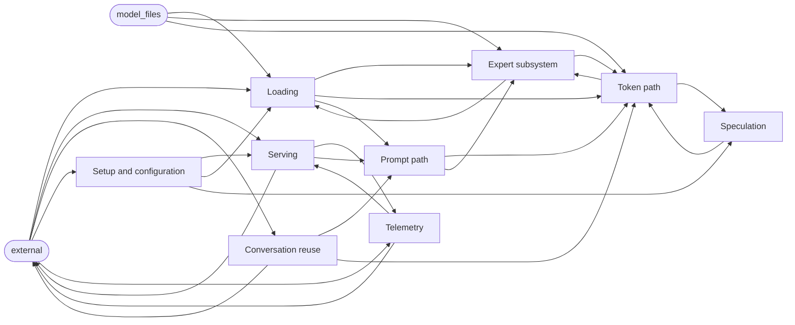

# Strata

Generated by `tools/so_docs.py` from the description files in this directory. Do not edit by hand.

A two-layer description. **Layer 1, system**: the engine as a whole. **Layer 2, components**: one entry per part with a single responsibility, independent of the target machine. Terms are defined in [the dictionary](../../../ontology/dictionary.md).

## Layer 1: system

Strata is an engine written for one mixture-of-experts model whose expert weights do not fit the fast memory of a consumer machine. Each token uses 10 of 512 experts in each of 48 layers. The engine keeps the weights every token needs and the most used experts in fast memory, keeps every expert in slow memory where the CPU computes the ones that are not in fast memory, moves experts between the two as usage changes, reads a lookup table from storage a few rows per token, and has the full model check several drafted tokens in one pass. A serving layer in front of the engine process holds conversations so that a continued conversation is not read again.

| | |
|---|---|
| Product | Strata |
| Source revision | 504b143342a9fe1aa8320a7b31e11f5c0ac265c3 |
| Source | https://github.com/Niko1221/Strata |
| Form | Written from scratch in C++ and CUDA, with a Python serving layer that drives the engine process. |

### Targets

| Model | Hardware | Resolved engine spec | Note |
|---|---|---|---|
| `model/qwen3.8-flash-125b-a6b` | `hw/pc-12g-64g` | `spec/qwen-flash-on-pc/strata-like` | A discrete GPU with 12 GB of its own memory and 64 GB of host memory. The configuration the component descriptions were read for. |
| `model/qwen3.8-flash-125b-a6b` | `hw/dgx-spark` | `spec/qwen-flash-on-dgx-spark/strata-like` | One memory pool shared by CPU and GPU. Described from the project's document for this machine and from the code paths it names; nothing was run there. |

### Resource expectations

| Holding | Held on | Amount | Note |
|---|---|---|---|
| Weights every token uses, session state for the configured context, and the drafter | fast_memory |  | Sized first. What remains, less a reserve, goes to the expert cache. |
| Expert cache: the most used experts, one per slot | fast_memory |  | Slot count is decided at startup from free memory and reduced if the reserve was not really left. The project's document says each extra GB holds about 700 more experts. |
| Every expert, 24,576 of them | slow_memory | 50.3 GB (reported) |  |
| Lookup table read by row | storage | 28.8 GB (reported) |  |

### Mechanism families used

- `mech/hot-expert-residency`: partial-residency-of-selected-weights
- `mech/work-based-prefill-split`: work-dependent-assignment
- `mech/draft-then-verify`: draft-verify-commit
- `mech/route-tail-skip`: skip-low-rank-selected

### Mechanisms with no mechanism file yet

- **degrade-before-refuse-startup-sizing**: Each memory consumer is sized in a fixed order from the free memory actually left, and a shortage walks a fixed ladder (smaller loan, lower reserve, own smaller prompt buffers, output head moved to host memory, cache reopened smaller) before the start is ended.
- **touch-then-recheck-reserve**: After a large device allocation its memory is written, free memory is read again, and the allocation is shrunk until the intended reserve is really left, because the free figure read before the allocation can be too high.
- **gpu-readable-host-weights**: Weights kept in host memory are registered with the GPU driver before they are written, so the GPU can read a selected piece in place over the bus without a staging copy; what cannot be registered is kept resident by an operating-system lock.
- **page-locked-headroom**: A small amount of page-locked memory is held back while a large region registers and released afterwards, so later small page-locked buffers do not fail on a platform with a ceiling on such memory.
- **serve-weights-in-file-encoding**: Tensors are uploaded in the block encoding the model file already uses and computed on by kernels for that encoding, and the engine-form copy of the same tensor is not loaded.
- **lossless-load-time-reencoding**: A tensor stored in a wider container than its values need is narrowed at load by an exact transform, and a plane the kernels want wider is widened exactly, so the on-disk form and the in-memory form can differ without changing any value.
- **fall-back-to-file-source-when-ram-short**: When host memory cannot hold all expert weights after a bounded wait, the engine reads them from their files through the page cache, with a copy of the hottest ones in the RAM that is available, instead of refusing or loading into a shortage.
- **recorded-graph-replay**: Record the fixed device work of a layer, a token or a whole window once and replay it with one driver call, passing everything that changes per token through fixed-address buffers; the stated gain is removed launch overhead.
- **in-graph-host-handoff**: A kernel inside the recorded graph publishes a layer's activations and routed ids to mapped host memory and a later kernel waits on a flag the host writes, so the CPU computes its experts while the GPU continues and the host makes no driver call per layer.
- **kv-streaming**: Keep the authoritative attention keys and values in page-locked host memory and only a window of pages in fast memory; before each attention step a device kernel makes the selected blocks resident with a clock sweep. Frees fast memory for more experts.
- **table-residency-by-startup-rule**: Hold a large lookup table locked in host memory only when it fits beside everything still to be allocated plus a headroom; otherwise read a few rows per token directly from storage, hidden behind other work.
- **residency-biased-routing**: Opt-in: bias the expert selection towards experts already resident in fast memory. Changes the output.
- **lookup-drafting**: Draft the tokens that followed the longest earlier occurrence of the current ending of prompt plus output, found through a trigram index, optionally chained after the neural drafts in the same window.
- **cost-aware-draft-window**: Choose the verify window width step by step from each draft's calibrated chance of holding and the measured wall time of each window width, maximising expected committed tokens per millisecond.
- **speculative-rejection-sampling**: For sampled requests, sample the draft from the drafter's distribution q and accept it with probability min(1, p/q), else resample from the positive part of p minus q, so each output token keeps the target distribution p; with a confidence gate handled as a masked proposal measure.
- **coupled-draft-sampling**: Sample the draft with the target's own sampler chain and the same position-keyed uniform, so an exact-match check accepts it more often without changing the text.
- **block-drafter-from-hidden-taps**: A small separate model reads the target's hidden states at a few layers for committed rows and drafts a block of tokens in one pass.
- **prefix-state-checkpoints**: Keep host copies of the small running state at turn boundaries and fixed intervals of the current conversation, relying on the positional K/V staying in place, so a later request that shares a prefix rewinds instead of re-reading.
- **parked-conversation-cache**: When the session switches conversation, copy the outgoing conversation's whole state including K/V to host memory within a budget tied to free memory, and restore or borrow from it when a prompt matches by tokens, pictures and steering flag.
- **multi-sequence-batch-windows**: Keep several sequences open in one engine, each with its own session state, and carry one row of each through the same window so shared weights are read once per window; a lone request stays on the single-sequence path with drafts and is moved into a slot when a second arrives.
- **cooperative-prompt-read-preemption**: A long prompt read gives way at a chunk boundary to a waiting request with a much shorter prompt; the part read waits in a slot and continues afterwards with the same chunks, and decoding slots get a share of time between a prompt's chunks.
- **cache-affinity-request-routing**: Send a request to the slot or engine process that already holds the longest start of its prompt, weighed against load, so a conversation's next turn returns to where its state is.
- **incremental-prompt-tokenization**: Reuse the token ids of an earlier prompt up to the last special-token boundary both texts share and encode only the rest, which is exact because encoding never crosses a special-token match.
- **measured-per-machine-settings**: On demand, time a bounded set of engine settings on the machine at hand with the real engine, keep a value only if it beats the default by more than noise, and bind the result to a hardware identity so it is not applied elsewhere.
- **engine-process-supervision**: Run the engine as a child process on a line protocol, detect silence, a frozen process and fatal device errors with separate limits, and restart it between requests with a cap on repeated fatal errors.

### Claims

| Claim | Status | Source | Baseline |
|---|---|---|---|
| Drafting and verifying yields 2.4 to 3.2 tokens per pass on average, 1.6 to 1.8 times sooner | reported | strata docs/HOW_IT_WORKS.md:41-43 | token-by-token decoding; the document does not give the measurement conditions |
| Long prompts are read at over 1,000 tokens per second | reported | strata docs/HOW_IT_WORKS.md:50-51 | not stated |

### What this description covers

Written from the source at the revision above and from the project's own documents; nothing was built or run. Each component states what was read in code, what only in a header comment or a document, and what was not read. Covered: the CUDA path for Qwen3.8-Flash-Next and the Python serving layer. Not covered: the HIP, SYCL and Metal backends, the other model engines in the same repository, kernel numerics, and vision input. Facts with file and line are in engines/strata-notes/.

## Component tree

```mermaid
flowchart TB
  S["Strata"]
  S --> n_setup["Setup and configuration"]
  S --> n_loading["Loading"]
  S --> n_serving["Serving"]
  S --> n_conversation_reuse["Conversation reuse"]
  S --> n_prompt_path["Prompt path"]
  S --> n_token_path["Token path"]
  S --> n_expert_subsystem["Expert subsystem"]
  S --> n_speculation["Speculation"]
  S --> n_telemetry["Telemetry"]
  n_expert_subsystem --> n_expert_source["Expert source"]
  n_expert_subsystem --> n_expert_cache["Expert cache"]
  n_expert_subsystem --> n_expert_dispatch["Expert dispatch"]
  n_expert_subsystem --> n_cpu_expert_pool["CPU expert pool"]
  n_expert_subsystem --> n_adaptive_tier["Adaptive tier"]
  n_expert_subsystem --> n_host_to_device_transfer["Host-to-device transfer"]
  n_loading --> n_model_file_reader["Model file reader and architecture guard"]
  n_loading --> n_expert_layout["Expert layout table"]
  n_loading --> n_weight_loader["Pack weight loader"]
  n_loading --> n_native_weight_loader["Native-form weight loaders"]
  n_loading --> n_startup_memory_sizing["Startup memory sizing"]
  n_loading --> n_host_memory_admission["Host memory admission and page-locked headroom"]
  n_serving --> n_http_front["HTTP front and admission bound"]
  n_serving --> n_prompt_builder["Prompt builder"]
  n_serving --> n_request_runner["Request runner"]
  n_serving --> n_engine_client["Engine process client and supervisor"]
  n_serving --> n_engine_command_loop["Engine command loop and batch slots"]
  n_serving --> n_slot_scheduler["Server-side slot scheduler"]
  n_serving --> n_replica_router["Replica router"]
  n_conversation_reuse --> n_resume_decision["Resume decision"]
  n_conversation_reuse --> n_checkpoint_chain["Checkpoint chain"]
  n_conversation_reuse --> n_parked_conversations["Parked conversation cache"]
  n_conversation_reuse --> n_session_files["Session files"]
  n_setup --> n_run_config_generator["Run configuration generator and store"]
  n_setup --> n_launch_argument_resolver["Launch and start-time argument resolver"]
  n_setup --> n_speed_calibration["Speed calibration and tuning presets"]
  n_telemetry --> n_engine_diagnostics["Engine diagnostics"]
  n_telemetry --> n_server_metrics["Request accounting and metric exporters"]
  n_speculation --> n_mtp_drafter["MTP drafter"]
  n_speculation --> n_dflash2_drafter["DFlash2 block drafter"]
  n_speculation --> n_lookup_drafter["Lookup (suffix) drafter"]
  n_speculation --> n_draft_policy["Draft policy"]
  n_speculation --> n_draft_verifier["Draft verifier"]
  n_token_path --> n_window_loop["Window loop"]
  n_token_path --> n_session_loop["Session loop"]
  n_token_path --> n_layer_kernels["Layer kernels and their order"]
  n_token_path --> n_expert_router["Expert router"]
  n_token_path --> n_window_graphs["Recorded graphs"]
  n_token_path --> n_kv_store["Key and value store"]
  n_token_path --> n_ngram_reader["N-gram hash and table reader"]
  n_token_path --> n_output_head["Output head"]
  n_token_path --> n_sampler["Sampler"]
```

| Component | Role | Runs | Responsibility | Basis |
|---|---|---|---|---|
| Setup and configuration | `subsystem` | offline, startup | Decide the engine's options for one model on one machine, keep the person's own choices across rewrites, and hand the engine process its final argument list and environment at every start. |  |
| &nbsp;&nbsp;&nbsp;Run configuration generator and store | `configuration` | offline | Produce a complete run configuration file for one model on this machine from machine facts and the person's answers, and rewrite it without losing what the person added by hand. | code |
| &nbsp;&nbsp;&nbsp;Launch and start-time argument resolver | `configuration` | startup | Turn the stored run configuration into the argument list and environment the engine process actually receives, at every launch and every engine start, so that standing choices kept outside the list cannot be undone by whoever last rewrote it. | code |
| &nbsp;&nbsp;&nbsp;Speed calibration and tuning presets | `configuration` | offline | Measure on this machine, with the real engine and on demand, which of a bounded set of settings is faster, keep a non-default value only when it beats the default by more than measurement noise, and store the result for later starts. | code |
| Loading | `subsystem` | startup, on_demand | Turn the pack directory and the GGUF shards into weights in memory, and size every memory consumer before the first token from what the machine reports free at that moment. |  |
| &nbsp;&nbsp;&nbsp;Model file reader and architecture guard | `file_reader` | startup, on_demand | Map a GGUF v3 shard read-only, expose its metadata, tensor directory and tensor bytes unchanged, and refuse a file whose declared shape the compiled kernels cannot run. | code |
| &nbsp;&nbsp;&nbsp;Expert layout table | `file_reader` | startup, on_demand | Read the pack's native_experts.txt once and answer, for the whole process, how many bytes each layer's expert blob has, where it starts, and where each layer's gate, up and down tensors lie in the GGUF shards. | code |
| &nbsp;&nbsp;&nbsp;Pack weight loader | `weight_loader` | startup | Copy every tensor the pack index lists, except those in a skip set, into one device memory range at its recorded offset, applying the byte transform the index names for each plane, and return a table from tensor name to location. | code |
| &nbsp;&nbsp;&nbsp;Native-form weight loaders | `weight_loader` | startup, on_demand | Upload selected tensors in their unchanged GGUF block form (per-layer projections, output head, token embedding) and attach them to the matching entries of the weight table, so that the pack copy of each can be skipped. | code |
| &nbsp;&nbsp;&nbsp;Startup memory sizing | `memory_planner` | startup | Give the expert cache the device memory that remains after weights, session, drafter and output head, minus a reserve and minus later allocations priced in advance; and when that is too little, step down through fixed last resort before ending the start. | code |
| &nbsp;&nbsp;&nbsp;Host memory admission and page-locked headroom | `memory_planner` | startup, on_demand | Decide at startup, from host memory readings taken before the allocations, whether the n-gram table is locked in RAM and whether the expert arena is loaded or replaced by the file source, and hold back page-locked memory while the arena registers so that later small page-locked buffers succeed. | code |
| Serving | `subsystem` | startup, per_request, per_window, background, on_demand | Turn each client request into prompt token ids for one resident engine process, and turn that process's token lines back into a response. |  |
| &nbsp;&nbsp;&nbsp;HTTP front and admission bound | `api_server` | per_request, background | Accept OpenAI- and Anthropic-shaped HTTP requests, bound how many inference calls are pending, answer every failure class with a defined status code, and cancel a request whose client has hung up. | code |
| &nbsp;&nbsp;&nbsp;Prompt builder | `tokenizer` | startup, per_request | Produce the exact prompt token ids and the token limit for a request from its messages, or refuse the request. | code |
| &nbsp;&nbsp;&nbsp;Request runner | `api_server` | per_request, per_window | Drive one API request through one or more engine generations and turn the token ids into reasoning, content and tool-call events with a final finish record. | code |
| &nbsp;&nbsp;&nbsp;Engine process client and supervisor | `supervisor` | startup, per_request, per_window, background, on_demand | Keep one engine child process resident and in step with the server: send each generation as one text command, deliver its token lines to the caller, and end and restart a process that is dead, silent, frozen or fatally broken. | code |
| &nbsp;&nbsp;&nbsp;Engine command loop and batch slots | `scheduler` | startup, per_request, per_window | Inside the engine process, read one command at a time, run one prompt read at a time, advance every active batch slot one window at a time between commands, and report each generation's tokens and end figures as text lines. | code |
| &nbsp;&nbsp;&nbsp;Server-side slot scheduler | `scheduler` | per_request, per_window, background | With batch slots on, decide for each request whether it runs alone or in a slot, which slot, and in what order requests get the single prompt-reading channel, and keep the server's record of slots consistent with the engine's. | code |
| &nbsp;&nbsp;&nbsp;Replica router | `distributed_coordinator` | startup, per_request, background | Present several independent engine processes, each on its own group of cards, as one engine, and choose a process for each generation. | code |
| Conversation reuse | `subsystem` | startup, per_request, on_demand | Let a request that continues a conversation the engine has seen start from stored state instead of reading its whole prompt again. |  |
| &nbsp;&nbsp;&nbsp;Resume decision | `policy_runner` | per_request | For each request, choose the stored state that shares the longest valid prefix with the prompt, make the session hold exactly that state, and report the prefix length. | code |
| &nbsp;&nbsp;&nbsp;Checkpoint chain | `state_manager` | per_request, on_demand | Keep a bounded set of snapshots of the running state at chosen token positions of the conversation the session currently holds, so a later request on the same history can rewind to one. | code |
| &nbsp;&nbsp;&nbsp;Parked conversation cache | `conversation_store` | startup, per_request, on_demand | Hold whole images of other conversations, including their attention K/V, within a host memory budget, find the one with the longest valid prefix for a prompt, and evict. | code |
| &nbsp;&nbsp;&nbsp;Session files | `conversation_store` | on_demand | On an explicit command, write the session's current conversation to one file or read one back, refusing any file that does not belong to this model, configuration and engine version before any state changes. | code |
| Prompt path | `prompt_reader` | per_request | Read the prompt in large chunks, layer by layer, and leave behind the model state that generation continues from. | code |
| Token path | `subsystem` | startup, per_request, per_window, per_step, per_layer, background, on_demand | Take one token, or one window of tokens, through all 48 layers and the output head and produce a token choice for each position. |  |
| &nbsp;&nbsp;&nbsp;Window loop | `host_loop` | per_window, per_layer | Run one window of 1 to max_t tokens through the layers and the output head as a single replayed graph, and serve each layer's host-side expert work when the GPU signals that the layer's routing is known. | code |
| &nbsp;&nbsp;&nbsp;Session loop | `host_loop` | per_step, per_layer | For one token on a canonical Q2_0 pack, launch the layers in order and place the CPU's expert rows between each layer's routing and its combine, so that a layer's experts meet that layer's router weights. | code |
| &nbsp;&nbsp;&nbsp;Layer kernels and their order | `kernel_set` | startup, per_request, per_layer | Compute the part of each layer every token needs, in a fixed order, and keep the per-sequence state those kernels read and write at fixed device addresses. | code |
| &nbsp;&nbsp;&nbsp;Expert router | `kernel_set` | per_layer | For each token in each layer, turn the feed-forward input into 512 logits and choose 10 experts with renormalised weights, on the device inside the recorded graph. | code |
| &nbsp;&nbsp;&nbsp;Recorded graphs | `graph_runner` | startup, on_demand | Record the fixed sequence of device work once and keep the recorded graphs available for replay, freeing and re-recording them when fast memory for a new one runs out. | code |
| &nbsp;&nbsp;&nbsp;Key and value store | `state_manager` | startup, per_request, per_layer | Hold the attention keys and values of every position of each attention layer in the configured format, reachable through a page table, and when streaming is on make every block a selection names resident in fast memory before the attention reads it. | code |
| &nbsp;&nbsp;&nbsp;N-gram hash and table reader | `table_reader` | startup, per_window, per_step, background, on_demand | For each token, compute its 16 row numbers from the token and its two predecessors and deliver those 16 rows of the n-gram table as 2560 floats before layer 1 needs them. | code |
| &nbsp;&nbsp;&nbsp;Output head | `kernel_set` | per_window, per_step | Turn the residual after the last layer into one row of vocabulary logits per position: a final residual read, then the vocabulary projection. | code |
| &nbsp;&nbsp;&nbsp;Sampler | `sampler` | per_window, per_step | Turn each position's logits into one token id by a fixed chain: logit bias, penalties, top-k, top-p, min-p, temperature, pick. | code |
| Expert subsystem | `subsystem` | startup, per_layer, background, on_demand | For every layer of every window, get each routed expert computed by whichever path can produce it soonest, and keep the fast memory filled with the experts in most use. |  |
| &nbsp;&nbsp;&nbsp;Expert source | `data_source` | startup, on_demand | Make the bytes of every routed expert of every layer addressable in host memory for the whole run, either as one arena filled at startup or as mappings of the files that hold them, and say for each expert whether the GPU can read it in place. | code |
| &nbsp;&nbsp;&nbsp;Expert cache | `cache` | startup, on_demand | Hold a fixed number of experts in fast memory and answer, for any expert, whether it is there and in which slot. | code |
| &nbsp;&nbsp;&nbsp;Expert dispatch | `assigner` | per_layer | For one layer of one window, decide for every routed expert which path computes it, and publish the accelerator's share before the CPU's share starts. | code |
| &nbsp;&nbsp;&nbsp;CPU expert pool | `executor` | startup, per_layer, background | Compute a batch of expert evaluations on CPU cores, reading each expert's bytes in place, and return only when every job is done and every worker is parked again. | code |
| &nbsp;&nbsp;&nbsp;Adaptive tier | `policy_runner` | background | Keep the expert cache filled with the experts the current conversation uses most, by swapping a bounded number of them at fixed intervals. | code |
| &nbsp;&nbsp;&nbsp;Host-to-device transfer | `data_mover` | on_demand | Copy expert bytes from slow memory to fast memory in an order the accelerator work that follows can rely on. | code |
| Speculation | `subsystem` | startup, per_request, per_window | Propose several next tokens cheaply, have the full model check them in one window, and make exactly the accepted prefix permanent. |  |
| &nbsp;&nbsp;&nbsp;MTP drafter | `drafter` | startup, per_request, per_window | From the verify window's final hidden rows and the tokens that followed them, produce draft tokens with a probability each, and keep the draft layer's own attention K/V complete for every accepted position. | code |
| &nbsp;&nbsp;&nbsp;DFlash2 block drafter | `drafter` | startup, per_window | Produce 7 draft tokens in one forward pass of a separate 5-layer drafter model that reads the target model's hidden states at five layers, and keep its context ring to committed rows only. | code |
| &nbsp;&nbsp;&nbsp;Lookup (suffix) drafter | `drafter` | per_request, per_window | Propose the tokens that followed the longest earlier occurrence of the text's current ending, with the match length, using no model weights. | code |
| &nbsp;&nbsp;&nbsp;Draft policy | `speculation_controller` | startup, per_request, per_window | Choose, for each round, where the verify window's drafts come from and how wide the window is, so that committed tokens per measured millisecond is highest; and under automatic drafter selection, which neural drafter a request uses. | code |
| &nbsp;&nbsp;&nbsp;Draft verifier | `draft_verifier` | per_window | Given the full model's target token for every row of a window, accept the longest prefix of drafts that agree, and make exactly that prefix permanent in indexer keys, recurrent state, convolution history and n-gram history. | code |
| Telemetry | `subsystem` | startup, per_request, per_window, background, on_demand | Record what a run chose and what each request cost, and make it readable from outside without changing any token. |  |
| &nbsp;&nbsp;&nbsp;Engine diagnostics | `telemetry` | startup, per_window, on_demand | Inside the engine process, count which kernel variants and window graphs were chosen, record what the run selected at start, and sample batch windows, writing each only when asked by an environment variable. | code |
| &nbsp;&nbsp;&nbsp;Request accounting and metric exporters | `telemetry` | per_request, per_window, background, on_demand | In the server process, turn the engine's end-of-request figures and the server's own clocks into per-request records, running totals and a live rate, fill the usage and timings of each response, sample the machine once a second, and render all of it for outside monitors. | code |

Basis: `code` the implementation was read; `header_comment` only the file's header comment was read; `docs` documents only.

## Flows between top-level components

### All flows

| Flow | From | To | Carries | When | Description |
|---|---|---|---|---|---|
| `gguf-shards-read` | model_files | Model file reader and architecture guard | weights `shared_weights` `expert_weights` | startup | The GGUF shards, mapped read-only: header, metadata, tensor directory and tensor bytes. |
| `model-geometry` | Model file reader and architecture guard | Startup memory sizing | plan | startup | Layer count, widths, expert count and experts per token read from the metadata shard and checked against the compiled shapes; every later size is computed from it. The same record is passed to the session, the expert source and the expert cache. |
| `gguf-tensor-bytes` | Model file reader and architecture guard | Native-form weight loaders | weights `shared_weights` | startup | Pointers into the mapping for the projections, the output head and the token embedding, uploaded unchanged. |
| `expert-layout-file` | model_files | Expert layout table | plan | startup | The pack's native_experts.txt: per-layer blob size and formats, and the file and offset of each layer's gate, up and down tensors. |
| `expert-layout-to-source` | Expert layout table | Expert source | plan | startup | Blob size and offset per layer, total bytes, and the GGUF spans the arena is filled from. |
| `expert-layout-to-sizing` | Expert layout table | Startup memory sizing | plan | startup | The largest blob and each layer's blob size, the unit the expert cache's slots are counted in. |
| `expert-layout-to-admission` | Expert layout table | Host memory admission and page-locked headroom | plan | startup | Total bytes of all routed experts, the arena size the n-gram table is priced against. |
| `pack-dense-read` | model_files | Pack weight loader | weights `shared_weights` | startup | The pack's index.txt and data files (dense.bin, embd.bin, extra.bin), read in 8 MiB chunks. |
| `natively-served-names` | Native-form weight loaders | Pack weight loader | plan | startup | The names of the tensors the native loaders will serve, so the pack loader skips them and its device range is sized without them. |
| `weight-table-to-native` | Pack weight loader | Native-form weight loaders | engine_state | startup | The name-to-location table; the native loader checks each projection against its row and attaches the GGUF-form pointer to it. |
| `dense-weights-in-vram` | Pack weight loader | Layer kernels and their order | weights `shared_weights` | startup | Device locations of the dense tensors in engine form, by name. |
| `native-projections-in-vram` | Native-form weight loaders | Layer kernels and their order | weights `shared_weights` | startup | Device locations of the per-layer projections in GGUF block form, and the token embedding where the GPU reads one row per token. |
| `native-head-weights` | Native-form weight loaders | Output head | weights `shared_weights` | startup | The output projection in GGUF block form, on the card or in page-locked host memory. |
| `operator-memory-settings` | external | Startup memory sizing | plan | startup | Command-line flags and environment: context length, expert cache size or auto, reserve, prompt chunk, pipeline windows. |
| `device-free-memory` | external | Startup memory sizing | signal | startup | Free device memory as the driver reports it, read before the cache is sized and again after its slots are written. |
| `expert-cache-size` | Startup memory sizing | Expert cache | plan | startup | Number of slots, and for a native pack the byte size of each slot in profile order. |
| `prompt-buffer-plan` | Startup memory sizing | Prompt path | plan | startup | Whether the prompt path borrows cache slots or keeps its own buffers, its chunk size, and how many slots a loan leaves in the cache. |
| `head-to-host` | Startup memory sizing | Native-form weight loaders | control | startup | Last resort when the cache has no slot: move the output head from the card to page-locked host memory. |
| `host-memory-readings` | external | Host memory admission and page-locked headroom | signal | startup | Available RAM, the tightest cgroup limit, and the operator's --ram-keep-gib and --ple-io settings. |
| `ngram-residency-decision` | Host memory admission and page-locked headroom | N-gram hash and table reader | plan | startup | Whether the n-gram table is mapped and locked in RAM or read directly from storage; and later, an instruction to give the lock back when the arena or the conversation cache needs the RAM. |
| `arena-admission-settings` | Host memory admission and page-locked headroom | Expert source | plan | startup | Whether reading from the file source instead is allowed, the RAM to keep free, the headroom under a hard limit, and the budget of the reduced RAM copy. |
| `arena-outcome` | Expert source | Host memory admission and page-locked headroom | signal | startup | Whether RAM was short, and how many bytes of the arena the GPU driver registered (used for the page-locked reserve's release and its hint). |
| `expert-bytes-from-files` | model_files | Expert source | weights `expert_weights` | startup | Every routed expert, read into the arena from the GGUF shards or experts.bin. In file-source mode the files are mapped instead and read on demand. |
| `expert-bytes-in-host-memory` | Expert source | CPU expert pool | weights `expert_weights` | per_layer | Pointers to the blobs of the experts the CPU computes. |
| `expert-bytes-to-upload` | Expert source | Host-to-device transfer | weights `expert_weights` | on_demand | Pointers to blobs to be copied into device memory (cache fill, swaps, the prompt path's staging). |
| `gpu-readable-experts` | Expert source | Expert dispatch | signal | per_layer | For an expert or a layer, whether its bytes are registered with the GPU driver and at which address the GPU reads them in place. |
| `residency-lookup` | Expert cache | Expert dispatch | engine_state `residency_table` | per_layer | For each routed expert, the fast-memory slot holding it or that it is absent |
| `accelerator-expert-plan` | Expert dispatch | Layer kernels and their order | plan `expert_ffn` | per_layer | Which routed experts the accelerator computes this layer, from cache slots or from the staging area; published before CPU work starts |
| `cpu-expert-work` | Expert dispatch | CPU expert pool | plan `expert_ffn` | per_layer | The routed experts left to the CPU for this layer of this window |
| `window-fetch-request` | Expert dispatch | Host-to-device transfer | control `expert_weights` | per_layer | Missed experts to copy into the staging area for this window only |
| `expert-usage` | Expert dispatch | Adaptive tier | signal `expert_heat` | per_layer | How many tokens of the window routed each expert |
| `swap-requests` | Adaptive tier | Host-to-device transfer | control `pending_swaps` | background | Experts to copy into the slots of experts that are leaving the cache |
| `residency-updates` | Adaptive tier | Expert cache | engine_state `residency_table` | background | A leaving expert is marked absent before its slot is overwritten; an entering expert is marked resident after its copy lands |
| `expert-bytes-to-fast-memory` | Host-to-device transfer | Expert cache | weights `expert_weights` | on_demand | Expert bytes copied from slow memory into a cache slot or the staging area |
| `prompt-state` | Prompt path | Key and value store | model_state `attention_kv` `indexer_keys` `gdn_state` `ple_history` | per_request | The model state left by reading the prompt, from which generation continues |
| `prompt-cpu-experts` | Prompt path | CPU expert pool | plan `expert_ffn` | per_layer | Experts of a prompt chunk that few tokens route to, handed to the CPU when sharing is armed |
| `window-tokens-to-ngram-reader` | Window loop | N-gram hash and table reader | tokens | per_window | The window's token ids and the two tokens before it, hashed to 16 row numbers per token; rows are prefetched before the launch and gathered while layer 0 runs. |
| `ngram-rows-from-file` | model_files | N-gram hash and table reader | weights `ngram_table` | on_demand | 16 table rows per token: direct page reads from storage, or reads of the table held in memory when the start-up rule admitted it. |
| `ngram-rows-to-layer-1` | N-gram hash and table reader | Layer kernels and their order | weights `ngram_table` | per_window | 2560 floats per token, written to mapped host staging and copied to the device before the layer-1 block reads them. On the session loop the same once per step. |
| `window-inputs` | Window loop | Layer kernels and their order | tokens | per_window | Token ids, per-row step counts and positions, written to fixed mapped buffers the graph copies from. |
| `launch-window-graph` | Window loop | Recorded graphs | control | per_window | Record the graph for this window size and variant if it does not exist, then hand back its handle for one launch. |
| `routed-experts` | Expert router | Layer kernels and their order | activations | per_layer | 10 expert ids and weights per token, in device memory; read by the publish kernel, the device-side resident plan and the combine. |
| `window-layer-handoff` | Window loop | Expert dispatch | activations | per_layer | When a layer signals: the feed-forward input of each row and its routed ids from mapped memory, with the buffer the unweighted expert rows are to be written into. Only in the doorbell graph; in the zero-doorbell graph the device plans from the residency table and the host is not asked. |
| `session-layer-handoff` | Session loop | Expert dispatch | activations | per_layer | Canonical pack only: one token's feed-forward input, routed ids and weights from the doorbell, with the page-locked buffer for the expert rows. |
| `cpu-expert-rows` | CPU expert pool | Layer kernels and their order | activations | per_layer | Unweighted expert outputs, one row of n_embd floats per token and rank, in page-locked mapped host memory; rows that belong to the GPU are zero. The device copies them, adds its own rows and the combine kernel applies the router weights. |
| `kv-pages-for-attention` | Key and value store | Layer kernels and their order | model_state `attention_kv` | per_layer | The pools and page table an attention step reads, with the selected blocks made resident first when streaming is on. |
| `kv-append` | Layer kernels and their order | Key and value store | model_state `attention_kv` | per_layer | The new position's keys and values of each attention layer; written to the host copy always and to the fast-memory slot only if its block is resident. |
| `final-residual-to-head` | Layer kernels and their order | Output head | activations | per_window | The residual stack after the last layer, one per window row. |
| `logits-to-sampler` | Output head | Sampler | activations | per_window | One row of vocabulary logits per window row, in device memory. |
| `picks-to-verifier` | Sampler | Draft verifier | tokens | per_window | One token id per window row, read by the host from mapped memory after the window has finished. |
| `mtp-drafts` | MTP drafter | Draft policy | tokens | per_window | Draft tokens for the next window with one probability each, and how many were drafted |
| `dflash2-drafts` | DFlash2 block drafter | Draft policy | tokens | per_window | Seven draft tokens with the selector's probabilities. Only when this drafter is loaded and is the request's drafter |
| `lookup-proposal` | Lookup (suffix) drafter | Draft policy | tokens | per_window | The tokens that followed an earlier occurrence of the current ending, and the match length; also the chained proposal after the neural drafts when the lookup chain is on |
| `chain-continue` | Draft policy | MTP drafter | control | per_window | After each draft step, whether to compute another draft. Only with the cost-aware window; otherwise the drafter runs to its cap or to the probability floor |
| `draft-cap` | Draft policy | MTP drafter | plan | per_request | The most drafts per round for this request (narrower for MTP requests under automatic drafter selection; lowered near the context end in gated mode) |
| `verify-window` | Draft policy | Window loop | tokens | per_window | The window to verify: the last accepted token followed by the chosen drafts, at the chosen width |
| `draft-distributions` | MTP drafter | Draft verifier | activations | per_window | For each MTP draft, the distribution it was sampled from (up to 64 token and probability pairs), or the gated measure built from it. Only with STRATA_SPEC_PROB=1 on a sampled request |
| `ngram-prefetch` | MTP drafter | N-gram hash and table reader | control | per_window | Prefetch the n-gram table rows of the drafted tokens so the next verify window finds them warm |
| `accepted-count` | Draft verifier | Draft policy | signal | per_window | How many drafts were accepted in the window; the policy pairs it with the round's wall time |
| `accepted-rows-to-mtp` | Draft verifier | MTP drafter | tokens | per_window | The window's target tokens, its position and the last accepted row, from which the drafter catches up its own K/V and drafts again |
| `accepted-rows-to-dflash2` | Draft verifier | DFlash2 block drafter | tokens | per_window | The committed rows and their position, so the drafter's context ring holds committed rows only |
| `accepted-tokens-to-lookup` | Draft verifier | Lookup (suffix) drafter | tokens | per_window | Emitted tokens appended to the lookup history. In the code the host loop makes the call, not the verifier class |
| `accepted-tokens` | Draft verifier | Session loop | tokens | per_window | The accepted prefix plus the one target token after it; the last one becomes the next window's first row |
| `commit-prefix` | Draft verifier | Recorded graphs | control | per_window | Launch the commit graph with the number of rows to keep and their positions (rejected rows carry position -1). Not sent after a one-row window, which commits itself |
| `client-request` | external | HTTP front and admission bound | request | per_request | An HTTP request in OpenAI or Anthropic form: messages, tools, sampling fields and an output limit |
| `client-response` | HTTP front and admission bound | external | response | per_window | A server-sent event stream or one JSON body, with usage and timings at the end |
| `messages-to-prompt` | HTTP front and admission bound | Prompt builder | request | per_request | Messages, tools and template arguments in one internal form |
| `prompt-ids` | Prompt builder | Request runner | tokens | per_request | The prompt token ids, the thinking flag and the output limit fitted to the context |
| `generation-call` | Request runner | Engine process client and supervisor | tokens | per_request | Prompt token ids, output limit, sampling settings and a cancel event for one engine generation; a request may make several |
| `generation-to-replica` | Replica router | Engine process client and supervisor | control | per_request | With replicas on: the generation handed to the chosen engine process |
| `generation-to-slots` | Engine process client and supervisor | Server-side slot scheduler | control | per_request | With batch slots on: the generation handed to the scheduler, which decides solo or slot |
| `engine-commands` | Engine process client and supervisor | Engine command loop and batch slots | control | per_request | Text lines on the engine's standard input: GEN with keys and prompt ids, STOP, VRAM, SAVE and RESTORE |
| `slot-commands` | Server-side slot scheduler | Engine command loop and batch slots | control | per_request | Text lines naming a slot: BGEN with the prompt ids, BSTOP, BYIELD and the opt-in BCO |
| `engine-token-lines` | Engine command loop and batch slots | Engine process client and supervisor | tokens | per_window | T <id> lines on the solo path, several per verify window when drafts are accepted |
| `slot-token-lines` | Engine command loop and batch slots | Server-side slot scheduler | tokens | per_window | BT <slot> <id> lines, routed to the slot's own queue, then BDONE; BADM and YIELDED on the control lines |
| `engine-stat-lines` | Engine command loop and batch slots | Request accounting and metric exporters | metrics | per_request | INFO at start; per request PP progress, RESUME and a DONE line with counts, prompt and decode milliseconds, drafts, reused tokens and expert cache hits |
| `tokens-to-runner` | Engine process client and supervisor | Request runner | tokens | per_window | Token ids as they arrive, with a heartbeat every 10 s of quiet |
| `response-events` | Request runner | HTTP front and admission bound | response | per_window | Reasoning, content and tool-call events, pings and one finish record |
| `prompt-to-read` | Engine command loop and batch slots | Prompt path | tokens | per_request | The prompt token ids of one GEN or BGEN, to be read from the resume point |
| `resume-point` | Resume decision | Prompt path | plan | per_request | How many prompt tokens the session already holds, so reading starts there |
| `rewind-to-checkpoint` | Resume decision | Checkpoint chain | control | per_request | Restore the chosen checkpoint and drop the ones past it |
| `take-or-park` | Resume decision | Parked conversation cache | control | per_request | Park the outgoing conversation; take or borrow from the chosen parked entry |
| `checkpoint-restore` | Checkpoint chain | Session loop | model_state `gdn_state` `ple_history` `indexer_keys` | on_demand | Running state copied back to the device at a rewind |
| `parked-restore` | Parked conversation cache | Key and value store | model_state `attention_kv` `indexer_keys` `gdn_state` `ple_history` | on_demand | A parked conversation's K/V, indexer rows and running state copied back to the device |
| `session-file-out` | Session files | external | model_state `attention_kv` `indexer_keys` `gdn_state` `ple_history` | on_demand | One session file on storage: live running state, one checkpoint, every attention layer's K/V and the draft layer's K/V |
| `session-file-in` | external | Session files | model_state `attention_kv` `indexer_keys` `gdn_state` `ple_history` | on_demand | A session file read back and validated before any device write |
| `operator-choices` | external | Run configuration generator and store | control | offline | The person's setup answers and options: model, context length, KV format, cards, reserve |
| `run-config` | Run configuration generator and store | Launch and start-time argument resolver | plan | startup | The run configuration file: engine path, argument list, environment, the person's own options and server keys |
| `measured-settings` | Speed calibration and tuning presets | Run configuration generator and store | plan | offline | Settings a calibration kept for this hardware key, written into the argument list |
| `preset-overlay` | Speed calibration and tuning presets | Launch and start-time argument resolver | plan | startup | The active tuning preset's arguments, environment and per-request values, applied over the configuration if still valid |
| `calibration-generations` | Speed calibration and tuning presets | Engine process client and supervisor | control | offline | Engine starts and generations made by the calibration to time candidates |
| `engine-argv` | Launch and start-time argument resolver | Engine process client and supervisor | plan | startup | The engine process's argument list and environment |
| `memory-options` | Launch and start-time argument resolver | Startup memory sizing | plan | startup | Context length, KV format and resident window, VRAM reserve, resident budget, expert cache request and batch slot count, as engine arguments |
| `drafter-options` | Launch and start-time argument resolver | Draft policy | plan | startup | The drafter chosen for the run, the speculative window and the confidence floor, as engine arguments |
| `request-figures` | Request accounting and metric exporters | HTTP front and admission bound | metrics | per_request | Usage with cached tokens and the timings object placed in the response |
| `metrics-out` | Request accounting and metric exporters | external | metrics | on_demand | JSON and Prometheus text on the metrics and status endpoints |
| `hardware-readings` | external | Request accounting and metric exporters | signal | background | GPU utilisation, memory, temperature and power from the vendor library, and CPU, RAM and disk readings from the operating system, once a second |
| `gpu-busy` | Request accounting and metric exporters | Engine process client and supervisor | signal | background | Whether the GPU is working (utilisation of 10% or more), read by the frozen-engine check |
| `diagnostic-files` | Engine diagnostics | external | metrics | on_demand | The dispatch count report at exit and the run manifest, each only when an environment variable names a file |
| `batch-samples` | Engine diagnostics | Request accounting and metric exporters | metrics | background | BSTAT and PSTAT lines, at most one a second, when batch telemetry is on |

## Layer 2: components

### Setup and configuration

`comp/strata/setup` · role `subsystem` · runs offline, startup

**Responsibility.** Decide the engine's options for one model on one machine, keep the person's own choices across rewrites, and hand the engine process its final argument list and environment at every start.

**Not responsible for.** Sizing memory pools inside the engine (startup memory sizing); Starting the engine process (engine client).

**Parts.** Run configuration generator and store, Launch and start-time argument resolver, Speed calibration and tuning presets.

**Sources.** `strata_control/setup_config.py lines 1 to 582` (code); `strata_control/arg_layers.py lines 1 to 131` (code); `serve/server.py lines 3781 to 3858 and 9322 to 9345` (code)

**Not read.** Most of setup.py (about 10,000 of 11,200 lines), most of strata_cli, the owner runtime and serving profiles beyond their start path.

#### Run configuration generator and store

`comp/strata/run-config-generator` · role `configuration` · runs offline · part of `comp/strata/setup`

**Responsibility.** Produce a complete run configuration file for one model on this machine from machine facts and the person's answers, and rewrite it without losing what the person added by hand.

**Not responsible for.** Measuring anything (speed calibration); Starting the engine or the server; The argument list the engine finally receives (launch argument resolver).

| | |
|---|---|
| Owns state | `run_config` |
| Effect on output | `approximate`. It chooses the K/V precision, position-encoding scaling, the speculative window and confidence floor, and on the GB10 machine the draft layer's quantisation. The project's own table classes the K/V format as a quality setting. A comment claims the GB10 draft-layer settings leave answers identical; not verified. |

| Direction | Flow | Other end | Carries | When |
|---|---|---|---|---|
| in | The person's setup answers and options: model, context length, KV format, cards, reserve | external | control | offline |
| out | The run configuration file: engine path, argument list, environment, the person's own options and server keys | Launch and start-time argument resolver | plan | startup |
| in | Settings a calibration kept for this hardware key, written into the argument list | Speed calibration and tuning presets | plan | offline |

| Needs | For |
|---|---|
| cpu | Probes of GPU, RAM, CPU and disk type; negligible |
| storage | One JSON file per installed model, with a backup of the previous one |

**On `hw/pc-12g-64g`.**

| Where | Purpose | Occupancy | Amount | Fixed at |
|---|---|---|---|---|
| `ssd0` | The run configuration file and its backup | pinned |  |  |

**On `hw/dgx-spark`.**

| Where | Purpose | Occupancy | Amount | Fixed at |
|---|---|---|---|---|
| `ssd0` | The run configuration file and its backup | pinned |  |  |

| Decision | Value | Fixed at | Source |
|---|---|---|---|
| Which value wins when the file is written. | the person's options > a saved calibration for this exact hardware key > machine rule or constant | design | strata_control/setup_config.py lines 564 to 573; setup.py lines 7028 to 7054 |
| The expert cache size is left to the engine. | auto | design | strata_control/setup_config.py line 218 |
| The speculative window and the confidence floor written by default. | --spec 4, --spec-min-p 0.5 | design | strata_control/setup_config.py line 219 |
| The context length: 131072 recommended, capped by a memory rule, or the person's choice. | 131072 tokens | design | setup.py line 689 and about lines 10793 to 10810 |
| The K/V precision: 16-bit float at a context of 8192 or less, else 8-bit integer, or the person's choice. | int8 above 8192 tokens | design | strata_control/setup_config.py lines 223 to 224 |
| Keep only a 32768-token window of K/V in fast memory when the context is 65536 or more and host memory suffices. | --kv-resident 32768 | design | strata_control/setup_config.py lines 295 to 326 |
| Host memory given to resident experts. | round(RAM in GiB) - 24 - ceil(K/V in RAM), clamped to 8 and all experts | design | setup.py lines 3697 to 3702; strata_control/setup_config.py lines 229 to 235 |
| Hold the n-gram table in host memory when memory covers the model plus the table plus 16 GB (4 GB on a rotational disk). | --ple-io ram when it fits | design | strata_control/setup_config.py lines 260 to 290 |
| On the GB10 machine type only: map experts from the file, a 32768-token prompt chunk, and 4-bit draft-layer options. | --mmap-experts, --prefill auto:32768, --mtp-q4 all, --mtp-hnorm stream | design | strata_control/setup_config.py lines 240 to 255 |
| On a CPU with more efficiency cores than performance cores, and only without a calibration, the worker count is P - 1 + E/2, at most 32. | rule | design | setup.py lines 1464 to 1490; strata_control/setup_config.py lines 572 to 573 |
| An option in the file's argument list that differs from what setup last wrote counts as the person's and is kept, except the options setup re-decides from its answers. | difference between args and args_written, kept in user_args | design | setup.py lines 7003 and 7028 to 7054; strata_control/user_args.py lines 92 to 106 |

| Call | Takes | Returns | Guarantees |
|---|---|---|---|
| `config_for` | parsed options, chosen GPUs, RAM, context, KV format, model paths, engine build facts | the configuration, its path and the argument list | Returns the complete configuration for the given machine facts and answers; writes nothing. |
| `write_setup_config` | path, new configuration, earlier file | the written configuration | Merges the person's options over the generated list, stamps what was written and writes the file. |
| `user_args.merge / capture / stamp` | argument lists | an argument list | Puts the person's options over a list; finds hand edits; records what a writer wrote. |
| `GET /config, POST /config` | a set of key and value pairs | the editable keys | Lets the running server's settings page read and change a fixed set of keys; a bad value rejects the whole change. |

**Invariants.**

- `inv/config-write-whole`: The file is written whole or not at all, by writing a temporary file and renaming it; the earlier file is kept as a backup.
- `inv/writer-stamps-own-args`: A writer that changes the argument list records what it wrote, so its change is not later read as a hand edit.
- `inv/calibration-exact-hardware`: A saved calibration is used only for the exact hardware key it was measured on.

| Checked by | What | Against | Where |
|---|---|---|---|
| unit_test | Generated configurations per machine class and model against golden files, with a stub engine. Named from the file name. The test body was not read, so what it asserts is not confirmed. |  | tools/test_setup_config.py, tools/test_setup_golden.py, tools/test_setup_small_card.py, tools/test_setup_hybrid.py, tests/snapshot/ |
| unit_test | Hand-edit preservation. Named from the file name. The test body was not read, so what it asserts is not confirmed. |  | tools/test_user_args.py, serve/test_runconfig.py, tools/test_setup_rerun_size.py |

**Sources.** `strata_control/setup_config.py lines 214 to 582` (code); `setup.py lines 6942 to 7138 (write, carry-over, hand-edit capture)` (code); `setup.py lines 1241 to 1257, 1464 to 1490, 1608 to 1617 and 1755 to 1758 (machine probes)` (code); `strata_control/user_args.py lines 15 to 117` (code); `serve/runconfig.py lines 21 to 183` (code); `docs/DGX_SPARK_LINUX.md lines 37 to 48` (docs)

**Not read.** Engine and model download, pack preparation, the low-memory decision functions and most hardware probes in setup.py.

#### Launch and start-time argument resolver

`comp/strata/launch-argument-resolver` · role `configuration` · runs startup · part of `comp/strata/setup`

**Responsibility.** Turn the stored run configuration into the argument list and environment the engine process actually receives, at every launch and every engine start, so that standing choices kept outside the list cannot be undone by whoever last rewrote it.

**Not responsible for.** Writing the installed configuration file; Measuring (speed calibration); Sizing the expert cache; that is left to the engine.

| | |
|---|---|
| Effect on output | `approximate`. It chooses the drafter and can shrink the K/V window kept in fast memory; the project's tuning table records that a window below the context changes answers except at measured values. Not verified in the engine. |

| Direction | Flow | Other end | Carries | When |
|---|---|---|---|---|
| in | The run configuration file: engine path, argument list, environment, the person's own options and server keys | Run configuration generator and store | plan | startup |
| in | The active tuning preset's arguments, environment and per-request values, applied over the configuration if still valid | Speed calibration and tuning presets | plan | startup |
| out | The engine process's argument list and environment | Engine process client and supervisor | plan | startup |
| out | Context length, KV format and resident window, VRAM reserve, resident budget, expert cache request and batch slot count, as engine arguments | Startup memory sizing | plan | startup |
| out | The drafter chosen for the run, the speculative window and the confidence floor, as engine arguments | Draft policy | plan | startup |

| Needs | For |
|---|---|
| cpu | Negligible |

**On `hw/pc-12g-64g`.**

| Where | Purpose | Occupancy | Amount | Fixed at |
|---|---|---|---|---|
| `cpu0` | Negligible, at each launch and engine start |  |  |  |

**On `hw/dgx-spark`.**

| Where | Purpose | Occupancy | Amount | Fixed at |
|---|---|---|---|---|
| `cpu0` | Negligible, at each launch and engine start |  |  |  |

| Decision | Value | Fixed at | Source |
|---|---|---|---|
| Which value an engine option takes at a launch. | explicit on this command line > persisted (the person's options and hand edits) > calibrated > generated | design | strata_control/arg_layers.py lines 75 to 108 |
| A calibration record is applied at launch only if its model name, context length and image setting equal the current configuration's. | exact equality of three fields | design | strata_control/arg_layers.py lines 46 to 52 and 83 to 91 |
| The order of changes at every engine start: the active tuning preset, then the person's options again, then the drafter choice, then the fast-memory fit, then draft-layer, vision, layer-split, elastic and parallel additions. | preset < person's options < drafter < fit < additions | design | serve/server.py lines 3781 to 3858 and 9967 to 9971 |
| On this backend the only option the start-time fit changes is the size of the K/V window kept in fast memory; it never changes the context length or the request count, and keeps a value the person set. Nothing is fitted on a layer split or with several cards. | --kv-resident only | startup | strata_control/vram_fit.py lines 280 to 327 |
| One drafter is chosen per run and the drafter options are rewritten to match. | one per run | startup | serve/server.py lines 3792 to 3802 |
| The engine's environment names the cards by bus order and restricts it to the configured cards; library folders come first on the search path. | CUDA_DEVICE_ORDER=PCI_BUS_ID, CUDA_VISIBLE_DEVICES | startup | serve/server.py lines 4287 to 4320 |

| Call | Takes | Returns | Guarantees |
|---|---|---|---|
| `arg_layers.layer` | installed configuration, explicit options, previous launch configuration | which options came from which source | Applies the four sources in order to the configuration's argument list and records enough to tell a later hand edit from its own writing. |
| `engine_args` | the configuration and the engine path | a list of arguments | Returns the argument list for the engine process. |
| `child_env` | the configuration | an environment | Returns the environment for the engine process. |
| `apply_saved_tuning` | the configuration | the configuration | Puts the active tuning preset over the configuration; skipped inside a tuning run. |

**Invariants.**

- `inv/calibrated-never-overrides-person`: A calibrated value never overrides a persisted or explicit one.
- `inv/once-flag-not-standing`: An option given once on a launch command line is not remembered as a standing choice.
- `inv/engine-gets-argv-only`: The engine process never reads the configuration file; it receives arguments and environment only.
- `inv/failed-fit-decides-nothing`: A fit estimate that fails changes nothing.

| Checked by | What | Against | Where |
|---|---|---|---|
| unit_test | Launch precedence. Named from the file name. The test body was not read, so what it asserts is not confirmed. |  | tests/terminal/test_launch_precedence_0213.py, tests/terminal/test_launch.py |
| unit_test | The start-time fit and drafter choice. Named from the file name. The test body was not read, so what it asserts is not confirmed. |  | tests/terminal/test_vram_fit.py, serve/test_draft_layer.py, serve/test_parallel.py |
| unit_test | The engine argument list per machine class, model and entry point against golden files. Named from the file name. The test body was not read, so what it asserts is not confirmed. |  | tests/snapshot/ |

**Sources.** `strata_control/arg_layers.py lines 27 to 127` (code); `strata_cli/launch/runner.py lines 536 to 614 and 1728 to 1757` (code); `serve/server.py lines 3781 to 3858 (engine_args)` (code); `serve/server.py lines 4287 to 4320 (child_env)` (code); `serve/server.py lines 9322 to 9345 (apply_saved_tuning)` (code); `strata_control/vram_fit.py lines 280 to 327` (code); `strata_control/presets.py lines 432 to 488` (code)

**Not read.** strata_control/drafting.py (the drafter choice), pool_cores_args and learned_profile_args, most of strata_cli/launch/runner.py.

#### Speed calibration and tuning presets

`comp/strata/speed-calibration` · role `configuration` · runs offline · part of `comp/strata/setup`

**Responsibility.** Measure on this machine, with the real engine and on demand, which of a bounded set of settings is faster, keep a non-default value only when it beats the default by more than measurement noise, and store the result for later starts.

**Not responsible for.** Measuring answer quality. It measures speed only.; Running during serving. It needs the machine to itself.; Changing the run configuration in the preset path; presets are applied over it at start..

| | |
|---|---|
| Owns state | `calibration_record`, `tuning_presets` |
| Effect on output | `bit_exact` when Only settings the project labels exact are chosen (speculation confidence floor, worker count). The label is the project's; not verified in the engine.; `numeric` when A setting the project labels placement is chosen (share read over the link, adaptive-tier settings), which the calibration does sweep. By the project's own classification a near-tied token may differ. The calibration checks speed only. |

| Direction | Flow | Other end | Carries | When |
|---|---|---|---|---|
| out | Settings a calibration kept for this hardware key, written into the argument list | Run configuration generator and store | plan | offline |
| out | The active tuning preset's arguments, environment and per-request values, applied over the configuration if still valid | Launch and start-time argument resolver | plan | startup |
| out | Engine starts and generations made by the calibration to time candidates | Engine process client and supervisor | control | offline |

| Needs | For |
|---|---|
| accelerator | The whole machine while measuring; the model is loaded and the engine restarted per candidate |
| storage | Calibration results per hardware key, preset files, an active index and a history of trials |

**On `hw/pc-12g-64g`.**

| Where | Purpose | Occupancy | Amount | Fixed at |
|---|---|---|---|---|
| `gpu0` | The whole machine for 15 to 30 minutes when a calibration is run; never during serving |  |  |  |
| `ssd0` | Calibration results and preset files | pinned |  |  |

**On `hw/dgx-spark`.**

| Where | Purpose | Occupancy | Amount | Fixed at |
|---|---|---|---|---|
| `gpu0` | The whole machine for 15 to 30 minutes when a calibration is run; never during serving |  |  |  |
| `ssd0` | Calibration results and preset files | pinned |  |  |

| Decision | Value | Fixed at | Source |
|---|---|---|---|
| What the calibration measures: decode tokens per second from the engine's own decode time, over 3 fixed prompts of 128 new tokens at temperature 0. On a layer split it also measures prompt read speed for the chunk-pipelining option. | generated tokens / decode_ms | design | tools/calibrate.py lines 49 to 62, 160 to 165 and 210 to 216 |
| What the calibration sweeps: the share of routed experts read over the link, the speculation confidence floor (both per request, without a restart), then the CPU worker count and adaptive-tier settings (one engine restart each). | pcie-frac in 0 to 1.0; spec-min-p in 0.3, 0.5, 0.7; worker counts; three adaptive-tier variants | design | tools/calibrate.py lines 303 to 437 |
| A non-default value is kept only if it beats the default by more than this in an interleaved confirmation. | 0.03 | design | tools/calibrate.py lines 49 and 186 to 192 |
| When the calibration runs: only on request (setup --calibrate, an offer at the end of a first install on NVIDIA, or the engine calibrate command). | on demand | design | setup.py lines 10382 to 10396 and 11167 to 11170 |
| The auto-tuner changes one setting at a time and accepts a change when the median per-round ratio exceeds 1 + max(0.03, twice the measured noise, twice the drift), every round is faster, and prompt speed loses at most 2%. | 1 + max(0.03, 2 x noise, 2 x drift) | runtime | strata_control/autotune.py lines 60 and 161 to 176 |
| The auto-tuner's time budget. | 20 min | design | strata_control/autotune.py line 73 |
| Only settings the project labels as leaving answers identical are chosen automatically; settings labelled as changing placement or as not repeatable need an explicit opt-in. | exact only, by default | design | strata_control/autotune.py lines 57 to 58; strata_control/tune_knobs.py lines 344 to 346 |
| A preset is not applied when the GPU, CPU, RAM (by more than 10%), link, model digest or backend changed; it is applied with a re-check offered when the engine's tuning epoch, the driver or its age changed. | hard and soft identity checks | startup | strata_control/presets.py lines 158 to 197 |

| Call | Takes | Returns | Guarantees |
|---|---|---|---|
| `calibrate.run` | the run configuration, a function that starts the engine | settings, environment entries and a report | Measures the candidates and returns the settings worth keeping with a report. |
| `calibrate.apply` | an argument list and settings | an argument list | Writes the kept settings into an argument list and resets the others to defaults. |
| `Tuner.run` | a session, base arguments and options | a tuning result | Runs the auto-tuner over HTTP against the server and returns the accepted changes. |
| `presets.overlay` | the configuration | the configuration and what was applied | Returns the configuration with the active preset applied, if it is still valid for this machine. |

**Invariants.**

- `inv/unchosen-setting-reset`: A setting the calibration did not choose is reset to the product default when a calibration is applied, so an old calibration does not linger.
- `inv/calibration-exact-hardware`: A saved calibration is used only for the exact hardware key it was measured on.
- `inv/never-list-not-applied`: A preset that contains a setting on the never list is not applied.
- `inv/preset-overlay-never-fails-start`: An unreadable preset store means no preset; it never stops a start.

| Checked by | What | Against | Where |
|---|---|---|---|
| unit_test | The calibration with a stand-in engine. Named from the file name. The test body was not read, so what it asserts is not confirmed. |  | tools/test_calibrate.py, tests/terminal/test_calibration.py |
| unit_test | The auto-tuner and preset store with a stub engine and stub session. Named from the file name. The test body was not read, so what it asserts is not confirmed. |  | tests/tuning/test_autotune.py, test_presets.py, test_preset_persistence.py, test_session.py |
| measurement | The component is itself a measurement: tokens per second per candidate on the machine at hand. |  | tools/calibrate.py lines 303 to 437 |

**Sources.** `tools/calibrate.py lines 31 to 62, 160 to 256, 303 to 511` (code); `setup.py lines 7432 to 7503 (hardware key, saved calibration)` (code); `strata_control/calibration.py lines 37 to 38, 162 to 243 and 275 to 276` (code); `strata_control/autotune.py lines 57 to 75, 161 to 176 and 244 to 268` (code); `strata_control/tune_knobs.py lines 85 to 190 and 344 to 346` (code); `strata_control/tune_session.py lines 49 to 56 and 345 to 426` (code); `strata_control/presets.py lines 128 to 204 and 432 to 512` (code); `strata_control/tuning.py lines 92 to 123 (third tuning path, dimension table only)` (header_comment)

**Not read.** strata_control/tuning.py, tune_engine.py, tune_api.py, tune_apply.py, tune_history.py and calibration_jobs.py beyond headers; autotune.py after line 333.

### Loading

`comp/strata/loading` · role `subsystem` · runs startup, on_demand

**Responsibility.** Turn the pack directory and the GGUF shards into weights in memory, and size every memory consumer before the first token from what the machine reports free at that moment.

**Not responsible for.** Writing the pack directory (offline Python tools, not read); Sizing the session's K/V and recurrent state (one allocation of session_bytes from the context length, made by the session code); Changing sizes after READY.

**Parts.** Model file reader and architecture guard, Expert layout table, Pack weight loader, Native-form weight loaders, Startup memory sizing, Host memory admission and page-locked headroom.

| | |
|---|---|
| Implements stages | `load` |
| Effect on output | `bit_exact` when tensors copied unchanged or through the exact transforms of the pack loader; `numeric` when the sizing puts a different set of experts in the GPU cache; the engine's startup message says the GPU rounds differently from the CPU; `approximate` when STRATA_HC_REQ8=1, or a BF16 projection converted to Q8_0 by the native loader |

| Needs | For |
|---|---|
| storage | the pack directory and the GGUF shards |
| fast_memory | dense weights in engine form and in GGUF form |
| slow_memory | file mappings, staging buffers, held-back page-locked memory |
| cpu | parsing, byte conversion, sizing arithmetic |
| accelerator | destination of the weight uploads |

| Decision | Value | Fixed at | Source |
|---|---|---|---|
| The model reaches the engine through two artifacts: a pack directory written offline (index.txt, dense.bin, embd.bin, optional experts.bin, native_experts.txt) and the published GGUF shards. Which loader reads which is fixed by design. |  | design | src/program/generate.cpp:603, 4380-4442, 5013-5033 |
| Allocation order at startup: weight range, pack weights, native projections, n-gram table, session, drafter, output head, host expert source, CPU pool, expert cache. Each size is taken from the free memory left by the ones before it. |  | design | src/program/generate.cpp:5189-5264, 5412-5492, 6764-6771, 7186, 7313-7321, 7496-7831, 7894-8419 |

**Invariants.**

- `inv/weights-before-caches`: The dense weight range is allocated before the K/V state and the expert cache, and the expert cache is sized only after weights, session, drafter and output head are in place.

| Checked by | What | Against | Where |
|---|---|---|---|
| end_to_end_only | The startup sequence as a whole has no isolated test in the files read; its parts are tested separately. |  |  |

**Sources.** `src/program/generate.cpp:4380-4442, 4633, 4868-5033, 5189-5264, 5412-5492, 7496-8419, 14085-14087` (code)

**Not read.** generate.cpp outside the cited ranges; the multi-GPU layer-split sizing; the Python tools that write the pack.

#### Model file reader and architecture guard

`comp/strata/model-file-reader` · role `file_reader` · runs startup, on_demand · part of `comp/strata/loading`

**Responsibility.** Map a GGUF v3 shard read-only, expose its metadata, tensor directory and tensor bytes unchanged, and refuse a file whose declared shape the compiled kernels cannot run.

**Not responsible for.** Reading the pack directory (weight loader, expert layout); Converting or copying tensor bytes; Filling the expert arena (the expert source opens the shards with its own file handles); Checksums of tensor contents.

| | |
|---|---|
| Effect on output | `bit_exact` when always; the class has no transformation (inferred from the code). The geometry it reads selects the expert count and experts per token used by the router. |

| Direction | Flow | Other end | Carries | When |
|---|---|---|---|---|
| in | The GGUF shards, mapped read-only: header, metadata, tensor directory and tensor bytes. | model_files | weights `shared_weights` `expert_weights` | startup |
| out | Layer count, widths, expert count and experts per token read from the metadata shard and checked against the compiled shapes; every later size is computed from it. The same record is passed to the session, the expert source and the expert cache. | Startup memory sizing | plan | startup |
| out | Pointers into the mapping for the projections, the output head and the token embedding, uploaded unchanged. | Native-form weight loaders | weights `shared_weights` | startup |

| Needs | For |
|---|---|
| storage | the GGUF shards |
| slow_memory | one whole-file read-only mapping per open, reclaimable (In generate.cpp every instance is a block-scoped local, so no mapping of this component outlives startup (inferred).) |
| cpu | header parsing |

**On `hw/pc-12g-64g`.**

| Where | Purpose | Occupancy | Amount | Fixed at |
|---|---|---|---|---|
| `ssd0` | the GGUF shards |  |  |  |
| `ram` | whole-file read-only mapping while a shard is open | reclaimable_mapping |  | startup |
| `cpu0` | header parsing |  |  |  |

**On `hw/dgx-spark`.**

| Where | Purpose | Occupancy | Amount | Fixed at |
|---|---|---|---|---|
| `ssd0` | the GGUF shards |  |  |  |
| `mem0` | whole-file read-only mapping while a shard is open | reclaimable_mapping |  | startup |
| `cpu0` | header parsing |  |  |  |

| Decision | Value | Fixed at | Source |
|---|---|---|---|
| Only GGUF version 3 is read. | 3 | design | include/strata/artifact/gguf_reader.hpp:481-484 |
| Tensor data alignment: general.alignment when non-zero, else the default. | 32 B | startup | include/strata/artifact/gguf_reader.hpp:510-514 |
| Only the first items of a metadata array are kept; the count is kept in full. | 64 | design | include/strata/artifact/gguf_reader.hpp:384-388 |
| Six metadata keys are required (block_count, embedding_length, expert_count, expert_used_count, attention.head_count, attention.head_count_kv); any other key the file lacks keeps the compiled value. |  | design | include/strata/artifact/gguf_reader.hpp:707-728 |
| Only the expert count, the experts per token and the vocabulary size may differ from the compiled geometry; every other shape must match. |  | design | include/strata/artifact/gguf_reader.hpp:802-835 |
| Upper limit on experts used per token. | 64 | design | include/strata/artifact/gguf_reader.hpp:760-762 |

| Call | Takes | Returns | Guarantees |
|---|---|---|---|
| `open_file` | a shard path | a handle with metadata map, tensor directory, data start and file size | Maps the file and parses the whole header; throws with a precise message on bad magic, wrong version, truncation, duplicate names, bad rank or a data section past the end. |
| `open_model` | the path of any shard | all shards opened together with one name index | Resolves the shard paths from the split suffix, throws when a shard is missing or the split keys disagree. |
| `find` | a tensor name | name, shape, type, offset and shard, or nothing | Looks the tensor up across all shards. |
| `tensor_data` | a tensor record | a pointer into the mapping | Returns the file's bytes for that tensor without copying. |
| `check_architecture` | the metadata shard | empty text, or the first key that does not fit | Reads the geometry from the metadata and compares it with the compiled geometry. |
| `read_geometry` | the metadata shard | the run-time geometry and the experts per token | Fills layer count, widths, expert count and experts per token from the file; refuses impossible or self-contradicting values. |

**Invariants.**

- `inv/header-bounds-checked`: Every read of the header is bounds-checked, so a truncated or corrupt file is an error message and never an out-of-range read.
- `inv/unique-tensor-names`: A tensor name resolves to exactly one tensor: a duplicate name in one file, or the same name in two shards, is refused at open.
- `inv/complete-split`: A split model is opened only when every shard is present, declares the same split count and tensor total, and the shards' directories add up to that total.
- `inv/compiled-shape-match`: The engine runs a file only if its architecture is qwen4exp and every pinned shape equals the shape the kernels were compiled for.

| Checked by | What | Against | Where |
|---|---|---|---|
| unit_test | Synthetic files: two distinct names open; a duplicate name is refused naming tensor and file; a header-only shard opens with a clamped data start; a truncated file with a tensor is refused. |  | src/artifact/gguf_reader_test.cpp |
| unit_test | Split models on synthetic shards: missing shard, shard of another model, tensor in two shards, directory total mismatch, truncated shard, first shard opened alone. |  | tests/core/gguf_split_test.cpp |
| unit_test | Geometry from metadata: the full key set, the six required keys only, a pruned expert count, keys that describe one thing twice and disagree, a shape the kernels are not compiled for. |  | tests/core/gguf_geometry_test.cpp |
| parity_with_reference | The --check mode recomputes each tensor's byte size from its block geometry and requires it to fit the gap to the next tensor's offset. | tools/gguf_reader.py, which the header names as the reference | src/artifact/gguf_reader.cpp:20-58 |

**Sources.** `include/strata/artifact/gguf_reader.hpp:279-866` (code); `include/strata/artifact/gguf_split.hpp:18-50` (code); `include/strata/artifact/model_family.hpp:15-63` (code); `src/artifact/gguf_reader.cpp:1-67` (code); `src/program/generate.cpp:4380-4405, 4868-4914` (code); `include/strata/core/family_layout.hpp:1-60` (code)

**Not read.** family_layout.hpp after line 60 (compiled_geometry_mismatch, the tensor layout tables, check_gguf_layout); geometry.hpp; the test files beyond their header comments.

#### Expert layout table

`comp/strata/expert-layout` · role `file_reader` · runs startup, on_demand · part of `comp/strata/loading`

**Responsibility.** Read the pack's native_experts.txt once and answer, for the whole process, how many bytes each layer's expert blob has, where it starts, and where each layer's gate, up and down tensors lie in the GGUF shards.

**Not responsible for.** Holding expert bytes (expert source); Checking the recorded GGUF offsets against the shards (done by the expert source before it reads).

| | |
|---|---|
| Effect on output | `bit_exact` when the table matches the shards; the expert source verifies that before reading |

| Direction | Flow | Other end | Carries | When |
|---|---|---|---|---|
| in | The pack's native_experts.txt: per-layer blob size and formats, and the file and offset of each layer's gate, up and down tensors. | model_files | plan | startup |
| out | Blob size and offset per layer, total bytes, and the GGUF spans the arena is filled from. | Expert source | plan | startup |
| out | The largest blob and each layer's blob size, the unit the expert cache's slots are counted in. | Startup memory sizing | plan | startup |
| out | Total bytes of all routed experts, the arena size the n-gram table is priced against. | Host memory admission and page-locked headroom | plan | startup |

| Needs | For |
|---|---|
| storage | native_experts.txt in the pack directory |
| cpu | parsing |

**On `hw/pc-12g-64g`.**

| Where | Purpose | Occupancy | Amount | Fixed at |
|---|---|---|---|---|
| `ssd0` | native_experts.txt in the pack |  |  |  |
| `cpu0` | parsing |  |  |  |

**On `hw/dgx-spark`.**

| Where | Purpose | Occupancy | Amount | Fixed at |
|---|---|---|---|---|
| `ssd0` | native_experts.txt in the pack |  |  |  |

| Decision | Value | Fixed at | Source |
|---|---|---|---|
| Bytes of one expert blob in the canonical (non-native) layout. | 1382400 B | design | include/strata/core/expert_source.hpp:18; include/strata/plan/plan.hpp:63 |
| Native layout (per-layer blob sizes and formats, GGUF spans) when native_experts.txt exists, else the canonical layout with one blob size. |  | startup | include/strata/kernels/cpu/expert_layout.hpp:102-106 |
| A native_experts.txt newer than the engine reads is refused. |  | design | include/strata/kernels/cpu/expert_layout.hpp:105-110 |

| Call | Takes | Returns | Guarantees |
|---|---|---|---|
| `load` | pack directory, layer count, expert count | success or an error text | Fills the process-wide table; the engine exits when it fails. |
| `blob_bytes` | layer | bytes of one expert of that layer | Answers from the table. |
| `blob_offset` | layer and expert | offset in the packed expert image | Answers from the table. |
| `gguf_span` | layer and role (gate, up, down) | file name beside the model shard and absolute offset | Answers from the table; empty file name means the model shard itself. |

**Invariants.**

- `inv/one-expert-address-rule`: Blob (layer, expert) starts at the layer's offset plus the expert index times that layer's blob size; every consumer derives addresses from this one table.

| Checked by | What | Against | Where |
|---|---|---|---|
| parity_with_reference | Copies of real packs' native_experts.txt parse to the same fields and totals as the earlier reader's rules; the v4 shard column; refusal of malformed columns and of a newer version. | a re-parse with the pre-v4 reader's rules inside the test | tests/core/expert_layout_test.cpp |

**Sources.** `include/strata/kernels/cpu/expert_layout.hpp:1-110` (header_comment); `src/program/generate.cpp:4627-4636` (code)

**Not read.** src/kernels/cpu/expert_layout.cpp (the parser).

#### Pack weight loader

`comp/strata/weight-loader` · role `weight_loader` · runs startup · part of `comp/strata/loading`

**Responsibility.** Copy every tensor the pack index lists, except those in a skip set, into one device memory range at its recorded offset, applying the byte transform the index names for each plane, and return a table from tensor name to location.

**Not responsible for.** Reading the GGUF shards (native weight loader); Allocating the device range (the caller sizes it with pool_bytes and allocates it); Knowing what a tensor means, or deciding its transform (decided offline by the tool that writes the index); The routed experts held in host memory (expert source).

| | |
|---|---|
| Implements stages | `load` |
| Effect on output | `bit_exact` when copy, BF16 high half and fp16 widening; and the F16 conversion when the pack's 32-bit word really holds an F16 value (not checked by the code); `approximate` when STRATA_HC_REQ8=1. generate.cpp calls this opt-in and says it changes the output. |

| Direction | Flow | Other end | Carries | When |
|---|---|---|---|---|
| in | The pack's index.txt and data files (dense.bin, embd.bin, extra.bin), read in 8 MiB chunks. | model_files | weights `shared_weights` | startup |
| in | The names of the tensors the native loaders will serve, so the pack loader skips them and its device range is sized without them. | Native-form weight loaders | plan | startup |
| out | The name-to-location table; the native loader checks each projection against its row and attaches the GGUF-form pointer to it. | Native-form weight loaders | engine_state | startup |
| out | Device locations of the dense tensors in engine form, by name. | Layer kernels and their order | weights `shared_weights` | startup |

| Needs | For |
|---|---|
| fast_memory | one range holding the kept tensors in engine form (Size is the pool number of the index header, or with a skip set the sum of kept destination sizes rounded up to the index alignment (256 B when none is given).) |
| slow_memory | two page-locked staging buffers of 8 MiB and 16 MiB, freed before the call returns |
| storage | index.txt, dense.bin, embd.bin, experts.bin, extra.bin of the pack |
| cpu | byte conversion on the calling thread |
| accelerator | destination of synchronous host-to-device copies |

**On `hw/pc-12g-64g`.**

| Where | Purpose | Occupancy | Amount | Fixed at |
|---|---|---|---|---|
| `vram` | holds `shared_weights` (a residency entry of the binding) | | | |
| `vram` | one range holding the kept dense tensors in engine form | pinned | 4.522 GB (reported) | startup |
| `ram` | two page-locked staging buffers | transient | 24 MB (reported) | design |
| `ssd0` | index.txt and the pack's data files |  |  |  |
| `cpu0` | byte conversion on the main thread |  |  |  |
| `gpu0` | destination of synchronous copies |  |  |  |

**On `hw/dgx-spark`.**

| Where | Purpose | Occupancy | Amount | Fixed at |
|---|---|---|---|---|
| `mem0` | holds `shared_weights` (a residency entry of the binding) | | | |
| `mem0` | one device range holding the kept dense tensors in engine form | pinned |  | startup |
| `mem0` | two page-locked staging buffers | transient | 24 MB (reported) | design |
| `ssd0` | index.txt and the pack's data files |  |  |  |

| Decision | Value | Fixed at | Source |
|---|---|---|---|
| Source bytes read and uploaded per round. | 8 MiB | design | src/core/weights.cpp:27 |
| One of four transforms per plane, named by the index row: copy; keep the high 16 bits of a BF16 value stored as 32 bits; convert an F16 value stored as 32 bits back to 16; widen an fp16 scale plane to 32 bits. |  | design | src/core/weights.cpp:47-52, 410-459 |
| Tensors another loader serves are not read; their rows keep metadata and no bytes. --keep-canonical loads both forms. |  | startup | src/program/generate.cpp:5013-5033; src/core/weights.cpp:224-236 |
| STRATA_HC_REQ8=1 on one GPU: the hyper-connection projections are requantized to int8 with one scale per 32 values instead of being loaded as BF16. Off by default. | False | startup | src/program/generate.cpp:5180-5188, 5245-5249; src/core/weights.cpp:525-599 |

| Call | Takes | Returns | Guarantees |
|---|---|---|---|
| `pool_bytes` | pack directory, optional skip set | bytes of the device range the load needs | Reads the index only; lets the caller size and allocate before committing to a load. |
| `load` | pack directory, device range and its size, optional skip set | success or an error text | Fills the range and the name table, or refuses on any of the invariants. |
| `find` | a tensor name | device pointer, bytes, shape, quantization attributes, plane sizes, source location; or nothing | Looks up the table; a skipped tensor has no pointer and is marked not resident. |
| `index_code_bits` | pack directory and tensor name | the row's code bits, or that there is no such row | Reads the index only. |
| `read_bf16_host` | name of a skipped BF16 tensor | its 16-bit values | Reads them back from the pack file. |

**Invariants.**

- `inv/index-row-complete`: A row of the index that does not parse to exactly 19 fields refuses the whole load; no partially parsed index is used.
- `inv/range-holds-pool`: Nothing is written unless the supplied device range is at least as large as the index requires.
- `inv/segments-match-index`: The plane layout the loader builds for a tensor must sum to the source and destination byte counts the index records, or the load is refused.
- `inv/no-split-element`: A widened or narrowed plane is never cut inside an element: odd fp16 byte counts are refused and a chunk never ends on half an element.
- `inv/convert-on-host`: Converted bytes are written to a host buffer and cross to the device once; host code never writes through a device address.

| Checked by | What | Against | Where |
|---|---|---|---|
| none_found | No test exercises the load in isolation; the table records each tensor's source offset and file so that a test could compare the device range with the pack bytes. |  | include/strata/core/weights.hpp:71-74 |

**Costs.**

- Pack form 5.305 GiB dense plus 0.444 GiB embedding; engine form 4.067 GiB dense plus 0.444 GiB embedding plus 10.88 MiB of widened scales, 4.522 GiB in all. (reported; include/strata/core/weights.hpp:17-18 (comment))
- With --native about 2.7 GB of the canonical tensors are not loaded because they are served in GGUF form. (reported; src/program/generate.cpp:5011-5012 (comment))

**Sources.** `include/strata/core/weights.hpp:1-158` (code); `src/core/weights.cpp:1-602` (code); `src/program/generate.cpp:5013-5033, 5180-5254` (code)

**Not read.** tools/pack_index.py and tools/pack_budget.py; whether a real index lists expert rows.

#### Native-form weight loaders

`comp/strata/native-weight-loader` · role `weight_loader` · runs startup, on_demand · part of `comp/strata/loading`

**Responsibility.** Upload selected tensors in their unchanged GGUF block form (per-layer projections, output head, token embedding) and attach them to the matching entries of the weight table, so that the pack copy of each can be skipped.

**Not responsible for.** Tensors the native kernels have no type for; those keep the pack path; Computing with the weights (layer kernels, output head).

| | |
|---|---|
| Implements stages | `load` |
| Effect on output | `bit_exact` when a tensor uploaded unchanged; `numeric` when native head or native projections in use; the header keeps the canonical head for numerical comparison (inferred that the two are not bit-identical); `approximate` when a BF16 projection is converted to Q8_0 at load (inferred from the conversion routine) |

| Direction | Flow | Other end | Carries | When |
|---|---|---|---|---|
| in | Pointers into the mapping for the projections, the output head and the token embedding, uploaded unchanged. | Model file reader and architecture guard | weights `shared_weights` | startup |
| out | The names of the tensors the native loaders will serve, so the pack loader skips them and its device range is sized without them. | Pack weight loader | plan | startup |
| in | The name-to-location table; the native loader checks each projection against its row and attaches the GGUF-form pointer to it. | Pack weight loader | engine_state | startup |
| out | Device locations of the per-layer projections in GGUF block form, and the token embedding where the GPU reads one row per token. | Layer kernels and their order | weights `shared_weights` | startup |
| out | The output projection in GGUF block form, on the card or in page-locked host memory. | Output head | weights `shared_weights` | startup |
| in | Last resort when the cache has no slot: move the output head from the card to page-locked host memory. | Startup memory sizing | control | startup |

| Needs | For |
|---|---|
| fast_memory | one allocation per projection matrix and the output head (The driver backs each allocation with 2 MiB granules; the loader accounts for that.) |
| slow_memory | the token embedding in page-locked host memory the GPU reads one row at a time; the output head when it is moved off the card |
| storage | the GGUF shards, through the model file reader's mapping |
| accelerator | destination of the uploads |
| cpu | optional conversion of BF16 projections to Q8_0 |

**On `hw/pc-12g-64g`.**

| Where | Purpose | Occupancy | Amount | Fixed at |
|---|---|---|---|---|
| `vram` | holds `shared_weights` (a residency entry of the binding) | | | |
| `vram` | one allocation per projection matrix, in 2 MiB granules | pinned |  | startup |
| `vram` | the output head in GGUF form | pinned | 0.41 GB (reported) | startup |
| `ram` | the token embedding in page-locked host memory, one row read by the GPU per token | pinned |  | startup |
| `gpu0` | destination of the uploads |  |  |  |

**On `hw/dgx-spark`.**

| Where | Purpose | Occupancy | Amount | Fixed at |
|---|---|---|---|---|
| `mem0` | holds `shared_weights` (a residency entry of the binding) | | | |
| `mem0` | projection matrices, output head and token embedding in GGUF form | pinned |  | startup |

| Decision | Value | Fixed at | Source |
|---|---|---|---|
| --native turns on native projections, native head and native embedding together; --native-head-gguf and --native-dense-gguf choose other files. |  | startup | src/program/generate.cpp:3478-3480, 4411-4430 |
| Which per-layer tensors are served natively: attn_qkv, attn_gate, ssm_out, attn_q, attn_k, attn_v, attn_output, and the three shared-expert matrices; plus the PLE key in four types. |  | design | src/core/native_dense.cpp:160-171 |
| STRATA_HC_Q8 is turned on by default on CUDA when the shards carry the hyper-connection projections as Q8_0; a value the user set is kept. |  | startup | src/program/generate.cpp:4431-4442 |
| The token embedding stays in page-locked host memory by default; STRATA_EMBED_VRAM=1 puts it on the card. |  | startup | include/strata/core/native_head.hpp:49-53 |
| The output head is on the card unless the startup sizing moves it to page-locked host memory as its last resort. |  | startup | include/strata/core/native_head.hpp:22-25; src/program/generate.cpp:8128-8152 |

| Call | Takes | Returns | Guarantees |
|---|---|---|---|
| `served_names` | shard paths | the tensor names the native load would serve | Reads GGUF headers only, so the pack loader's skip set can be built before anything is allocated. |
| `load_projections` | shard paths and the weight table | success or an error text | Uploads each eligible matrix and attaches it to its table entry. |
| `load_head` | shard paths, input width, vocabulary size | success or an error text | Uploads output.weight in GGUF form. |
| `head_to_host` | nothing | whether it moved | Moves the head's weights from the card to mapped page-locked host memory. |
| `load_embedding` | shard paths, width, vocabulary size | success or an error text | Places token_embd.weight where the GPU can read a row per token. |
| `weight_bytes` | nothing | bytes uploaded and bytes the device lost to them | Reports for the sizing that follows. |

**Invariants.**

- `inv/native-matches-table`: A projection is uploaded natively only if the weight table's row for it is quantized and has the same two dimensions; otherwise the load is refused.

| Checked by | What | Against | Where |
|---|---|---|---|
| unit_test | The rule that keeps an unquantized PLE key in the pack path. |  | tests/core/native_dense_ple_key_test.cpp (header comment only) |
| none_found | No isolated test of the projection, head or embedding upload was identified in the files read. |  |  |

**Sources.** `include/strata/core/native_dense.hpp:1-70` (code); `src/core/native_dense.cpp:140-171, 296-312, 395-412` (code); `include/strata/core/native_head.hpp:1-80` (header_comment); `src/program/generate.cpp:4411-4442, 4988-5033, 5256-5264, 7313-7321` (code)

**Not read.** src/core/native_head.cpp entirely; src/core/native_dense.cpp outside the cited lines.

#### Startup memory sizing

`comp/strata/startup-memory-sizing` · role `memory_planner` · runs startup · part of `comp/strata/loading`

**Responsibility.** Give the expert cache the device memory that remains after weights, session, drafter and output head, minus a reserve and minus later allocations priced in advance; and when that is too little, step down through fixed last resort before ending the start.

**Not responsible for.** A plan record: there is none; each number goes straight into an allocator call or an option; The standalone calculator in plan.hpp (not called by the engine); The session size (allocated from the context length by the session code); Host memory decisions (host memory admission); The integrated-GPU rule of uma_cache.hpp (compiled only for HIP builds).

| | |
|---|---|
| Effect on output | `bit_exact` when the sizing only moves where bytes are read from (output head on host, smaller prompt chunks); inferred; `numeric` when the slot count changes which experts the GPU computes. The source contradicts itself: generate.cpp:7963 says the cache size changes no output bit; generate.cpp:8427-8439 prints that the GPU rounds cached experts differently from the CPU, 95 to 98 percent identical top-1 over 2,557 tokens. |

| Direction | Flow | Other end | Carries | When |
|---|---|---|---|---|
| in | Layer count, widths, expert count and experts per token read from the metadata shard and checked against the compiled shapes; every later size is computed from it. The same record is passed to the session, the expert source and the expert cache. | Model file reader and architecture guard | plan | startup |
| in | The largest blob and each layer's blob size, the unit the expert cache's slots are counted in. | Expert layout table | plan | startup |
| in | Command-line flags and environment: context length, expert cache size or auto, reserve, prompt chunk, pipeline windows. | external | plan | startup |
| in | Free device memory as the driver reports it, read before the cache is sized and again after its slots are written. | external | signal | startup |
| out | Number of slots, and for a native pack the byte size of each slot in profile order. | Expert cache | plan | startup |
| out | Whether the prompt path borrows cache slots or keeps its own buffers, its chunk size, and how many slots a loan leaves in the cache. | Prompt path | plan | startup |
| out | Last resort when the cache has no slot: move the output head from the card to page-locked host memory. | Native-form weight loaders | control | startup |
| in | Context length, KV format and resident window, VRAM reserve, resident budget, expert cache request and batch slot count, as engine arguments | Launch and start-time argument resolver | plan | startup |

| Needs | For |
|---|---|
| cpu | arithmetic on the main thread |
| accelerator | free-memory readings; zeroing the opened cache to make it resident before re-reading free memory |

**On `hw/pc-12g-64g`.**

| Where | Purpose | Occupancy | Amount | Fixed at |
|---|---|---|---|---|
| `vram` | the reserve left free after loading | pinned | 700 MB (reported) | startup |
| `cpu0` | arithmetic on the main thread |  |  |  |
| `gpu0` | free-memory readings and zeroing the opened cache |  |  |  |

**On `hw/dgx-spark`.**

| Where | Purpose | Occupancy | Amount | Fixed at |
|---|---|---|---|---|
| `mem0` | the reserve left free after loading | pinned | 700 MB (reported) | startup |

| Decision | Value | Fixed at | Source |
|---|---|---|---|
| Device memory left free once everything is loaded. | 700 MiB | startup | src/program/generate.cpp:799, 3548 (--vram-reserve-mib) |
| Device memory the load allocates after the cache that no setting prices; left out of the cache unless that would take it below the minimum slot count. Zero under STRATA_DEFAULTS=026. | 256 MiB | design | include/strata/core/auto_cache.hpp:9-23 |
| slots = (free - reserve - late) / largest slot when that is at least the minimum and positive, else (free - reserve) / largest slot; reserve = vram-reserve + prompt buffers + draft head bind size + pipeline windows; capped by the number of ranked pairs in the expert profile. |  | startup | include/strata/core/auto_cache.hpp:33-45; src/program/generate.cpp:7996-8009 |
| Price of the prompt path's own buffers when it does not borrow cache slots: 160 + chunk * 680 / 1024 MiB; STRATA_OWNED_PRICE=exact prices the real allocation plus 64 MiB. |  | startup | src/program/generate.cpp:7909-7917 |
| Least working cache: slots for a 256-token prompt chunk's buffers plus the slots a loan leaves behind, or 1 without a borrowing prompt path. |  | startup | src/program/generate.cpp:8000-8001 |
| Slots a loan to the prompt path leaves in the cache. | 128 | startup | src/program/generate.cpp:8048-8067 |
| Lowest value the reserve is lowered to so that the minimum cache fits. | 300 MiB | design | src/program/generate.cpp:8078-8093 |
| Extra kept free when the prompt path is given its own small buffers. | 100 MiB | design | src/program/generate.cpp:8101 |
| For a native pack with a profile the uniform slot count becomes a byte budget, and slots of each layer's own blob size are taken in profile order until it is used, so the final count can exceed the uniform one. |  | startup | src/program/generate.cpp:8226-8251 |
| After the cache is opened its slots are zeroed and free memory is read again; while more than 64 MiB short of the reserve the cache is reopened smaller. | 6 attempts | design | src/program/generate.cpp:8358-8362, 8402-8419 |
| When an automatic cache cannot be allocated it is retried at three quarters of its size. | 8 retries | design | src/program/generate.cpp:8376-8392 |
| When the automatic cache is below the minimum on one discrete GPU and the reserve was not given by hand: keep 16 slots behind a loan; lower the reserve to the floor; give the prompt path its own buffers at 1024, 512 or 256 tokens; move the output head to host memory; then report what is short. STRATA_SPILL_OFF=1 and STRATA_HEAD_HOST_OFF=1 disable steps. |  | startup | src/program/generate.cpp:8052-8174 |
| --expert-cache N is kept as asked; 0 and auto both mean the automatic rule. |  | startup | src/program/generate.cpp:3535-3537, 5943 |

| Call | Takes | Returns | Guarantees |
|---|---|---|---|
| `auto_cache_slots` | free bytes, reserve bytes, largest slot bytes, minimum slots, late-allocation MiB | slot count and whether the late allocation was priced | Applies the slot rule; never returns a negative count. |

**Invariants.**

- `inv/weights-before-caches`: The dense weight range is allocated before the K/V state and the expert cache, and the expert cache is sized only after weights, session, drafter and output head are in place.
- `inv/reserve-left-after-touch`: With an automatic cache, the reserve is checked against free memory read after the cache's slots have been written, not before.
- `inv/start-ends-on-failed-allocation`: The start ends with a message when the weight range, the session state, or an explicitly sized expert cache cannot be allocated; it is never continued with a smaller explicit size silently.

| Checked by | What | Against | Where |
|---|---|---|---|
| unit_test | The slot rule on numbers: late allocation priced only when the minimum survives, zero and negative room, zero blob. |  | src/core/auto_cache_test.cpp |
| invariant_test | STRATA_TEST_CACHE_FAIL=N makes the first N cache opens fail as an out-of-commit allocation does, to exercise the shrink-and-retry path. |  | src/program/generate.cpp:8363-8371 |
| none_found | No test of the sizing ladder as a whole was found. |  |  |

**Costs.**

- With the output head moved to host memory decode is about 3 times slower (12.7 against 36.1 tok/s per user, 2 requests on a 12 GB mimic). (reported; src/program/generate.cpp:8124-8127 (comment))

**Sources.** `src/program/generate.cpp:5189-5232, 6764-6771, 7890-8192, 8199-8251, 8320-8440` (code); `include/strata/core/auto_cache.hpp:1-47` (code); `include/strata/core/uma_cache.hpp:1-45` (code)

**Not read.** session_bytes, ExpertCache::open, Prefill::bytes_needed and the drafter's bind_bytes (only their call sites); what the run does after a zero-slot automatic cache (generate.cpp:8153-8174 has no exit); the multi-GPU split sizing; --kv-grow and --vram-elastic, whose comments say the cache can give up slots while running.

#### Host memory admission and page-locked headroom

`comp/strata/host-memory-admission` · role `memory_planner` · runs startup, on_demand · part of `comp/strata/loading`

**Responsibility.** Decide at startup, from host memory readings taken before the allocations, whether the n-gram table is locked in RAM and whether the expert arena is loaded or replaced by the file source, and hold back page-locked memory while the arena registers so that later small page-locked buffers succeed.

**Not responsible for.** Allocating, filling or locking the arena (expert source); Device memory (startup memory sizing); Reading system memory itself: readings are passed in by the callers.

| | |
|---|---|
| Effect on output | `bit_exact` when n-gram table in RAM or read directly, per the source's report of identical answer checksums; arena or file source, per the startup message. Not verified by us.. The arena-or-file choice changes which experts can be read by the GPU directly, which can move expert computation between CPU and GPU (inferred). |

| Direction | Flow | Other end | Carries | When |
|---|---|---|---|---|
| in | Total bytes of all routed experts, the arena size the n-gram table is priced against. | Expert layout table | plan | startup |
| in | Available RAM, the tightest cgroup limit, and the operator's --ram-keep-gib and --ple-io settings. | external | signal | startup |
| out | Whether the n-gram table is mapped and locked in RAM or read directly from storage; and later, an instruction to give the lock back when the arena or the conversation cache needs the RAM. | N-gram hash and table reader | plan | startup |
| out | Whether reading from the file source instead is allowed, the RAM to keep free, the headroom under a hard limit, and the budget of the reduced RAM copy. | Expert source | plan | startup |
| in | Whether RAM was short, and how many bytes of the arena the GPU driver registered (used for the page-locked reserve's release and its hint). | Expert source | signal | startup |

| Needs | For |
|---|---|
| slow_memory | two page-locked reserves held while the arena registers (Default 640 MiB plus 160 MiB on Windows CUDA; nothing on Linux unless STRATA_PIN_RESERVE_MIB is set.) |
| cpu | arithmetic |

**On `hw/pc-12g-64g`.**

| Where | Purpose | Occupancy | Amount | Fixed at |
|---|---|---|---|---|
| `ram` | soft page-locked reserve, held while the arena registers | transient | 640 MB (reported) | startup |
| `ram` | hard page-locked reserve, held until READY or the first refused guarded allocation | transient | 160 MB (reported) | startup |
| `cpu0` | arithmetic |  |  |  |

**On `hw/dgx-spark`.**

| Where | Purpose | Occupancy | Amount | Fixed at |
|---|---|---|---|---|
| `mem0` | page-locked reserves | transient | 0 MB (reported) | startup |

| Decision | Value | Fixed at | Source |
|---|---|---|---|
| The n-gram table is locked in RAM only if available RAM holds the table, the whole expert arena still to be filled, and a headroom; unknown availability, table size or expert size admits nothing. Considered only when --ple-io was not given and STRATA_PLE_AUTO_RAM is not 0. | 8 GiB | startup | include/strata/core/ple_residency.hpp:13-37; src/program/generate.cpp:5446-5492 |
| Load when the arena's need fits; when a hard memory limit or the available RAM is below the need, fall back to the file source if allowed, else refuse (hard limit) or warn and load (available RAM). |  | startup | include/strata/core/ple_residency.hpp:50-65 |
| The engine may swap the arena for the file source on its own unless --ple-io ram was given by hand, a shared arena file is named, or STRATA_ARENA_RAM_FALLBACK=0. | True | startup | include/strata/core/ple_residency.hpp:67-74; src/program/generate.cpp:7503-7504 |
| --ram-keep-gib W (or STRATA_RAM_KEEP_GIB): RAM that must stay available after the arena; added to the arena's need. | 0 GiB | startup | include/strata/core/ple_residency.hpp:140-162; src/program/generate.cpp:3754-3758 |
| RAM the reduced copy of the hottest experts leaves free: the larger of ram-keep and the safety headroom; STRATA_RESIDENT_HEADROOM_GIB overrides. | 4 GiB | startup | include/strata/core/ple_residency.hpp:157, 175-178; src/program/generate.cpp:7514-7519 |
| Budget of the reduced RAM copy: available minus headroom, or none when that leaves under 1 GiB. |  | startup | include/strata/core/ple_residency.hpp:180-183; src/program/generate.cpp:7775-7782 |
| Page-locked memory held while the arena registers and released right after it. | 640 MiB | startup | include/strata/core/pin_budget.hpp:89-97, 151-161 |
| Page-locked memory held until READY or until a guarded allocation is refused: a quarter of the soft reserve, at least 64 MiB. | 160 MiB | startup | include/strata/core/pin_budget.hpp:127, 162-170; src/program/generate.cpp:14085 |
| A reserve that cannot be had is halved down to 16 MiB, then skipped. |  | design | include/strata/core/pin_budget.hpp:129-139 |

| Call | Takes | Returns | Guarantees |
|---|---|---|---|
| `ple_resident_admit` | available RAM, table bytes, expert bytes, headroom | yes or no | Applies the n-gram rule without overflow. |
| `arena_ram_verdict` | need, available, hard limit, whether reading from the file instead is allowed | load, fall back, warn or refuse | Applies the arena rule. |
| `pin_reserve_take` | nothing | nothing | Takes the hard then the soft reserve before the arena registers; idempotent. |
| `pin_reserve_release_soft` | nothing | nothing | Hands the soft reserve back once the arena is placed. |
| `host_alloc_guarded` | size and flags of a page-locked buffer | the buffer or the driver's refusal | On a refusal releases the reserves and tries once more. |
| `pin_register` | a host range | the driver's answer | Registers the range with the GPU driver through the optional simulated ceiling. |

**Invariants.**

- `inv/price-arena-before-table`: The n-gram table's lock is decided before the arena is filled and against the arena's full size, so the table never takes lockable memory the arena needs.
- `inv/never-fails-start`: Taking or missing a page-locked reserve never ends a start; a short host memory reading leads to the file source or a warning, except a hard memory limit below the arena with the last resort disallowed.
- `inv/guarded-retry-once`: A page-locked buffer the engine cannot run without is retried exactly once after both reserves are released.

| Checked by | What | Against | Where |
|---|---|---|---|
| unit_test | The admission, verdict, keep, headroom and budget rules on numbers, including overflow and unknown inputs. |  | src/core/ple_residency_test.cpp |
| invariant_test | With a simulated page-locked ceiling (STRATA_TEST_PIN_BUDGET_MIB, STRATA_TEST_PIN_LEFT_KIB) the reserves are taken, released and a refused guarded allocation succeeds on retry. Needs a GPU; prints SKIP and passes without one. |  | src/core/pin_budget_test.cpp |
| unit_test | Available host memory from fixture meminfo and cgroup trees. |  | tests/core/memory_guard_test.cpp |

**Sources.** `include/strata/core/ple_residency.hpp:1-195` (code); `include/strata/core/pin_budget.hpp:1-221` (code); `src/program/generate.cpp:5446-5492, 7496-7519, 7727-7786, 14085` (code)

**Not read.** host_available_memory, wait_for_ram and the cgroup parsing that produce the readings; the conversation cache's later give-back of the n-gram lock (generate.cpp:12027) beyond its call.

### Serving

`comp/strata/serving` · role `subsystem` · runs startup, per_request, per_window, background, on_demand

**Responsibility.** Turn each client request into prompt token ids for one resident engine process, and turn that process's token lines back into a response.

**Not responsible for.** Computing anything on the GPU. The Python server holds no model state.; Deciding whether stored conversation state is reused. The engine process decides that from the token ids (conversation reuse)..

**Parts.** HTTP front and admission bound, Prompt builder, Request runner, Engine process client and supervisor, Engine command loop and batch slots, Server-side slot scheduler, Replica router.

**Sources.** `serve/server.py lines 1 to 26 (module docstring)` (header_comment); `serve/server.py lines 1101 to 3140 (StrataEngine) and 4723 to 6715 (Service)` (code)

**Not read.** Vision, image generation, MCP tools, the Responses API module, split serving and the web application were out of scope or not read.

#### HTTP front and admission bound

`comp/strata/http-front` · role `api_server` · runs per_request, background · part of `comp/strata/serving`

**Responsibility.** Accept OpenAI- and Anthropic-shaped HTTP requests, bound how many inference calls are pending, answer every failure class with a defined status code, and cancel a request whose client has hung up.

**Not responsible for.** Rendering or tokenizing the prompt (prompt builder); Ordering requests onto the engine; it only counts and refuses (slot scheduler and the request runner's turn lock); The content of metrics endpoints (server metrics).

| | |
|---|---|
| Owns state | `admission_counters` |
| Observation points | `admission_reserved`, `admission_rejected`, `queue_timeouts`, `client_disconnect_cancels` |
| Effect on output | `bit_exact`. It can refuse a request or end one early. It does not alter tokens. |

| Direction | Flow | Other end | Carries | When |
|---|---|---|---|---|
| in | An HTTP request in OpenAI or Anthropic form: messages, tools, sampling fields and an output limit | external | request | per_request |
| out | A server-sent event stream or one JSON body, with usage and timings at the end | external | response | per_window |
| out | Messages, tools and template arguments in one internal form | Prompt builder | request | per_request |
| in | Reasoning, content and tool-call events, pings and one finish record | Request runner | response | per_window |
| in | Usage with cached tokens and the timings object placed in the response | Request accounting and metric exporters | metrics | per_request |

| Needs | For |
|---|---|
| cpu | One thread per connection and one watcher thread per inference request |

**On `hw/pc-12g-64g`.**

| Where | Purpose | Occupancy | Amount | Fixed at |
|---|---|---|---|---|
| `cpu0` | One thread per connection and a disconnect watcher per inference request |  |  |  |

**On `hw/dgx-spark`.**

| Where | Purpose | Occupancy | Amount | Fixed at |
|---|---|---|---|---|
| `cpu0` | One thread per connection and a disconnect watcher per inference request |  |  |  |

| Decision | Value | Fixed at | Source |
|---|---|---|---|
| How many inference calls may wait beyond those the engine can run at once. Unset means no bound. | UNSET | startup | serve/server.py lines 9985 to 9987 and 10204 |
| The number of reserved inference calls above which a new one is refused with 429. | max(1, engine batch slots) + max_queue | startup | serve/server.py lines 4866 to 4869 |
| How long a request may wait for the engine before it is answered 429. | UNSET | startup | serve/server.py line 10205 |
| How long a streaming write may make no progress before the request ends as a disconnect. | 60 s | startup | serve/server.py line 320 (environment variable STRATA_STREAM_WRITE_TIMEOUT_S) |
| How often the watcher checks whether the client closed its socket. | 0.5 s | design | serve/server.py line 7659 |

| Call | Takes | Returns | Guarantees |
|---|---|---|---|
| `POST /v1/chat/completions, /v1/messages, /v1/responses` | A JSON body with messages, tools, sampling fields and max tokens | A server-sent event stream, or one JSON body | Runs one generation and answers in the caller's dialect. |
| `reserve_inference / release_inference` |  | true, false (limit reached) or none (draining) | Counts one pending inference call; refuses when the limit is reached or the server is draining. |
| `note_client_disconnect` | The request's cancel event |  | Sets the request's cancel event once and counts the disconnect only if the request was still queued or running. |
| `begin_drain / wait_for_drain / cancel_owned_requests` | A timeout | The number of calls still in flight | Stops admission, waits for reserved calls to finish, and cancels the requests this server admitted. |

**Invariants.**

- `inv/admission-before-headers`: An inference call is counted against the admission limit before any response header is written.
- `inv/draining-refuses`: While the server is draining, every new inference request is answered 503 and none is admitted.
- `inv/never-truncate-prompt`: A prompt that does not fit the context is refused with 400 and is never shortened.

| Checked by | What | Against | Where |
|---|---|---|---|
| unit_test | HTTP behaviour against a scripted mock engine. Named from the file name. The test body was not read, so what it asserts is not confirmed. |  | serve/test_server.py, test_request_hardening.py, test_chunked_body.py, test_security.py, test_queue_keepalive.py, test_quiet_cancel.py, test_lifecycle.py |

**Sources.** `serve/server.py lines 4866 to 4959 (admission, drain, disconnect)` (code); `serve/server.py lines 7646 to 7672 (client watcher)` (code); `serve/server.py lines 8132 to 8310 (POST routing, admission block and error mapping)` (code); `serve/server.py lines 7750 to 8130 (GET routes; route list only)` (code); `serve/server.py lines 8887 (server class)` (code)

**Not read.** Most route handler bodies, the event-stream framing (openai_chunks, anthropic_events), serve/responses.py and serve/structured.py.

#### Prompt builder

`comp/strata/prompt-builder` · role `tokenizer` · runs startup, per_request · part of `comp/strata/serving`

**Responsibility.** Produce the exact prompt token ids and the token limit for a request from its messages, or refuse the request.

**Not responsible for.** Tokenizing inside the engine. The engine process receives and returns integers only.; Deciding how much of the prompt the engine re-reads (resume decision).

| | |
|---|---|
| Owns state | `prompt_encode_cache` |
| Effect on output | `bit_exact`. The component defines the prompt, so the template, effort placement and the output limit it chooses all decide what the model is asked. |

| Direction | Flow | Other end | Carries | When |
|---|---|---|---|---|
| in | Messages, tools and template arguments in one internal form | HTTP front and admission bound | request | per_request |
| out | The prompt token ids, the thinking flag and the output limit fitted to the context | Request runner | tokens | per_request |

| Needs | For |
|---|---|
| cpu | Template rendering, byte-level BPE encoding and incremental decoding, in the server process |
| slow_memory | Vocabulary, merge table and the few most recent rendered prompts with their ids |

**On `hw/pc-12g-64g`.**

| Where | Purpose | Occupancy | Amount | Fixed at |
|---|---|---|---|---|
| `cpu0` | Template rendering, BPE encoding and detokenizing in the server process |  |  |  |
| `ram` | Vocabulary, merges and up to 4 kept prompts | pinned |  |  |

**On `hw/dgx-spark`.**

| Where | Purpose | Occupancy | Amount | Fixed at |
|---|---|---|---|---|
| `cpu0` | Template rendering, BPE encoding and detokenizing in the server process |  |  |  |
| `mem0` | Vocabulary, merges and up to 4 kept prompts | pinned |  |  |

| Decision | Value | Fixed at | Source |
|---|---|---|---|
| Which tokenizer runs. It is the project's own byte-level BPE in Python, built from the pack's tokenizer directory (vocab.json, merges.txt, token_type.json, tokenizer.json). | tools/strata_tokenizer.py, pre-tokenizer qwen35 | startup | serve/server.py lines 10041 to 10063 |
| Which chat template renders the messages. The pack's own Jinja template is used if present, else the shipped one. It runs in a sandboxed immutable Jinja2 environment. | tokenizer/chat_template.jinja of the pack, else serve/chat_template.jinja | startup | serve/server.py lines 10184 to 10191; serve/frontend.py line 50 |
| Tokens kept free between prompt plus output and the context length. The engine applies the same margin. | 8 tokens | design | serve/server.py line 293 |
| When prompt plus requested output exceeds the context, shorten the output limit to the room left instead of refusing. | True | startup | serve/server.py lines 5939 to 5950 and 10194 |
| An absent, zero or negative output limit means the rest of the context. | context - 8 - prompt length | runtime | serve/server.py lines 5930 to 5938 |
| How many recent prompts are kept so that a new prompt re-encodes only what follows the last special token it shares with one of them. | 4 | startup | serve/server.py lines 4832 to 4842; tools/strata_tokenizer.py line 441 |
| Whether a non-default reasoning effort is written in a short system turn before the answer, so the cached prompt start stays the same. Off by default. | False | startup | serve/server.py lines 4745 to 4747 and 5745 to 5761 |

| Call | Takes | Returns | Guarantees |
|---|---|---|---|
| `prepare` | messages, tools, template arguments, requested output limit, forced tool call | prompt token ids, whether thinking is on, the output limit | Renders, encodes and fits the request to the context; raises a context-overflow error instead of truncating. |
| `encode_prompt` | messages, tools, template arguments | token ids | Renders the template and returns its token ids, reusing kept prompts. |
| `Detokenizer.push` | one token id | text, possibly empty | Returns the complete characters one more token adds; holds a character split across tokens until it is complete. |

**Invariants.**

- `inv/never-truncate-prompt`: A prompt that does not fit the context is refused with 400 and is never shortened.
- `inv/incremental-encode-equals-full`: Reusing ids up to a shared special-token boundary gives the same ids as encoding the whole prompt.
- `inv/message-text-is-not-control`: Control-token text written inside a message is encoded as plain text; only the template's own control tokens become control tokens.

| Checked by | What | Against | Where |
|---|---|---|---|
| parity_with_reference | decode(encode(s)) equals s over a corpus of boundary cases, per the module's header. Named from the file name. The test body was not read, so what it asserts is not confirmed. | The round trip, and llama.cpp's qwen35 pre-tokenizer per the header comment | tools/test_strata_tokenizer.py, tools/test_tokenizer_plain_spans.py |
| unit_test | Incremental prompt encoding and context-overflow handling. Named from the file name. The test body was not read, so what it asserts is not confirmed. |  | serve/test_prompt_encoder.py, serve/test_context_overflow.py, serve/test_detok.py, serve/test_frontend.py |

**Costs.**

- Running BPE over a whole 100K-token prompt costs hundreds of milliseconds, which the kept-prompt reuse avoids. (reported; tools/strata_tokenizer.py lines 419 to 421 (comment))

**Sources.** `serve/server.py lines 5745 to 5778 (render and encode)` (code); `serve/server.py lines 5833 to 5973 (prepare: context fit)` (code); `serve/server.py lines 10041 to 10063 and 10184 to 10191 (tokenizer and template loaded at start)` (code); `tools/strata_tokenizer.py lines 115 to 380 (Tokenizer; outline) and 416 to 486 (PromptEncoder)` (code); `serve/frontend.py lines 28 to 66 (ChatTemplate)` (code); `serve/server.py lines 4548 to 4570 (Detokenizer)` (code)

**Not read.** The BPE merge loop and the pre-tokenizer pattern in detail; message conversion and the output parser in serve/frontend.py; the image path of prepare.

#### Request runner

`comp/strata/request-runner` · role `api_server` · runs per_request, per_window · part of `comp/strata/serving`

**Responsibility.** Drive one API request through one or more engine generations and turn the token ids into reasoning, content and tool-call events with a final finish record.

**Not responsible for.** Choosing a batch slot or the order of admissions (slot scheduler); HTTP framing (HTTP front); Sampling. It forwards sampling settings; the engine's sampler applies them..

| | |
|---|---|
| Observation points | `queued`, `admitted`, `reading`, `first_token`, `finished`, `cancelled`, `disconnected`, `timeout`, `error` |
| Effect on output | `bit_exact` when No thinking budget, forced call, recovery pass, stop string or repeat stop fires; `approximate` when A thinking budget or forced tool call injects tokens, a recovery pass raises temperature and presence penalty, or the reply is cut at a stop string. These changes are deliberate and set by the request or the config. |

| Direction | Flow | Other end | Carries | When |
|---|---|---|---|---|
| in | The prompt token ids, the thinking flag and the output limit fitted to the context | Prompt builder | tokens | per_request |
| out | Prompt token ids, output limit, sampling settings and a cancel event for one engine generation; a request may make several | Engine process client and supervisor | tokens | per_request |
| in | Token ids as they arrive, with a heartbeat every 10 s of quiet | Engine process client and supervisor | tokens | per_window |
| out | Reasoning, content and tool-call events, pings and one finish record | HTTP front and admission bound | response | per_window |

| Needs | For |
|---|---|
| cpu | Per-token detokenizing and output parsing on the request's thread |

**On `hw/pc-12g-64g`.**

| Where | Purpose | Occupancy | Amount | Fixed at |
|---|---|---|---|---|
| `cpu0` | Per-token parsing on the request's thread |  |  |  |

**On `hw/dgx-spark`.**

| Where | Purpose | Occupancy | Amount | Fixed at |
|---|---|---|---|---|
| `cpu0` | Per-token parsing on the request's thread |  |  |  |

| Decision | Value | Fixed at | Source |
|---|---|---|---|
| Which sampling value wins when several sources give one. | request field > shared chat settings > config sampling block > model-card defaults | runtime | serve/server.py lines 6159 to 6162 |
| Without batch slots, one request at a time holds the engine. The turn is a plain lock polled with a timeout; arrival order is not enforced. | threading.Lock, polled every 10 s with a keep-alive | design | serve/server.py lines 4743 and 6274 to 6296 |
| With thinking on and no budget given, close the thinking early enough that the answer keeps a share of the output limit. | answer keeps min(max(reserve minimum, limit/4), limit/2) tokens | runtime | serve/server.py lines 6165 to 6173 |
| End the reply as length when one token repeats this many times in a row. | UNSET | startup | serve/server.py lines 4821 and 6381 to 6384 |
| When the engine reports non-finite logits before any token was sent, send the same request once more. | 1 retries | design | serve/server.py lines 6457 to 6480 |
| Opt-in: when the thinking repeats whole passages, either end the reply or continue from a rewritten prompt with temperature at least 1.0 and presence penalty at least 1.5. | False | startup | serve/server.py lines 6405 to 6416 and 6481 to 6499 |
| A ping is sent when nothing has gone out for this long. | 10 s | design | serve/server.py lines 288 to 289 |

| Call | Takes | Returns | Guarantees |
|---|---|---|---|
| `run` | prompt token ids, thinking flag, tools, output limit, sampling settings, cancel event, forced call | events (reasoning, content, tool call), pings, then a record with finish reason, completion tokens, reused tokens and timings | Yields the request's events in order and always ends with one finish record, also when the client leaves or the engine fails. |

**Invariants.**

- `inv/drain-before-release`: A generation is stopped and read to its end line while the request still holds the engine, so the next request cannot read its leftovers.
- `inv/own-done-only`: Only end-of-generation records that belong to this request are counted as its figures.
- `inv/continuation-extends-prefix`: A continuation's prompt is the previous prompt plus the tokens generated plus the injected text, so the engine continues from the prefix it already holds.

| Checked by | What | Against | Where |
|---|---|---|---|
| unit_test | Stop strings, budgets, recovery passes and accounting against a scripted mock engine. Named from the file name. The test body was not read, so what it asserts is not confirmed. |  | serve/test_stop_holdback.py, test_reasoning_loop_recovery.py, test_reasoning_rescue.py, test_reasoning_tools.py, test_drafting_retry.py, test_request_accounting.py, test_serve_robustness.py |

**Sources.** `serve/server.py lines 6143 to 6715 (Service.run and _run)` (code); `serve/server.py lines 288 to 293 (keep-alive constants)` (code); `serve/server.py lines 4528 to 4545 (end token ids)` (code)

**Not read.** The output parser (serve/frontend.py OutputParser) and tool-call recovery; MCP tool rounds (run_with_mcp).

#### Engine process client and supervisor

`comp/strata/engine-client` · role `supervisor` · runs startup, per_request, per_window, background, on_demand · part of `comp/strata/serving`

**Responsibility.** Keep one engine child process resident and in step with the server: send each generation as one text command, deliver its token lines to the caller, and end and restart a process that is dead, silent, frozen or fatally broken.

**Not responsible for.** Interpreting tokens (request runner); Serialising requests when batch slots are off. The request runner's turn lock does that.; Building the engine's argument list (launch argument resolver).

| | |
|---|---|
| Owns state | `engine_process_state` |
| Observation points | `engine_info`, `prompt_progress`, `reused_tokens`, `last_done_figures`, `death_note` |
| Effect on output | `bit_exact`. It forwards sampling settings unchanged except the top_k clamp to 64 and a default penalty window of 64 tokens. A restart drops cached conversation state, which changes what is re-read, not what is asked. |

| Direction | Flow | Other end | Carries | When |
|---|---|---|---|---|
| in | Prompt token ids, output limit, sampling settings and a cancel event for one engine generation; a request may make several | Request runner | tokens | per_request |
| in | With replicas on: the generation handed to the chosen engine process | Replica router | control | per_request |
| out | With batch slots on: the generation handed to the scheduler, which decides solo or slot | Server-side slot scheduler | control | per_request |
| out | Text lines on the engine's standard input: GEN with keys and prompt ids, STOP, VRAM, SAVE and RESTORE | Engine command loop and batch slots | control | per_request |
| in | T <id> lines on the solo path, several per verify window when drafts are accepted | Engine command loop and batch slots | tokens | per_window |
| out | Token ids as they arrive, with a heartbeat every 10 s of quiet | Request runner | tokens | per_window |
| in | Engine starts and generations made by the calibration to time candidates | Speed calibration and tuning presets | control | offline |
| in | The engine process's argument list and environment | Launch and start-time argument resolver | plan | startup |
| in | Whether the GPU is working (utilisation of 10% or more), read by the frozen-engine check | Request accounting and metric exporters | signal | background |

| Needs | For |
|---|---|
| cpu | One reader thread per engine process; a watchdog thread inside the engine process |

**On `hw/pc-12g-64g`.**

| Where | Purpose | Occupancy | Amount | Fixed at |
|---|---|---|---|---|
| `cpu0` | One reader thread per engine process and the in-engine watchdog thread |  |  |  |

**On `hw/dgx-spark`.**

| Where | Purpose | Occupancy | Amount | Fixed at |
|---|---|---|---|---|
| `cpu0` | One reader thread per engine process and the in-engine watchdog thread |  |  |  |

| Decision | Value | Fixed at | Source |
|---|---|---|---|
| How the server talks to the engine: a child process started with --serve, text lines on its standard input and output, standard error to a log file. | stdin/stdout pipes, line buffered | design | serve/server.py lines 1209 to 1211 |
| How long the engine may take to report READY. | 900 s | startup | serve/server.py line 388 (STRATA_ENGINE_READY_S; 0 waits for ever) |
| How often a start that exits before READY for a transient reason is tried again, after 2, 4 and 8 s. | 3 | startup | serve/server.py lines 692 and 1260 to 1276 |
| One more start with no drafter when a card ran out of memory; one more start with the MTP drafter when an automatically chosen DFlash2 drafter did not start. | one retry each | design | serve/server.py lines 1277 to 1302 |
| How long a running request's engine may print nothing before it is killed. A first prompt chunk adds min(prompt, 32768)/50 s; after a progress line the allowance is 3 times the last chunk's time. | 300 s | startup | serve/server.py lines 314, 328 to 330, 2792 to 2806 and 2856 to 2859 (config key engine_silence_s; 0 waits for ever) |
| An engine that prints nothing for this long and also used at most 0.5 CPU seconds and 1 MiB of I/O in that time, while the GPU is not busy, is killed. | 90 s | startup | serve/server.py lines 349, 376 to 383 and 2942 to 2966 (STRATA_ENGINE_STALL_S; needs psutil) |
| Inside the engine, a thread aborts the process when a busy request records no progress beat for this long. | 60 s | startup | src/program/generate.cpp lines 14027 to 14078 (STRATA_WATCHDOG_S; 0 off) |
| How often a dead engine is started again at the next request, 15 s apart. | 3 | design | serve/server.py lines 1512 and 1530 to 1563 |
| After this many engine deaths from a fatal GPU error within ten minutes the engine is not started again until the window has passed. | 3 | design | serve/server.py lines 5215 to 5241 |
| Unload the engine after this many idle seconds. Off by default. | 0 s | startup | serve/server.py lines 5467 to 5478 |
| A top_k outside 1 to 64 is sent as 64, the most candidates the engine's sampled path keeps. | 64 | design | serve/server.py lines 1656 to 1659 |

| Call | Takes | Returns | Guarantees |
|---|---|---|---|
| `generate` | prompt token ids, output limit, sampling settings, cancel event | token ids and heartbeats; the end-line figures in last | Sends one generation and yields its token ids as they arrive, with a heartbeat every 10 s of quiet; leaves the engine at a command boundary or ended. |
| `alive / restart / unload` |  | true or false; nothing | Reports whether the process is usable; starts the same command again; ends the process and keeps the command for a later start. |
| `vram` | a reserve in MiB, or none for the starting reserve | the engine's figures (expert slots, cache size, free VRAM) | Asks the engine between requests to keep a given amount of VRAM free by shrinking or growing its expert cache. |
| `session_file` | action and path | tokens, bytes and milliseconds | Relays a session save or restore between requests and kills the engine if the reply is outside the allowed set. |

**Invariants.**

- `inv/one-stdout-reader`: Exactly one thread reads the engine's output at a time: a helper up to READY, then the reader thread.
- `inv/request-bound-to-process`: A request notes the engine process it was sent to and never sends to or reads from the process that replaced it.
- `inv/not-alive-until-ready`: An engine counts as alive only between its READY line and its end; a restarting engine is not alive.
- `inv/fatal-line-ends-engine`: After a verifier-timeout line or a fatal GPU error line the process takes no further request, and its trailing end line is never delivered.
- `inv/early-leave-drains`: A caller that leaves early causes STOP to be sent and the lines read to the end line within a time allowance; if the allowance passes the engine is killed.

| Checked by | What | Against | Where |
|---|---|---|---|
| unit_test | Start, restart, fatal GPU handling, drain and cancel behaviour against stub engines. Named from the file name. The test body was not read, so what it asserts is not confirmed. |  | serve/test_fatal_gpu_restart.py, test_fatal_recovery.py, test_restart_waiters.py, test_ready_timeout.py, test_reader_follows_engine.py, test_abort_sync.py, test_control_cancel.py, test_stream_ownership.py, test_leftover_engines.py |
| none_found | The in-engine progress watchdog. |  | src/program/generate.cpp lines 14022 to 14082 |

**Sources.** `serve/server.py lines 1101 to 1563 (start, READY read, reader thread, restart)` (code); `serve/server.py lines 1565 to 1768 (end-line parser, sampling keys, send)` (code); `serve/server.py lines 2742 to 2981 (generate, stall check, silent end)` (code); `serve/server.py lines 298 to 388 (timeouts) and 970 to 976 (fatal prefixes)` (code); `serve/server.py lines 5215 to 5328 (fatal GPU limit and ensure_loaded)` (code); `serve/server.py lines 5441 to 5478 (unload and idle unload)` (code); `src/program/generate.cpp lines 14022 to 14082 (in-engine progress watchdog)` (code); `include/strata/core/progress.hpp lines 17 to 68` (code)

**Not read.** close(), the body of the session-file exchange, the Vision class, and the stall report the in-engine watchdog prints.

#### Engine command loop and batch slots

`comp/strata/engine-command-loop` · role `scheduler` · runs startup, per_request, per_window · part of `comp/strata/serving`

**Responsibility.** Inside the engine process, read one command at a time, run one prompt read at a time, advance every active batch slot one window at a time between commands, and report each generation's tokens and end figures as text lines.

**Not responsible for.** Choosing which slot a request goes to or the order of admissions. The Python server decides and names the slot (slot scheduler).; The forward pass, verification and sampling inside a window (token path, speculation); Deciding from which stored state a prompt read starts (resume decision).

| | |
|---|---|
| Implements stages | `prefill`, `verify` |
| Owns state | `live_conversation_record`, `batch_slot_table` |
| Reads state | `conversation_checkpoints`, `parked_conversations` |
| Runs policies | `batch-window-composition` |
| Observation points | `PP`, `RESUME`, `REUSED`, `DONE`, `BDONE`, `INFO`, `VRAM` |
| Effect on output | `bit_exact` when Batch slots off. The loop only orders commands on this path.; `numeric` when Batch slots on, greedy decoding. The project reports token equality per slot and states for the slot-draft option that this is text equality, not a bit-exactness proof (docs/BATCHING.md lines 75 to 79).; `approximate` when Batch slots on, sampled decoding, with a move between the solo path and a slot. Not established. A continued leg resends the same seed, and whether the sampler's random stream continues was not determined. |

| Direction | Flow | Other end | Carries | When |
|---|---|---|---|---|
| in | Text lines on the engine's standard input: GEN with keys and prompt ids, STOP, VRAM, SAVE and RESTORE | Engine process client and supervisor | control | per_request |
| in | Text lines naming a slot: BGEN with the prompt ids, BSTOP, BYIELD and the opt-in BCO | Server-side slot scheduler | control | per_request |
| out | T <id> lines on the solo path, several per verify window when drafts are accepted | Engine process client and supervisor | tokens | per_window |
| out | BT <slot> <id> lines, routed to the slot's own queue, then BDONE; BADM and YIELDED on the control lines | Server-side slot scheduler | tokens | per_window |
| out | INFO at start; per request PP progress, RESUME and a DONE line with counts, prompt and decode milliseconds, drafts, reused tokens and expert cache hits | Request accounting and metric exporters | metrics | per_request |
| out | The prompt token ids of one GEN or BGEN, to be read from the resume point | Prompt path | tokens | per_request |

| Needs | For |
|---|---|
| fast_memory | One session state per batch slot on every stage, allocated at start before the expert cache is sized (Only with batch slots on. The memory is taken from what the expert cache would hold.) |
| accelerator | Batch windows |
| cpu | The command loop thread and one thread reading standard input |

**On `hw/pc-12g-64g`.**

| Where | Purpose | Occupancy | Amount | Fixed at |
|---|---|---|---|---|
| `cpu0` | The command loop thread and the standard-input reader thread |  |  |  |
| `vram` | One session state per batch slot, only when batch slots are configured | pinned | 0.56 GB (reported) |  |

**On `hw/dgx-spark`.**

| Where | Purpose | Occupancy | Amount | Fixed at |
|---|---|---|---|---|
| `cpu0` | The command loop thread and the standard-input reader thread |  |  |  |
| `mem0` | One session state per batch slot, only when batch slots are configured | pinned | 0.56 GB (reported) |  |

| Decision | Value | Fixed at | Source |
|---|---|---|---|
| How many sequences the engine keeps open. Zero means one request at a time. | 0 | startup | serve/server.py lines 3874 to 3921 (config key parallel, flags --batch and --slots) |
| The engine runs as many slot sessions as it can allocate on every stage; fewer than two turns batching off. It reports the number it runs. | min(asked, fit, window rows) | startup | src/program/generate.cpp lines 6996 to 7030 |
| The most rows one batch window holds. | 8 | design | include/strata/kernels/window_limits.hpp lines 14 to 23 |
| With the opt-in slot drafts a slot takes two rows, so at most four slots are in one window and more take turns. | 2 rows per slot | startup | src/program/generate.cpp lines 14584 to 14587 and 14664 |
| On a layer split, the slots are divided into groups that flow through the cards as a pipeline. The count must divide the slot count, else one group. | 1 | startup | include/strata/program/batch_groups.hpp lines 1 to 17; src/program/generate.cpp line 7030 |
| While a prompt is read beside decoding slots, after each prompt chunk the slots decode for this fraction of the time the chunk took. | 0.5 | startup | src/program/generate.cpp lines 17194 to 17198 (STRATA_BATCH_DECODE_SHARE) |

| Call | Takes | Returns | Guarantees |
|---|---|---|---|
| `GEN <max_new> [key=value ...] <ids>` | output limit, sampling and reuse keys, prompt token ids | T lines, then DONE with counts, prompt and decode milliseconds and finish reason | Reads the prompt and generates on the solo path; prints PP progress, RESUME, T <id> per token and one DONE line. |
| `BGEN <slot> <max_new> [keys] <ids>` | slot number, output limit, keys, prompt token ids | T, DONE, BADM <slot> <0|1>, then BT <slot> <id> lines and BDONE <slot> <produced> <finish> <ms> | Reads the prompt and its first token as a solo generation, copies the state into the slot and continues there; BADM says whether it continues. |
| `STOP / BSTOP <slot> / BYIELD <slot>` | a slot number where named | DONE, BDONE or YIELDED <slot> <tokens read> | Ends the solo generation; ends a slot at its next window; makes a prompt read give way at its next chunk boundary into the named slot. |
| `VRAM [<reserve_mib>]` | a reserve in MiB | a VRAM line of key=value figures | Between requests, shrinks or grows the expert cache to keep the reserve free. |
| `INFO / READY` |  | INFO key=value ..., then READY <context> stop | At start, states the engine's facts and that it is loaded. |

**Invariants.**

- `inv/one-prompt-read`: The engine reads one prompt at a time; admissions are taken one after another.
- `inv/batch-row-layout`: A window has between 1 and the window capacity rows; each row's slot is in range; a slot's rows are contiguous and its proposed rows have consecutive positions.
- `inv/stop-seen-mid-generation`: A STOP line is acted on during a generation, because a separate thread reads standard input and sets a flag.
- `inv/done-fields-append-only`: New fields of the end line are appended, so an older server can read a newer engine.

| Checked by | What | Against | Where |
|---|---|---|---|
| unit_test | The row-layout rule of a batch window. |  | tests/core/batch_rows_test.cpp |
| unit_test | How many pipelined groups a slot count resolves to. Named from the file name. The test body was not read, so what it asserts is not confirmed. |  | src/program/batch_groups_test.cpp |
| parity_with_reference | Every slot of a batch decodes the tokens it decodes alone, per the project's document. The script was not read. | The same sequence decoded alone | tools/batch_test.py (named in docs/BATCHING.md lines 107 to 112) |
| none_found | The command loop itself and the line formats on the engine side. |  |  |

**Costs.**

- Each batch slot's session takes 0.56 GiB of VRAM at a 32K context with 8-bit KV, taken from the expert cache. (reported; docs/BATCHING.md lines 145 to 147)

**Sources.** `src/program/generate.cpp lines 13780 to 13830 (stdin thread; STOP is seen during a generation)` (code); `src/program/generate.cpp lines 13964 to 13990 and 14087 (INFO and READY lines)` (code); `src/program/generate.cpp lines 14270 to 14302 (BSlot)` (code); `src/program/generate.cpp lines 14577 to 14664 (batch_step row selection)` (code); `src/program/generate.cpp lines 15417 to 15566 (loop top and command dispatch)` (code); `src/program/generate.cpp lines 6821 to 7030 (slot sessions allocated at start)` (code); `src/program/generate.cpp lines 17192 to 17198 (decode share during a prompt read)` (code); `src/program/generate.cpp lines 19659 to 19682 and 19804 (DONE and BADM lines)` (code); `include/strata/core/batch_rows.hpp lines 1 to 30` (code); `include/strata/program/batch_groups.hpp lines 1 to 80` (code); `include/strata/kernels/window_limits.hpp lines 14 to 23` (code); `docs/BATCHING.md lines 1 to 200` (docs)

**Not read.** The GEN and BGEN request path between lines 15800 and 19800 except the print sites; batch_step after row selection; the pipelined group loop; option parsing; batch_groups.hpp after line 80.

#### Server-side slot scheduler

`comp/strata/slot-scheduler` · role `scheduler` · runs per_request, per_window, background · part of `comp/strata/serving`

**Responsibility.** With batch slots on, decide for each request whether it runs alone or in a slot, which slot, and in what order requests get the single prompt-reading channel, and keep the server's record of slots consistent with the engine's.

**Not responsible for.** Composing a batch window from the active slots (engine command loop); Copying state into or out of a slot (engine); Deciding reuse. The engine checks the real prefix; the scheduler only steers a conversation back to the slot it believes holds it..

| | |
|---|---|
| Owns state | `slot_ledger` |
| Runs policies | `slot-admission` |
| Observation points | `live.slots`, `live.running`, `waiting`, `admitting`, `queue_wait_s (opt-in)`, `stale_frames` |
| Effect on output | `bit_exact` when Greedy decoding. Reported by the project for the batch path as token equality; the scheduler itself touches no numerics. A slot decodes without drafts unless the slot-draft option is on.; `approximate` when Sampled decoding with a move between the solo path and a slot. Not established; see the engine command loop. |

| Direction | Flow | Other end | Carries | When |
|---|---|---|---|---|
| in | With batch slots on: the generation handed to the scheduler, which decides solo or slot | Engine process client and supervisor | control | per_request |
| out | Text lines naming a slot: BGEN with the prompt ids, BSTOP, BYIELD and the opt-in BCO | Engine command loop and batch slots | control | per_request |
| in | BT <slot> <id> lines, routed to the slot's own queue, then BDONE; BADM and YIELDED on the control lines | Engine command loop and batch slots | tokens | per_window |

| Needs | For |
|---|---|
| cpu | One thread per running request plus short-lived threads that wait for a slot's end line |
| slow_memory | Per slot, the list of token ids the server believes the slot holds, up to the context length |

**On `hw/pc-12g-64g`.** Not active: Batch slots are off unless the configuration asks for them. The project's setup does not recommend them on a 12 GB card, where the experts mostly run on the CPU (docs/BATCHING.md lines 152 to 157).

**On `hw/dgx-spark`.** Not active: Batch slots are off unless the configuration asks for them. Whether setup recommends them on this machine was not established.

| Decision | Value | Fixed at | Source |
|---|---|---|---|
| The most slots asked of the engine without a layer split. | 8 | design | serve/server.py line 3861 |
| How often one request's prompt read gives way to a waiting request whose prompt is at most half as long. | 2 | design | serve/server.py lines 2072 and 2224 to 2227 |
| How often a request left alone in a slot returns to the solo path, and the fewest tokens it must still be allowed. | 2 | design | serve/server.py lines 2211 to 2222 |
| Opt-in: new requests with at most N prompt tokens take the prompt-reading channel before longer ones; a longer one that waited 30 s counts as short. | 0 tokens | startup | serve/server.py lines 351 to 359 and 2199 to 2209 |
| Opt-in: the request holding the channel also sends up to N-1 waiting prompts so the engine reads them in one pass. | 0 | startup | serve/server.py lines 360 to 374 and 2155 to 2197 |
| How often a request tries another slot after the engine refused one, and how long a refused slot is kept out of the picks. | 6 | design | serve/server.py lines 2027 to 2028 and 2466 to 2484 |
| How long the control lines or a slot stay held for an engine that owes an end line and says nothing, before the engine is ended. | 600 s | design | serve/server.py lines 1120 to 1122 |
| The turn token id, the 8192-token branch boundary and the 512-token minimum prefix used by the slot choice repeat engine defaults by hand; no code links them. | turn token 248045; 8192; 512 | design | serve/server.py lines 2644 to 2646 |

| Call | Takes | Returns | Guarantees |
|---|---|---|---|
| `generate_batched` | prompt token ids, output limit, sampling settings, cancel event | token ids and heartbeats | Runs one generation alone or in a slot, moves it between the two as others arrive or leave, and leaves engine and server in step when the caller leaves early. |
| `pick_slot` | prompt token ids | a slot number, or none when all are busy | Returns a free slot: the one holding the longest usable start of the prompt, else an empty one, else the least recently used; with several groups, the least busy group first. |
| `slots_view` |  | per slot: idle with held token count, or reading or decoding with counts and rate | Describes each slot for the metrics endpoint. |

**Invariants.**

- `inv/slot-freed-at-bdone`: A slot is given to another request only after the engine's end line for it; if that line does not come within the quarantine the engine is ended.
- `inv/control-lines-one-exchange`: The control lines carry one exchange at a time; a request, a VRAM command or a session-file command takes them before sending or reading.
- `inv/no-wait-holding-control`: A request waiting for a free slot does not hold the control lines, because a read that gave way needs them to continue.
- `inv/stale-frame-dropped`: A slot line for a slot no request has claimed is dropped and never read by the next request on that slot.
- `inv/orphan-slot-reclaimed`: A slot marked busy with no owner for 3 s is freed.

| Checked by | What | Against | Where |
|---|---|---|---|
| unit_test | Slot choice. Named from the file name. The test body was not read, so what it asserts is not confirmed. |  | serve/test_slot_alloc.py |
| unit_test | Parallel requests, yielding, admission order and stream ownership against stub engines. Named from the file name. The test body was not read, so what it asserts is not confirmed. |  | serve/test_parallel.py, test_parallel_yield.py, test_admit_order.py, test_stream_ownership.py, test_restart_waiters.py, test_logprobs_parallel.py |

**Sources.** `serve/server.py lines 1326 to 1386 (slot and admission state)` (code); `serve/server.py lines 1770 to 2070 (control reader, quarantine, slot release, orphan reaping)` (code); `serve/server.py lines 2072 to 2227 (taking the control lines, coalescing, short-first order)` (code); `serve/server.py lines 2229 to 2641 (generate_batched)` (code); `serve/server.py lines 2643 to 2725 (pick_slot)` (code); `serve/server.py lines 351 to 374 (opt-in admission switches)` (code)

**Not read.** Test bodies.

#### Replica router

`comp/strata/replica-router` · role `distributed_coordinator` · runs startup, per_request, background · part of `comp/strata/serving`

**Responsibility.** Present several independent engine processes, each on its own group of cards, as one engine, and choose a process for each generation.

**Not responsible for.** Splitting one sequence's layers across cards. That is the layer split inside one engine.; Checking the real prefix. Each engine does that itself..

| | |
|---|---|
| Owns state | `replica_index` |
| Runs policies | `replica-routing` |
| Effect on output | `bit_exact`. It decides which process, and therefore which cached state, serves a request. |

| Direction | Flow | Other end | Carries | When |
|---|---|---|---|---|
| out | With replicas on: the generation handed to the chosen engine process | Engine process client and supervisor | control | per_request |

| Needs | For |
|---|---|
| cpu | Hashing prompts in 64-token blocks |
| slow_memory | Each replica keeps its own copy of the experts unless the shared arena is turned on (About 47 GiB per replica for the IQ3_S pack, per the module description.) |

**On `hw/pc-12g-64g`.** Not active: Opt-in, and it needs at least two groups of cards; this target has one GPU.

**On `hw/dgx-spark`.** Not active: Opt-in, and it needs at least two groups of cards; this target has one GPU.

| Decision | Value | Fixed at | Source |
|---|---|---|---|
| Whether several engines run. Off unless configured. | 0 | startup | serve/replicas.py lines 8 to 13 |
| The cost of one request already running on a replica, in prompt tokens. | 3000 | design | serve/replicas.py line 45 |
| Hashes of 64-token blocks kept to track what each replica holds. | 262144 | design | serve/replicas.py lines 44 to 46 |
| A dead replica is started again in the background at most this often. | 60 s | design | serve/replicas.py line 47 |
| Opt-in: back every replica's expert arena with one shared memory object so the experts are in RAM once. | False | startup | serve/replicas.py lines 22 to 31 |

| Call | Takes | Returns | Guarantees |
|---|---|---|---|
| `generate` | prompt token ids, output limit, sampling settings, cancel event | token ids and heartbeats | Routes the generation to the replica with the lowest cost and yields its tokens. |
| `route` | prompt token ids | a replica number, or -1 when none is alive | Returns the living replica with the lowest cost: prompt tokens it would re-read plus 3000 per request running on it. |

**Invariants.**

- `inv/replica-drained-before-reuse`: A replica's pipe belongs to one request until its exchange is over; a replica whose pipe could not be drained is killed and left out of routing until restarted.
- `inv/restart-forgets-index`: A replica that restarted or reported non-finite logits is forgotten by the routing index.

| Checked by | What | Against | Where |
|---|---|---|---|
| unit_test | Routing and replica recovery. Named from the file name. The test body was not read, so what it asserts is not confirmed. |  | serve/test_replicas.py, serve/test_pool_cores.py |

**Sources.** `serve/replicas.py lines 1 to 60 (module description and constants)` (header_comment); `serve/replicas.py lines 513 to 632 (route, heal, generate, quarantine)` (code); `serve/server.py lines 9466 to 9528 (start_replicas; outline)` (header_comment)

**Not read.** The Router class body, the shared arena plan and CPU core assignment.

### Conversation reuse

`comp/strata/conversation-reuse` · role `subsystem` · runs startup, per_request, on_demand

**Responsibility.** Let a request that continues a conversation the engine has seen start from stored state instead of reading its whole prompt again.

**Not responsible for.** Identifying a conversation by an id. There is none; matching is by token ids, image keys and the steering flag.; Reading the part of the prompt that is not reused (prompt path).

**Parts.** Resume decision, Checkpoint chain, Parked conversation cache, Session files.

**Sources.** `src/program/generate.cpp lines 11986 to 12050 (live record, chain and cache set up at serve start)` (code); `src/program/generate.cpp lines 16072 to 16794 (resume decision)` (code); `include/strata/core/conversation_cache.hpp lines 1 to 542` (code)

**Not read.** See the parts.

#### Resume decision

`comp/strata/resume-decision` · role `policy_runner` · runs per_request · part of `comp/strata/conversation-reuse`

**Responsibility.** For each request, choose the stored state that shares the longest valid prefix with the prompt, make the session hold exactly that state, and report the prefix length.

**Not responsible for.** Reading prompt tokens (prompt path); Creating checkpoints (checkpoint chain); Copying state between device and host (parked conversations, checkpoint chain).

| | |
|---|---|
| Implements stages | `prefill` |
| Reads state | `conversation_checkpoints`, `parked_conversations`, `batch_slot_table` |
| Writes state | `live_conversation_record`, `conversation_checkpoints`, `parked_conversations` |
| Runs policies | `conversation-resume` |
| Observation points | `RESUME`, `REUSED` |
| Effect on output | `bit_exact` when The resume point leaves the prompt's chunk boundaries and the expert placement the same as a cold read. Inferred: restored values are byte copies. No test read asserts it.; `numeric` when The resume point changes where the prompt is cut into chunks, or the expert placement differs. The project's document says chunk geometry can change floating-point results and claims no bitwise parity. |

| Direction | Flow | Other end | Carries | When |
|---|---|---|---|---|
| out | How many prompt tokens the session already holds, so reading starts there | Prompt path | plan | per_request |
| out | Restore the chosen checkpoint and drop the ones past it | Checkpoint chain | control | per_request |
| out | Park the outgoing conversation; take or borrow from the chosen parked entry | Parked conversation cache | control | per_request |

| Needs | For |
|---|---|
| cpu | Comparing token ids; linear in the prefix length |

**On `hw/pc-12g-64g`.**

| Where | Purpose | Occupancy | Amount | Fixed at |
|---|---|---|---|---|
| `cpu0` | Token comparison on the engine's command loop thread |  |  |  |

**On `hw/dgx-spark`.**

| Where | Purpose | Occupancy | Amount | Fixed at |
|---|---|---|---|---|
| `cpu0` | Token comparison on the engine's command loop thread |  |  |  |

| Decision | Value | Fixed at | Source |
|---|---|---|---|
| Reuse of any kind needs a checkpoint capacity above zero. | 6 | startup | src/program/generate.cpp lines 927 and 16198 |
| Which stored state wins: the live session and its checkpoints, longest first; then an idle batch slot or its checkpoints if strictly longer (text-only requests); then the best parked conversation if strictly longer than both. | live and own checkpoints > idle slot > parked | design | src/program/generate.cpp lines 16199 to 16204, 16237 to 16257 and 16292 to 16302 |
| A match on a parked conversation's live state or deepest checkpoint moves the whole entry into the session; a match on a shallower checkpoint copies only the K/V up to that point and leaves the entry parked. No borrow with a layer split or past a pinned checkpoint. | take at the deepest point, borrow at a shallower one | runtime | include/strata/core/conversation_cache.hpp lines 343 to 359; src/program/generate.cpp lines 16536 to 16563 |
| A card that would have to create its copy stream and has less than this much VRAM free gets no restore; the prompt is read again. | 64 MiB | design | src/program/generate.cpp lines 16327 to 16367 |

| Call | Takes | Returns | Guarantees |
|---|---|---|---|
| `request keys cvec=, ckpt=, pin=, img_keys=` | values on the GEN line | nothing | Tell the decision the steering flag, whether to cut a turn checkpoint, where to pin one, and how to identify pictures. |
| `RESUME <n> / REUSED <n>` |  | a token count | Report before reading how many prompt tokens will not be read again, and after reading how many were reused. |

**Invariants.**

- `inv/last-token-never-reused`: A reused prefix is at least 1 and at most n-1 tokens of an n-token prompt; the last prompt token always starts the first verify window.
- `inv/reuse-needs-tokens-images-steering`: A stored prefix is reused only when every token id equals the prompt's, the image keys below it are equal, and the steering flag matches.
- `inv/prefix-ends-at-stored-point`: Reading resumes only at a stored point: the live end or a checkpoint, never at an arbitrary common prefix.
- `inv/park-before-rewind`: Before any restore or rewind, the outgoing conversation is parked.
- `inv/validate-before-touch`: A parked image is validated before the outgoing state is touched; a restore that fails after validation ends the engine rather than decoding from partial state.
- `inv/drop-checkpoints-past-resume`: After the decision, every checkpoint longer than the resume point or not on this prompt's path is dropped, because the request rewrites every K/V cell from the resume point on.
- `inv/nonfinite-flushes-all`: After a window with non-finite logits the next request drops the live session, all checkpoints, all parked conversations and all idle slots, and reads from token 0.

| Checked by | What | Against | Where |
|---|---|---|---|
| unit_test | The matching predicates the decision uses (prefix match, best entry, borrow). Named from the file name. The test body was not read, so what it asserts is not confirmed. |  | src/core/conversation_cache_test.cpp |
| none_found | The decision block itself, which is inline in the serve loop. |  |  |
| end_to_end_only | A debug switch re-reads instead of restoring and compares the answer; it claims equality only with the set of experts in VRAM fixed. |  | src/program/generate.cpp lines 16671 to 16687 (STRATA_CKPT_REREAD) |

**Sources.** `src/program/generate.cpp lines 16072 to 16794` (code); `src/program/generate.cpp lines 15822 to 15861 (request keys)` (code); `include/strata/core/conversation_cache.hpp lines 226 to 238 and 306 to 359` (code); `docs/MESSAGE_BOUNDARY_CACHE.md lines 64 to 65` (docs)

**Not read.** Batch-slot internals where they supply a source; the async paths.

#### Checkpoint chain

`comp/strata/checkpoint-chain` · role `state_manager` · runs per_request, on_demand · part of `comp/strata/conversation-reuse`

**Responsibility.** Keep a bounded set of snapshots of the running state at chosen token positions of the conversation the session currently holds, so a later request on the same history can rewind to one.

**Not responsible for.** Attention K/V. A checkpoint holds none; the K/V is positional and stays where it is.; Other conversations (parked conversations).

| | |
|---|---|
| Owns state | `conversation_checkpoints` |
| Reads state | `gdn_state`, `ple_history`, `indexer_keys` |
| Writes state | `gdn_state`, `ple_history`, `indexer_keys` |
| Runs policies | `checkpoint-retention` |
| Effect on output | `bit_exact`. A restore is a byte copy.; `numeric` when A cut ends a prompt part and so changes the chunking of the prompt read. Placement, not retention, is what can change results; see the resume decision. |

| Direction | Flow | Other end | Carries | When |
|---|---|---|---|---|
| in | Restore the chosen checkpoint and drop the ones past it | Resume decision | control | per_request |
| out | Running state copied back to the device at a rewind | Session loop | model_state `gdn_state` `ple_history` `indexer_keys` | on_demand |

| Needs | For |
|---|---|
| slow_memory | Host copies of the running state, one per checkpoint |
| accelerator | A device synchronise and device-to-host copy at each save; host-to-device at a restore |

**On `hw/pc-12g-64g`.**

| Where | Purpose | Occupancy | Amount | Fixed at |
|---|---|---|---|---|
| `ram` | holds `conversation_checkpoints` (a residency entry of the binding) | | | |
| `ram` | Up to 6 checkpoints of running state | pinned | 0.71 GB (derived) |  |
| `gpu0` | Device synchronise and copies at each save and restore |  |  |  |

**On `hw/dgx-spark`.**

| Where | Purpose | Occupancy | Amount | Fixed at |
|---|---|---|---|---|
| `mem0` | holds `conversation_checkpoints` (a residency entry of the binding) | | | |
| `mem0` | Up to 6 checkpoints of running state | pinned | 0.71 GB (derived) |  |
| `gpu0` | Device synchronise and copies at each save and restore |  |  |  |

| Decision | Value | Fixed at | Source |
|---|---|---|---|
| How many checkpoints the chain keeps. | 6 | startup | src/program/generate.cpp lines 927 and 3614 (--prompt-cache) |
| A checkpoint is cut at the last turn token after the resume point, unless the request says ckpt=0. | 248045 | startup | src/program/generate.cpp lines 955 and 17931 to 17950 |
| When reading from token 0, a checkpoint is cut at the first turn token if it is at or beyond this position. Taken even with ckpt=0. | 2048 tokens | startup | src/program/generate.cpp lines 952 and 17952 to 17957 |
| A checkpoint is cut every this many freshly read tokens, at a chunk end. | 16384 tokens | startup | src/program/generate.cpp lines 947 and 12662 to 12694 |
| A request may pin one checkpoint at a given position; needs a capacity of at least 3; at most one pinned checkpoint at a time. | request key pin=N | runtime | src/program/generate.cpp lines 17965 to 17987 |
| Opt-in, one GPU: an extra cut at the previous turn token if it is at or beyond 8192 tokens and within 1024 tokens of the turn cut. | False | startup | src/program/generate.cpp lines 17958 to 17964; include/strata/program/message_boundary.hpp line 10 |
| Opt-in, one GPU: one extra checkpoint at the last chunk boundary before the prompt's end. | False | startup | src/program/generate.cpp lines 12665 to 12668 |
| Opt-in: drop the checkpoint whose removal leaves the smallest relative gap instead of the least recently used. | False | startup | include/strata/program/conv_cache.hpp lines 102 to 119 |

| Call | Takes | Returns | Guarantees |
|---|---|---|---|
| `checkpoint_at` | a prefix length | false only if the copy failed | Saves the state after L tokens into the chain and evicts down to the capacity. |
| `conversation_checkpoint_save / restore` | a checkpoint, the session and geometry | success or an error | Copies the running state device to host, or host to device, including the indexer's row for the next token and the last two token ids. |
| `eviction_victim / spread_victim` | use stamps or lengths, count, capacity, tail and pinned marks | an index | Returns the index of the checkpoint to drop. |
| `message_checkpoint_boundary` | token ids, resume point, turn cut, turn token | a position | Returns the position of the message-boundary cut, or -1. |

**Invariants.**

- `inv/checkpoints-are-prefixes-of-live`: Every checkpoint's token ids are a prefix of the live conversation.
- `inv/one-checkpoint-per-length`: There is at most one checkpoint per prefix length.
- `inv/root-never-dropped`: With a capacity of two or more, the shortest checkpoint is never dropped, and a pinned one is dropped only when every other is pinned.
- `inv/checkpoint-sizes-match`: A restore is refused unless the payload sizes equal the session's computed sizes.
- `inv/save-failure-skips`: A save that fails only for lack of memory skips the checkpoint and the request continues.

| Checked by | What | Against | Where |
|---|---|---|---|
| unit_test | The retention rule. Named from the file name. The test body was not read, so what it asserts is not confirmed. |  | src/program/conv_cache_test.cpp |
| unit_test | The message-boundary position. Named from the file name. The test body was not read, so what it asserts is not confirmed. |  | src/program/message_boundary_test.cpp |
| unit_test | Save and restore on a device, also in the async and VRAM-slot variants. Named from the file name. The test body was not read, so what it asserts is not confirmed. |  | src/core/conversation_snapshot_test.cpp, src/core/conversation_validation_test.cpp |

**Costs.**

- A checkpoint is about 118 MB at this model's geometry. (reported; src/program/generate.cpp lines 925 to 926 and include/strata/program/conv_cache.hpp line 18 (comments); not recomputed)

**Sources.** `src/program/generate.cpp lines 12442 to 12608 (save and retention)` (code); `src/program/generate.cpp lines 12662 to 12696 and 17927 to 18090 (placement)` (code); `include/strata/program/conv_cache.hpp lines 18 to 119` (code); `include/strata/program/message_boundary.hpp lines 9 to 18` (code); `src/core/conversation_state.cpp lines 284 to 429` (code)

**Not read.** The async save path and the checkpoint pool beyond their declarations.

#### Parked conversation cache

`comp/strata/parked-conversations` · role `conversation_store` · runs startup, per_request, on_demand · part of `comp/strata/conversation-reuse`

**Responsibility.** Hold whole images of other conversations, including their attention K/V, within a host memory budget, find the one with the longest valid prefix for a prompt, and evict.

**Not responsible for.** The current conversation's rewind points (checkpoint chain); Persisting anything. The parked cache is never written to disk.; Reserving memory. The host memory check is a measurement, not a reservation..

| | |
|---|---|
| Owns state | `parked_conversations` |
| Reads state | `attention_kv`, `indexer_keys`, `gdn_state`, `ple_history` |
| Writes state | `attention_kv`, `indexer_keys`, `gdn_state`, `ple_history` |
| Runs policies | `parked-eviction` |
| Effect on output | `bit_exact`. It stores and returns byte images. After a prefix restore, cells past the restored point hold the donor's later tokens until the request overwrites them, which the code relies on. Its effect on results is the resume decision's. |

| Direction | Flow | Other end | Carries | When |
|---|---|---|---|---|
| in | Park the outgoing conversation; take or borrow from the chosen parked entry | Resume decision | control | per_request |
| out | A parked conversation's K/V, indexer rows and running state copied back to the device | Key and value store | model_state `attention_kv` `indexer_keys` `gdn_state` `ple_history` | on_demand |

| Needs | For |
|---|---|
| slow_memory | Host images of parked conversations, in separately allocated 16 MiB segments so eviction returns memory at once |
| accelerator | Device-to-host and host-to-device copies at a park and a restore |

**On `hw/pc-12g-64g`.**

| Where | Purpose | Occupancy | Amount | Fixed at |
|---|---|---|---|---|
| `ram` | holds `parked_conversations` (a residency entry of the binding) | | | |
| `ram` | Parked conversation images | elastic |  |  |
| `gpu0` | Copies between device and host at a park and a restore |  |  |  |

**On `hw/dgx-spark`.**

| Where | Purpose | Occupancy | Amount | Fixed at |
|---|---|---|---|---|
| `mem0` | holds `parked_conversations` (a residency entry of the binding) | | | |
| `mem0` | Parked conversation images | elastic |  |  |
| `gpu0` | Copies between device and host at a park and a restore |  |  |  |

| Decision | Value | Fixed at | Source |
|---|---|---|---|
| The host memory the cache may take. Given by flag, else computed once at start: 40% of available memory above the floor, capped at 8192 MiB, rounded down to 256 MiB, zero below 1024 MiB or when memory cannot be read. | UNSET | startup | include/strata/core/conversation_memory.hpp lines 70 to 78; src/program/generate.cpp lines 12020 to 12047 (--conversation-cache-mib) |
| The most conversations parked at once. | 4 | startup | src/program/generate.cpp line 929 (--conversation-cache-slots) |
| Host memory that must stay available after a park, a session save or a restore. | 2560 MiB | startup | src/program/generate.cpp line 930 (--conversation-cache-min-free-mib) |
| A conversation is parked only on a switch or a rewind, not on each continuing request, and before a batch slot is overwritten. | switch or rewind | design | src/program/generate.cpp lines 12139 and 16434 |
| An allocation is admitted when available memory is at least the floor and the allocation fits above it. Available is the least of the system's figure, the room under each control-group limit and an operator cap. An unreadable figure refuses. | available >= floor and allocation <= available - floor | runtime | include/strata/core/conversation_memory.hpp lines 12 to 29 and 82 to 85 |
| When the same conversation is parked again, only K/V pages after the first rewritten token are copied again. | retained K/V up to the earliest rewrite | runtime | src/core/conversation_snapshot.cpp lines 298 to 320 |

| Call | Takes | Returns | Guarantees |
|---|---|---|---|
| `best` | prompt token ids, image keys, steering flag | entry index, matched tokens and whether the match is at the entry's live end | Returns the entry with the longest valid prefix for the prompt; ties go to the most recently parked. |
| `put / take` | an image; an index | whether it was stored; the image | Stores an image after dropping entries it supersedes and making room; removes and returns an entry. |
| `conversation_snapshot_save / restore / restore_prefix` | the session, geometry, draft-layer state and an image | restored, invalid or transfer_failed | Copies one conversation's complete state between the device and a host image; the prefix form restores only the K/V of the first tokens for a borrow. |
| `conversation_memory_admit` | available bytes, allocation, floor | true or false | Answers whether an allocation may be made now. |

**Invariants.**

- `inv/reuse-needs-tokens-images-steering`: A stored prefix is reused only when every token id equals the prompt's, the image keys below it are equal, and the steering flag matches.
- `inv/retained-kv-bounded-by-rewrites`: Retained K/V is reused only for the prefix shared with the conversation it was captured from and only up to the earliest rewrite since it was restored; equal token ids alone are not enough.
- `inv/pinned-and-donor-not-evicted`: An entry holding a pinned checkpoint, and the entry a borrow is copying from, are never evicted.
- `inv/park-never-fatal`: A park that does not fit the budget, the host memory floor or an allocation is skipped; it never fails the request.
- `inv/image-matches-runtime`: An image is accepted only if its geometry key, layer range, checkpoint prefixes and every K/V layer's format and sizes equal the running engine's, checked before any device write.

| Checked by | What | Against | Where |
|---|---|---|---|
| unit_test | Matching, supersede and eviction rules. Named from the file name. The test body was not read, so what it asserts is not confirmed. |  | src/core/conversation_cache_test.cpp, src/core/conversation_split_failure_test.cpp |
| unit_test | Capture, validation and restore on a device. Named from the file name. The test body was not read, so what it asserts is not confirmed. |  | src/core/conversation_snapshot_test.cpp, src/core/conversation_validation_test.cpp, src/core/conversation_copy_streams_test.cpp |
| unit_test | The host memory reading and admit rule. Named from the file name. The test body was not read, so what it asserts is not confirmed. |  | src/core/conversation_memory_test.cpp |

**Costs.**

- A long conversation's image is about 1 GB; four 100K-token conversations were parked in 8 GiB. (reported; include/strata/core/conversation_buffer.hpp lines 147 to 148 and conversation_memory.hpp lines 68 to 69 (comments))

**Sources.** `include/strata/core/conversation_cache.hpp lines 174 to 542` (code); `include/strata/core/conversation_snapshot.hpp lines 15 to 185` (code); `src/core/conversation_state.cpp lines 87 to 158 and 532 to 731` (code); `src/core/conversation_snapshot.cpp lines 298 to 403` (code); `include/strata/core/conversation_memory.hpp lines 12 to 85` (code); `include/strata/core/conversation_buffer.hpp lines 21 and 147 to 148` (code); `src/program/generate.cpp lines 12020 to 12050, 12269 to 12364 and 16379 to 16438 (budget, park path)` (code)

**Not read.** src/core/conversation_memory.cpp (control-group parsing), the async park and VRAM-slot machinery, conversation_copy.hpp and conversation_checked.hpp.

#### Session files

`comp/strata/session-files` · role `conversation_store` · runs on_demand · part of `comp/strata/conversation-reuse`

**Responsibility.** On an explicit command, write the session's current conversation to one file or read one back, refusing any file that does not belong to this model, configuration and engine version before any state changes.

**Not responsible for.** Saving automatically. Nothing is written unless a SAVE command arrives.; Persisting parked conversations; Authenticating a file. The hashes detect corruption only..

| | |
|---|---|
| Reads state | `live_conversation_record`, `conversation_checkpoints`, `attention_kv`, `indexer_keys`, `gdn_state`, `ple_history` |
| Writes state | `live_conversation_record`, `conversation_checkpoints`, `attention_kv`, `indexer_keys`, `gdn_state`, `ple_history` |
| Effect on output | `bit_exact`. A restored session has fewer rewind points than the saved one because one checkpoint is written. The model fingerprint does not detect an edit in the middle of a model file. |

| Direction | Flow | Other end | Carries | When |
|---|---|---|---|---|
| out | One session file on storage: live running state, one checkpoint, every attention layer's K/V and the draft layer's K/V | external | model_state `attention_kv` `indexer_keys` `gdn_state` `ple_history` | on_demand |
| in | A session file read back and validated before any device write | external | model_state `attention_kv` `indexer_keys` `gdn_state` `ple_history` | on_demand |

| Needs | For |
|---|---|
| storage | One file per saved session: the conversation's K/V plus running state |
| slow_memory | On a save, two copies of the kept checkpoint, the live state and a 16 MiB write buffer; on a read, about the payload plus a 16 MiB buffer |
| accelerator | Streaming K/V from the device on a save and writing state on a restore |

**On `hw/pc-12g-64g`.**

| Where | Purpose | Occupancy | Amount | Fixed at |
|---|---|---|---|---|
| `ssd0` | Session files, written only on an explicit save | pinned |  |  |
| `ram` | Buffers during a save or restore | transient |  |  |

**On `hw/dgx-spark`.**

| Where | Purpose | Occupancy | Amount | Fixed at |
|---|---|---|---|---|
| `ssd0` | Session files, written only on an explicit save | pinned |  |  |
| `mem0` | Buffers during a save or restore | transient |  |  |

| Decision | Value | Fixed at | Source |
|---|---|---|---|
| Exactly one checkpoint is written: the deepest, or the deepest pinned one. | 1 | design | src/core/conversation_file.cpp lines 1120 to 1136 |
| Disk space that must remain after a save. | 4096 MiB | startup | src/program/generate.cpp lines 944 and 15692 |
| Opt-in: a save short of memory first drops retained K/V, then evicts parked conversations oldest first, then erases checkpoints other than the one to be written and pinned ones. | False | startup | src/program/generate.cpp lines 945 and 15650 to 15661; include/strata/core/session_save_reclaim.hpp lines 17 to 53 |
| Session files are refused with a layer split, a peer device, batch slots, a checkpoint capacity of zero, or no complete live session. | refused | design | src/program/generate.cpp lines 15601 to 15605 and 15624 |
| What binds a file to a configuration: engine version, backend, KV format, context length, resident K/V, draft window, K/V rotation, position-encoding parameters, the control-vector digest and 23 arithmetic switches. Sampling, seeds, draft tuning, expert tier and prompt chunk are excluded. | one engine version per file | design | include/strata/core/conversation_file.hpp lines 69 to 83 |
| What binds a file to a model: for each loaded model input, its size and its first and last MiB. An edit in the middle of a file is not detected. | size plus first and last MiB per input | design | include/strata/core/conversation_file.hpp lines 86 to 99 |
| With the reclaim option, the server retries a save refused for memory up to 3 times, waiting up to 30 s for memory. | 3 | design | serve/session_save_retry.py lines 12 to 14 and 35 to 84 |

| Call | Takes | Returns | Guarantees |
|---|---|---|---|
| `SAVE <path> / RESTORE <path>` | a path | SAVED or RESTORED <tokens> <bytes> <ms>; SERR <kind> <published 0|1> <reason>; FATAL <reason>; progress lines | Writes or reads one session file between requests. |
| `POST /slots/0?action=save|restore` | a file name | status 200, or 400, 507, 503, 500 or 501 by refusal kind | Exposes the two commands over HTTP when a save directory is configured; only slot 0, only a plain file name, not with batch slots. |

**Invariants.**

- `inv/file-validated-before-device-write`: A file is checked in order (regular single-link file, size bounds, header hash, magic, version, model and configuration identity, memory, bounded parse, payload hash, full snapshot validation) and only then is device state written.
- `inv/atomic-save`: A save writes a temporary file beside the target and renames it; a failure before the rename leaves the old file.
- `inv/failed-restore-ends-engine`: A transfer failure after device writes began ends the engine.
- `inv/lost-step-kills-engine`: Any reply line outside the allowed set during a save or restore means the two sides lost step, and the server kills the engine.

| Checked by | What | Against | Where |
|---|---|---|---|
| unit_test | File format, validation and the reclaim order. Named from the file name. The test body was not read, so what it asserts is not confirmed. |  | src/core/conversation_file_test.cpp, src/core/session_save_reclaim_test.cpp |
| unit_test | The HTTP endpoint and the policing of the exchange. Named from the file name. The test body was not read, so what it asserts is not confirmed. |  | serve/test_slots.py, serve/test_session_save_retry.py |

**Sources.** `include/strata/core/conversation_file.hpp lines 1 to 243` (code); `src/core/conversation_file.cpp lines 46 to 49, 359 to 369, 686 to 708 and 1120 to 1233` (code); `include/strata/core/session_save_reclaim.hpp lines 17 to 53` (code); `src/program/generate.cpp lines 12055 to 12124 and 15556 to 15792` (code); `serve/server.py lines 4685 to 4706 and 4961 to 5027 (file name rule and slot_action)` (code); `serve/session_save_retry.py lines 12 to 84` (code)

**Not read.** The platform file layer of conversation_file.cpp and the body of the write routine.

### Prompt path

`comp/strata/prompt-path` · role `prompt_reader` · runs per_request

**Responsibility.** Read the prompt in large chunks, layer by layer, and leave behind the model state that generation continues from.

**Not responsible for.** Producing output tokens; Reusing an earlier conversation; conversation reuse decides where reading starts.

| | |
|---|---|
| Implements stages | `prefill` |
| Writes state | `attention_kv`, `indexer_keys`, `gdn_state`, `ple_history` |
| Runs policies | `prefill-cpu-share` |
| Implements mechanisms | `mech/work-based-prefill-split` |
| Observation points | `per_object_time_cpu`, `per_object_time_gpu`, `tokens_per_object` |
| Effect on output | `numeric` when the CPU share is armed. The project's documents say the output changes in the last bits.; `approximate` when the optional approximate late-layer read is on; it is off by default; `bit_exact` when neither is on. Stated relative to the same engine's own chunked reading, not to token-by-token decoding. |

| Direction | Flow | Other end | Carries | When |
|---|---|---|---|---|
| in | Whether the prompt path borrows cache slots or keeps its own buffers, its chunk size, and how many slots a loan leaves in the cache. | Startup memory sizing | plan | startup |
| out | The model state left by reading the prompt, from which generation continues | Key and value store | model_state `attention_kv` `indexer_keys` `gdn_state` `ple_history` | per_request |
| out | Experts of a prompt chunk that few tokens route to, handed to the CPU when sharing is armed | CPU expert pool | plan `expert_ffn` | per_layer |
| in | The prompt token ids of one GEN or BGEN, to be read from the resume point | Engine command loop and batch slots | tokens | per_request |
| in | How many prompt tokens the session already holds, so reading starts there | Resume decision | plan | per_request |

| Needs | For |
|---|---|
| accelerator | batched computation of a chunk, one layer at a time |
| fast_memory | chunk buffers; it may borrow expert cache slots for the duration of the prompt |
| cpu | experts that few of the chunk's tokens route to, when the CPU share is armed |

**On `hw/pc-12g-64g`.**

| Where | Purpose | Occupancy | Amount | Fixed at |
|---|---|---|---|---|
| `gpu0` | batched computation of a prompt chunk |  |  |  |
| `cpu0` | experts few tokens route to, while sharing is armed |  |  |  |
| `vram` | chunk buffers | transient |  |  |

**On `hw/dgx-spark`.**

| Where | Purpose | Occupancy | Amount | Fixed at |
|---|---|---|---|---|
| `gpu0` | batched computation of a prompt chunk |  |  |  |
| `mem0` | chunk buffers | transient |  |  |

| Decision | Value | Fixed at | Source |
|---|---|---|---|
| Tokens per prompt chunk. | 8192 (reported) | startup | docs/HOW_IT_WORKS.md:50 |
| The CPU's share of the experts not in fast memory is the accelerator's time per expert over the sum of both times, as running averages, kept between these bounds. | 0.05 to 0.9 (reported) | runtime | src/prefill/prefill.cpp:4954 |
| Sharing is switched off for following layers when the measured time with sharing is not lower than without. |  | runtime | src/prefill/prefill.cpp:4957-4980 |
| An expert may go to the CPU only if it is routed in this chunk, is not in fast memory, is not taken by a second accelerator, is routed by no more tokens than the CPU kernel's batch limit, and its weights can be read from slow memory without assembling a short-lived buffer. Candidates are taken in order of fewest tokens first. |  | runtime | src/prefill/prefill.cpp:5008-5041 |

**Invariants.**

- `inv/stable-source`: An expert handed to the CPU must have weights in slow memory that stay readable for the duration of its computation; the pointers are taken before the CPU thread starts.

| Checked by | What | Against | Where |
|---|---|---|---|
| none_found | Not established; most of the prompt path was not read. |  |  |

**Claims.**

- In a streamed chunk, 47 percent of streamed experts at 1,045 tokens, 35 percent at 2K and 15 percent at 8,192 tokens are experts no token routes to (reported; include/strata/prefill/routed_stream.hpp (header comment))

**Sources.** `src/prefill/prefill.cpp:4946-5041` (code); `include/strata/prefill/share_rules.hpp` (header_comment); `include/strata/prefill/routed_stream.hpp` (header_comment); `include/strata/program/prefill_plan.hpp` (header_comment)

**Not read.** Most of src/prefill/ (about 28,000 lines). Read in code: the per-expert token count, the CPU candidate selection, the share formula and the gate.

### Token path

`comp/strata/token-path` · role `subsystem` · runs startup, per_request, per_window, per_step, per_layer, background, on_demand

**Responsibility.** Take one token, or one window of tokens, through all 48 layers and the output head and produce a token choice for each position.

**Not responsible for.** Computing or placing the routed experts (expert subsystem); Deciding how many tokens to draft and which drafts to keep (speculation); Reading the prompt in chunks (prompt path).

**Parts.** Window loop, Session loop, Layer kernels and their order, Expert router, Recorded graphs, Key and value store, N-gram hash and table reader, Output head, Sampler.

| Decision | Value | Fixed at | Source |
|---|---|---|---|
| Which of the two host loops runs. A pack whose folder holds native_experts.txt (the IQ2_XS, IQ3_XXS, IQ3_S, NVFP4 and Unsloth packs) runs the window loop only, with a window of one token for plain decoding. A pack without that file (the canonical Q2_0 pack) runs the session loop for the prompt tail and the first generated token, and hands over to the window loop from the second generated token when a draft window is configured. |  | startup | src/program/generate.cpp:4680, 9196, 9714, 20220, 20437; src/kernels/cpu/expert_layout.cpp:456-458 |
| Which dense kernel set the layers use. The --native preset turns on the native kernels (projections, recurrent mixer, router, attention, indexer, rope). The window loop refuses to run without them. Every switch is fixed before the first graph is captured. |  | startup | src/program/generate.cpp:4380-4416, 5300-5320; src/core/layer.cpp:537-547 |

**Sources.** `src/program/generate.cpp:4680, 9196, 9714, 20218-20437` (code); `src/core/session.cpp:51-984` (code); `src/core/verify.cpp:3229-3702` (code)

**Not read.** Kernel numerics. Most of src/core/verify.cpp and src/program/generate.cpp outside the cited ranges.

#### Window loop

`comp/strata/window-loop` · role `host_loop` · runs per_window, per_layer · part of `comp/strata/token-path`

**Responsibility.** Run one window of 1 to max_t tokens through the layers and the output head as a single replayed graph, and serve each layer's host-side expert work when the GPU signals that the layer's routing is known.

**Not responsible for.** Drafting tokens or choosing the window size (speculation); Deciding which accepted prefix to keep and making it permanent (draft verifier); Deciding which device computes an expert (expert dispatch, called through the pool callback); Recording the graph (window graphs).

| | |
|---|---|
| Implements stages | `decode`, `verify` |
| Reads state | `residency_table` |
| Writes state | `attention_kv`, `indexer_keys`, `ple_history` |
| Observation points | `ms_wait`, `ms_pool`, `ms_host`, `windows`, `verify_trace` |
| Effect on output | `bit_exact` when default configuration; stated by the header comment, not checked here; `approximate` when STRATA_ROUTE_PRIOR or STRATA_ROUTE_RESIDENT is set, or a route tail skip rank is set |

| Direction | Flow | Other end | Carries | When |
|---|---|---|---|---|
| out | The window's token ids and the two tokens before it, hashed to 16 row numbers per token; rows are prefetched before the launch and gathered while layer 0 runs. | N-gram hash and table reader | tokens | per_window |
| out | Token ids, per-row step counts and positions, written to fixed mapped buffers the graph copies from. | Layer kernels and their order | tokens | per_window |
| out | Record the graph for this window size and variant if it does not exist, then hand back its handle for one launch. | Recorded graphs | control | per_window |
| out | When a layer signals: the feed-forward input of each row and its routed ids from mapped memory, with the buffer the unweighted expert rows are to be written into. Only in the doorbell graph; in the zero-doorbell graph the device plans from the residency table and the host is not asked. | Expert dispatch | activations | per_layer |
| in | The window to verify: the last accepted token followed by the chosen drafts, at the chosen width | Draft policy | tokens | per_window |

| Needs | For |
|---|---|
| cpu | one host thread that spins on the layer signal and then runs the pool callback |
| slow_memory | page-locked, device-mapped staging: window tokens, positions, n-gram rows, the layer's activations and routed ids, the CPU's expert rows, the picks, the signal and flag words |
| fast_memory | one arena sized for max_t rows: the window's own residual, per-layer mixer inputs kept for commit, router logits, expert rows, head logits, a 16-expert staging area |
| accelerator | the window graph |

**On `hw/pc-12g-64g`.**

| Where | Purpose | Occupancy | Amount | Fixed at |
|---|---|---|---|---|
| `cpu0` | the host thread: spin on the layer signal, run the pool callback |  |  |  |
| `gpu0` | the window graph |  |  |  |
| `vram` | the window arena, sized at start for the largest window |  | UNSET | startup |
| `ram` | page-locked mapped staging |  | UNSET | startup |

**On `hw/dgx-spark`.**

| Where | Purpose | Occupancy | Amount | Fixed at |
|---|---|---|---|---|
| `cpu0` | the host thread |  |  |  |
| `gpu0` | the window graph |  |  |  |
| `mem0` | the window arena and mapped staging |  | UNSET | startup |

| Decision | Value | Fixed at | Source |
|---|---|---|---|
| Per window: the zero-doorbell graph when the host residency table shows every expert of the stage in fast memory, otherwise the doorbell graph. Checked before each window. |  | runtime | src/core/verify.cpp:2736-2750 |
| Whether the window's rows go through multi-row kernels (STRATA_DEC_BATCH). | on (reported) | startup | src/core/verify.cpp:1360 |
| Whether the window is split into two token groups whose CPU and GPU work are pipelined (--spec-split). | off (reported) | startup | include/strata/core/verify.hpp:733 |
| How long the host waits for a layer signal before it enters the driver once to flush and check for a fault. | 2000 us (reported) | design | src/core/verify.cpp:3445 |
| How long a layer may stay silent before the window is abandoned and the GPU's waits are force-released. | 20 s (reported) | design | src/core/verify.cpp:3460-3475 |
| When the window's n-gram rows are gathered. Doorbell graph: after layer 0's CPU experts are served and before the layer-0 flag is raised. Zero-doorbell graph: right after the launch, or before it when STRATA_VERIFY_EARLY_PLE_FLAG says so (0 on CUDA). |  | startup | src/core/verify.cpp:377-387, 3308-3318, 3419-3431, 3521-3531 |

| Call | Takes | Returns | Guarantees |
|---|---|---|---|
| `run` | window size T, T token ids, first position, pool callback | one pick per row | Launches the T-token graph, serves every layer that signals, waits for the graph to finish, and returns the picks. |
| `prepare` | window size T | done, or that fast memory was insufficient | Has the T-token graph recorded ahead of first use without changing anything else. |
| `set_sampling` | sampling settings of the request | nothing | Makes the next windows re-sample outside the graph with these settings. |

**Invariants.**

- `inv/window-inside-context`: A window's last position is inside the context the session was sized for.
- `inv/payload-before-signal`: The layer signal is the last write in stream order, so a host that sees it may read the published activations and routed ids.
- `inv/cpu-rows-before-flag`: The host raises a layer's flag only after the CPU's expert rows for that layer are in the mapped buffer.
- `inv/ngram-rows-before-layer-1`: The window's n-gram rows are in mapped memory before the flag that layer 1 waits on is raised.
- `inv/no-window-after-forced-release`: After the GPU's waits were force-released, no further window is run on that verifier.

| Checked by | What | Against | Where |
|---|---|---|---|
| none_found | No isolated test of the window host loop was found. The multi-row kernels it launches are tested (route_window_parity, kv_window_parity, kv_steps_parity). |  |  |

**Sources.** `src/core/verify.cpp:3229-3702` (code); `src/core/verify.cpp:1420-1604, 2190-2645` (code); `src/core/verify.cpp:1020-1118` (code); `include/strata/core/verify.hpp:1-21` (header_comment)

**Not read.** Verifier::commit, the batch and pipelined windows, stage_inputs, and the mixer section of record_window (only its call order was extracted).

#### Session loop

`comp/strata/session-loop` · role `host_loop` · runs per_step, per_layer · part of `comp/strata/token-path`

**Responsibility.** For one token on a canonical Q2_0 pack, launch the layers in order and place the CPU's expert rows between each layer's routing and its combine, so that a layer's experts meet that layer's router weights.

**Not responsible for.** Any token of a native pack (window loop); The n-gram read, the embedding, the output head and the sampler, which the generate driver calls around it; Deciding which device computes an expert (inside the pool and hit callbacks).

| | |
|---|---|
| Implements stages | `decode` |
| Writes state | `attention_kv`, `indexer_keys`, `gdn_state`, `ple_history` |
| Observation points | `rings_mid_graph`, `ms_to_ring`, `ms_host`, `calls_total`, `token_graph_ms_wait`, `token_graph_ms_pool`, `token_graph_flushes` |
| Effect on output | `bit_exact` when stated by comments (same kernels in the same order per layer); not tested in the checkout |

| Direction | Flow | Other end | Carries | When |
|---|---|---|---|---|
| out | Canonical pack only: one token's feed-forward input, routed ids and weights from the doorbell, with the page-locked buffer for the expert rows. | Expert dispatch | activations | per_layer |
| in | The accepted prefix plus the one target token after it; the last one becomes the next window's first row | Draft verifier | tokens | per_window |
| in | Running state copied back to the device at a rewind | Checkpoint chain | model_state `gdn_state` `ple_history` `indexer_keys` | on_demand |

| Needs | For |
|---|---|
| cpu | one host thread pinned to the core the CPU pool leaves free, spinning on the layer signal |
| slow_memory | page-locked mapped staging for the CPU's expert rows (k x n_embd floats) and the doorbell words |
| fast_memory | the device copy of the expert rows |
| accelerator | two graphs per layer, or one graph per token |

**On `hw/pc-12g-64g`.**

| Where | Purpose | Occupancy | Amount | Fixed at |
|---|---|---|---|---|
| `cpu0` | the pinned host thread |  |  |  |
| `ram` | page-locked staging for the expert rows |  | 102400 B (derived) | startup |
| `vram` | the device copy of the expert rows |  | 102400 B (derived) | startup |

**On `hw/dgx-spark`.** Not active: Runs only with the canonical Q2_0 pack; whether that pack is used on this target was not established.

| Decision | Value | Fixed at | Source |
|---|---|---|---|
| Three forms: one graph per token with a device-side wait per layer (default when it can be captured); two graphs per layer with a host poll per layer (--no-token-graph, dumps, or a hit path the token graph cannot hold); direct kernel launches (--no-capture). |  | startup | src/program/generate.cpp:9714, 20277-20295 |
| Token graph: how long a late layer signal waits before one driver call (STRATA_TG_FLUSH_US). | 2000 us (reported) | startup | src/core/session.cpp:934-937 |
| Token graph: time after which a silent layer is an error. | 20 s (reported) | design | src/core/session.cpp:962 |

| Call | Takes | Returns | Guarantees |
|---|---|---|---|
| `session_loop` | position, session state, per-layer graphs, pool callback, hit callback, scratch | success or an error | Per layer: wait for the signal, start the GPU's own experts, run the pool, copy its rows to the device, launch the combine half, launch the next layer's first half. One synchronization at the end of the token. |
| `session_run_token` | position, session state, token graph, pool callback, the captured staging buffer | success or an error | One launch per token; per layer the host only waits for the signal, runs the pool and writes the flag the device waits on. |
| `session_token` | position, session state, expert rows prepared by the caller | success or an error | Runs the 48 layers by direct launches; a debug option synchronizes after every layer. |

**Invariants.**

- `inv/position-staged-before-replay`: The per-token position and step counts are written to their fixed pinned buffers before every replay, because the graphs captured the source address and not the value.
- `inv/no-sync-in-layer-loop`: The layer loop makes no blocking synchronization; it waits by querying.
- `inv/post-before-next-pre`: A layer's combine half is launched before the next layer's first half, because the next layer's residual read overwrites the buffers the combine reads.
- `inv/experts-of-this-layer`: The expert rows combined in a layer are the ones that layer's own router selected.
- `inv/payload-before-signal`: The layer signal is the last write in stream order, so a host that sees it may read the published activation, ids and weights.

| Checked by | What | Against | Where |
|---|---|---|---|
| none_found | No test source in the checkout calls session_loop, session_run_token or session_token. The built-in oracle is a per-layer residual dump compared with a reference outside the engine. |  |  |

**Sources.** `src/core/session.cpp:191-198, 533-585, 587-843, 923-984` (code); `src/program/generate.cpp:20218-20438` (code); `include/strata/core/session.hpp:309-434` (header_comment)

#### Layer kernels and their order

`comp/strata/layer-kernels` · role `kernel_set` · runs startup, per_request, per_layer · part of `comp/strata/token-path`

**Responsibility.** Compute the part of each layer every token needs, in a fixed order, and keep the per-sequence state those kernels read and write at fixed device addresses.

**Not responsible for.** Choosing the routed experts (expert router) or computing them (expert dispatch, CPU expert pool); Hashing a token to n-gram rows or reading the table (n-gram reader); both are host work and must stay outside any recorded graph; The vocabulary projection (output head).

| | |
|---|---|
| Performs model operations | `shared_blocks` |
| Owns state | `gdn_state`, `indexer_keys`, `ple_history` |
| Reads state | `attention_kv` |
| Writes state | `attention_kv` |
| Effect on output | `bit_exact` when multi-row window kernels, default configuration; stated by comments; `numeric` when not established here; several selectable kernel sets exist and kernel numerics were not read. UNSET in substance |

| Direction | Flow | Other end | Carries | When |
|---|---|---|---|---|
| in | Device locations of the dense tensors in engine form, by name. | Pack weight loader | weights `shared_weights` | startup |
| in | Device locations of the per-layer projections in GGUF block form, and the token embedding where the GPU reads one row per token. | Native-form weight loaders | weights `shared_weights` | startup |
| in | Which routed experts the accelerator computes this layer, from cache slots or from the staging area; published before CPU work starts | Expert dispatch | plan `expert_ffn` | per_layer |
| in | 2560 floats per token, written to mapped host staging and copied to the device before the layer-1 block reads them. On the session loop the same once per step. | N-gram hash and table reader | weights `ngram_table` | per_window |
| in | Token ids, per-row step counts and positions, written to fixed mapped buffers the graph copies from. | Window loop | tokens | per_window |
| in | 10 expert ids and weights per token, in device memory; read by the publish kernel, the device-side resident plan and the combine. | Expert router | activations | per_layer |
| in | Unweighted expert outputs, one row of n_embd floats per token and rank, in page-locked mapped host memory; rows that belong to the GPU are zero. The device copies them, adds its own rows and the combine kernel applies the router weights. | CPU expert pool | activations | per_layer |
| in | The pools and page table an attention step reads, with the selected blocks made resident first when streaming is on. | Key and value store | model_state `attention_kv` | per_layer |
| out | The new position's keys and values of each attention layer; written to the host copy always and to the fast-memory slot only if its block is resident. | Key and value store | model_state `attention_kv` | per_layer |
| out | The residual stack after the last layer, one per window row. | Output head | activations | per_window |

| Needs | For |
|---|---|
| accelerator | residual read and write, recurrent mixer, attention mixer, shared expert, combine of expert rows, layer-1 n-gram block, token embedding |
| fast_memory | the session arena: residual stack, one recurrent state per recurrent layer, per attention layer the indexer keys and position tables, shared scratch, n-gram convolution history |

**On `hw/pc-12g-64g`.**

| Where | Purpose | Occupancy | Amount | Fixed at |
|---|---|---|---|---|
| `gpu0` | all dense per-layer work |  |  |  |
| `vram` | the session arena without the key and value pages |  | UNSET | startup |

**On `hw/dgx-spark`.**

| Where | Purpose | Occupancy | Amount | Fixed at |
|---|---|---|---|---|
| `gpu0` | all dense per-layer work |  |  |  |
| `mem0` | the session arena |  | UNSET | startup |

| Decision | Value | Fixed at | Source |
|---|---|---|---|
| Residual read (attention half), mixer (attention on 12 layers, recurrent on 36), residual write, residual read (feed-forward half), router and publish, shared expert, then after the host or the GPU has supplied the expert rows the combine and the residual write. On layer 1 the n-gram block updates the residual first. |  | design | src/core/layer.cpp:1473-1650; src/core/verify.cpp:2511-2517 |
| Norm, key and value projections, append to the key and value store, append to the indexer, query projection, block scores, block top-k, make the selected blocks resident, attention, gate, output projection. |  | design | src/core/layer.cpp:1144-1320 (call order) |
| The shared expert runs right after the layer signal so that the GPU computes it while the host runs the CPU experts. | on (reported) | startup | include/strata/core/layer.hpp:194-199; src/core/layer.cpp:1587 |
| The residual read folds in the previous half's pending write. On only with the native projection contract and no dump or stage timing. |  | startup | src/program/generate.cpp:5304-5309 |
| The session arena is sized once from the context length, the layer range and the key and value storage plan; nothing is allocated on the token path. |  | startup | src/core/session.cpp:51-126 |

| Call | Takes | Returns | Guarantees |
|---|---|---|---|
| `block_layer_pre` | layer index, session buffers, doorbell, n-gram run | success or an error | Launches a layer from its first residual read through the router, the publish and the shared expert. |
| `block_layer_post` | layer index, session buffers, the layer's expert rows | success or an error | Launches the combine and the residual write of a layer. |
| `session_zero` | session, initial residual | nothing | Returns every layer's state and the n-gram history and token window to the start of a sequence. |
| `layer_verify_compatible` | nothing | yes, or the first switch that is off | Says whether the current kernel set is the one the window graph reproduces. |

**Invariants.**

- `inv/fixed-addresses`: Every buffer a recorded graph touches keeps its address from session set-up until the graphs are freed.
- `inv/halves-share-buffers`: The mixed activation and the injection a layer's first half leaves are untouched until its combine half has read them.
- `inv/experts-of-this-layer`: The expert rows combined in a layer are the ones that layer's own router selected.
- `inv/host-work-outside-graphs`: Host operations (the n-gram hash and the table gather) are never inside a recorded function, or they would run once at recording time and replay the same rows for every token.
- `inv/router-activation-format`: The router reads the activation in the format its weight was stored for; another format moves the logits enough to change a selection.

| Checked by | What | Against | Where |
|---|---|---|---|
| parity_with_reference | Each kernel alone against its reference, stated by the header comment; the parity sources were not read. | ref/ reference implementations | include/strata/core/layer.hpp:3-6 |
| end_to_end_only | The order of kernels in a layer: per-layer and per-half residual dumps compared with a reference outside the engine. |  | include/strata/core/layer.hpp:467-475; include/strata/core/session.hpp:345-353 |

**Sources.** `src/core/layer.cpp:405-561, 1473-1650` (code); `src/core/layer.cpp:251-384, 1144-1320` (code); `src/core/session.cpp:51-198` (code); `src/core/verify.cpp:1420-1604, 2280-2332, 2341-2509` (code); `include/strata/core/verify.hpp:13-18` (header_comment)

**Not read.** All kernel bodies. For the two mixers only the order of calls was extracted. The commit rules in the states file come from a header comment.

#### Expert router

`comp/strata/expert-router` · role `kernel_set` · runs per_layer · part of `comp/strata/token-path`

**Responsibility.** For each token in each layer, turn the feed-forward input into 512 logits and choose 10 experts with renormalised weights, on the device inside the recorded graph.

**Not responsible for.** Deciding which device computes a chosen expert (expert dispatch); Publishing the choice to the host (the loops' doorbell).

| | |
|---|---|
| Performs model operations | `expert_router` |
| Reads state | `residency_table` |
| Effect on output | `bit_exact` when default; intended by the contract comments and covered only by the parity tests named above; `approximate` when STRATA_ROUTE_PRIOR or STRATA_ROUTE_RESIDENT is set |

| Direction | Flow | Other end | Carries | When |
|---|---|---|---|---|
| out | 10 expert ids and weights per token, in device memory; read by the publish kernel, the device-side resident plan and the combine. | Layer kernels and their order | activations | per_layer |

| Needs | For |
|---|---|
| accelerator | one projection with the router weight and one top-10 per token per layer |
| fast_memory | logits, ids and weights per window row |

**On `hw/pc-12g-64g`.**

| Where | Purpose | Occupancy | Amount | Fixed at |
|---|---|---|---|---|
| `gpu0` | projection and top-10 |  |  |  |

**On `hw/dgx-spark`.**

| Where | Purpose | Occupancy | Amount | Fixed at |
|---|---|---|---|---|
| `gpu0` | projection and top-10 |  |  |  |

| Decision | Value | Fixed at | Source |
|---|---|---|---|
| Which top-10 kernel runs. Without the --native preset: the generic kernel (router_top10.cu). With it, for 512 experts and 10 picks: the fused native kernel (native_router.cu), in its multi-row form for a window of more than one row. The window loop requires the preset, so native packs use the native kernel. |  | startup | src/core/layer.cpp:420-423; src/core/verify.cpp:2202-2227; src/program/generate.cpp:4414, 5316 |
| STRATA_ROUTE_PRIOR=lambda: pick the 10 again with a logit bonus for experts resident in fast memory; the weights stay the router's own. | 0 (reported) | startup | src/core/verify.cpp:281-291, 2233-2235 |
| STRATA_ROUTE_RESIDENT: swap a non-resident expert at a tail rank for a resident one within a logit margin. | off (reported) | startup | src/core/verify.cpp:2236-2243 |

| Call | Takes | Returns | Guarantees |
|---|---|---|---|
| `moe_route` | layer index, the feed-forward input of one token | 10 ids and 10 weights in device memory | Projects, selects, and when a doorbell is given publishes the input, ids and weights and raises the layer signal last. |
| `moe_route_window` | layer index, the inputs of n tokens | n x 10 ids and weights | Routes the rows in two launches; each row equals the single-token call bit for bit. |

**Invariants.**

- `inv/deterministic-ties`: Equal probabilities select the lower expert index.
- `inv/route-independent-of-window`: A token's routing does not depend on how many tokens share its window.

| Checked by | What | Against | Where |
|---|---|---|---|
| parity_with_reference | Ids exactly and weights to a tolerance on several logit distributions, ties and near-ties included. | a host re-implementation of ref/moe.py router; not llama.cpp itself | src/kernels/router_top10_parity.cpp |
| parity_with_reference | The batched window routing equals the per-token calls bit for bit. | the per-token kernels | src/kernels/route_window_parity.cpp |
| unit_test | The resident tail swap. |  | src/kernels/route_resident_parity.cu |

**Sources.** `src/core/layer.cpp:405-467` (code); `src/core/verify.cpp:2195-2271` (code); `src/kernels/cuda/router_top10.cu:395-497` (code); `src/kernels/cuda/native_router.cu:205-222` (code); `include/strata/kernels/router_top10.hpp; include/strata/kernels/native_router.hpp; include/strata/kernels/route_prior.hpp` (header_comment)

**Not read.** The kernel bodies of both routers and of the two opt-in re-pick kernels.

#### Recorded graphs

`comp/strata/window-graphs` · role `graph_runner` · runs startup, on_demand · part of `comp/strata/token-path`

**Responsibility.** Record the fixed sequence of device work once and keep the recorded graphs available for replay, freeing and re-recording them when fast memory for a new one runs out.

**Not responsible for.** Owning or checking the buffers a graph touches; fixed addresses are the caller's obligation; Launching a graph and serving it (the two loops).

| | |
|---|---|
| Owns state | `captured_graphs` |
| Effect on output | `bit_exact` when stated by comments; the documented failure is a stale recorded value replayed for every token |

| Direction | Flow | Other end | Carries | When |
|---|---|---|---|---|
| in | Record the graph for this window size and variant if it does not exist, then hand back its handle for one launch. | Window loop | control | per_window |
| in | Launch the commit graph with the number of rows to keep and their positions (rejected rows carry position -1). Not sent after a one-row window, which commits itself | Draft verifier | control | per_window |

| Needs | For |
|---|---|
| fast_memory | driver memory held by each instantiated graph (The code does not compute the amount; a comment gives 20 to 30 MiB per batch-layout pair on one card.) |
| accelerator | recording and upload |

**On `hw/pc-12g-64g`.**

| Where | Purpose | Occupancy | Amount | Fixed at |
|---|---|---|---|---|
| `vram` | driver memory of the instantiated graphs |  | UNSET | runtime |

**On `hw/dgx-spark`.**

| Where | Purpose | Occupancy | Amount | Fixed at |
|---|---|---|---|---|
| `mem0` | driver memory of the instantiated graphs |  | UNSET | runtime |

| Decision | Value | Fixed at | Source |
|---|---|---|---|
| Window loop: one graph per window size, holding all layers and the head, in two variants (zero-doorbell and doorbell), recorded on first use or ahead of it, plus one commit graph. Session loop: one graph per token, or a first-half and a combine-half graph per layer. |  | design | src/core/verify.cpp:2752-2916; src/core/session.cpp:200-285, 849-921 |
| When instantiating a graph reports out of memory: first free the least recently used batch-layout graphs; then, for a single-request window, free the graph of the largest other window size that is neither the one being recorded nor one already launched ahead. A freed size is recorded again when next used. |  | runtime | src/core/verify.cpp:4409-4427, 4525-4570; include/strata/core/window_evict.hpp:11-17 |
| Upper bound on recorded batch layouts (0 means unbounded). |  | startup | include/strata/core/verify.hpp:258-259 |

| Call | Takes | Returns | Guarantees |
|---|---|---|---|
| `capture` | window size T | a graph handle, or out of memory | Records the T-token window once; a second call for the same size and variant does nothing. |
| `session_capture` | session, the device address of the expert rows | two graph handles per layer | Records every layer's two halves once. |
| `session_capture_token` | session, device and host addresses of the expert rows | one graph handle | Records all 48 layers with a device-side wait and a copy from mapped memory between each layer's halves. |
| `pick_window_victim` | which sizes have a graph, the size to keep, the size launched ahead | the size to free, or none | Names the largest other size. |

**Invariants.**

- `inv/fixed-addresses`: A recorded graph reads and writes buffers at the addresses it was recorded with.
- `inv/per-token-values-are-data`: Anything that changes per token (position, step counts, token id) reaches a graph through a fixed-address buffer, never as a kernel argument.
- `inv/switches-before-capture`: Every kernel-set switch is set before the first recording.
- `inv/no-capture-while-in-flight`: No graph is recorded or freed while a window is in flight on the same stream; the stream is synchronised first.

| Checked by | What | Against | Where |
|---|---|---|---|
| unit_test | The victim rule: largest first, never the kept size, never the launched-ahead size. |  | src/core/window_evict_test.cpp |
| none_found | No test of recording or replay itself was found. |  |  |

**Sources.** `src/core/verify.cpp:2752-2916, 4405-4427, 4525-4589` (code); `src/core/session.cpp:200-285, 496-531, 849-921` (code); `include/strata/core/window_evict.hpp` (code)

**Not read.** The batch-layout and commit graph recording.

#### Key and value store

`comp/strata/kv-store` · role `state_manager` · runs startup, per_request, per_layer · part of `comp/strata/token-path`

**Responsibility.** Hold the attention keys and values of every position of each attention layer in the configured format, reachable through a page table, and when streaming is on make every block a selection names resident in fast memory before the attention reads it.

**Not responsible for.** Choosing which positions are attended (the indexer and block top-k in the layer kernels); Choosing the format or the resident window (start-up flags written by setup).

| | |
|---|---|
| Owns state | `attention_kv`, `kv_residency_map` |
| Runs policies | `kv-residency` |
| Effect on output | `bit_exact` when fp16 format, with or without streaming (streaming is tested bitwise equal to resident); `approximate` when int8, 4-bit or mixed format. A setup tuner note says a resident window below the context changes answers; this was not reconciled with the parity test. |

| Direction | Flow | Other end | Carries | When |
|---|---|---|---|---|
| in | The model state left by reading the prompt, from which generation continues | Prompt path | model_state `attention_kv` `indexer_keys` `gdn_state` `ple_history` | per_request |
| out | The pools and page table an attention step reads, with the selected blocks made resident first when streaming is on. | Layer kernels and their order | model_state `attention_kv` | per_layer |
| in | The new position's keys and values of each attention layer; written to the host copy always and to the fast-memory slot only if its block is resident. | Layer kernels and their order | model_state `attention_kv` | per_layer |
| in | A parked conversation's K/V, indexer rows and running state copied back to the device | Parked conversation cache | model_state `attention_kv` `indexer_keys` `gdn_state` `ple_history` | on_demand |

| Needs | For |
|---|---|
| fast_memory | the key and value pages (all of them, or the resident window when streaming), the page table and the residency map |
| slow_memory | when streaming: the authoritative copy of every page, page-locked and device-mapped |
| accelerator | append, resolve and copy kernels inside the recorded graphs |

**On `hw/pc-12g-64g`.**

| Where | Purpose | Occupancy | Amount | Fixed at |
|---|---|---|---|---|
| `vram` | holds `attention_kv` (a residency entry of the binding) | | | |
| `vram` | resident key and value pages of 12 attention layers |  | 12672 B per context position (reported) | startup |
| `ram` | streaming only: the authoritative copy of every page, page-locked |  | 12672 B per context position (derived) | startup |

**On `hw/dgx-spark`.**

| Where | Purpose | Occupancy | Amount | Fixed at |
|---|---|---|---|---|
| `mem0` | holds `attention_kv` (a residency entry of the binding) | | | |

| Decision | Value | Fixed at | Source |
|---|---|---|---|
| Storage format, with bytes per position per attention layer: fp16 2048, int8 with one scale per 64 values 1056, rotated 4-bit 576, 8-bit keys with rotated 4-bit values 816. | fp16 (reported) | startup | src/program/generate.cpp:670 |
| Positions per attention layer kept in fast memory (--kv-resident). 0 keeps every position there and makes the resolve step a no-op. Streaming applies only when the window is smaller than the context. | 0 (reported) | startup | src/program/generate.cpp:671 |
| The smallest resident window a streamed layer may have (STRATA_KV_RESIDENT_MIN, at least 1024). | 4096 positions (reported) | startup | src/core/layer.cpp:771-785 |
| Positions per page; one page is one indexer block. | 4 positions (reported) | design | include/strata/kernels/qsa.hpp:119 |
| With --kv-grow (fully resident, single GPU only) the pages get addresses for the whole context but physical memory only for the first 16384 positions; more is mapped as the context grows, from chunks the expert cache gives up. | off (reported) | startup | src/program/generate.cpp:672, 6751-6752; src/core/layer.cpp:624-730 |
| The draft layer's state keeps only its window of pages in fast memory at block modulo slots, with a host copy for resume. |  | startup | src/core/layer.cpp:738-756 |

| Call | Takes | Returns | Guarantees |
|---|---|---|---|
| `qsa_state_init` | context length, a device base address, optionally another layer's position tables to share | bytes used, or zero on failure | Lays out one layer's pools, page table, residency map and host copy for the configured format and mode. |
| `qsa_kv_resolve` | selected position ids per query, per-query widths | nothing | When streaming, makes every named block resident: marks hits, picks one victim per miss, re-points the page table, copies the missed blocks from the host copy. Otherwise does nothing. |
| `qsa_attn_pools` | a layer's state | the pool pointers and the page table a reader uses | Gives readers one view whatever the format. |
| `kv_stream_counters` | a residency map | misses, lookups, calls, overflow flag | A synchronous read for the end-of-request summary. |

**Invariants.**

- `inv/kv-resident-before-read`: Every block a selection names is resident in fast memory before the attention kernel reads it; this is kept by stream order and by a slot count large enough for one call.
- `inv/host-copy-authoritative`: A writer writes the host copy always and the fast-memory slot only if the block is resident, so a slot never goes stale.
- `inv/no-evict-in-use`: A slot used by the current resolve call is never taken as a victim in that call.
- `inv/addresses-never-move`: Pool addresses do not change after set-up, including when the elastic store grows.
- `inv/min-slots`: A streamed layer has at least 1024 slots; fewer stops the process.

| Checked by | What | Against | Where |
|---|---|---|---|
| parity_with_reference | Streamed attention output is bitwise equal to a fully resident pool, the map stays consistent, no call overflows, a ring restored from the host copy reads the same values; all four formats. | a fully resident pool with the identity page table | src/kernels/kv_stream_parity.cpp |
| parity_with_reference | The window's multi-position append, batched resolve and batched attention inside a recorded graph on a layer that must evict. | the single-position calls | src/kernels/kv_window_parity.cpp; src/kernels/kv_steps_parity.cpp |
| parity_with_reference | Each storage format's append and gather. |  | src/kernels/kv_q8_parity.cpp; src/kernels/kv_q4_parity.cpp; src/kernels/kv_hybrid_parity.cpp |

**Sources.** `src/core/layer.cpp:572-1027` (code); `src/kernels/cuda/kv_stream.cu:1-286` (code); `include/strata/kernels/kv_stream.hpp; include/strata/kernels/kv_q8.hpp; include/strata/kernels/kv_q4.hpp` (header_comment); `strata_control/setup_config.py:290-312` (code)

**Not read.** The append and gather kernels of each format. What the attention kernel does with a page-table entry left at -1 after an overflow. The elastic store's memory mapping layer.

#### N-gram hash and table reader

`comp/strata/ngram-reader` · role `table_reader` · runs startup, per_window, per_step, background, on_demand · part of `comp/strata/token-path`

**Responsibility.** For each token, compute its 16 row numbers from the token and its two predecessors and deliver those 16 rows of the n-gram table as 2560 floats before layer 1 needs them.

**Not responsible for.** The layer-1 block that consumes the rows and its convolution history (layer kernels); Advancing the two-token window, which the driver and the window commit do.

| | |
|---|---|
| Performs model operations | `ngram_lookup` |
| Observation points | `reader_requests`, `reader_cache_hits`, `reader_dedup_rows`, `reader_reads`, `reader_bytes`, `reader_wait_us`, `reader_read_latency`, `keepalive_reads` |
| Effect on output | `bit_exact` when any of the three read modes; the table's own encoding (for example IQ4_NL against FP8) is a property of the model file, not of the reader |

| Direction | Flow | Other end | Carries | When |
|---|---|---|---|---|
| in | Whether the n-gram table is mapped and locked in RAM or read directly from storage; and later, an instruction to give the lock back when the arena or the conversation cache needs the RAM. | Host memory admission and page-locked headroom | plan | startup |
| in | The window's token ids and the two tokens before it, hashed to 16 row numbers per token; rows are prefetched before the launch and gathered while layer 0 runs. | Window loop | tokens | per_window |
| in | 16 table rows per token: direct page reads from storage, or reads of the table held in memory when the start-up rule admitted it. | model_files | weights `ngram_table` | on_demand |
| out | 2560 floats per token, written to mapped host staging and copied to the device before the layer-1 block reads them. On the session loop the same once per step. | Layer kernels and their order | weights `ngram_table` | per_window |
| in | Prefetch the n-gram table rows of the drafted tokens so the next verify window finds them warm | MTP drafter | control | per_window |

| Needs | For |
|---|---|
| storage | the table: direct reads of one 4096-byte page per row (8192 when a row straddles two), rows on the same page sharing a read |
| slow_memory | direct mode: a read slab and a bounded row cache; resident mode: the whole table mapped and locked; mapped mode: the table's pages in the file cache |
| cpu | the hash on the calling thread, one I/O worker thread, row dequantisation |

**On `hw/pc-12g-64g`.**

| Where | Purpose | Occupancy | Amount | Fixed at |
|---|---|---|---|---|
| `ssd0` | holds `ngram_table` (a residency entry of the binding) | | | |
| `ssd0` | the table, read 16 rows per token by unbuffered page reads | read_through | 28.8 GB (reported) |  |
| `ram` | row cache of 1048576 rows |  | 94 MB (derived) | startup |
| `ram` | read slab, 256 slots of two pages |  | 2 MB (derived) | startup |
| `cpu0` | the hash, one I/O worker thread, dequantisation |  |  |  |

**On `hw/dgx-spark`.**

| Where | Purpose | Occupancy | Amount | Fixed at |
|---|---|---|---|---|
| `mem0` | holds `ngram_table` (a residency entry of the binding) | | | |
| `ssd0` | the table when read direct | read_through |  |  |
| `mem0` | the table locked in memory when the start-up rule admits it |  | UNSET | startup |

| Decision | Value | Fixed at | Source |
|---|---|---|---|
| How rows are read. Unless --ple-io is given: the table is held locked in memory when available memory is at least the table plus the expert arena still to be filled plus 8 GiB, measured before either is allocated; otherwise unbuffered direct reads. Unknown figures admit nothing. STRATA_PLE_AUTO_RAM=0 keeps direct reads. A third mode maps the table without locking. |  | startup | src/program/generate.cpp:5413-5492; include/strata/core/ple_residency.hpp:25-37 |
| Outstanding storage reads (--ple-inflight, 1 to 1024). | 256 (reported) | startup | src/program/generate.cpp:667 |
| Rows kept after being read, 8-way set-associative with round-robin replacement (--ple-row-cache, 0 disables). | 1048576 rows (reported) | startup | src/program/generate.cpp:666 |
| Direct mode with the worker: after this long without a read, read one random page of the table, until 60 s after the last request for rows (STRATA_SSD_KEEPALIVE, 0 off). | 100 ms (reported) | startup | src/program/generate.cpp:5424-5430 |
| Direct reads are probed at start; below 15000 rows per second the engine warns and switches to mapped reads only when STRATA_PLE_AUTO_MMAP=1. |  | startup | src/program/generate.cpp:5495-5527 |
| Row number = (XOR over the n-gram of token id times a per-position multiplier) modulo the head's vocabulary size plus the head's offset; 8 bigram heads and 8 trigram heads; a missing or end-of-sequence predecessor cuts all older context. |  | design | src/kernels/ngram.cpp:100-126 |

| Call | Takes | Returns | Guarantees |
|---|---|---|---|
| `ngram_rows` | token ids, two predecessors each (oldest first, -1 for none), the hash constants | 16 row numbers per token | Pure host hash. |
| `issue` | 16 row numbers | accepted, or refused when a token is already in flight | Starts the reads and returns at once. |
| `collect` | a host buffer of 2560 floats | success or an I/O error | Blocks until the issued rows have arrived and writes them dequantised. |
| `prefetch_rows` | 16 row numbers | nothing | Starts the reads without a waiter; a later batch gather of the same rows uses them. |
| `gather_batch` | 16 row numbers for each of n tokens, a host buffer | success or an I/O error | Reads all rows as one request with pages deduplicated and sorted by offset. |

**Invariants.**

- `inv/rows-before-layer-1`: A token's rows are collected before layer 1 reads them. Session loop: before the layer loop starts. Window loop: before the flag layer 1 waits on is raised.
- `inv/one-token-in-flight`: At most one single-token request is in flight per table; a batch gather is refused while one is.
- `inv/table-fits-file`: The table's rows times row bytes fit the file at the offset a validated header parse gives, and fill it exactly when the table is alone in its file.
- `inv/no-mapping-while-direct`: The table file is not kept mapped while it is read direct; a live mapping serialises the unbuffered reads.
- `inv/failed-reader-stays-failed`: After a failed read every later request returns the error at once until the table is reopened.

| Checked by | What | Against | Where |
|---|---|---|---|
| parity_with_reference | The direct reader on a synthetic table whose rows encode their own index (wrong offset, page straddle, dedup mix-up), and direct against mapped bytes on the real table. | ground truth rows; the mapped read | src/ngram/ple_reader_test.cpp; src/ngram/ple_reader_stress_test.cpp |
| parity_with_reference | The hash with the file's own constants, the row dequantisation, and the layer-1 block; stated by header comments. | ref/ngram.py, numpy over the original file, ggml's graph | src/kernels/ple_parity.cpp |
| unit_test | The residency admission rule. |  | src/core/ple_residency_test.cpp |
| measurement | Issue latency. |  | tests/ngram/ple_issue_bench.cpp |

**Sources.** `src/ngram/ple_reader.cpp:1-625` (code); `src/kernels/ngram.cpp:96-145, 248-747` (code); `src/program/generate.cpp:5405-5550, 20236-20255` (code); `src/core/verify.cpp:3291-3318, 3419-3431, 3521-3531` (code); `include/strata/kernels/ngram.hpp; include/strata/ngram/ple_reader.hpp; include/strata/core/ple_residency.hpp:1-47` (header_comment)

**Not read.** The platform file layer under the direct reader. Test bodies.

#### Output head

`comp/strata/output-head` · role `kernel_set` · runs per_window, per_step · part of `comp/strata/token-path`

**Responsibility.** Turn the residual after the last layer into one row of vocabulary logits per position: a final residual read, then the vocabulary projection.

**Not responsible for.** Choosing a token from the logits (sampler).

| | |
|---|---|
| Performs model operations | `output_projection` |
| Effect on output | `numeric` when not established here; kernel numerics were not read. UNSET in substance |

| Direction | Flow | Other end | Carries | When |
|---|---|---|---|---|
| in | The output projection in GGUF block form, on the card or in page-locked host memory. | Native-form weight loaders | weights `shared_weights` | startup |
| in | The residual stack after the last layer, one per window row. | Layer kernels and their order | activations | per_window |
| out | One row of vocabulary logits per window row, in device memory. | Sampler | activations | per_window |

| Needs | For |
|---|---|
| accelerator | the final residual read and the vocabulary projection |
| fast_memory | one logits row of vocabulary size per window row |

**On `hw/pc-12g-64g`.**

| Where | Purpose | Occupancy | Amount | Fixed at |
|---|---|---|---|---|
| `gpu0` | final residual read and vocabulary projection |  |  |  |

**On `hw/dgx-spark`.**

| Where | Purpose | Occupancy | Amount | Fixed at |
|---|---|---|---|---|
| `gpu0` | final residual read and vocabulary projection |  |  |  |

| Decision | Value | Fixed at | Source |
|---|---|---|---|
| The projection reads the head in the model file's own format when the --native preset loaded it, otherwise in the pack's format with an 8-bit activation image. |  | startup | src/program/generate.cpp:9241-9246; src/core/verify.cpp:2612-2626 |
| Window loop: inside the window graph, in column chunks for long windows. Session loop: called by the driver after the layer loop, followed by a device synchronisation and by default a full logits read-back and a scan for non-finite values. |  | design | src/core/verify.cpp:2531-2641; src/program/generate.cpp:20320-20354 |

| Call | Takes | Returns | Guarantees |
|---|---|---|---|
| `lm_head` | the residual stack | logits in device memory | Final residual read, activation image, vocabulary projection. |
| `lm_head_mix` | the residual stack | the mixed activation | Only the final residual read, so a different projection can follow. |

**Invariants.**

- `inv/nonfinite-logits-reported`: A row of logits holding a NaN or an infinity is reported for the window, not silently picked from.

| Checked by | What | Against | Where |
|---|---|---|---|
| none_found | No isolated test of the head was identified. Dense projection parity tests exist (native_dense_parity and others) but were not read. |  |  |

**Sources.** `src/core/layer.cpp:1391-1425` (code); `src/core/verify.cpp:2531-2641` (code); `src/program/generate.cpp:9241-9246, 20320-20377` (code)

**Not read.** The native head and its projection kernels.

#### Sampler

`comp/strata/sampler` · role `sampler` · runs per_window, per_step · part of `comp/strata/token-path`

**Responsibility.** Turn each position's logits into one token id by a fixed chain: logit bias, penalties, top-k, top-p, min-p, temperature, pick.

**Not responsible for.** Computing the logits (output head); Deciding whether a drafted token is accepted (draft verifier).

| | |
|---|---|
| Implements stages | `decode`, `verify` |
| Effect on output | `bit_exact` when greedy, or sampled with exact-match draft acceptance; `distribution_exact` when STRATA_SPEC_PROB=1 (drafts judged by rejection sampling); intended, not checked here |

| Direction | Flow | Other end | Carries | When |
|---|---|---|---|---|
| in | One row of vocabulary logits per window row, in device memory. | Output head | activations | per_window |
| out | One token id per window row, read by the host from mapped memory after the window has finished. | Draft verifier | tokens | per_window |

| Needs | For |
|---|---|
| accelerator | the pick: one block per row for greedy; for a sampled request a split top-k over the vocabulary and one warp per row |
| fast_memory | scratch for the split top-k, grown on demand outside any recording |

**On `hw/pc-12g-64g`.**

| Where | Purpose | Occupancy | Amount | Fixed at |
|---|---|---|---|---|
| `gpu0` | the pick |  |  |  |

**On `hw/dgx-spark`.**

| Where | Purpose | Occupancy | Amount | Fixed at |
|---|---|---|---|---|
| `gpu0` | the pick |  |  |  |

| Decision | Value | Fixed at | Source |
|---|---|---|---|
| Greedy: inside the window graph, at no extra launch or synchronisation. A sampled, penalised or biased request: again outside the graph after the window has finished, with the request's own settings, followed by a synchronisation. Session loop: once per token after the head. |  | runtime | src/core/verify.cpp:2628-2638, 3602-3642; src/program/generate.cpp:20382-20390 |
| A request without settings is greedy in the window loop. The parameter defaults are top-k 20, top-p 0.95, min-p 0, temperature 1.0, penalties off. |  | runtime | include/strata/core/verify.hpp:553-558; include/strata/kernels/sampler.hpp:15-30 |
| The random draw of a row is a counter-based generator keyed by the seed and the row's absolute position. |  | design | src/core/verify.cpp:3594-3605; src/program/generate.cpp:20380-20382 |
| Three implementations of the sampled chain that pick the same token: split top-k (default), one block per row (STRATA_SAMPLER_ONE_BLOCK, and where the split cannot run), the older kernel (STRATA_OLD_SAMPLER). |  | startup | src/kernels/cuda/sampler.cu:1123-1139, 1285-1312 |
| Penalties count only the current reply unless STRATA_PENALTY_PROMPT=1; each window row gets its own history ending with the drafts before it. |  | startup | include/strata/kernels/sampler.hpp:94-122 |

| Call | Takes | Returns | Guarantees |
|---|---|---|---|
| `sample_tokens` | device logits for n rows, optional per-row history, settings | one token id per row in device or mapped memory | Applies the chain; with no stream it also synchronises the device. |
| `penalty_rows` | the tokens consumed before the window, the window's tokens, a history length | one history row per window row | Builds on the host the history plain decoding would count at each row. |

**Invariants.**

- `inv/sampler-order`: The chain order is logit bias, penalties, top-k, top-p, min-p, temperature, pick.
- `inv/draw-tied-to-position`: A seed gives the same text however the output was cut into windows, because a row's draw depends only on the seed and the position.
- `inv/sampling-outside-graph`: Request-specific sampling is never part of a recorded graph, which would replay the same settings and draws.

| Checked by | What | Against | Where |
|---|---|---|---|
| parity_with_reference | The pick on a fixture where the two possible chain orders give different tokens, for each of the three sampled implementations. | an independently computed distribution | src/kernels/sampler_parity.cpp; cmake/strata_gpu_engine.cmake:1140-1161 |
| unit_test | The penalty window. |  | src/kernels/penalty_window_test.cpp |

**Sources.** `src/kernels/cuda/sampler.cu:1-60, 1255-1320` (code); `src/core/verify.cpp:2628-2641, 3594-3650` (code); `include/strata/kernels/sampler.hpp` (header_comment)

**Not read.** The sampler kernels themselves and the draft-acceptance variants.

### Expert subsystem

`comp/strata/expert-subsystem` · role `subsystem` · runs startup, per_layer, background, on_demand

**Responsibility.** For every layer of every window, get each routed expert computed by whichever path can produce it soonest, and keep the fast memory filled with the experts in most use.

**Parts.** Expert source, Expert cache, Expert dispatch, CPU expert pool, Adaptive tier, Host-to-device transfer.

| | |
|---|---|
| Implements mechanisms | `mech/hot-expert-residency`, `mech/route-tail-skip` |

**Sources.** `src/core/expert_source.cpp:4925-5079` (code); `src/program/generate.cpp:13142-13314` (code)

#### Expert source

`comp/strata/expert-source` · role `data_source` · runs startup, on_demand · part of `comp/strata/expert-subsystem`

**Responsibility.** Make the bytes of every routed expert of every layer addressable in host memory for the whole run, either as one arena filled at startup or as mappings of the files that hold them, and say for each expert whether the GPU can read it in place.

**Not responsible for.** Computing experts (CPU expert pool, expert dispatch); Deciding which experts are in device memory (expert cache, adaptive tier); Deciding whether RAM allows the arena (host memory admission supplies the rule and the settings).

| | |
|---|---|
| Implements stages | `load` |
| Effect on output | `bit_exact` when always; the fill rearranges bytes per expert and converts nothing (inferred from the fill code); `numeric` when registration status changes the share of uncached experts the GPU computes instead of the CPU (inferred from the engine's own message about GPU and CPU rounding) |

| Direction | Flow | Other end | Carries | When |
|---|---|---|---|---|
| in | Blob size and offset per layer, total bytes, and the GGUF spans the arena is filled from. | Expert layout table | plan | startup |
| in | Whether reading from the file source instead is allowed, the RAM to keep free, the headroom under a hard limit, and the budget of the reduced RAM copy. | Host memory admission and page-locked headroom | plan | startup |
| out | Whether RAM was short, and how many bytes of the arena the GPU driver registered (used for the page-locked reserve's release and its hint). | Host memory admission and page-locked headroom | signal | startup |
| in | Every routed expert, read into the arena from the GGUF shards or experts.bin. In file-source mode the files are mapped instead and read on demand. | model_files | weights `expert_weights` | startup |
| out | Pointers to the blobs of the experts the CPU computes. | CPU expert pool | weights `expert_weights` | per_layer |
| out | Pointers to blobs to be copied into device memory (cache fill, swaps, the prompt path's staging). | Host-to-device transfer | weights `expert_weights` | on_demand |
| out | For an expert or a layer, whether its bytes are registered with the GPU driver and at which address the GPU reads them in place. | Expert dispatch | signal | per_layer |

| Needs | For |
|---|---|
| slow_memory | the arena: every expert plus one spare largest blob, kept resident (Size is the expert layout's total plus one largest blob, computed at startup; with pin by need each blob is padded to 4 KiB.) |
| slow_memory | in file-source mode, read-only mappings of experts.bin or of the GGUF shards, which the operating system may drop |
| storage | experts.bin or the GGUF shards |
| cpu | reader threads that fill the arena |
| accelerator | registration of the arena so the GPU can read host memory in place |

**On `hw/pc-12g-64g`.**

| Where | Purpose | Occupancy | Amount | Fixed at |
|---|---|---|---|---|
| `ram` | holds `expert_weights` (a residency entry of the binding) | | | |
| `ram` | the arena: every routed expert plus one spare largest blob | pinned | 33.97 GB (reported) | startup |
| `ram` | file-source mode: read-only mappings of experts.bin or the GGUF shards | reclaimable_mapping |  | startup |
| `ssd0` | experts.bin or the GGUF shards |  |  |  |
| `cpu0` | 6 reader threads at startup, 16 when reading unbuffered |  |  |  |
| `gpu0` | reads registered host memory in place |  |  |  |

**On `hw/dgx-spark`.**

| Where | Purpose | Occupancy | Amount | Fixed at |
|---|---|---|---|---|
| `mem0` | holds `expert_weights` (a residency entry of the binding) | | | |
| `mem0` | the arena: every routed expert plus one spare largest blob | pinned |  | startup |
| `ssd0` | experts.bin or the GGUF shards |  |  |  |
| `cpu0` | 6 reader threads at startup |  |  |  |

| Decision | Value | Fixed at | Source |
|---|---|---|---|
| Arena by default. File source with --mmap-experts, --resident-experts or --resident-budget-gib, and automatically for this run when RAM is still short after the wait and the give-back. |  | startup | src/program/generate.cpp:3741-3764, 7520-7545, 7754-7785 |
| The arena is filled from the GGUF shards when the pack is native, has no experts.bin, records GGUF offsets and --native is set; else from experts.bin. |  | startup | src/core/expert_source.cpp:5900 |
| Threads that fill the arena. | 6 | startup | src/program/generate.cpp:7749; src/core/expert_source.cpp:6222 |
| Seconds to wait for RAM an exiting program still holds, polled every 0.25 s; STRATA_ARENA_RAM_WAIT_S. | 20 s | startup | src/core/expert_source.cpp:6005-6029 |
| Large pages first (all or nothing), else ordinary pages; STRATA_NO_LARGEPAGES skips the attempt. |  | startup | src/core/pinned.cu:244-288, 432-506 |
| Register the whole arena with the GPU driver; if refused or capped, register layer by layer from the start until refusal or cap; keep the unregistered rest resident with an operating-system lock; large pages take no lock. STRATA_ARENA_PIN_GIB sets a cap, none, or auto; STRATA_ARENA_LOCK=0 disables the lock. |  | startup | src/core/pinned.cu:570-614, 737-856 |
| Under WDDM with several GPUs or remote experts at most this much of the arena is registered. | 8 GiB | startup | src/program/generate.cpp:7638-7651 |
| STRATA_PIN_BY_NEED=1: register chosen byte ranges (the hottest experts the GPU cache will not hold first) instead of a prefix. Off by default. | False | startup | src/program/generate.cpp:7652-7726; src/core/pinned.cu:858-947 |
| On bare Linux a short arena still loads when a 2 MiB huge-page pool holds the whole mapping or free plus droppable file pages cover the need; STRATA_ARENA_FILE_CACHE=0 disables. |  | startup | src/core/expert_source.cpp:6045-6090 |
| On Windows the fill bypasses the file cache when a timed probe says the files are not cached and RAM could not keep them cached beside the arena; STRATA_UNBUFFERED_LOAD forces either way. Always buffered elsewhere. |  | startup | src/core/pinned.cu:1098-1165 |
| When the file source is taken automatically and an expert profile exists, a RAM copy of the hottest experts is also built within the reduced budget; STRATA_ARENA_FALLBACK_RESIDENT=0 keeps the plain file source. |  | startup | src/program/generate.cpp:7770-7783 |

| Call | Takes | Returns | Guarantees |
|---|---|---|---|
| `open` | pack directory, layer count, expert count, reader threads, registration cap, optional shared-arena file | success, or failure with a flag saying RAM was short | Checks sizes, applies the RAM verdict, reserves and registers the range, fills it, and records which experts the GPU can read in place. |
| `blob` | layer and expert | a host pointer to the expert's bytes, or nothing | Arena: pointer arithmetic into resident memory. File source: the RAM copy when it holds the expert, else a staging buffer or the mapping. |
| `pinned` | layer and expert | yes or no | Says whether the blob lies in memory registered with the GPU driver. |
| `device_alias` | layer and expert | the address at which the GPU reads the blob, or nothing | Never returns an address for a blob that is not wholly registered. |
| `pcie_layer` | layer | yes or no | Says whether the GPU may take any share of that layer's uncached experts from host memory. |
| `copy_blob` | layer, expert, destination | success | Copies the blob's bytes; safe from several threads for a source whose blob pointers are short-lived. |

**Invariants.**

- `inv/stable-source`: A pointer handed out for an expert in the arena stays readable for as long as the source is open.
- `inv/arena-size-before-allocation`: The source's size is checked before anything is allocated: experts.bin must have exactly the layout's size, or every GGUF span must be the named tensor with the pack's type, shape, bytes per expert and offset, inside its file.
- `inv/register-before-touch`: Host memory is registered with the GPU driver before any of its pages is written.
- `inv/one-registration-per-blob`: An expert is reported as GPU-readable only if its whole blob lies inside one registered range; if a device address cannot be obtained for any range, no expert is reported GPU-readable.
- `inv/complete-fill`: The arena is used only if the fill reports success and exactly the layout's byte count; otherwise it is freed and the start fails.
- `inv/no-load-into-shortage`: When told to fall back, nothing is allocated or registered if RAM is short of the arena's need under a hard limit or after the wait and the give-back.

| Checked by | What | Against | Where |
|---|---|---|---|
| parity_with_reference | A synthetic arena at the real dimensions is filled from GGUF shards with one layer's roles in two files, and every byte is compared with the source tensors; then the refusals (wrong offset, type, shape, truncation). | the source tensors' bytes | tests/core/expert_layout_test.cpp |
| unit_test | The file source on fixture files, and its RAM copy with a layer split on a CPU-only machine with the device calls wrapped. |  | tests/core/file_expert_source_test.cpp; tests/core/split_lend_complement_test.cpp (header comments only) |
| unit_test | The operating-system lock on a 256 MiB region; the shared-file backing of the arena on Linux. |  | src/platform/memory_test.cpp; src/core/pinned_shared_test.cpp |
| measurement | strata-load builds an arena of N layers from experts.bin, prints per-layer FNV-1a checksums, the load rate and host-to-device bandwidth at four transfer sizes; STRATA_VERIFY_ARENA prints a checksum of the loaded arena in the engine. |  | src/core/load_main.cpp; src/core/expert_source.cpp:6300-6303 |

**Costs.**

- Arena sizes named in comments: 33.97 GB for the Q2_0 pack, 46.84 GiB on one reported PC, about 51 GiB for IQ3_S. (reported; include/strata/core/pinned.hpp:3; src/program/generate.cpp:7771; include/strata/core/ple_residency.hpp:16)
- The plain file source decodes at 9 to 10 tok/s where a RAM copy of the hottest experts gives 27 to 28, on a 63.1 GB PC with an RTX 5070. (reported; src/program/generate.cpp:7770-7772 (comment))
- Registering the whole arena before the load costs about 2.5 s at 33 GiB of 4 KB pages. (reported; src/core/expert_source.cpp:6182-6183 (comment))

**Sources.** `include/strata/core/expert_source.hpp:184-305, 718-825, 1262-1407` (code); `src/core/expert_source.cpp:1410-1580, 1708-1792, 4664-4716, 5634-6491` (code); `include/strata/core/pinned.hpp:1-196` (code); `src/core/pinned.cu:62-150, 236-300, 425-470, 566-625, 730-1014, 1096-1166` (code); `include/strata/platform/memory.hpp:1-97` (code); `src/platform/memory.cpp:1-215` (code); `src/program/generate.cpp:7496-7831` (code)

**Not read.** The file source beyond open and blob (about 3,000 lines: prefetch, staging, unbuffered reads, the RAM copy, exchanges with the adaptive tier); load_experts_ranges and load_experts_direct; the shared-file branches of the arena reservation; the host-memory probes.

#### Expert cache

`comp/strata/expert-cache` · role `cache` · runs startup, on_demand · part of `comp/strata/expert-subsystem`

**Responsibility.** Hold a fixed number of experts in fast memory and answer, for any expert, whether it is there and in which slot.

**Not responsible for.** Choosing which experts to hold; the adaptive tier does that; Evicting on its own; its basic admit operation never evicts; Deciding its own size; startup memory sizing does that.

| | |
|---|---|
| Owns state | `residency_table` |
| Implements mechanisms | `mech/hot-expert-residency` |
| Effect on output | `bit_exact` when the GPU and CPU expert kernels round identically. The cache itself does not change arithmetic. The project's own text is inconsistent on whether GPU-computed and CPU-computed experts are bit-identical; see engines/strata-notes/loading.md. |

| Direction | Flow | Other end | Carries | When |
|---|---|---|---|---|
| in | Number of slots, and for a native pack the byte size of each slot in profile order. | Startup memory sizing | plan | startup |
| out | For each routed expert, the fast-memory slot holding it or that it is absent | Expert dispatch | engine_state `residency_table` | per_layer |
| in | A leaving expert is marked absent before its slot is overwritten; an entering expert is marked resident after its copy lands | Adaptive tier | engine_state `residency_table` | background |
| in | Expert bytes copied from slow memory into a cache slot or the staging area | Host-to-device transfer | weights `expert_weights` | on_demand |

| Needs | For |
|---|---|
| fast_memory | one slot per cached expert (takes what remains after dense weights, session state and the drafter) |

**On `hw/pc-12g-64g`.**

| Where | Purpose | Occupancy | Amount | Fixed at |
|---|---|---|---|---|
| `vram` | holds `expert_weights` (a residency entry of the binding) | | | |

**On `hw/dgx-spark`.**

| Where | Purpose | Occupancy | Amount | Fixed at |
|---|---|---|---|---|
| `mem0` | holds `expert_weights` (a residency entry of the binding) | | | |

| Decision | Value | Fixed at | Source |
|---|---|---|---|
| How many slots the cache has. The automatic value is the free fast memory minus a reserve, divided by the largest expert; after opening, free memory is read again and the cache is shrunk if the reserve was not really left. |  | startup | engines/strata-notes/loading.md, startup sizing |

| Call | Takes | Returns | Guarantees |
|---|---|---|---|
| `lookup` | layer and expert number | slot number, or absent | Reads the residency table; never reports an expert whose copy is still in flight. |
| `admit` | layer, expert number and a free slot | nothing | Records the expert as resident in that slot. Does not evict. |
| `device_slot` | slot number | the address of the slot in fast memory | Gives the destination for an upload. |

**Invariants.**

- `inv/read-ready`: A slot is reported as holding an expert only after that expert's bytes have fully arrived.
- `inv/no-overwrite-while-read`: A slot is not written while any launched computation may still read it.

| Checked by | What | Against | Where |
|---|---|---|---|
| none_found | No isolated test of the cache was identified in the code read. |  |  |

**Costs.**

- Without the cache the CPU reads 663.6 MB of expert bytes per token at about 40 GB/s, 16.2 ms of a token of about 53 ms (reported; include/strata/core/expert_cache.hpp (header comment))

**Claims.**

- Each extra GB of fast memory holds about 700 more experts (reported; docs/HOW_IT_WORKS.md:25)

**Sources.** `src/program/generate.cpp:13204-13263` (code); `include/strata/core/expert_cache.hpp` (header_comment)

**Not read.** The cache's own implementation file. Its behaviour here is taken from how the dispatch and the adaptive tier use it.

#### Expert dispatch

`comp/strata/expert-dispatch` · role `assigner` · runs per_layer · part of `comp/strata/expert-subsystem`

**Responsibility.** For one layer of one window, decide for every routed expert which path computes it, and publish the accelerator's share before the CPU's share starts.

**Not responsible for.** Changing what the cache holds; the adaptive tier does that; Summing the experts' outputs; a combine kernel on the accelerator does that.

| | |
|---|---|
| Performs model operations | `expert_ffn` |
| Reads state | `residency_table` |
| Writes state | `expert_heat` |
| Implements mechanisms | `mech/hot-expert-residency`, `mech/route-tail-skip` |
| Observation points | `cache_hit_count`, `cache_miss_count`, `tail_skipped_count`, `route_dump` |
| Effect on output | `approximate` when the tail skip is on, which is the default on the CUDA serving path. The code comment states it changes the output; other experts' weights are not renormalised.; `bit_exact` when the tail skip is off |

| Direction | Flow | Other end | Carries | When |
|---|---|---|---|---|
| in | For an expert or a layer, whether its bytes are registered with the GPU driver and at which address the GPU reads them in place. | Expert source | signal | per_layer |
| in | For each routed expert, the fast-memory slot holding it or that it is absent | Expert cache | engine_state `residency_table` | per_layer |
| out | Which routed experts the accelerator computes this layer, from cache slots or from the staging area; published before CPU work starts | Layer kernels and their order | plan `expert_ffn` | per_layer |
| out | The routed experts left to the CPU for this layer of this window | CPU expert pool | plan `expert_ffn` | per_layer |
| out | Missed experts to copy into the staging area for this window only | Host-to-device transfer | control `expert_weights` | per_layer |
| out | How many tokens of the window routed each expert | Adaptive tier | signal `expert_heat` | per_layer |
| in | When a layer signals: the feed-forward input of each row and its routed ids from mapped memory, with the buffer the unweighted expert rows are to be written into. Only in the doorbell graph; in the zero-doorbell graph the device plans from the residency table and the host is not asked. | Window loop | activations | per_layer |
| in | Canonical pack only: one token's feed-forward input, routed ids and weights from the doorbell, with the page-locked buffer for the expert rows. | Session loop | activations | per_layer |

| Needs | For |
|---|---|
| accelerator | experts found in the cache and experts fetched for this window |
| fast_memory | a staging area for experts fetched for this window only |

**On `hw/pc-12g-64g`.**

| Where | Purpose | Occupancy | Amount | Fixed at |
|---|---|---|---|---|
| `gpu0` | experts found in the cache and experts fetched for the window |  |  |  |

**On `hw/dgx-spark`.**

| Where | Purpose | Occupancy | Amount | Fixed at |
|---|---|---|---|---|
| `gpu0` | experts found in the cache and experts fetched for the window |  |  |  |

| Decision | Value | Fixed at | Source |
|---|---|---|---|
| The order in which paths are tried for a routed expert: cached in fast memory; omitted because it ranks low for every token of the window; held by a second accelerator; fetched for this window only; computed by the CPU. |  | design | src/core/expert_source.cpp:5032-5070 |
| A missed expert that every token of the window routes only at this rank or lower is neither fetched nor computed. | 7 (reported) | design | src/core/expert_source.cpp:4964 |
| How many of a layer's missed experts are fetched for this window instead of being left to the CPU. A fixed share, or a count from measured CPU and accelerator costs when that option is on. |  | runtime | src/core/expert_source.cpp:5002-5009 |

| Call | Takes | Returns | Guarantees |
|---|---|---|---|
| `dispatch_window` | for one layer, the routed expert numbers and weights of every token in the window, and the normed activations | per routed entry, the path chosen | Counts usage, classifies every distinct routed expert, publishes the accelerator plan, then starts CPU work. |

**Invariants.**

- `inv/always-served`: Every routed expert that is not omitted is computed by exactly one path.
- `inv/gpu-first`: The accelerator's share is decided and published before the CPU's share starts, so the two overlap.

| Checked by | What | Against | Where |
|---|---|---|---|
| none_found | No isolated test of the classification was identified. A route dump option writes one line per layer and window for replaying placement policies offline. |  | src/core/expert_source.cpp:4987-5001 |

**Sources.** `src/core/expert_source.cpp:4925-5079` (code)

#### CPU expert pool

`comp/strata/cpu-expert-pool` · role `executor` · runs startup, per_layer, background · part of `comp/strata/expert-subsystem`

**Responsibility.** Compute a batch of expert evaluations on CPU cores, reading each expert's bytes in place, and return only when every job is done and every worker is parked again.

**Not responsible for.** Choosing which experts it is given (expert dispatch); Applying the router weights or summing; it returns unweighted rows and a GPU kernel does the weighted sum; Holding the expert bytes (expert source).

| | |
|---|---|
| Performs model operations | `expert_ffn` |
| Observation points | `pool_wait_park_ms`, `pool_drain_ms`, `pool_repark_ms`, `multi_gu_ms`, `multi_quant_ms`, `multi_down_ms`, `multi_bytes`, `numa_slice_ms` |
| Effect on output | `bit_exact` when always; scheduling and row splitting do not change a row; `numeric` when not established here; a window-invariant arithmetic option and a multi-token kernel switch exist. UNSET in substance |

| Direction | Flow | Other end | Carries | When |
|---|---|---|---|---|
| in | Pointers to the blobs of the experts the CPU computes. | Expert source | weights `expert_weights` | per_layer |
| in | The routed experts left to the CPU for this layer of this window | Expert dispatch | plan `expert_ffn` | per_layer |
| in | Experts of a prompt chunk that few tokens route to, handed to the CPU when sharing is armed | Prompt path | plan `expert_ffn` | per_layer |
| out | Unweighted expert outputs, one row of n_embd floats per token and rank, in page-locked mapped host memory; rows that belong to the GPU are zero. The device copies them, adds its own rows and the combine kernel applies the router weights. | Layer kernels and their order | activations | per_layer |

| Needs | For |
|---|---|
| cpu | one pinned worker per physical core used, plus the host thread, which also takes jobs |
| slow_memory | per-thread scratch and the split buffers, allocated once; it reads expert bytes from wherever the expert source holds them and writes rows into the loop's page-locked mapped buffer |

**On `hw/pc-12g-64g`.**

| Where | Purpose | Occupancy | Amount | Fixed at |
|---|---|---|---|---|
| `cpu0` | workers pinned one per physical core, plus the host thread |  | UNSET | startup |
| `ram` | per-thread scratch and split buffers |  | UNSET | startup |

**On `hw/dgx-spark`.** Not active: Taken from the earlier description, not from the token-path notes: all experts are resident on this target, so no layer has CPU work. The pool is still built and its workers sleep.

| Decision | Value | Fixed at | Source |
|---|---|---|---|
| Default: physical cores on the host thread's socket minus one for the host; one more kept free when that is 16 or more; on a hybrid CPU with more efficiency than performance cores at most performance cores minus one plus half the efficiency cores; at most a container's CPU quota minus one; never above 32. A configured count runs as given with a warning. |  | startup | include/strata/kernels/cpu/pool_plan.hpp:27-123; src/kernels/cpu/pool.cpp:802-818 |
| The host thread claims jobs itself during a batch. | on (reported) | startup | src/program/generate.cpp:7850; src/kernels/cpu/pool.cpp:1430-1440 |
| Row ranges a phase is cut into (--pool-tasks, 0 to 4096). | 3 per participating thread (reported) | startup | src/kernels/cpu/pool.cpp:1322-1324 |
| A parked worker spins this long, then sleeps on a condition variable (STRATA_POOL_SPIN_US). | 20 ms (reported) | design | include/strata/kernels/cpu/pool.hpp:282 |
| A wait that sees no progress this long stops the process after releasing the GPU's waits. | 60 s (reported) | design | include/strata/kernels/cpu/pool.hpp:285; src/kernels/cpu/pool.cpp:1138-1172 |
| Single-token path: one job per missed expert, whole or split by rows across threads. Window path: one job per distinct missed expert carrying every token routed to it, in two row phases (gate and up rows, then down rows) with a quantisation between. |  | design | src/core/expert_source.cpp:4841-4851, 5279-5331; src/kernels/cpu/pool.cpp:1306-1395 |
| With two or more memory nodes the row phases are split one slice per node when that can run (STRATA_NUMA_POOL=0 turns it off). |  | startup | src/kernels/cpu/pool.cpp:753-760, 819-911 |

| Call | Takes | Returns | Guarantees |
|---|---|---|---|
| `run` | n jobs, each an expert's bytes, a shared quantised activation and an output row | when all rows are written | Whole experts, one claim per job. |
| `run_split` | up to 16 single-token jobs | when all rows are written | Every expert split by rows across all threads; bitwise the same rows as run. |
| `run_split_multi_native` | the layer's format, jobs each with up to a window's tokens | when all rows are written | The same for a native pack's layer, reading each expert's rows once for all its tokens, in batches of 96 experts. |
| `diag` | an output file | nothing | Prints the batch, the counters and every thread's state for the stall watchdog. |

**Invariants.**

- `inv/claim-carries-batch`: A claim succeeds only for the batch the thread woke for, so a late worker can never take or count a job of the next batch.
- `inv/batch-is-a-barrier`: A batch is published only when every worker is parked, and the call returns only when every job is done and every worker is parked again.
- `inv/one-writer-per-row`: Each output row is written by exactly one thread.
- `inv/hit-rows-zeroed`: A row that belongs to the GPU is written as zeros by the host or the device, never left with the previous layer's content.
- `inv/no-token-path-allocation`: Nothing is allocated while a batch runs.

| Checked by | What | Against | Where |
|---|---|---|---|
| parity_with_reference | Every job's output is bit-identical to running that expert serially; every job runs exactly once; repeated batches; batches larger and smaller than the worker count. | serial execution | src/kernels/cpu/pool_test.cpp |
| invariant_test | Stress of the park and claim protocol. |  | src/kernels/cpu/pool_stress.cpp |
| unit_test | The default worker count on mock CPU layouts; task counts; explicit core lists; affinity; the per-node split. |  | src/kernels/cpu/pool_plan_test.cpp; pool_tasks_test.cpp; pool_cores_test.cpp; pool_affinity_test.cpp; numa_pool_test.cpp |
| parity_with_reference | The CPU expert kernels. |  | src/kernels/cpu/expert_parity.cpp; src/kernels/cpu/expert_multi_test.cpp; src/kernels/native_expert_parity.cpp |

**Sources.** `src/kernels/cpu/pool.cpp:743-1454` (code); `include/strata/kernels/cpu/pool_plan.hpp:1-146` (code); `src/core/expert_source.cpp:4770-4861, 5240-5409` (code); `include/strata/kernels/cpu/pool.hpp` (header_comment)

**Not read.** CPU topology detection and affinity (pool.cpp:1-742), the vector kernels, and the instruction set each pack requires.

#### Adaptive tier

`comp/strata/adaptive-tier` · role `policy_runner` · runs background · part of `comp/strata/expert-subsystem`

**Responsibility.** Keep the expert cache filled with the experts the current conversation uses most, by swapping a bounded number of them at fixed intervals.

**Not responsible for.** The size of the cache; Where a missed expert is computed in the current window.

| | |
|---|---|
| Owns state | `expert_heat`, `pending_swaps` |
| Reads state | `residency_table` |
| Writes state | `residency_table` |
| Runs policies | `expert-cache` |
| Implements mechanisms | `mech/hot-expert-residency` |
| Observation points | `swap_count`, `swap_time` |
| Effect on output | `bit_exact` when the GPU and CPU expert kernels round identically. Which experts are resident decides which device computes them. The project's documents say adaptive-tier timing can change rounding with some model files; see engines/strata-notes/speculation.md. |

| Direction | Flow | Other end | Carries | When |
|---|---|---|---|---|
| in | How many tokens of the window routed each expert | Expert dispatch | signal `expert_heat` | per_layer |
| out | Experts to copy into the slots of experts that are leaving the cache | Host-to-device transfer | control `pending_swaps` | background |
| out | A leaving expert is marked absent before its slot is overwritten; an entering expert is marked resident after its copy lands | Expert cache | engine_state `residency_table` | background |

| Needs | For |
|---|---|
| cpu | choosing swaps, on a thread beside the commit and the next draft |

**On `hw/pc-12g-64g`.**

| Where | Purpose | Occupancy | Amount | Fixed at |
|---|---|---|---|---|
| `cpu0` | choosing swaps on a thread beside the commit and the next draft |  |  |  |

**On `hw/dgx-spark`.** Not active: Every expert is in the cache, so there is no absent expert to swap in.

| Decision | Value | Fixed at | Source |
|---|---|---|---|
| Run once every this many verify windows. | 4 (reported) | design | src/program/generate.cpp:887 |
| At most this many swaps per run, taken in order of gain across all layers. | 96 (reported) | design | src/program/generate.cpp:923 |
| After each run every usage count is multiplied by this. | 0.7 (reported) | design | src/program/generate.cpp:892 |
| A swap is made only if the entering expert's count exceeds the leaving expert's by at least this. | 1.5 (reported) | design | src/program/generate.cpp:895 |
| An expert is a candidate to enter only if its count is at least this. | 2 (reported) | design | src/program/generate.cpp:13158 |

| Call | Takes | Returns | Guarantees |
|---|---|---|---|
| `adapt` | nothing; reads the usage counts and the residency table | whether it succeeded | Pairs the hottest absent experts with the coldest resident ones per layer, keeps pairs above the gain threshold, takes the best across layers up to the limit, and issues the copies. |

**Invariants.**

- `inv/read-ready`: An entering expert is marked resident only after its copy has landed.
- `inv/no-overwrite-while-read`: A leaving expert is marked absent first; the copy into its slot waits until all work launched before that has completed.
- `inv/one-batch-in-flight`: A run does nothing while the previous run's copies are still in flight.
- `inv/swap-within-layer`: An expert is only swapped with another expert of the same layer.

| Checked by | What | Against | Where |
|---|---|---|---|
| none_found | No isolated test was identified. A test hook slows the copy link to make windows wait for copies. |  | src/program/generate.cpp:13227-13231 |

**Sources.** `src/program/generate.cpp:13142-13314` (code); `src/program/generate.cpp:885-923` (code)

#### Host-to-device transfer

`comp/strata/host-to-device-transfer` · role `data_mover` · runs on_demand · part of `comp/strata/expert-subsystem`

**Responsibility.** Copy expert bytes from slow memory to fast memory in an order the accelerator work that follows can rely on.

| | |
|---|---|
| Owns state | `staged_experts` |
| Effect on output | `bit_exact` |

| Direction | Flow | Other end | Carries | When |
|---|---|---|---|---|
| in | Pointers to blobs to be copied into device memory (cache fill, swaps, the prompt path's staging). | Expert source | weights `expert_weights` | on_demand |
| in | Missed experts to copy into the staging area for this window only | Expert dispatch | control `expert_weights` | per_layer |
| in | Experts to copy into the slots of experts that are leaving the cache | Adaptive tier | control `pending_swaps` | background |
| out | Expert bytes copied from slow memory into a cache slot or the staging area | Expert cache | weights `expert_weights` | on_demand |

| Needs | For |
|---|---|
| slow_memory | page-locked bounce slots for uploads whose source memory is pageable |
| fast_memory | the destination slots and the staging area |

**On `hw/pc-12g-64g`.**

| Where | Purpose | Occupancy | Amount | Fixed at |
|---|---|---|---|---|
| `vram` | holds `expert_weights` (a residency entry of the binding) | | | |
| `ram` | page-locked bounce slots for uploads from pageable memory | pinned |  | startup |

**On `hw/dgx-spark`.** Not active: Every expert is in the cache after startup, so nothing is fetched for a window and nothing is swapped.

| Decision | Value | Fixed at | Source |
|---|---|---|---|
| Whether the adaptive tier's copies are issued one by one or as one batched copy. |  | startup | src/program/generate.cpp:13219-13287 |
| The most experts that can be fetched for one window, bounded by the staging area and by 64. |  | startup | src/core/expert_source.cpp:5056 |

**Invariants.**

- `inv/ordered-upload`: An upload is ordered before the accelerator work that reads its destination.
- `inv/pinned-source`: Only an expert whose source bytes are page-locked is fetched for a window; otherwise it stays with the CPU.

| Checked by | What | Against | Where |
|---|---|---|---|
| none_found | No isolated test was identified in the code read. |  |  |

**Sources.** `src/program/generate.cpp:13219-13287` (code); `src/core/expert_source.cpp:5052-5066` (code); `include/strata/core/pinned_ring.hpp` (header_comment)

**Not read.** The pinned ring's implementation.

### Speculation

`comp/strata/speculation` · role `subsystem` · runs startup, per_request, per_window

**Responsibility.** Propose several next tokens cheaply, have the full model check them in one window, and make exactly the accepted prefix permanent.

**Not responsible for.** Running the verify window through the 48 layers (token path); Sampling a target token from logits when no draft is judged (sampler).

**Parts.** MTP drafter, DFlash2 block drafter, Lookup (suffix) drafter, Draft policy, Draft verifier.

| | |
|---|---|
| Implements stages | `draft`, `verify`, `commit` |
| Implements mechanisms | `mech/draft-then-verify` |
| Effect on output | `bit_exact` when greedy request, and every row's logits do not depend on the window width or on where an expert was computed. Header claim (include/strata/core/verify.hpp:4-8). See comp/strata/draft-verifier for the documented exceptions.; `numeric` when native IQ pack with experts computed on the CPU in the default mode, or adaptive-tier swaps landing during decode. docs/DETAILS.md:603-605 and src/program/generate.cpp:19054-19056. The CPU pool kernels were not read.; `distribution_exact` when STRATA_SPEC_PROB=1 on a sampled request and the gated rule is usable, or STRATA_SPEC_PROB_GATE=top. Claimed by include/strata/core/spec_prob.hpp:8-9. docs/DETAILS.md:601 says no model-level distribution run is published. |

| Decision | Value | Fixed at | Source |
|---|---|---|---|
| Whether speculative decoding runs at all, and the widest verify window. | 0 (reported) | startup | src/program/generate.cpp:853 |
| With the lookup drafter on and --spec at least 2, the neural drafter keeps the given --spec as its widest window and lookup windows may be 2 rows wider, up to 8; in serve on one GPU with the 8-row build and no batch, DFlash2 or lookup chain, lookup windows may reach 12 rows. | 12 (reported) | startup | src/program/generate.cpp:4324-4349; include/strata/core/lookup_default.hpp:23-28 |

**Invariants.**

- `inv/commit-same-prefix`: Every kind of main-session state is committed to the same accepted prefix.

**Sources.** `src/program/generate.cpp:18937-19444` (code); `include/strata/core/verify.hpp:1-21` (header_comment)

**Not read.** The CLI loop (src/program/generate.cpp:20784-21225) except a few lines; the pipelined and batch serve paths.

#### MTP drafter

`comp/strata/mtp-drafter` · role `drafter` · runs startup, per_request, per_window · part of `comp/strata/speculation`

**Responsibility.** From the verify window's final hidden rows and the tokens that followed them, produce draft tokens with a probability each, and keep the draft layer's own attention K/V complete for every accepted position.

**Not responsible for.** Deciding any emitted token; The main session's K/V, indexer keys, recurrent state or n-gram history; Choosing the verify window width (draft policy).

| | |
|---|---|
| Implements stages | `draft` |
| Performs model operations | `mtp_draft` |
| Owns state | `mtp_kv` |
| Reads state | `ple_history` |
| Implements mechanisms | `mech/draft-then-verify` |
| Observation points | `drafts_offered`, `draft_time_ms`, `draft_rounds` |
| Effect on output | `bit_exact` when the verifier's result for a token does not depend on which window it was verified in, and STRATA_ROUTE_RESIDENT_MTP is off. A drafter only proposes (include/strata/core/mtp.hpp:13-14).; `numeric` when the verifier's arithmetic depends on window width (see comp/strata/draft-verifier), since the number of drafts sets the width; `distribution_exact` when STRATA_SPEC_PROB=1 on a sampled request: the draft is one of the random draws that fix the token |

| Direction | Flow | Other end | Carries | When |
|---|---|---|---|---|
| out | Draft tokens for the next window with one probability each, and how many were drafted | Draft policy | tokens | per_window |
| in | After each draft step, whether to compute another draft. Only with the cost-aware window; otherwise the drafter runs to its cap or to the probability floor | Draft policy | control | per_window |
| in | The most drafts per round for this request (narrower for MTP requests under automatic drafter selection; lowered near the context end in gated mode) | Draft policy | plan | per_request |
| out | For each MTP draft, the distribution it was sampled from (up to 64 token and probability pairs), or the gated measure built from it. Only with STRATA_SPEC_PROB=1 on a sampled request | Draft verifier | activations | per_window |
| out | Prefetch the n-gram table rows of the drafted tokens so the next verify window finds them warm | N-gram hash and table reader | control | per_window |
| in | The window's target tokens, its position and the last accepted row, from which the drafter catches up its own K/V and drafts again | Draft verifier | tokens | per_window |

| Needs | For |
|---|---|
| fast_memory | draft-layer dense weights, its 512 routed experts, its own K/V, the draft-head subset of the main output head, draft logits, scratch buffers and captured graphs |
| slow_memory | pinned host copy of the draft K/V when it is kept as a ring; pinned snapshot of the experts while they are lent to the prompt path |
| accelerator | catch-up rows and one draft-layer pass per drafted token, on its own stream |
| cpu | one host thread spin-waits on mapped memory for each draft token and prefetches n-gram rows (src/core/mtp.cpp:1788-1800) |
| storage | draft-layer files read once at startup: dense.txt, dense.bin, experts.bin, draft_vocab.bin |

**On `hw/pc-12g-64g`.**

| Where | Purpose | Occupancy | Amount | Fixed at |
|---|---|---|---|---|
| `vram` | draft-layer weights, its 512 experts, its K/V ring, draft-head subset, draft logits, buffers and graphs | pinned | 0.9 GB (reported) | startup |
| `ram` | pinned host copy of the draft K/V ring; pinned snapshot of the experts while lent | pinned | UNSET | startup |
| `gpu0` | catch-up rows and one draft-layer pass per drafted token on its own stream |  |  |  |
| `cpu0` | one host thread spin-waits for each draft token and prefetches n-gram rows |  |  |  |
| `ssd0` | draft-layer files read once at startup | read_through |  |  |

**On `hw/dgx-spark`.**

| Where | Purpose | Occupancy | Amount | Fixed at |
|---|---|---|---|---|
| `mem0` | draft-layer weights, its 512 experts, its K/V, draft-head subset, draft logits, buffers and graphs | pinned | 0.9 GB (reported) | startup |
| `gpu0` | catch-up rows and one draft-layer pass per drafted token |  |  |  |
| `cpu0` | one host thread spin-waits for each draft token and prefetches n-gram rows |  |  |  |
| `ssd0` | draft-layer files read once at startup | read_through |  |  |

| Decision | Value | Fixed at | Source |
|---|---|---|---|
| Rows the drafter's graphs hold. | min(--spec, 8) (reported) | startup | src/program/generate.cpp:7184; src/core/mtp.cpp:285 |
| Most drafts in one round: the smallest of rows minus 1, the configured cap, and the cells left in the context. | min(max_t - 1, max_drafts, max_cells - (p + a)) (reported) | runtime | src/core/mtp.cpp:1731 |
| Configured cap on drafts per round. | S_mtp - 1 (reported) | startup | src/program/generate.cpp:14097-14099 |
| When the draft chain stops before the cap: at the first draft whose probability is below --spec-min-p, or when the draft policy's cost rule says so. | 0.0 (reported) | startup | src/program/generate.cpp:904; src/core/mtp.cpp:1842 |
| How many of the latest cells the draft layer attends to. | 32768 cells (reported) | startup | src/program/generate.cpp:878 |
| Which rows of the verified window get their draft K/V written: accepted rows only, or all rows (STRATA_MTP_CATCHUP_ALL=1). | accepted rows only (reported) | startup | src/core/mtp.cpp:70-77,1726 |
| The token subset the draft head covers. Drafts can only be tokens in the subset. | <mtp dir>/draft_vocab.bin (reported) | startup | src/core/mtp.cpp:796-798 |
| Whether the draft K/V is a ring of window + 4 x rows + 64 cells over a pinned host copy, or fully resident when pinned memory is short. | ring when the window is smaller than the context (reported) | startup | src/core/mtp.cpp:384-403 |
| Whether drafts are sampled with the request's sampler chain instead of taken as the argmax. | False (reported) | runtime | include/strata/core/coupled_draft.hpp:57-79; src/core/mtp.cpp:712-717 |

| Call | Takes | Returns | Guarantees |
|---|---|---|---|
| `load` | draft-layer directory, model geometry, session, row count, attention window | success or an error text | Reads the draft-layer weights and allocates its K/V and buffers. |
| `bind` | main weight table, main output head, the verifier's final-row buffer | success or an error text | Attaches the main embedding and head and gathers the draft-head subset. |
| `prefill` | hidden rows, the tokens after them, count, first cell | success or an error text | Writes draft K/V for those cells without drafting. |
| `draft` | window size, the verifier's target tokens, window position, last accepted row, probability floor | draft tokens, their probabilities, how many, and the budget used | Catches the draft K/V up over the accepted rows, then drafts from the last accepted row. |
| `draft_first` | one hidden row, one token, its cell | draft tokens and probabilities | Drafts the first round from a single cell. |
| `set_chain_rule` | a callback given each draft's index and probability |  | Lets the caller stop the chain after any step. |

**Invariants.**

- `inv/draft-kv-accepted-complete`: Before a draft is made at a cell, the draft K/V of every accepted cell before it has been written from real hidden rows and real tokens.
- `inv/draft-kv-write-before-read`: A draft K/V cell written by a draft step or for a rejected row is never rolled back; it is rewritten before any later read reaches it.
- `inv/no-draft-while-experts-lent`: No draft or catch-up pass runs while the draft layer's experts are lent to the prompt path.

| Checked by | What | Against | Where |
|---|---|---|---|
| none_found | No parity or unit test executable for the draft layer was found in the CMake files searched. |  | cmake/strata_gpu_engine.cmake; cmake/backends/cpu.cmake |
| measurement | Offline probe of greedy draft acceptance at steps 1 to 3. |  | include/strata/core/mtp.hpp:3-4 (cites tools/mtp_probe.py; the script was not read) |
| unit_test | Counter and history arithmetic of coupled draft sampling. |  | src/core/coupled_draft_test.cpp (name and CMake entry only) |

**Costs.**

- About 0.9 GB of GPU memory in total; the 512 draft-layer experts are 708 MB of it. (reported; include/strata/core/mtp.hpp:19,47)

**Claims.**

- Greedy drafts are accepted at rates 0.89, 0.86 and 0.85 at draft steps 1 to 3. (reported; include/strata/core/mtp.hpp:3-4)

**Sources.** `src/core/mtp.cpp:267-475,629-863,1023-1144,1432-1494,1702-1914` (code); `include/strata/core/mtp.hpp:1-377` (header_comment); `src/program/generate.cpp:7184-7185,14097-14118,19367-19369` (code)

**Not read.** record_rest (attention, experts, head, top probability), prefill body, chain_launch and chain_poll for pipelined windows, experts_lend and experts_reclaim, the 4-bit copies, tools/mtp_probe.py and tools/mtp_rt.py.

#### DFlash2 block drafter

`comp/strata/dflash2-drafter` · role `drafter` · runs startup, per_window · part of `comp/strata/speculation`

**Responsibility.** Produce 7 draft tokens in one forward pass of a separate 5-layer drafter model that reads the target model's hidden states at five layers, and keep its context ring to committed rows only.

**Not responsible for.** Deciding any emitted token; Choosing whether a request uses it or the MTP drafter (draft policy).

| | |
|---|---|
| Implements stages | `draft` |
| Performs model operations | `dflash2_draft` |
| Owns state | `dflash2_context` |
| Implements mechanisms | `mech/draft-then-verify` |
| Effect on output | `bit_exact` when the verifier's result for a token does not depend on which window it was verified in; `numeric` when the verifier's arithmetic depends on window width. include/strata/core/draft_cap.hpp:17 records a greedy output that differs by window width on one unified-memory pack (a HIP card). |

| Direction | Flow | Other end | Carries | When |
|---|---|---|---|---|
| out | Seven draft tokens with the selector's probabilities. Only when this drafter is loaded and is the request's drafter | Draft policy | tokens | per_window |
| in | The committed rows and their position, so the drafter's context ring holds committed rows only | Draft verifier | tokens | per_window |

| Needs | For |
|---|---|
| fast_memory | drafter pack, context ring of 2064 K/V slots per layer, buffers and graphs (about 0.8 GB (include/strata/core/dflash2.hpp:49)) |
| accelerator | one block forward pass per round |
| storage | the drafter pack read once at startup |

**On `hw/pc-12g-64g`.** Not active: Opt-in (--draft dflash2 --draft-model PACK), not loaded by default. For 12 GB NVIDIA cards the engine itself says the MTP drafter measured faster (strata include/strata/core/draft_cap.hpp:27-28).

**On `hw/dgx-spark`.** Not active: Opt-in, not loaded by default. When loaded on this card class (compute capability 12.1) its window is capped at 6 rows (strata include/strata/core/draft_cap.hpp:19-24).

| Decision | Value | Fixed at | Source |
|---|---|---|---|
| Whether this drafter is loaded. | False (reported) | startup | src/program/generate.cpp:997-1001,7188-7197 |
| Widest verify window for this drafter by card class: 8 for unified-memory cards, 8 for compute capability 12.0 with at least 48 GB, 6 for other capability 12, no cap otherwise. | 8, 8, 6 or none (reported) | startup | include/strata/core/draft_cap.hpp:8-24 |
| The window ends where the product of the selector's probabilities falls below --draft-conf. | 0.0 (reported) | startup | src/program/generate.cpp:1006; include/strata/spec/window_rule.hpp:65-69 |
| Skip the draft round when the lookup match is at least this many tokens. | 0 tokens (reported) | startup | include/strata/spec/window_rule.hpp:41-55 |

| Call | Takes | Returns | Guarantees |
|---|---|---|---|
| `load` | pack path, device | success or an error text | Reads the pack and allocates the ring and buffers. |
| `draft` | the hidden-state taps of the committed rows, their count and position, the anchor token | 7 draft tokens and their probabilities | Adds the committed rows to the ring and drafts one block. |
| `context` | the taps of committed rows, their count and position |  | Adds committed rows to the ring without drafting. |

**Invariants.**

- `inv/dflash2-ring-committed-only`: The context ring holds only committed rows, so a rejected draft leaves nothing to roll back.

| Checked by | What | Against | Where |
|---|---|---|---|
| parity_with_reference | Named dflash2_parity and dflash2_q4_parity; contents not read. |  | cmake/strata_gpu_engine.cmake:452-455 |
| unit_test | The ring log and rebuild against an uninterrupted update sequence. |  | cmake/strata_gpu_engine.cmake:458 (src/core/dflash2_ring_test.cpp, not read) |

**Sources.** `include/strata/core/dflash2.hpp:1-80` (header_comment); `src/program/generate.cpp:7188-7197,18945-18960,19316-19330,19357-19364` (code); `cmake/strata_gpu_engine.cmake:12-13` (code)

**Not read.** src/core/dflash2.cpp, its kernels and its tests. Only the header and the call sites were read.

#### Lookup (suffix) drafter

`comp/strata/lookup-drafter` · role `drafter` · runs per_request, per_window · part of `comp/strata/speculation`

**Responsibility.** Propose the tokens that followed the longest earlier occurrence of the text's current ending, with the match length, using no model weights.

**Not responsible for.** Judging whether the proposal is worth verifying (draft policy); Deciding any emitted token.

| | |
|---|---|
| Implements stages | `draft` |
| Owns state | `lookup_history` |
| Implements mechanisms | `mech/draft-then-verify` |
| Effect on output | `bit_exact` when the verifier's result for a token does not depend on which window it was verified in; `numeric` when the verifier's arithmetic depends on window width; lookup windows are the widest (up to 12 rows) |

| Direction | Flow | Other end | Carries | When |
|---|---|---|---|---|
| out | The tokens that followed an earlier occurrence of the current ending, and the match length; also the chained proposal after the neural drafts when the lookup chain is on | Draft policy | tokens | per_window |
| in | Emitted tokens appended to the lookup history. In the code the host loop makes the call, not the verifier class | Draft verifier | tokens | per_window |

| Needs | For |
|---|---|
| slow_memory | token history and a fixed-size hash table of trigram end positions, allocated up front for the whole context |
| cpu | index update per emitted token and one proposal per round, on the main host thread |

**On `hw/pc-12g-64g`.**

| Where | Purpose | Occupancy | Amount | Fixed at |
|---|---|---|---|---|
| `ram` | token history and trigram table for max_context + 4096 tokens | pinned | at least 68 bytes per token of capacity (derived) | startup |
| `cpu0` | index update per emitted token and one proposal per round |  |  |  |

**On `hw/dgx-spark`.**

| Where | Purpose | Occupancy | Amount | Fixed at |
|---|---|---|---|---|
| `mem0` | token history and trigram table for max_context + 4096 tokens | pinned | at least 68 bytes per token of capacity (derived) | startup |
| `cpu0` | index update per emitted token and one proposal per round |  |  |  |

| Decision | Value | Fixed at | Source |
|---|---|---|---|
| Shortest match that produces a proposal. | 3 tokens (reported) | startup | src/spec/suffix_drafter.cpp:19; src/program/generate.cpp:976 |
| Longest match length counted. | 64 tokens (reported) | startup | src/program/generate.cpp:14100 |
| Most recent end positions kept per trigram. | 4 (reported) | design | include/strata/spec/suffix_drafter.hpp:21 |
| History tokens the index is sized for. | max_context + 4096 tokens (reported) | startup | src/program/generate.cpp:14100 |
| Tokens a lookup may append after the neural drafts in the same window, and the shortest match it extends on. | 0 (reported) | startup | src/program/generate.cpp:982-983,3650-3651 |

| Call | Takes | Returns | Guarantees |
|---|---|---|---|
| `reset` |  |  | Clears the history and the index for a new request. |
| `append` | tokens |  | Adds tokens to the history and indexes their trigrams. |
| `propose` | the most tokens wanted | the proposed tokens, their count and the match length | Returns nothing when no match reaches the minimum length. |
| `propose_after` | unverified draft tokens and the most tokens wanted | the proposed tokens and their count | Proposes what follows the history extended by the drafts, leaving the history unchanged. |
| `propose_from_sources` | the context tail, how many of its tokens are unverified, the most tokens wanted, the minimum match | the proposal with the longest match and which source gave it | Asks the request's own text and then every registered extra source; ties keep the earlier source. |

**Invariants.**

- `inv/lookup-match-verified-by-tokens`: A candidate's match length is computed by comparing actual tokens, so a hash collision cannot produce a false match.
- `inv/lookup-history-committed-only`: The indexed history holds only the prompt and emitted tokens; unverified drafts used for a chained proposal are removed after the proposal.

| Checked by | What | Against | Where |
|---|---|---|---|
| unit_test | The suffix drafter's calls. |  | src/spec/suffix_drafter_test.cpp (cmake/backends/cpu.cmake:54) |
| none_found | No dedicated test of the draft-source registry was found. |  |  |

**Costs.**

- At least 64 bytes of table plus 4 bytes of history per token of capacity, allocated at construction. (derived; include/strata/spec/suffix_drafter.hpp:44-48; src/spec/suffix_drafter.cpp:18-25)

**Sources.** `src/spec/suffix_drafter.cpp:1-98` (code); `src/spec/draft_source.cpp:1-36` (code); `include/strata/spec/suffix_drafter.hpp:1-59` (code); `include/strata/spec/draft_source.hpp:1-62` (code); `src/program/generate.cpp:18122-18125,18985-18999,19021-19037,19344` (code)

**Not read.** Whether suffix_drafter_test.cpp covers propose_after.

#### Draft policy

`comp/strata/draft-policy` · role `speculation_controller` · runs startup, per_request, per_window · part of `comp/strata/speculation`

**Responsibility.** Choose, for each round, where the verify window's drafts come from and how wide the window is, so that committed tokens per measured millisecond is highest; and under automatic drafter selection, which neural drafter a request uses.

**Not responsible for.** Accepting or rejecting tokens; Comparing against decoding without drafts: its baseline is the neural drafter's window; Producing drafts.

| | |
|---|---|
| Owns state | `draft_estimates`, `drafter_choice_stats` |
| Runs policies | `draft-window`, `draft-source`, `drafter-choice` |
| Implements mechanisms | `mech/draft-then-verify` |
| Observation points | `drafts_offered`, `drafts_accepted`, `round_time_ms`, `cost_table_text` |
| Effect on output | `bit_exact` when the verifier's result for a token does not depend on which window it was verified in. Header claim: the output is unchanged (include/strata/spec/draft_policy.hpp:15,95).; `numeric` when the verifier's arithmetic depends on window width; the policy's choices use wall-clock times and are not reproducible run to run; `distribution_exact` when STRATA_SPEC_PROB=1 with the gated rule usable: timing and current draws are kept out of the request's choices. src/program/generate.cpp:3152-3176,18131-18133. |

| Direction | Flow | Other end | Carries | When |
|---|---|---|---|---|
| in | Draft tokens for the next window with one probability each, and how many were drafted | MTP drafter | tokens | per_window |
| in | Seven draft tokens with the selector's probabilities. Only when this drafter is loaded and is the request's drafter | DFlash2 block drafter | tokens | per_window |
| in | The tokens that followed an earlier occurrence of the current ending, and the match length; also the chained proposal after the neural drafts when the lookup chain is on | Lookup (suffix) drafter | tokens | per_window |
| out | After each draft step, whether to compute another draft. Only with the cost-aware window; otherwise the drafter runs to its cap or to the probability floor | MTP drafter | control | per_window |
| out | The most drafts per round for this request (narrower for MTP requests under automatic drafter selection; lowered near the context end in gated mode) | MTP drafter | plan | per_request |
| out | The window to verify: the last accepted token followed by the chosen drafts, at the chosen width | Window loop | tokens | per_window |
| in | How many drafts were accepted in the window; the policy pairs it with the round's wall time | Draft verifier | signal | per_window |
| in | The drafter chosen for the run, the speculative window and the confidence floor, as engine arguments | Launch and start-time argument resolver | plan | startup |

| Needs | For |
|---|---|
| cpu | a few arithmetic comparisons per round on the main host thread |

**On `hw/pc-12g-64g`.**

| Where | Purpose | Occupancy | Amount | Fixed at |
|---|---|---|---|---|
| `cpu0` | a few comparisons per round and per draft step |  |  |  |

**On `hw/dgx-spark`.**

| Where | Purpose | Occupancy | Amount | Fixed at |
|---|---|---|---|---|
| `cpu0` | a few comparisons per round and per draft step |  |  |  |

| Decision | Value | Fixed at | Source |
|---|---|---|---|
| How much better a lookup or chained window must be than the neural drafter's window to be taken. The cost-aware window uses a third of it. | 0.03 (reported) | design | include/strata/spec/draft_policy.hpp:35; src/spec/draft_policy.cpp:153,263 |
| Whether the MTP window width is chosen step by step from each draft's probability and the measured cost of each width. | False (reported) | startup | src/program/generate.cpp:14109; src/core/nv_defaults.cpp:77-80 |
| Which window sizes a lookup or chained window may use. A size whose window graph finds no GPU memory is dropped for the rest of the process. | all sizes up to the widest window, narrowed by flags (reported) | runtime | src/program/generate.cpp:1315-1335,14119-14139 |
| When a neural drafter is loaded, a lookup window is considered only if its first token equals the neural drafter's first draft. Not required in probabilistic mode. | True (reported) | design | src/program/generate.cpp:18996 |
| Without the cost-aware window, the MTP window ends before the first draft whose probability is below --spec-min-p. | 0.0 (reported) | startup | include/strata/spec/window_rule.hpp:61-64; src/program/generate.cpp:904 |
| Under --draft auto, the drafter of a request that names none: df2, mtp or learn. | df2 (reported) | startup | src/program/generate.cpp:1009,15927-15942 |

| Call | Takes | Returns | Guarantees |
|---|---|---|---|
| `choose` | the neural window size, the lookup proposal length, its match length | lookup or not, and the window size | Takes the lookup window only when its expected tokens per millisecond beats the neural window by the margin, or to probe an unmeasured or stale size for a confident match. |
| `chain` | the neural window size, the probability that all its drafts hold, chained tokens available, match length | how many chained tokens to append | Keeps the chained tokens that pay at the measured window costs. |
| `keep_draft` | chain state, draft index, its probability, the widest window | whether to compute another draft; the best width so far is left in the chain state | Cost-aware window: tracks the width with the best expected tokens per millisecond. |
| `observe` | source, window size, accepted count, match length, round time |  | Updates the cost of that size and the acceptance estimates. Variants exist for chained rounds, draft probabilities and gated mode. |
| `set_context` | the position of the next round |  | Selects the cost table of that context length. |
| `choose_window` | the active source, the cost rule's kept width, the draft probabilities, the caps | the window size before any lookup choice | Applies the rule of the source that drew this round's candidates. |

**Invariants.**

- `inv/window-size-allowed`: A chosen window size is never outside the allowed set or above the widest window; size 1 is always allowed.
- `inv/no-choice-from-own-draws`: In gated probabilistic mode, a request's source choice uses only committed outcomes and round times whose random draws are all committed; it never looks at the current draw or its width.

| Checked by | What | Against | Where |
|---|---|---|---|
| unit_test | Learning from accepted and rejected lookups, probing unmeasured sizes, stale re-probing, chaining, gated copies, size masks. |  | src/spec/draft_policy_test.cpp (cmake/backends/cpu.cmake:60) |
| unit_test | Which rule picks the window and whose distributions judge it, by active draft source. |  | src/spec/window_rule_test.cpp |
| unit_test | DFlash2 window cap by card class; draft vocabulary resolution; loop start position. |  | src/core/draft_cap_test.cpp; src/spec/draft_vocab_test.cpp; src/spec/spec_start_test.cpp |
| none_found | No test of the cost-aware step rule (keep_draft) was seen in the check list read; not confirmed absent. |  |  |
| none_found | No test of the per-request drafter choice (the learn rule) was found. |  |  |

**Claims.**

- The cost-aware window gave decode +4.7% on DGX Spark. (reported; docs/DGX_SPARK_LINUX.md:125)

**Sources.** `src/spec/draft_policy.cpp:1-332` (code); `include/strata/spec/draft_policy.hpp:1-135` (code); `include/strata/spec/window_rule.hpp:1-75` (code); `include/strata/core/draft_cap.hpp:1-30` (code); `src/program/generate.cpp:14091-14139,15904-15945,18962-19040,19414-19453` (code)

**Not read.** src/core/nv_defaults.cpp selection logic; the test bodies beyond their check messages; STRATA_SPEC_T_CYCLE.

#### Draft verifier

`comp/strata/draft-verifier` · role `draft_verifier` · runs per_window · part of `comp/strata/speculation`

**Responsibility.** Given the full model's target token for every row of a window, accept the longest prefix of drafts that agree, and make exactly that prefix permanent in indexer keys, recurrent state, convolution history and n-gram history.

**Not responsible for.** Running the window through the layers and producing logits (token path); The attention K/V: the commit does nothing to it; The MTP drafter's own K/V: the drafter catches itself up; Choosing the window (draft policy).

| | |
|---|---|
| Implements stages | `verify`, `commit` |
| Owns state | `commit_stores` |
| Reads state | `attention_kv` |
| Writes state | `indexer_keys`, `gdn_state`, `ple_history` |
| Implements mechanisms | `mech/draft-then-verify` |
| Observation points | `drafts_accepted`, `commit_time`, `spec_windows` |
| Effect on output | `bit_exact` when greedy request; all of a row's arithmetic is independent of window width and of where each expert was computed. Header claim (include/strata/core/verify.hpp:4-8); the GPU kernels are parity-tested bitwise.; `numeric` when default mode with a native IQ pack and experts computed on the CPU (grouped kernels round differently by window width), or adaptive-tier swaps changing where an expert runs. docs/DETAILS.md:603-605; src/program/generate.cpp:19054-19056,19230. The CPU pool kernels were not read.; `bit_exact` when sampled request in the default exact-match mode or with coupled drafting, under the same arithmetic conditions as the greedy case. The target sample is keyed by seed and position (src/core/verify.cpp:3594-3605). docs/DETAILS.md:572 says sampled output is not reproducible run to run with the default adaptive tier.; `distribution_exact` when STRATA_SPEC_PROB=1, sampled request, and either the gated rule is usable or STRATA_SPEC_PROB_GATE=top. Not the same tokens as non-speculative sampling with that seed. No model-level distribution run is published (docs/DETAILS.md:601).; `approximate` when STRATA_SPEC_PROB=1 with the pick gate where the gated rule is not usable. The engine prints that the older rule's distribution is off when the gate fails (src/program/generate.cpp:3172-3173). |

| Direction | Flow | Other end | Carries | When |
|---|---|---|---|---|
| in | One token id per window row, read by the host from mapped memory after the window has finished. | Sampler | tokens | per_window |
| in | For each MTP draft, the distribution it was sampled from (up to 64 token and probability pairs), or the gated measure built from it. Only with STRATA_SPEC_PROB=1 on a sampled request | MTP drafter | activations | per_window |
| out | How many drafts were accepted in the window; the policy pairs it with the round's wall time | Draft policy | signal | per_window |
| out | The window's target tokens, its position and the last accepted row, from which the drafter catches up its own K/V and drafts again | MTP drafter | tokens | per_window |
| out | The committed rows and their position, so the drafter's context ring holds committed rows only | DFlash2 block drafter | tokens | per_window |
| out | Emitted tokens appended to the lookup history. In the code the host loop makes the call, not the verifier class | Lookup (suffix) drafter | tokens | per_window |
| out | The accepted prefix plus the one target token after it; the last one becomes the next window's first row | Session loop | tokens | per_window |
| out | Launch the commit graph with the number of rows to keep and their positions (rejected rows carry position -1). Not sent after a one-row window, which commits itself | Recorded graphs | control | per_window |

| Needs | For |
|---|---|
| fast_memory | per-window stores the commit replays from: the indexer tail snapshot and raw keys, the recurrent layers' stored inputs, the n-gram history snapshot per row; the captured commit graph; a small buffer for draft distributions |
| accelerator | the commit graph on the verifier's stream; the acceptance kernels for sampled requests |
| cpu | the accept loop and the host-side previous-token update |

**On `hw/pc-12g-64g`.**

| Where | Purpose | Occupancy | Amount | Fixed at |
|---|---|---|---|---|
| `vram` | commit stores for the widest window times the layers, the commit graph, a small buffer for draft distributions | pinned | UNSET | startup |
| `gpu0` | commit graph after each window of more than one row; acceptance kernels for sampled requests |  |  |  |
| `cpu0` | accept loop |  |  |  |

**On `hw/dgx-spark`.**

| Where | Purpose | Occupancy | Amount | Fixed at |
|---|---|---|---|---|
| `mem0` | commit stores, the commit graph, a small buffer for draft distributions | pinned | UNSET | startup |
| `gpu0` | commit graph after each window of more than one row; acceptance kernels for sampled requests |  |  |  |
| `cpu0` | accept loop |  |  |  |

| Decision | Value | Fixed at | Source |
|---|---|---|---|
| How a draft is judged. Greedy: equal to the row's argmax. Sampled, default: equal to the row's sample drawn from a random stream keyed by seed and position. Sampled with STRATA_SPEC_PROB=1: accepted with probability min(1, p/q), else replaced by a sample from the positive part of p minus q. | exact match (reported) | runtime | src/program/generate.cpp:19258-19259; src/core/verify.cpp:3594-3642; include/strata/core/spec_prob.hpp:127-158 |
| Under STRATA_SPEC_PROB=1, which confidence gate: pick (masked, not renormalised draft measure with a no-candidate tail) or top (gate on the largest probability before the draw). | pick (reported) | startup | include/strata/core/spec_prob.hpp:45-51; include/strata/core/gated_proposal.hpp:70-127 |
| The pick gate's exact rule is used only with serial decode on one device, no lookup chain, no adaptive swaps, no PCIe share, no cost-aware window, no DFlash2, a window of at most 8 rows. Otherwise the older rule runs and the engine warns that its distribution is off when the gate fails. | checked per request (reported) | runtime | src/program/generate.cpp:3156-3176,17894-17897 |
| A one-row window advances the state inside the window graph and no commit graph is launched. | True (reported) | startup | src/core/verify.cpp:495-508,1359,3886-3888 |
| The commit graph is launched without waiting; anything that reads the session from elsewhere waits for it first. | True (reported) | startup | src/core/verify.cpp:3911-3925; src/program/generate.cpp:5682 |
| All recurrent layers commit in two launches and all attention layers' indexer restore and re-append in one. | True (reported) | startup | src/core/verify.cpp:2938-2990 |

| Call | Takes | Returns | Guarantees |
|---|---|---|---|
| `commit` | the number of rows to keep | success or an error text | Makes the first rows of the last window permanent in every committed state and advances the previous-token pair. |
| `wait_commit` |  | success or an error text | Waits for the last commit graph when commit did not. |
| `set_spec_q` | the drafter's distribution rows and how many rows have one |  | For the next window only, judges those drafts by rejection sampling instead of exact match. |
| `set_spec_proposal` | the gated measure rows and their count |  | For the next window only, judges offers against the gated measure; a count equal to the window size marks a no-candidate tail. |

**Invariants.**

- `inv/commit-same-prefix`: Every kind of main-session state is committed to the same accepted prefix.
- `inv/no-read-rejected`: Attention K/V written for a rejected position is never read as history; it is overwritten when that position is processed again.
- `inv/accept-iff-target-agrees`: In exact-match mode a draft is accepted exactly when it equals the target token the full model produced for the row before it, given the accepted tokens before it.
- `inv/commit-count-in-range`: The number of rows kept is at least 1 and at most the rows of the last window.
- `inv/session-read-after-commit`: No reader on another stream or the host sees the session before the last commit graph has finished.
- `inv/gated-errors-never-fall-back`: An invalid gated proposal or an empty residual fails the window; it never falls back to an ordinary sample.

| Checked by | What | Against | Where |
|---|---|---|---|
| parity_with_reference | Window and commit kernels against the single-token kernels, bitwise, on random inputs including special values. | single-token kernels | src/kernels/verify_parity.cpp (cmake/strata_gpu_engine.cmake:1081-1084) |
| parity_with_reference | Batched recurrent-state commit equals the per-layer commit, bitwise. | per-layer commit | src/kernels/gdn_parity.cpp:559-618 |
| parity_with_reference | Batched indexer key append and the layered tail restore plus append equal the single append. | single-key append | src/kernels/qsa_parity.cpp:1431-1496 |
| parity_with_reference | GPU acceptance kernels against the host reference, token for token, for the rejection rule and the gated rule. | include/strata/core/spec_prob.hpp host functions | src/kernels/spec_verify_parity.cpp; src/kernels/spec_proposal_parity.cpp |
| unit_test | Exact enumeration of the acceptance rule over a two-token vocabulary for each gate; the gated packet builder; the host rejection rule. |  | src/core/spec_admission_test.cpp; src/core/gated_proposal_test.cpp; src/core/spec_prob_test.cpp |
| end_to_end_only | Exactness run with drafts from a token file or with every Nth draft corrupted (--spec-oracle, --spec-corrupt). No registered test uses them. |  | src/program/generate.cpp:848-849 |

**Costs.**

- A window of T tokens reads the dense weights once; the experts the CPU must compute are the union over the window, 1.75, 2.4 and 3.05 times one token's for T of 2, 3 and 4. (reported; include/strata/core/verify.hpp:10-11)

**Sources.** `src/core/verify.cpp:2918-3054,3876-3948` (code); `src/core/verify.cpp:1540-1590,1660-1790,1869-1898,3594-3650` (code); `src/kernels/cuda/native_qsa_indexer.cu:49-147` (code); `src/kernels/cuda/verify_kernels.cu:81-96,638-644` (code); `include/strata/core/spec_prob.hpp:1-160` (code); `include/strata/core/gated_proposal.hpp:1-128` (code); `src/program/generate.cpp:3152-3233,19225-19335` (code); `include/strata/core/verify.hpp:1-21,147-230` (header_comment)

**Not read.** Batch, pipelined and deferred commit paths; the window graph beyond the cited lines, including the order of indexer append and block selection; the CPU pool functions; the GPU acceptance kernels beyond their header comments; STRATA_SPEC_GUMBEL.

### Telemetry

`comp/strata/telemetry` · role `subsystem` · runs startup, per_request, per_window, background, on_demand

**Responsibility.** Record what a run chose and what each request cost, and make it readable from outside without changing any token.

**Not responsible for.** Liveness watchdogs. They are with the engine client.; Explaining a failed GPU allocation at start (gpu_report.hpp); that belongs with loading..

**Parts.** Engine diagnostics, Request accounting and metric exporters.

**Sources.** `include/strata/core/dispatch_stats.hpp lines 1 to 154` (code); `serve/server.py lines 5521 to 5740 and 6577 to 6628` (code)

**Not read.** See the parts.

#### Engine diagnostics

`comp/strata/engine-diagnostics` · role `telemetry` · runs startup, per_window, on_demand · part of `comp/strata/telemetry`

**Responsibility.** Inside the engine process, count which kernel variants and window graphs were chosen, record what the run selected at start, and sample batch windows, writing each only when asked by an environment variable.

**Not responsible for.** Anything a client sees by default. All of its outputs are off unless an environment variable is set.; Timing requests (server metrics, from the engine's end lines).

| | |
|---|---|
| Owns state | `dispatch_counts`, `run_manifest_record` |
| Observation points | `dispatch counts per kernel variant`, `window graph launches per width and kind`, `run manifest`, `BSTAT`, `PSTAT` |
| Effect on output | `bit_exact`. Write-only; no engine path reads the counters or the manifest back. |

| Direction | Flow | Other end | Carries | When |
|---|---|---|---|---|
| out | The dispatch count report at exit and the run manifest, each only when an environment variable names a file | external | metrics | on_demand |
| out | BSTAT and PSTAT lines, at most one a second, when batch telemetry is on | Request accounting and metric exporters | metrics | background |

| Needs | For |
|---|---|
| cpu | One hash lookup under a lock per counted choice; one atomic increment per launched window |
| slow_memory | One map entry per distinct choice; grows with distinct keys, not with tokens |
| storage | A JSON report at exit and a JSON manifest, each only when a path is given |

**On `hw/pc-12g-64g`.**

| Where | Purpose | Occupancy | Amount | Fixed at |
|---|---|---|---|---|
| `cpu0` | Counting at each kernel choice and window launch |  |  |  |
| `ram` | Count maps and the manifest record | pinned |  |  |

**On `hw/dgx-spark`.**

| Where | Purpose | Occupancy | Amount | Fixed at |
|---|---|---|---|---|
| `cpu0` | Counting at each kernel choice and window launch |  |  |  |
| `mem0` | Count maps and the manifest record | pinned |  |  |

| Decision | Value | Fixed at | Source |
|---|---|---|---|
| Whether choices are counted. On by default. | True | startup | include/strata/core/dispatch_stats.hpp lines 116 to 117 (STRATA_DISPATCH_STATS=0 turns it off) |
| Whether the counts are written as a file at process exit. Off unless a path is given. | False | startup | include/strata/core/dispatch_stats.hpp lines 108 to 109 (STRATA_DISPATCH_REPORT) |
| Whether a record of the engine choice, budgets, fast paths taken or declined and tensor formats is written. Off unless a file is named. Written before READY and again after a request that changed something. | False | startup | include/strata/core/run_manifest.hpp lines 187 to 193 (STRATA_MANIFEST); src/program/generate.cpp lines 14086 and 15419 |
| Whether batch windows and per-stage in-flight time are sampled, at most once a second, as BSTAT and PSTAT lines. Off by default. | False | startup | src/program/generate.cpp lines 14326 to 14328 (STRATA_BATCH_TELEMETRY=1) |
| Whether research counters of the batch loop are printed to the log when it goes idle. Off by default. | False | startup | include/strata/program/par_counters.hpp line 29 (STRATA_PAR_COUNTERS=1) |

| Call | Takes | Returns | Guarantees |
|---|---|---|---|
| `dispatch::kernel / note / Scope / graph_launch` | category, variant, tensor type and shape, or a note; window width and kind |  | Counts one choice at the point it is made. |
| `manifest engine / budget / path / tensors / flush_if_dirty` | a key and a value; a stage name |  | Records one fact; rewrites the file only if something changed. |
| `BatchWindowSampler.complete` | processed rows, active rows, idle flag, start time | a sample or nothing | Adds one finished window and returns a sample at most once a second. |

**Invariants.**

- `inv/no-device-readback-in-counting`: Counting touches host maps only. This holds by construction (the header uses no device types); no check asserts it.
- `inv/manifest-deterministic`: The manifest has sorted keys and no timestamps, process ids or addresses, and is written by write-then-rename.
- `inv/batch-sample-valid`: A batch window sample with fewer than one processed row, fewer than one active row, more active than processed rows or a negative span is rejected.

| Checked by | What | Against | Where |
|---|---|---|---|
| unit_test | The manifest's content and write behaviour. Named from the file name. The test body was not read, so what it asserts is not confirmed. |  | tests/core/run_manifest_test.cpp |
| unit_test | The batch window sampler. Named from the file name. The test body was not read, so what it asserts is not confirmed. |  | src/core/batch_telemetry_test.cpp |
| none_found | Dispatch counters and parallelism counters: no test file refers to them. |  |  |

**Sources.** `include/strata/core/dispatch_stats.hpp lines 1 to 154` (code); `include/strata/core/run_manifest.hpp lines 1 to 195` (code); `include/strata/core/batch_telemetry.hpp lines 29 to 107` (code); `include/strata/program/par_counters.hpp lines 29 to 74` (code); `src/program/generate.cpp lines 13991 to 14021, 14086, 14326 to 14346, 15373 to 15381 and 15419` (code); `src/core/verify.cpp lines 1396 to 1399 and 3220 (call sites)` (code)

**Not read.** include/strata/program/pipe_probe.hpp; whether cumulative counters are reset between requests.

#### Request accounting and metric exporters

`comp/strata/server-metrics` · role `telemetry` · runs per_request, per_window, background, on_demand · part of `comp/strata/telemetry`

**Responsibility.** In the server process, turn the engine's end-of-request figures and the server's own clocks into per-request records, running totals and a live rate, fill the usage and timings of each response, sample the machine once a second, and render all of it for outside monitors.

**Not responsible for.** Measuring inside the engine. Both request durations come from the engine's own clock.; Per-token timestamps. A token line carries none..

| | |
|---|---|
| Owns state | `request_history` |
| Observation points | `usage.prompt_tokens_details.cached_tokens`, `timings.predicted_per_second`, `timings.prompt_per_second`, `vllm:time_to_first_token_seconds`, `vllm:inter_token_latency_seconds`, `vllm:e2e_request_latency_seconds`, `llamacpp:predicted_tokens_seconds`, `first_engine_token_s`, `live.tok_s`, `hit_rate`, `pcie_share`, `drafts_offered`, `drafts_accepted`, `gpu utilisation, memory, temperature and power` |
| Effect on output | `bit_exact`. It runs after tokens are produced. One indirect effect: its GPU utilisation reading (10% or more counts as busy) keeps the engine client from declaring a quiet engine frozen. |

| Direction | Flow | Other end | Carries | When |
|---|---|---|---|---|
| in | INFO at start; per request PP progress, RESUME and a DONE line with counts, prompt and decode milliseconds, drafts, reused tokens and expert cache hits | Engine command loop and batch slots | metrics | per_request |
| out | Usage with cached tokens and the timings object placed in the response | HTTP front and admission bound | metrics | per_request |
| out | JSON and Prometheus text on the metrics and status endpoints | external | metrics | on_demand |
| in | GPU utilisation, memory, temperature and power from the vendor library, and CPU, RAM and disk readings from the operating system, once a second | external | signal | background |
| out | Whether the GPU is working (utilisation of 10% or more), read by the frozen-engine check | Engine process client and supervisor | signal | background |
| in | BSTAT and PSTAT lines, at most one a second, when batch telemetry is on | Engine diagnostics | metrics | background |

| Needs | For |
|---|---|
| cpu | One sampler thread; work per scrape and per finished request |
| slow_memory | Bounded histories: 500 request rows, 128 transition events, 60 samples per hardware series |

**On `hw/pc-12g-64g`.**

| Where | Purpose | Occupancy | Amount | Fixed at |
|---|---|---|---|---|
| `cpu0` | One sampler thread at one sample a second; work per scrape |  |  |  |
| `ram` | 500 request rows, 128 events and 60 samples per hardware series | pinned |  |  |

**On `hw/dgx-spark`.**

| Where | Purpose | Occupancy | Amount | Fixed at |
|---|---|---|---|---|
| `cpu0` | One sampler thread at one sample a second; work per scrape |  |  |  |
| `mem0` | 500 request rows, 128 events and 60 samples per hardware series | pinned |  |  |

| Decision | Value | Fixed at | Source |
|---|---|---|---|
| Tokens per second of a finished request is the engine's generated count divided by the engine's decode time, which runs from the end of the prompt read to the last token and so includes the first window. Not reported for fewer than 2 tokens. | generated / decode_ms, engine steady clock | design | serve/server.py lines 6751 to 6787; src/program/generate.cpp lines 18202 and 19446 |
| Prompt tokens per second is tokens read divided by the engine's prompt time, which starts after the request line is parsed and includes restoring stored conversation state. | tokens read / prompt_ms, engine steady clock | design | src/program/generate.cpp lines 16073 and 18101 |
| The live rate is the token count gained over the last 2 s of samples; before 0.25 s of span it is the mean so far. | 2.0 s | design | serve/server.py lines 311 to 312 and 5535 to 5556 |
| Time to first token is not in any API response. It is a histogram (from passing the queue and loading to the first engine token, server wall clock) and a history field (from entering the queue to the first engine token). | histogram and history field only | design | serve/server.py lines 6241, 6325 to 6326, 6360 to 6361 and 6622 to 6624 |
| The inter-token latency histogram records each finished request's mean gap, once per gap; it has no spread within a request. | decode seconds / (n - 1), observed n - 1 times | design | serve/prometheus.py lines 45 to 50 |
| How often GPU, CPU, RAM and disk readings are taken, and how many are kept per series. | 1 s | design | serve/telemetry.py lines 25 and 672 |
| How many finished requests and transition events are kept. | 500 | design | serve/server.py lines 4769 and 4785 |

| Call | Takes | Returns | Guarantees |
|---|---|---|---|
| `usage and timings of a response` |  | usage with cached tokens set to the engine's reused count; a timings object in llama.cpp's field names | Reports prompt, completion and cached token counts, and the engine's prompt and decode durations and rates. |
| `GET /metrics` | an Accept header or a format query | JSON or Prometheus text | Returns engine facts, live state, slots, recent requests, totals and hardware readings as JSON, or as Prometheus text in vLLM's metric names when asked. |
| `GET /metrics/prometheus` |  | Prometheus text | Returns totals and two rates averaged since the previous scrape, in llama.cpp's metric names. |
| `GET /v1/status, /status, /health, /slots, /v1/telemetry` |  | JSON | Return a status summary, the live state, a liveness record, per-slot state and a versioned snapshot with the last transition events. |
| `Telemetry.snapshot` |  | now, history and static | Returns the latest hardware readings, their short history and static machine facts. |

**Invariants.**

- `inv/settle-before-release`: A request's history row, totals and latency observations are settled before the engine is released to the next request.
- `inv/own-done-only`: Only end-of-generation records that belong to this request are counted as its figures.
- `inv/refused-admission-not-counted`: A request the batch engine refused to admit gets an error row but no part in totals or latency histograms.
- `inv/sampler-never-stops-server`: A reading that cannot be taken is recorded as absent; a failing sample does not end the sampler or the server.
- `inv/events-carry-no-content`: Request transition events hold only an id, a time and a state; no prompt or answer text.

| Checked by | What | Against | Where |
|---|---|---|---|
| unit_test | The Prometheus rendering and histograms. Named from the file name. The test body was not read, so what it asserts is not confirmed. |  | serve/test_prometheus.py |
| unit_test | Request accounting, speed figures and the monitor view. Named from the file name. The test body was not read, so what it asserts is not confirmed. |  | serve/test_request_accounting.py, serve/test_answer_speed.py, serve/test_speed_average.py, serve/test_monitor.py |
| none_found | The engine side of the line formats the accounting depends on. |  |  |

**Sources.** `serve/server.py lines 1565 to 1585 (end-line parser) and 1927 to 1933` (code); `serve/server.py lines 4761 to 4795 (state) and 5521 to 5740 (rates, metrics, prometheus, status)` (code); `serve/server.py lines 6577 to 6628 (settle block) and 6718 to 6815 (figures)` (code); `serve/prometheus.py lines 10 to 90` (code); `serve/telemetry.py lines 1 to 108 and 543 to 677` (code); `src/program/generate.cpp lines 16073, 18101, 18202 and 19446 (where the two engine durations start and end)` (code)

**Not read.** strata_cli/client.py (the exact shape of the /v1/telemetry snapshot), the tail of that handler, docs/TERMINAL_TELEMETRY_FIELDS.md and docs/monitoring.

